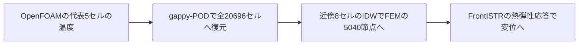
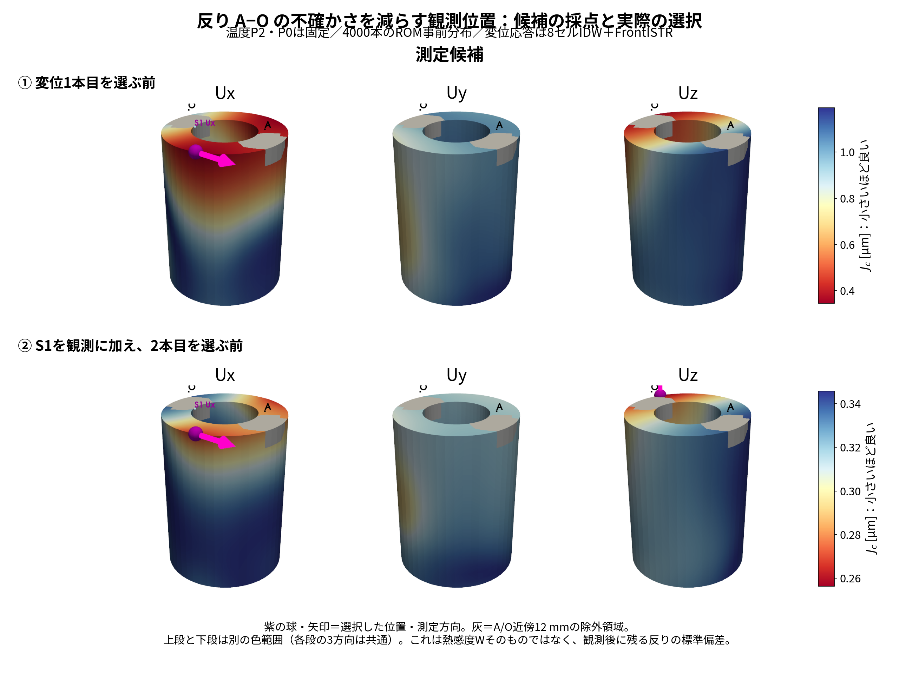

# 観測点はなぜ選ばれたか：IDWへの統一と、反りを対象にした配置の理論

2026-10-12更新。本ページはIDWで再計算した結果と理論の対応をまとめる。OpenFOAMの温度場自体を新たに解いた結果ではなく、保存済みのCHT温度場をIDWでFEMへ渡し、FrontISTRとEnKFを再計算した結果である。

## 1. 代表5点はOpenFOAMのセル中心

P0〜P4はOpenFOAM固体領域の20,696セルからQ-DEIMで選んだ**セル中心**であり、FrontISTRの節点ではない。代表5点はROMを時間発展させる場所、観測点はセンサで測る場所である。観測点を代表5点と一致させる必要はない。

## 2. 温度写像をIDWに統一した

FEM節点 $n$ に近い8セルを $\mathcal N_8(n)$、節点とセル中心の距離を $d_{n,i}$ とする。温度写像 $M$ は次の重みを持つ。

$$
M_{n,i}=\frac{1/d_{n,i}}{\sum_{q\in\mathcal N_8(n)}1/d_{n,q}},\qquad
T_{F,n}=\sum_{i\in\mathcal N_8(n)}M_{n,i}T_{\mathrm{cell},i}.
$$

近傍以外の重みは0、各行の重みの和は1。セル中心と節点が一致するときは、そのセル値を採用する。重複した一致セルがあれば一致セル間で等分する。$M$ の行はFEM節点、列はOpenFOAMセルである。

$$
\Phi_F=M\Phi,\qquad D=W\Phi_F,
$$

$$
R_T=M\Phi U_{rP}^{+},\qquad
\mathbf h_c^{\mathsf T}=D_cU_{rP}^{+}=W_cR_T.
$$

$\Phi$ はセル上のPODモード、$\Phi_F$ は節点上のモード、$D$ はモードごとの変位応答。$U_{rP}^{+}$ は代表5点温度差からモード係数への換算。$\mathbf h_c$ は候補センサ $c$ の予測値を代表5点温度差から計算する係数である。全節点の熱感度 $W$ 自体は温度写像の変更では変わらず、$D$ と $\mathbf h_c$ が変わる。

共通実装は `dacore/temperature_mapping.py`。旧最近傍キャッシュにはIDWの方式タグがないため再利用しない。旧結果は `results/archive_nearest_20261012/` に保存した。

## 3. 4,000ケースは何のためか

初期の代表5点温度、発熱量Q、放熱コンダクタンス $h_{\mathrm{ROM}}$ を変えた4,000本のROM計算から、各時刻の代表5点温度の共分散 $B(t)$ を作る。候補点ごとに4,000回FEMを解くのではない。変位は事前計算した $D$ を使って温度から求める。

- 初期温度：各点独立、17〜32 °Cの一様分布。
- 発熱量：$Q=15q_{\mathrm{scale}}$、$q_{\mathrm{scale}}$ は0.3〜1.8の一様分布（Qは4.5〜27 W）。
- 放熱コンダクタンス：平均0.02、標準偏差0.01 W/Kの正規乱数を0.001〜0.1 W/Kへクリップ。
- seed：20260930。加熱0〜300秒、RK4刻み2秒。30〜300秒の10時刻で共分散を計算。

**これは仮定した事前不確かさを数値的に広げる方法である。4,000という本数や分布範囲が物理法則から一意に決まるわけではない。**

## 4. なぜその点を選ぶのか：対象との関係とノイズで決まる

代表5点の温度差を $\delta\mathbf T_P$、知りたい反りを $d$、候補センサのノイズなしの値を $y_c$ とする。定数の基準値は分散に影響しないので省略する。

$$
d=\mathbf w^{\mathsf T}\delta\mathbf T_P,\qquad
y_c=\mathbf h_c^{\mathsf T}\delta\mathbf T_P.
$$

$\mathbf w=\mathbf h_{A,z}-\mathbf h_{O,z}$。候補が温度計なら $\mathbf h_c^{\mathsf T}$ はgappy-POD復元行列の候補セルの行、変位計なら $D_cU_{rP}^{+}$ である。観測ノイズ分散を $r_c$ とする。

すでに選んだ観測集合を $S$、それらを測った後に残る温度共分散を $P_S$ とする。1本目の変位計を選ぶときも、温度P2・P0はすでに $S$ に含める。

候補を1本追加したときの反りの分散減少は、

$$
\boxed{
\Delta_c(t)=
\frac{\big(\mathbf w^{\mathsf T}P_S(t)\mathbf h_c\big)^2}
{\mathbf h_c^{\mathsf T}P_S(t)\mathbf h_c+r_c}
}
$$

であり、残る反りの標準偏差は、

$$
\sigma_{S+c}(t)=
\sqrt{\mathbf w^{\mathsf T}P_S(t)\mathbf w-\Delta_c(t)}.
$$

**分子は「候補の値と反りが一緒に変わる度合い」、分母は「候補の信号のばらつき＋観測ノイズ」である。** 単に大きく動く点ではなく、反りについて役立つ情報を、ノイズに埋もれず測れる点を選ぶ。

本研究で候補に付ける点数は、

$$
\boxed{J_c(S)=\frac{1}{10}\sum_{k=1}^{10}\sigma_{S+c}(30k)}.
$$

**$J_c$ が最も小さい候補を選ぶ。** 時刻ごとの分散減少を単純平均して最大にする基準とは、平方根が入るため一般には同じ順位にならない。

### 感度が大きいだけでは足りない理由

共分散の平方根を使って $\mathbf a=P_S^{1/2}\mathbf w$、$\mathbf b=P_S^{1/2}\mathbf h_c$ と置く。両者のなす角を $\theta$ とすると、

$$
\Delta_c=\|\mathbf a\|^2\cos^2\theta\,
\frac{\|\mathbf b\|^2}{\|\mathbf b\|^2+r_c}.
$$

式の右辺は、対象の不確かさ、対象と観測が捉える温度変動の方向の一致度、信号とノイズの比に分かれる。$\mathbf a$ または $\mathbf b$ が0の場合は角度を使わず元の式で評価する。

| 条件 | なぜ良いか |
|---|---|
| $\cos^2\theta$ が大きい | その観測が、反りを変える温度変動を捉える |
| $\|\mathbf b\|^2/r_c$ が大きい | 信号がノイズに埋もれない |
| 既存観測を条件にした後も両者が大きい | すでに測ったセンサと情報が重複しにくい |

**2本目は $B$ ではなく更新後の $P_S$ で採点する。** 1本目と似た情報しか持たない点の価値が下がり、補完的な点を選べる。これは線形推定の誤差分散についての理論である。線形ガウスモデルなら条件付き分散として解釈でき、非ガウス分布でも最良の線形推定の誤差分散を表す。

### $J_c$ の分布と、実際に選ばれた位置

*IDWで作り直した変位応答を使用。上段＝温度P2・P0を条件にして変位1本目を採点、下段＝さらにS1を条件にして2本目を採点。各列はUx/Uy/Uzの測定方向。赤いほど点数Jcが小さく、紫の球と矢印が選択位置・方向。灰色はA/O近傍12 mmの候補除外領域。上下段の色範囲は異なる。A・Oは評価専用で観測しない。*

| 構成 | 時刻平均の予測標準偏差 [µm] |
|---|---:|
| 温度P2・P0のみ | 1.192 |
| ＋S1：$(9.7,-36.2,100.5)$ mmのUx | 0.346 |
| ＋S1・S2：S2は$(-34.6,14.4,100.5)$ mmのUz | 0.256 |

位置はIDWへの変更後も旧計算と同じだった。鏡映対称な候補などには近い点数があり、この一点だけが物理的に唯一の解という意味ではない。

本手法は、目的量の事後不確かさを減らす目的指向の観測設計に対応する。[Attia・Alexanderian・Saibabaの原論文](https://arxiv.org/abs/1802.06517)も、未知量全体ではなく目的量の不確かさに着目する枠組みを扱う。本研究の4,000本ROMによる共分散と貪欲探索は、その目的に向けた具体的な実装である。

## 5. 4,000本を減らす、より系統的な方法

**第一候補は、感度方程式で不確かさを伝播し、同じ $J_c$ を計算する方法である。** センサの採点式を変える必要はなく、$B(t)$ の作り方を変える。

初期の不確かな量を、

$$
\boldsymbol\xi=
\begin{bmatrix}T[P0](0)&\cdots&T[P4](0)&Q&h_{\mathrm{ROM}}\end{bmatrix}^{\mathsf T}
$$

とし、平均を $\bar{\boldsymbol\xi}$、共分散を $\Sigma_\xi$ とする。ROM解を平均条件のまわりで一次展開する。

$$
\mathbf T_P(t;\boldsymbol\xi)
\approx\mathbf T_P(t;\bar{\boldsymbol\xi})
+J_T(t)(\boldsymbol\xi-\bar{\boldsymbol\xi}),\qquad
J_T(t)=\frac{\partial\mathbf T_P(t)}{\partial\boldsymbol\xi}.
$$

$J_T$ は5×7の感度行列。したがって、

$$
\boxed{B(t)\approx J_T(t)\Sigma_\xi J_T(t)^{\mathsf T}}.
$$

- $Q,h$ だけでなく、初期5点温度の不確かさも含める必要がある。温度5変数＋Q感度5変数＋h感度5変数の15変数だけでは、初期5温度のばらつきはまだ扱えていない。
- 拡大状態7変数の感度をまとめるなら、状態7変数と7×7の遷移感度を同時積分し、その先頭5行を $J_T$ として取り出せる。Qを使う式とコード内のq_scaleの式は、$Q=15q_{\mathrm{scale}}$ の換算をそろえる。
- 別案は7変数に対する15個のシグマ点を使う方法。不確かさを代表する少数点を時間発展させる。ただし、クリップしたhの分布や広い初期分布を正確に再現する保証はない。

感度法は平均条件近傍の近似なので、現状の広い事前分布では4,000本の順位と一致するか確認が必要である。**まず既存4,000本を比較基準として残し、感度法・シグマ点法で選んだ配置を同じseed群のEnKFで比較する**のが次の検証になる。これらの代替法は本ページでは提案であり、実装・検証済みとは扱わない。

| 推定対象 | 理論的に見るべき量 |
|---|---|
| 未観測の反りA−O | 本ページの $J_c$：反りの予測標準偏差 |
| 全温度場 | gappy-POD復元後の温度誤差分散の和 |
| 発熱量Q | 観測値のQ感度とノイズ、Qの事後分散 |
| Qと放熱条件の同時推定 | ノイズ・パラメータ尺度をそろえた感度行列の独立性、Fisher情報。初期温度も未知ならその影響を含める |

**「熱感度Wが最大なら最適」とは言えない。推定対象・事前不確かさ・観測ノイズ・既存観測を指定したうえで、選ぶ理由を式で説明できる。** 貪欲法は各段階の最良候補を選ぶ方法であり、全センサ組合せの大域最適性や、非線形逐次EnKFの実現誤差の最小性まで証明したものではない。

## 6. 再現ファイル

- IDW：`dacore/temperature_mapping.py`。逆距離（べき1）、近傍8セル。
- 全節点の変位応答：`run/build_full_disp_operator.py` → `results/dispop_allnodes.npz`。FrontISTR作業フォルダ `openfoam/dispop_all/`。
- 真値の全節点変位：`run/holdout_AO_realsolver.py` → `results/truth_disp_all_<case>.npz`。作業フォルダ `openfoam/limit/fistr_all_<case>/`。
- 分布図・実際の選択：`run/make_sensor_score_map.py` → `results/sensor_score_idw.json`、`.npz`、`.csv`。
- ParaView：`results/vtk/sensor_score_idw.vtu`。`J_step1_Ux_um` など6つの点データ配列。
- 旧結果の保存：`results/archive_nearest_20261012/`。
