# blog_008：本研究の主張 ―「温度だけでなく変位もデータ同化の観測に使う」

> **2026-10-05の読み直し：条件の区別**
> 研究対象は中空円筒の数値実験。工作機械への応用は将来の位置付けです。ROM双子実験と実ソルバ真値を区別し、温度場の精度と未観測変位の精度を別々に評価します。文献検索で見つからないことは新規性の証明ではありません。

更新日：2026-10-12（点の名前・観測条件・代表点で取り出す行列の説明を補足）

これまでの記事で、温度2点に変位2点を足すと推定が良くなることを示してきました。
この記事は、**それが研究の主張として成り立つのか**を、先行研究を調べたうえで整理したものです。

> **この記事は、本研究の「主張」と「先行研究との関係」をまとめた記事です。**
> 計算の中身は [blog_006](blog_006_temp2_disp2_step_by_step.md)（データ同化の手順）、
> [blog_007](blog_007_rom_applicability.md)（ROM の適用範囲）にあります。
> **工作機械の研究全体の中でどこに位置するか**は §8 です。

> **blog_006〜008 の役割分担**
>
> | 記事 | 扱うこと | 真値 |
> |---|---|---|
> | [blog_006](blog_006_temp2_disp2_step_by_step.md) | **データ同化の手順**。温度2点＋変位2点をどう使い、なぜ発熱量が直るか | ROM の双子実験 |
> | [blog_007](blog_007_rom_applicability.md) | **ROM の適用範囲**。条件が変わっても使えるか | **OpenFOAM＋FrontISTR** |
> | [blog_008](blog_008_novelty_displacement_assimilation.md) | **主張と先行研究**。研究としてどこが新しいか | ROM（§4・§5）と<br>**OpenFOAM＋FrontISTR**（§6・§7） |
>
> 数値は重複を避け、各記事が担当する検証だけを載せています。

> **2026-10-12：IDWへ統一して再計算しました。** 最新の採点分布・選択理由・未観測変位の比較は[IDW更新結果](25_sensor_selection_theory_and_idw.md)を参照してください。以下の既存本文には最近傍法で得た旧数値が残るため、最新数値として混用しないでください。数式の説明と再現コードはIDWへ更新しています。

**配置の採点分布は、前提条件を説明した [blog_009 §4〜5](blog_009_two_sensors_nonrep.md) で示します。**

*上段は1本目、下段はS1追加後の2本目の採点。赤いほど残る反りの不確かさJcが小さい。紫＝選択位置・測定方向。温度はP2・P0に固定。上下段で色範囲が異なる。*

## 先に、点の名前を整理する

**P0〜P4は、OpenFOAM固体領域のセル中心からQ-DEIMで選んだ「代表5点」の名前です。FrontISTRの節点ではありません。5本の温度計を常に置いている、という意味ではありません。** ROMは5点すべての温度を計算しますが、実際に観測として使う点は、試験ごとにその一部を選びます。

| 点の名前 | どこの点か（概略座標、単位mm） | 何のための点か |
|---|---|---|
| P0 | ヒータ側・中段 $(21.3,-1.6,51.6)$ | ROMの温度代表点。P2と同じ側に温度計を置く比較で使う |
| P1 | 反対側寄り・中段 $(-14.1,33.1,51.6)$ | ROMの温度代表点・温度計の候補 |
| P2 | ヒータ側・中段 $(36.5,6.9,50.8)$ | ROMの温度代表点。ROMの発熱入力を与える点で、主な温度観測位置 |
| P3 | ヒータ側・底面近く $(35.1,0.8,0.8)$ | ROMの温度代表点・温度計の候補 |
| P4 | 反対側・底面近く $(-35.1,0.8,0.8)$ | ROMの温度代表点。ヒータ側と反対側に分けて温度計を置く比較で使う |
| S1・S2 | 円筒の上面に選んだ、別々の2点 | 変位を観測する位置。S1では横方向 $U_x$ 、S2では上下方向 $U_z$ を測る |
| A・O | 上面のヒータ側と反対側 | 推定したい変位差 $d=U_z(A)-U_z(O)$ の評価位置。§5〜7のS1・S2を使う試験ではA・Oを観測しない |

座標は $(x,y,z)$ の順で、 $z$ が高さです。P0〜P4はOpenFOAMのセル、S1・S2とA・OはFrontISTRの節点です。A・Oを観測する参考比較もあるため、**点の名前と「観測に使ったかどうか」は分けて読みます。**


例えば「温度P2＋P4」とは、**ヒータ側の中段と、反対側の底面近くに温度計を1本ずつ置く**ことです。「温度P2＋P0」は、**ヒータ側の中段に2本置く**ことです。どちらもROM内部では、測っていない残り3点を含む5点すべてを計算・補正します。

| 本記事で出てくる比較 | 温度計の位置 | 変位計の位置 | 確かめること |
|---|---|---|---|
| 温度計の配置比較（blog_005） | 代表5点から2点を選ぶ全10組 | なし | 同じ側に2本か、両側に1本ずつか |
| §0-8の観測の組合せ比較 | P2のみ、またはP2＋P4 | なし、またはS1＋S2 | 温度観測に変位観測を加える効果 |
| §5〜7の変位計の配置比較 | **P2＋P0に固定** | S1＋S2など、置き場所を変える | 同じ温度観測の下で、変位計はどこが良いか |

**P2＋P4の結果とP2＋P0の結果は、温度計の位置が違う試験です。** 数値だけを横並びにして、変位計の効果や配置の優劣を判断しないようにします。

## この記事で確かめること

| | 内容 |
|---|---|
| **確かめたいこと** | 「温度だけでなく**変位も観測としてデータ同化に入れる**」ことが、研究の主張として成り立つか。先行研究にないか、そして実際に効果があるか |
| **検証1（§4）** | **同じ場所**に温度計を置くか変位計を置くかで差が出るか。センサの本数（4本）と場所をそろえ、**測る量だけ**を変える |
| **検証2（§5）** | 評価点 A・O を**一度も観測せず**、別の場所の変位2点だけで A・O の変形を当てられるか（[blog_004 §7-4](blog_004_pod_selected_rom.md) の未観測点で独立に評価する） |
| **検証3（§6）** | 検証2 を、真値を **OpenFOAM＋FrontISTR** にしてやり直しても同じ結論か |
| **検証4（§7）** | 変位計の**置き場所の決め方**は、既存の配置法（A最適・D最適・Q-DEIM など）より良いか |
| **真値（正解）** | 検証1・2 は ROM の双子実験、**検証3・4 は OpenFOAM＋FrontISTR**。いずれも実機ではありません |
| **共通の観測** | 温度2点（P2・P0）。ここに変位2点を足したり、場所を変えたりする |
| **ノイズ** | 温度 0.30 K、変位 0.30 µm |
| **データ同化の設定** | EnKF・60メンバー・30 秒ごと20回・seed 20260913〜17 の5回平均 |
| **評価** | 加熱期 30〜300 秒の平均。全 20,696 セルの温度、反り $U_z(A)-U_z(O)$ 、個別の $U_z(A)$ ・ $U_z(O)$ |
| **文献調査の範囲** | 2026-10-03 に英語5回・日本語1回の検索。**網羅的ではありません**（§3） |

---

> **この記事の結論**
> 1. 工作機械の熱変形補正では、**温度を観測して変位を推定する**か、**変位を直接測って補正する**かのどちらかが一般的。
> 2. **温度と変位を同時に観測としてデータ同化に入れ、温度場・発熱量まで推定した例は、調べた範囲では見当たらない。**
> 3. 手法そのもの（EnKF、POD、変位のデータ同化）は既知。本研究の貢献候補は**オープンソースでの一貫実装、未観測変位の評価、推定対象に合わせた配置の検証**。対象は工作機械を想定した中空円筒であり、工作機械実機への適用を実証したものではない。
> 4. **今回の同じ位置・同じ本数の比較では、温度場RMSEは近い値**だった（§4）。反りの推定では差があり、温度計と変位計が同じ情報を持つという結論ではない。計測可能位置が異なる利点は実務上の仮説で、実機の設置可能性は未検証。
> 5. **別の場所で変位を測れば、一度も測っていない場所の変形を、直接測るより正確に当てられた**（0.076 µm 対 0.135 µm、§5）。
> 6. 真値を **OpenFOAM＋FrontISTR** にしても、3条件すべてで同じ結論だった（§6）。
> 7. 置き場所の決め方は、**既存の配置法より良かった**（0.075 対 A最適 0.090・D最適 0.108 µm）。ただし差は 15〜20 %（§7）。

---

## この記事の構成

| 節 | 何を書いているか | そこで分かること |
|---|---|---|
| **0. 研究全体のまとめ** | 発表の流れ（9項目）に沿った全体のまとめ | 正解データ → データ同化 → ROM → 変位を使う意味 → センサ位置の選び方 |
| **1. 主張したいこと** | 一言でいうと何を言いたいのか | 記事全体の結論 |
| **2. 主張を支える計算** | どの数値がどの記事にあるかの一覧 | 根拠の所在 |
| **3. 先行研究の調査** | 英語5回・日本語1回の検索結果と、いちばん近い研究 | **温度と変位を同時に観測に入れた例は見当たらない** |
| **4.【検証1】** | 同じ場所に温度計か変位計か（本数・場所をそろえる） | **温度場RMSEは近いが、反りの誤差には差がある**。温度場と反りで評価を分ける。設置可能性は実機で未検証 |
| **5.【検証2】** | A・O を一度も測らず、別の場所の変位2点で当てる | **0.076 µm。直接測る（0.135 µm）より正確** |
| **6.【検証3】** | 検証2 を、真値を OpenFOAM＋FrontISTR にしてやり直す | **3条件とも同じ結論**（0.07〜0.08 µm） |
| **7.【検証4】** | 置き場所の決め方を、既存の配置法と比べる | **目的指向が3条件とも最小**。ただし差は 15〜20 % |
| **8. 位置づけ** | 工作機械の研究4流派と、本研究の切り口A・B・C | どこが空いていて、どこに入るのか |
| **9. 主張の書き方** | 言ってよいこと／言ってはいけないこと | 発表で使う言い方 |
| **10. 発表での位置づけ** | 章ごとに何を言うか | スライドの骨子 |

**検証の節（4〜7）はすべて同じ並びです。**
「この節で知りたいこと・条件」→「やったこと」→「結果」→「分かったこと」。

---

## 0. 研究全体のまとめ ― 発表の流れに沿って

オープンCAE学会で話す流れ（9項目）に沿って、研究全体を1か所にまとめます。各項目は「何をしたか → 結果 → 分かったこと」の順で、詳しい説明の記事にリンクしています。
§1 以降は、このうち **0-7〜0-9** を深く掘り下げた検証です。

| # | 項目 | ひとことで | 詳しく |
|---|---|---|---|
| 0-1 | OpenFOAM と FrontISTR の連携で正解データを作る | 温度場 → 熱変形を計算し、データ同化の「正解」にする | [blog_001](blog_001_cht_thermal_expansion_and_htc.md) |
| 0-2 | データ同化（OI と EnKF） | OI は発熱量が当たりにくい。EnKF は当たるが、実ソルバだと計算が重い | [blog_002](blog_002_oi_data_assimilation.md)、[blog_003](blog_003_ensemble_kalman_filter.md) |
| 0-3 | POD でモード分解 | 温度場は2つの型で 99.9 % 表せる | [blog_004 §2・§5](blog_004_pod_selected_rom.md) |
| 0-4 | Q-DEIM で代表5点を決める | 型の強さを決めるのに都合のよい5点を自動で選ぶ | [blog_004 §4](blog_004_pod_selected_rom.md) |
| 0-5 | ROM の構築 | 5点の熱回路の係数を OpenFOAM に合わせて決める。600 秒が約 31 ms | [blog_004 §6](blog_004_pod_selected_rom.md) |
| 0-6 | ROM の適用範囲 | 発熱量や加熱のしかた（間欠運転）が変わっても使える。熱源の位置が変わると作り直し | [blog_007](blog_007_rom_applicability.md) |
| 0-7 | 温度を測っても変位が合わないことがある | 温度1点だけでは、反りが 0.9〜1.7 µm 外れる | 本節、[§4](#4-検証1同じ場所なら温度計と変位計のどちらが良いか) |
| 0-8 | **温度1点＋変位2点でもデータ同化でき、精度が上がる** | 温度2点より、温度1点＋変位2点のほうが温度も反りも良い | 本節 |
| 0-9 | 何を推定したいかで、適切なセンサ位置は変わる | 推定したい量のあいまいさ σ を、熱感度 $W$ とばらつきから測る前に計算して選ぶ | [§5・§7](#5-検証2別の場所の変位で測っていない-ao-を当てられるか)、[blog_005](blog_005_optimal_sensor_placement.md) |
| 0-10 | 発表の結論：どのセンサ配置が良く、なぜ良かったのか | 温度計はヒータ側と反対側、変位計は上面の S1・S2。 $W$ と温度のばらつきから配置を選ぶ | 本節 |
| 0-11 | ブログ全体の結果で確かめる | 未観測点も合う。悪い置き方（底面・同じことを2回測る）。 $W$ だけでは決まらず、 $\sigma$ で順位が当たる | 本節 |

真値はすべて計算（ROM の双子実験、または OpenFOAM＋FrontISTR）で、**実機の測定ではありません**。

### 0-1. OpenFOAM と FrontISTR の連携で、正解データを作る

**何をしたか**：片側にヒータ（15 W）を付けた中空円筒を、OpenFOAM で空気と固体を連成して解き（CHT）、固体の温度場を求めました。その温度を FEM の節点に写して FrontISTR に入れ、熱変形を計算しました。


*左：OpenFOAM の温度場、右：FrontISTR の熱変形（誇張表示）。*

**分かったこと**：この温度と変形を「正解」とし、そこから取り出したセンサの値（＋ノイズ）だけで、どこまで推定できるかを以降で調べます。

### 0-2. データ同化を行った ― OI と EnKF

**何をしたか**：センサの値で計算を直す方法として、OI（最適内挿）と EnKF（アンサンブルカルマンフィルタ）を実ソルバで試しました。

| 手法 | 結果 | 問題 |
|---|---|---|
| OI | 最終温度場RMSEは約 0.09 K | 今回の固定共分散・観測条件では、**発熱量が約 8.9 W**（正解 15 W）。共分散の調整だけでは改善しなかったが、OI一般の限界を証明した結果ではない |
| EnKF | 104では最終発熱量が約 14.93 W（正解 15 W） | **5メンバー・60秒ごと10更新**でも、600秒間の現象を扱う一連の計算に**約13時間**かかった。1回の更新の時間ではない |

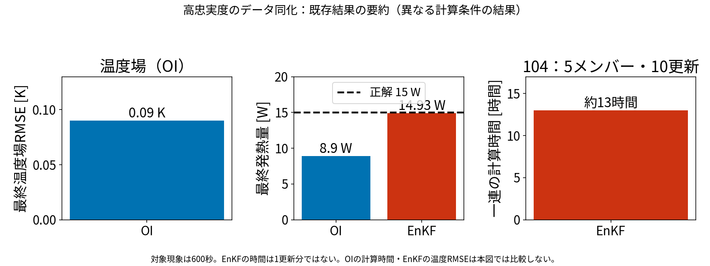

*異なる計算条件の既存結果を整理した図。手法そのものの公平な性能比較ではありません。*

**温度・変位の時間変化**：次は高忠実度計算の既存時刻歴です。OIとEnKFでは観測・共分散の条件が異なるため、各図の条件を区別して読みます。

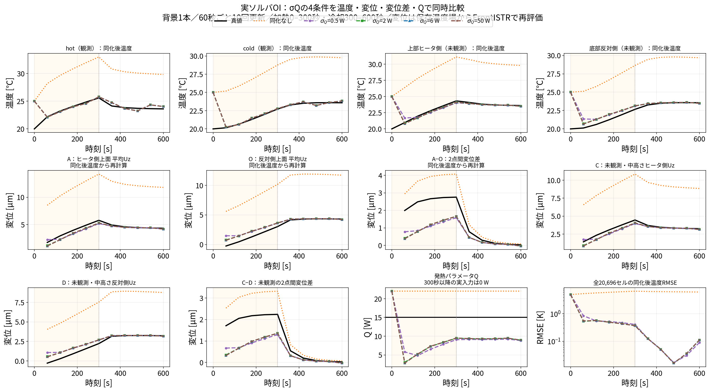

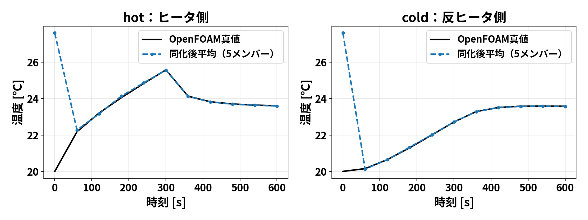

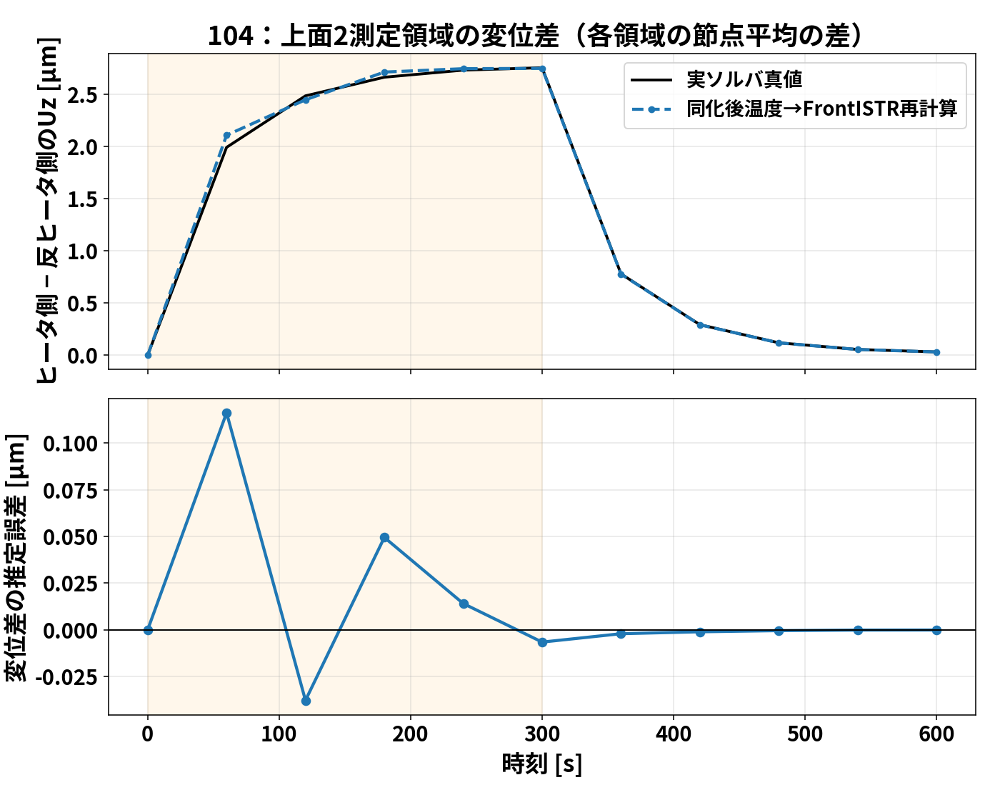


**分かったこと**：EnKF を使うには、予報モデルを軽くする必要がある（→ 0-3〜0-5）。

### 0-3. POD でモード分解

**何をしたか**：OpenFOAM の温度場（20,696 セル × 121 時刻）を特異値分解し、場を「型 × 時間の係数」の足し算に分けました。


**分かったこと**：**2つの型で 99.9 %**。1つ目は全体が温まる型、2つ目はヒータ側と反対側の温度差の型（反りを決める）。安全をみて5つの型を使います。

### 0-4. Q-DEIM で代表点5点を決める

**何をしたか**：5つの型の強さを決めるのに都合のよい5点を、型の行列の QR 分解（列ピボット）で自動的に選びました。


**分かったこと**：5点の温度が分かれば、gappy-POD で全 20,696 セルの温度を復元できます。

### 0-5. ROM の構築（パラメータの決定）

**何をしたか**：代表5点を熱容量 $C$ と熱の通りやすさ $K$ でつないだ熱回路（ROM）を作り、係数を OpenFOAM の温度に合うよう最小二乗で決めました。


**分かったこと**：校正の残差 0.014 K。**600 秒の計算が約 31 ms**（OpenFOAM なら分〜時間のオーダー）。発熱は代表点 P2 の1点に入れる近似です（[blog_004 §6-1b](blog_004_pod_selected_rom.md)）。

### 0-6. ROM の適用範囲

**何をしたか**：ROM を作るのに使っていない条件（25 W、間欠運転）で、データ同化なしの ROM と OpenFOAM を比べました。


*左：ヒータの ON/OFF を OpenFOAM と同じに与えた ROM（細い破線）と OpenFOAM（太い薄い線）。右：比較のため、ON/OFF を与えなかった ROM。*

**分かったこと**

- **同じ 15 W で間欠運転にしても、ON/OFF を与えれば ROM はそのまま使える**（最大 0.038 K、温度計のノイズ 0.3 K の約 1/8）。
- 25 W でも最大 0.11 K。
- **熱源の位置や形が変わると作り直しが必要**（発熱を P2 の1点に入れ、係数をその条件で決めているため）。

**復元した未観測点まで確認する。** 上は同化なしのROM単体の検証です。次の図は別途、選定温度2点へ変位2点を追加するEnKFを実行し、復元後の温度・変位を比較したものです。P1・P3・P4の温度とA・O・E・Fの変位は観測していません。60メンバー、30秒ごと20更新、5seed平均で、選定の順序・観測条件は [blog_009 §4〜6](blog_009_two_sensors_nonrep.md) に示します。


### 0-7. 温度を測っても、変位が合わないことがある

**何をしたか**：従来は「温度を測って、変位は計算で出す」のが普通です。温度計1本（P2）だけでデータ同化して、観測していない反り A−O がどれだけ合うかを見ました（真値＝OpenFOAM＋FrontISTR）。

**結果**（下の 0-8 の図の灰色）

| 条件 | 温度1点だけのときの反り A−O の誤差 |
|---|---:|
| 15 W | 0.92 µm |
| 25 W | 1.70 µm |
| 15 W 間欠加熱 | 0.64 µm |

反りの大きさは最大 2.7 µm（25 W では約 4.6 µm）なので、**温度1点では反りが大きく外れます**。温度計のある P2 は合っていても、反対側の温度が分からないためです。

### 0-8. 温度1点＋変位2点でもデータ同化でき、精度が上がる

**何をしたか**：温度計1本（P2）に、上面の変位計2本（S1・S2。§5 で選んだ点）を足してデータ同化しました。比較として、温度計2本（P2・P4）の場合も回しました。真値は OpenFOAM＋FrontISTR、5 seed 平均、評価時刻は 30, 60, …, 300 秒（ `run/temp1_disp2.py` ）。S1は上面の $(x,y)\simeq(9.7,-36.2)$ mm の $U_x$ 、S2は $(-34.6,14.4)$ mm の $U_z$ です。**2点とも $U_z$ を測る構成ではありません**。

この参考試験のS1・S2は、**温度P2・P0を固定して反りの事後標準偏差を小さくする基準**で選んだものです。これから温度位置を先に選ぶblog_009の変位点とは異なります。


| 観測 | 温度場（15 W／25 W／間欠） | 反り A−O（15 W／25 W／間欠） | 発熱量 300 秒時点（正解 15／25／15 W） |
|---|---|---|---|
| 温度1点 | 0.65／1.18／0.58 K | 0.92／1.70／0.64 µm | 13.2／22.1／15.3 W |
| **温度1点＋変位2点** | **0.15／0.16／0.14 K** | **0.10／0.13／0.08 µm** | **14.8／24.8／14.5 W** |
| 温度2点 | 0.16／0.18／0.15 K | 0.23／0.28／0.20 µm | 14.7／24.7／14.6 W |
| 温度2点＋変位2点 | 0.08／0.12／0.08 K | 0.11／0.11／0.10 µm | 15.4／25.4／15.2 W |

（間欠加熱は、ヒータの ON/OFF を ROM に与えた場合。0〜150秒と300〜450秒がONなので、この表の30〜300秒には冷却区間も含まれます。QはON時の発熱量パラメータで、OFF時の瞬間の発熱量とは区別します。）

**表の誤差の計算方法**：温度は各時刻で全セルのRMSEを計算してから時間平均、反りは絶対誤差の時間平均（MAE）です。反りの値をRMSEと呼ばないようにします。

$$
E_T^{(s)}=\frac{1}{10}\sum_{k=1}^{10}\sqrt{\frac{1}{20696}\sum_{i=1}^{20696}\left(\widehat T_i^{(s)}(30k)-T_i^{\mathrm{true}}(30k)\right)^2}
$$

$$
E_{A-O}^{(s)}=\frac{1}{10}\sum_{k=1}^{10}\left|\widehat d^{(s)}(30k)-d^{\mathrm{true}}(30k)\right|,
\qquad d=U_z(A)-U_z(O)
$$

$s$ は5個の乱数seedの番号、 $i$ はセル番号、 $k$ は評価時刻の番号、 $\widehat T$ ・ $\widehat d$ は同化後60メンバー平均から求めた推定値です。表はさらに $\frac{1}{5}\sum_{s=1}^{5}E^{(s)}$ を載せています。A・O・E・Fの変位は観測に使っていません。発熱量の列は時間平均ではなく、**300秒の更新後のQ推定値の5 seed平均**です。

**分かったこと**

- **温度1点に変位2点を足すと、温度場の誤差は約 1/4〜1/7、反りの誤差は約 1/8〜1/13 になった**（3条件とも）。
- **温度1点＋変位2点は、温度2点よりも、温度場・反りともに良かった**（センサの合計本数は 3 本 対 2 本なので、本数をそろえた比較ではない）。
- 変位計1本の値は、5点すべての温度に重みを掛けて足したものなので、温度計のない反対側の温度まで直るためです（[blog_006 §3](blog_006_temp2_disp2_step_by_step.md)）。

### 0-9. 次に、センサ位置を順序立てて選ぶ

ここまでで、温度だけでなく変位も観測すると推定が改善することを確認しました。次の問いは、**どこを測ればよいか**です。

配置を混ぜずに、次の順に検証します。

1. 温度センサの候補を $J_c$ 分布で採点し、温度2点T1・T2を選ぶ。
2. 人が決めた温度2点P2・P0と、同じ条件でデータ同化して比較する。
3. 選んだT1・T2を固定し、変位センサの位置と測定方向を同じ基準で選ぶ。
4. 温度2点のみ、底面の変位2点を追加、選定変位2点を追加、の順に未観測量の誤差を比較する。

**今回の採点目的は、観測に使わない反り $U_z(A)-U_z(O)$ の不確かさを減らすことです。** 温度場RMSEやQ/h推定を直接最小化する配置とは区別します。採点式、条件付きの分布図、選定後の時刻歴と比較結果を [blog_009](blog_009_two_sensors_nonrep.md) にまとめました。

#### Jc分布と選択点はここで確認する

$J_c$ は「候補cを測った後に残る、反りA−Oの標準偏差を30〜300秒で平均した値」です。小さい候補から1本ずつ選び、次の候補は選択済みセンサの情報を加えて採点し直します。計算式と1本目の分布は [blog009 §3〜5](blog_009_two_sensors_nonrep.md) にあります。

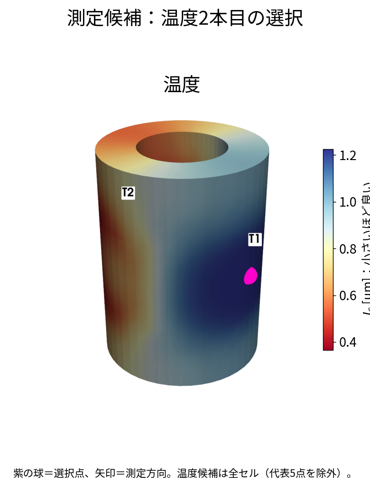

*温度1本目T1を観測する条件で2本目T2を選定。初めからP2・P0を固定していません。紫球が選択点です。*

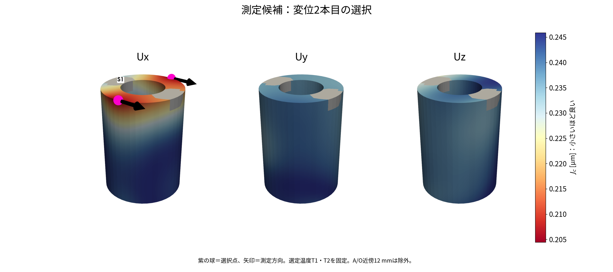

*選定温度T1・T2と変位S1を観測する条件でS2を選定。Ux・Uy・Uzは測定方向。紫球と太い矢印が選択点・方向、灰色はA/O近傍12 mmの除外領域です。*

### 0-10. 同じ順序で検証すると、精度は上がったか

温度2点を先に選び、その配置へ変位2点を追加して、OpenFOAM＋FrontISTRを正解にしたEnKFを再実行しました。15 W、60メンバー、30秒ごと20更新、5seedです。評価は30〜300秒の平均です。

| 配置 | 全セル温度場RMSEの時間平均 | 未観測反りA−Oの平均絶対誤差 |
|---|---:|---:|
| 手動の温度2点P2・P0 | 0.543 K | 0.775 µm |
| Jで選定した温度2点T1・T2 | 0.208 K | 0.198 µm |
| T1・T2＋底面近くの変位2点 | 0.176 K | 0.178 µm |
| T1・T2＋Jで選定した変位2点 | 0.169 K | 0.103 µm |


温度配置を選ぶ段階で改善し、さらに反りを狙った変位配置を追加すると反りが改善しました。**以下の§4〜7は温度P2・P0固定などの旧試験を詳しく残したものです。今回の温度先行配置の続きは [blog_009](blog_009_two_sensors_nonrep.md) を読んでください。** 試験ごとに前提が違うため、異なる試験で選ばれた点を一組の最適配置として混ぜません。

## 1. 主張したいこと

> **今回比較した中空円筒の条件では、適切に選んだ変位観測を温度観測に加えると、未観測の熱変位推定が改善しました。** 全対象・全配置で併用が最良という主張ではありません。
> 変位観測と温度状態の共分散により、温度計のない点も更新できます。ただし、更新が必ず改善を意味するわけではなく、発熱量の同定には主に温度観測が寄与した試験もあります。
> そして**変位計は、知りたい場所に置く必要がない**。別の場所で測って、測っていない場所の変形を当てられる。

この主張を支える計算結果と、先行研究との関係を以下にまとめます。

---

## 2. 主張を支える計算 ― どこに何があるか

この記事は**主張と位置づけ**を扱います。計算の中身はそれぞれの記事にあるので、ここでは一覧だけ示します。

| 主張を支える事実 | 数値 | どの記事に |
|---|---|---|
| 変位は5点の温度の足し算なので、**変位計1本が5点すべてに触れる** | 熱感度 $W$ の行が全点に非ゼロ | [blog_006 §7-1](blog_006_temp2_disp2_step_by_step.md) |
| **温度計のない点の温度が、変位計だけで直る** | $t=30$ 秒で P3 を −4.97 K、P4 を −7.67 K | [blog_006 §7-5b](blog_006_temp2_disp2_step_by_step.md) |
| 温度計のずれが 0 になった後も、変位計だけが温度場を直す | $t=150$ 秒で温度の寄与 0.000 K | 同上 |
| **変位を足すと温度も発熱量も当たる** | 温度場 0.503 → **0.160 K**、 $Q$ 14.05 → **14.89 W**（真値 15 W） | [blog_004 §7-6](blog_004_pod_selected_rom.md)、[blog_006 §15](blog_006_temp2_disp2_step_by_step.md) |
| **係数を決めていない条件でも成立**（実ソルバ真値） | 25 W で反り 0.74 → **0.09 µm**、発熱量 **24.91 W**（真値 25 W） | [blog_007](blog_007_rom_applicability.md)、[21](21_advantage_verification.md) |
| **ROM は条件が変わっても使える** | 25 W・間欠加熱とも全セルがノイズ 0.3 K 未満 | [blog_007 §6](blog_007_rom_applicability.md) |
| **配置の選び方が既存法より良い** | 目的指向 0.075 対 A最適 0.090・D最適 0.108・Q-DEIM 0.137 µm（15 W） | §7 |

この記事で**新しく行った検証**は4つです。

| 検証 | 知りたいこと | 真値 |
|---|---|---|
| **§4** | 同じ場所に温度計を置いたらどうなるか（変位計は本当に有利か） | ROM |
| **§5** | A・O を一度も測らずに、別の場所の変位2点で当てられるか | ROM |
| **§6** | §5 を、真値を実ソルバにしてやり直しても同じか | OpenFOAM＋FrontISTR |
| **§7** | 置き場所の決め方は、既存の配置法より良いか | OpenFOAM＋FrontISTR |

---

## 3. 比較に進む前に

先行研究の調査は、結果を読み終えてから参照できるよう本記事末尾に移しました。ここからは、観測条件と推定結果を順に確認します。

## 4. 【検証1】同じ場所なら、温度計と変位計のどちらが良いか
> **この節で知りたいこと**：「変位計は5点すべての温度に触れるから有利」は本当か。同じ場所に温度計を置いたらどうなるか
>
> **条件**：センサの本数（計4本）と場所をそろえ、**測る量だけ**を変える。温度2点（P2・P0）は共通、A・O に温度計2本 or 変位計2本。真値＝ROM の双子実験、EnKF・5 seed・加熱期 30〜300 秒


「変位計のほうが情報量が多いから良い」のかを確かめるため、**同じ場所に温度計を置いた場合**と比べました。
センサの本数（計4本）と場所をそろえ、変えるのは「そこで何を測るか」だけです（`run/disp_vs_temp_same_place.py`）。

### 4-1. どこに何を置いたか

| 記号 | 座標 [mm] | 何を測るか |
|---|---|---|
| **P2** | (36.5, 6.9, 50.8) ヒータ側・中段 | 温度（4構成すべて共通） |
| **P0** | (21.3, −1.6, 51.6) 同じヒータ側・中段 | 温度（4構成すべて共通） |
| **A** | (28.7, 0, 100.5) 上面・ヒータ側 | 構成により **温度** または **変位 $U_z$ ** |
| **O** | (−28.7, 0, 100.5) 上面・反対側 | 同上 |

- **変位計**は A・O の FEM 節点そのものに置きます。
- **温度計**は A・O にいちばん近い OpenFOAM セル、(26.6, −1.6, 98.8) と (−26.6, −1.6, 98.8) mm に置きます（代表5点ではないセルですが、[blog_007 §10](blog_007_rom_applicability.md) のとおりデータ同化できます）。
- **評価しているのも同じ A・O** なので、この節の結果は循環を含みます。循環を断った試験は §5です。なお「直接測るより正確」は、A/Oにノイズ付き観測を与えて同化した比較ケースより誤差が小さかった、という意味です。計測器の精度を上回ると一般化した結論ではありません。

4つの構成は次のとおりです。

| 構成 | 観測の中身 | 本数 |
|---|---|---:|
| 温度2点のみ | 温度 P2・P0 | 2 |
| ＋A/O に温度計2本 | 温度 P2・P0・**A・O**（計4点とも温度） | 4 |
| ＋A/O に変位計2本（本番） | 温度 P2・P0 ＋ **変位 A・O の $U_z$ ** | 4 |
| ＋両方 | 温度 P2・P0・A・O ＋ 変位 A・O | 6 |

### 4-2. 結果

まず、**どこを測って、温度と変位がどう合ったか**を見ます。


*左＝観測点と評価点（上面を真上から見た図）／中＝**温度**：温度計を置いていない代表点 P4 の時刻歴／
右＝**変位**：反り A−O の時刻歴。黒が真値、色が各構成。帯は加熱中（0〜300 秒）。*

- **中**：温度2点のみ（灰）は真値から離れますが、A・O に温度計を足しても変位計を足しても、ほぼ同じように真値に重なります。
- **右**：反りも同様で、**温度計（橙）と変位計（赤）の差はほとんど見えません**。

誤差を加熱期で平均すると次のようになります。


| 観測（温度2点 P2＋P0 は共通） | 温度場全体 | 反り A−O | Uz(A) | Uz(O) |
|---|---:|---:|---:|---:|
| 温度2点のみ | 0.528 K | 0.756 µm | 0.234 µm | 0.922 µm |
| ＋ A/O に**温度計**2本 | **0.132 K** | 0.201 µm | **0.113 µm** | 0.154 µm |
| ＋ A/O に**変位計**2本（本番） | 0.145 K | **0.135 µm** | 0.138 µm | **0.104 µm** |
| ＋ 両方（計6本） | 0.127 K | 0.136 µm | 0.110 µm | 0.117 µm |

seed ごとに対応をとった勝敗（変位計が温度計より良かった回数、5回中）：

| 評価する量 | 変位計が良かった回数 |
|---|---:|
| 温度場全体 | 2 / 5 |
| **反り A−O** | **4 / 5** |
| Uz(A) | 0 / 5 |
| **Uz(O)** | **5 / 5** |

### 4-3. 分かったこと（主張の修正）

- **温度場全体を当てるなら、同じ場所なら温度計と変位計はほぼ互角**です（0.132 対 0.145 K、差は seed のばらつきに埋もれる）。
- **反りを当てるなら変位計のほうが良い**（0.135 対 0.201 µm、5回中4回）。知りたい量を直接測っているためです。

> **したがって「変位計は情報量が多いから優れている」とは言えません。**
> 変位計の価値は、**温度計を置けない場所に置けること**にあります。
> 工作機械では、加工中の工具先端や内部に熱電対を入れられませんが、変位計なら外側から測れます。

> **この節で分かったこと**
> - **今回の同じ位置・同じ本数の比較では、温度場RMSEは近い値**。温度場全体では温度計がわずかに良い（0.132 対 0.145 K、差は seed のばらつき内）。
> - **反りを当てるなら変位計が良い**（0.135 対 0.201 µm、5 seed 中4回）。知りたい量を直接測っているため。
> - よって「変位計は情報量が多いから優れている」とは**言えない**。
> - 変位計の価値は、**温度計を置けない場所に置けること**にある（加工中の工具先端に熱電対は入れられない）。


---

## 5. 【検証2】別の場所の変位で、測っていない A・O を当てられるか
> **この節で知りたいこと**：評価点 A・O を**一度も観測せず**に、別の場所の変位2点だけで A・O の変形を当てられるか。変位計はどこに置けばよいか
>
> **条件**：温度2点（P2・P0）は共通。変位の候補は全 5,040 節点 × 3 方向＝15,120 通り（A・O から 12 mm 以内は除外）。真値＝ROM の双子実験、EnKF・5 seed・加熱期 30〜300 秒


[blog_004 §7-4](blog_004_pod_selected_rom.md) の構成は、評価している A・O をそのまま観測に使っていました（観測点での適合評価）。
そこで、**A・O を一度も観測せず**、別の場所の変位2点だけで A・O を当てられるかを調べました（`run/disp_elsewhere_predict_AO.py`）。

### 5-1. どこを測って、どこを評価したか


*赤＝温度センサ（P2・P0）／緑＝選定した変位2点（矢印＝測る方向）／黒＝評価点 A・O。
**A・O は一度も観測していません。***

| 役割 | 場所 | 測るもの |
|---|---|---|
| 温度センサ（共通） | P2 (36.5, 6.9, 50.8)、P0 (21.3, −1.6, 51.6) mm | 温度 |
| **選定した変位1点目** | (9.7, −36.2, 100.5) mm（上面、−y 寄り） | ** $U_x$ （半径方向）** |
| **選定した変位2点目** | (−34.6, 14.4, 100.5) mm（上面、ヒータの反対側） | ** $U_z$ （上下方向）** |
| **評価点 A・O** | (±28.7, 0, 100.5) mm（上面） | **測らない** |

### 5-2. 変位の候補はどう選んだか ― 実際にやった作業

やったことは**総当たり**です。難しいことはしていません。

#### 全体の流れ

まず、選び方の全体を1枚で示します。**データ同化も測定値も使わず、計算だけで選んでいます。**


*上段＝最初に1回だけ計算する3つの材料。点線の枠＝候補1つごとの採点（14,754 回くり返す）。赤＝点数が最小の候補を選ぶ。灰＝選んだ後に、初めてデータ同化（EnKF）を回して確かめる。*

以下、図の順に1つずつ説明します。

#### ステップ1：候補を全部リストアップし、5点の温度への「重み」を作る（図の①）

変位計の候補は、FEM の全節点 5,040 個 × 3 方向（ $U_x, U_y, U_z$ ）＝ **15,120 通り**です。
A・O から 12 mm 以内の節点は「A・O を測ったのと同じ」になるので候補から外し、**14,754 通り**が残りました。

どの候補 $c$ の変位も、ROM の代表5点の温度 $\mathbf T=(T_0,\dots,T_4)^{\mathsf T}$ の一次式で書けます。

$$
y_c=y_{c,0}+\mathbf h_c^{\mathsf T}\mathbf T,\qquad
\mathbf h_c=(h_{c,0},\,h_{c,1},\,h_{c,2},\,h_{c,3},\,h_{c,4})
$$

$y_{c,0}$ は温度が基準のときの値（定数）、 $h_{c,j}$ は「代表点 $P_j$ の温度が 1 K 上がると、候補 $c$ の変位が何 µm 動くか」です。
この重みは、FrontISTR を**6回だけ**解いて作りました。15,120 通りの候補ごとに FEM を解く必要はありません。理由は「重ね合わせ」です。


> ① 温度分布を6つの型（平均＋POD の型5つ）の足し算で表す。② 型ごとに FrontISTR を1回ずつ解く。③ 型の強さ $a_k$ は代表5点の温度から決まる。②と③を合わせると、どの節点のどの方向の変位も、代表5点の温度の一次式になる（ `run/make_fem6_fig.py` ）。

1. **温度分布を6つの型の足し算で書く。** OpenFOAM の温度場を POD で分解すると、どの時刻の温度分布も「平均の温度分布 $\bar T(x)$ ＋ 型 $\varphi_1(x),\dots,\varphi_5(x)$ をそれぞれ $a_1,\dots,a_5$ 倍したもの」でほぼ表せます（5つの型で 99.9 % 以上）。

$$
T(x)\approx\bar T(x)+a_1\varphi_1(x)+a_2\varphi_2(x)+\cdots+a_5\varphi_5(x)
$$

2. **型ごとに FrontISTR を1回ずつ解く（計6回）。** 平均の温度分布を入れた変位 $\bar{\mathbf u}$ と、型 $\varphi_k$ だけを入れた変位 $\mathbf d_k$ です。 $\mathbf d_1,\dots,\mathbf d_5$ を横に並べた 15,120×5 の行列が $D$ で、blog_006 §7 の $D=WMU_r$ （ $W$ ＝FrontISTRの熱感度、 $M$ ＝セルからFEM節点への温度写像、 $U_r=\Phi$ ＝PODモード）です。FEM節点上のモードを $\Phi_F=MU_r$ と書けば $D=W\Phi_F$ です（この対応は下でも展開します）。 $D_{c,k}$ は、節点 $c$ のある方向の、型 $k$ による変位です。FEM は1回解くと**全 5,040 節点 × 3方向の変位が一度に出る**ので、6回で全候補の答えがそろいます。

3. **変位も同じ足し算になる。** 熱弾性の計算は線形（温度が2倍なら変位も2倍、温度の足し算は変位の足し算）なので、

$$
\mathbf u\approx\bar{\mathbf u}+a_1\,\mathbf d_1+a_2\,\mathbf d_2+\cdots+a_5\,\mathbf d_5
$$

4. **型の強さ $a_k$ は、代表5点の温度から決まる（gappy-POD）。** ここで添字 $P$ は「P0〜P4の代表5点で取り出した値」という目印です。この式の $P$ 自体が新しい未知数や行列という意味ではありません。

まず、代表5点の温度を並べます。

$$
\mathbf T_P=
\begin{bmatrix}T[P0]\\T[P1]\\T[P2]\\T[P3]\\T[P4]\end{bmatrix},
\qquad
\bar{\mathbf T}_P=
\begin{bmatrix}\bar T[P0]\\\bar T[P1]\\\bar T[P2]\\\bar T[P3]\\\bar T[P4]\end{bmatrix},
\qquad
\mathbf a=\begin{bmatrix}a_1\\a_2\\a_3\\a_4\\a_5\end{bmatrix}
$$

$T[Pj]$ は今の時刻の代表点Pjの温度、 $\bar T[Pj]$ はその点での学習データの時間平均温度です。**平均温度も各点で違う5個の値**です。 $a_k$ はPODの第 $k$ モードを何倍使うかを表します。

次に、各モードの値を代表5点で取り出して並べます。これは $U_r$ から代表5点の行だけを取り出したもので、 $U_{rP}$ と書きます（blog_006 と同じ記号）。

$$
U_{rP}=
\begin{bmatrix}
\varphi_1(P0)&\varphi_2(P0)&\varphi_3(P0)&\varphi_4(P0)&\varphi_5(P0)\\
\varphi_1(P1)&\varphi_2(P1)&\varphi_3(P1)&\varphi_4(P1)&\varphi_5(P1)\\
\varphi_1(P2)&\varphi_2(P2)&\varphi_3(P2)&\varphi_4(P2)&\varphi_5(P2)\\
\varphi_1(P3)&\varphi_2(P3)&\varphi_3(P3)&\varphi_4(P3)&\varphi_5(P3)\\
\varphi_1(P4)&\varphi_2(P4)&\varphi_3(P4)&\varphi_4(P4)&\varphi_5(P4)
\end{bmatrix}
$$

**行は場所、列はモード**です。例えば1行目は「P0の温度を、5つのモードでどう表すか」を示し、 $T[P0]-\bar T[P0]=\sum_{k=1}^{5}\varphi_k(P0)a_k$ となります。これを5点についてまとめると、次の式になります。

$$
\mathbf T_P=\bar{\mathbf T}_P+U_{rP}\,\mathbf a\quad\Rightarrow\quad\mathbf a=U_{rP}^{-1}\big(\mathbf T_P-\bar{\mathbf T}_P\big)
$$

ここで $U_{rP}^{-1}$ は、5点の温度差から5モードの係数を逆に求める操作です。上式は正則な5×5行列の場合の表記で、コードでは `np.linalg.pinv()` による擬似逆行列を使います。**センサの観測値をここに直接代入して同化するのではなく、各メンバーのROMが計算した代表5点の温度から、センサ位置の予測値を作るために使います。**

5. **3と4を合わせると、重みが出る。** 節点 $c$ のある方向の変位は

$$
u_c=\bar u_c+\mathbf h_c^{\mathsf T}\big(\mathbf T_P-\bar{\mathbf T}_P\big),\qquad
\mathbf h_c^{\mathsf T}=\big(D_{c,1},\dots,D_{c,5}\big)\,U_{rP}^{-1}
$$

つまり重み $\mathbf h_c$ は、6回の FrontISTR の結果のうち節点 $c$ の値を取り出して、5×5 の行列 $U_{rP}^{-1}$ を掛けるだけで出ます。15,120 通りすべてについて、掛け算だけで計算できます。

**近似が入るのは、1の「5つの型で表す」ところ（と、OpenFOAM のセルの温度を FEM の節点へ受け渡すところ）**です。2・3は FEM の線形性そのものなので、近似はありません。

**FrontISTR で実際にやったこと**（ `run/build_full_disp_operator.py` ）

| 項目 | 設定 |
|---|---|
| 形状・要素 | 中空円筒（外径 75 mm・内径 40 mm・高さ 100.5 mm）。半径 4 × 周 48 × 高さ 20 分割、節点 5,040 個 |
| 材料 | 鋼：ヤング率 205 GPa、ポアソン比 0.3、線膨張係数 $1.2\times10^{-5}$ /K |
| 解析 | 線形の静的熱応力解析。熱ひずみ ＝ 線膨張係数 ×（温度 − 基準温度 20 °C） |
| 支持 | **底面の3節点だけ**で、円筒が丸ごと動いたり回ったりするのを止める（1点は xyz、1点は yz、1点は z を固定）。底面全体を固定してはいないので、円筒は自由に熱膨張できる |
| 温度の渡し方 | FEM の各節点に、一番近い OpenFOAM のセルの温度を渡す |

| 回 | 入れる温度 | 出てくるもの |
|---|---|---|
| 1回目 | 平均の温度分布 $\bar T(x)$ （OpenFOAM の 121 時刻の平均） | 全節点 × 3方向の変位 $\bar{\mathbf u}$ |
| 2〜6回目 | 基準温度 ＋ 型 $\varphi_k(x)$ （型をそのまま温度の上がり分として入れる） | 型を1倍入れたときの全節点 × 3方向の変位 $\mathbf d_k$ |

**例：点 A の上下変位の重み。** 2〜6回目の結果から節点 A の $U_z$ を取り出すと

$$
\big(D_{A,1},\dots,D_{A,5}\big)=(-0.0077,\,-0.0088,\,-0.0063,\,-0.0065,\,+0.0008)\ \mu\mathrm m
$$

（型は全セルで大きさ 1 にそろえた形なので、1か所あたりの温度は 0.01 K 程度と小さく、変位も小さくなります。）これに 5×5 の換算表 $U_{rP}^{-1}$ を掛けると

$$
\mathbf h_A^{\mathsf T}=\big(D_{A,1},\dots,D_{A,5}\big)\,U_{rP}^{-1}=(0.329,\,-0.134,\,0.261,\,0.639,\,0.115)\ \mu\mathrm m/\mathrm K
$$

になります。反りの重みは $\mathbf w=\mathbf h_{A,z}-\mathbf h_{O,z}$ です。


**確かめ：重み × 実際の温度の時刻歴は、FrontISTR の答えと合うか。** データ同化を使わずに、OpenFOAM の実際の5点の温度の時刻歴に重みを掛け、FrontISTR に全温度場を入れて解いた変位（真値）と比べました。


> 15 W。① 代表5点の温度（平均の温度分布からの上がり分）。② $U_z(A)$ を「平均の温度分布での変位 3.97 µm ＋ 各点の 重み × 上がり分」で積み上げたもの（○＝FrontISTR の答え）。③ 時刻歴：線＝重み × 温度、点＝FrontISTR。（ `run/make_weight_times_temp_anim.py` ）

$$
U_z(A)\approx \bar u_A+\sum_{j=0}^{4}h_{A,j}\big(T_j-\bar T_j\big)
$$

** $h_{A,j}$ とは、代表点Pjの温度変化を、Aの上下変位の変化に換算する係数です。** 単位は **µm/K**。Aは「変位を知りたい場所」、jは「代表温度点の番号0〜4」です。ここでのhは感度の記号で、ROMの放熱コンダクタンス $h_{\mathrm{ROM}}$ [W/K]とは別です。

** $D$ と熱感度行列 $W$ の関係： $D=W\Phi$ のメッシュを明記する。** $D$ は、PODモードの温度変化を $W$ に入力したときの変位応答を並べた行列です。温度モードがFEM節点上にあれば、ご指摘のとおり $D=W\Phi$ です。

本研究でPODから得る $\Phi=U_r$ は、OpenFOAMの**セル中心**にある温度モードです。一方、FrontISTRが必要とする温度は、FEMの**節点**にあります。場所と点数が異なるため、そのまま渡せません。

** $M$ はセル中心の温度をFEM節点へ受け渡すIDW（逆距離加重補間）の行列です。** 各FEM節点から近い8セルを選び、距離の逆数で重み付けして平均します。 $M$ の行はFEM節点、列はOpenFOAMセルで、各行の重みの和は1です。

節点 $n$ に近い8セルを $\mathcal N_8(n)$ 、距離を $d_{n,i}$ とすると、

$$
M_{n,i}=\frac{1/d_{n,i}}{\sum_{q\in\mathcal N_8(n)}1/d_{n,q}},\qquad
T_{F,n}=\sum_{i\in\mathcal N_8(n)}M_{n,i}T_{\mathrm{cell},i}.
$$

近傍以外の重みは0。位置が一致するときは、そのセル値を採用します。コードでは `build_idw_mapping(Cc, coords)` で疎行列 $M$ を作り、`map_temperature(temperature_map, U)` でセル上のモードを節点へ写します。共通実装は `dacore/temperature_mapping.py` です。

2026-10-12に、モード応答・真値の節点温度・関連する可視化を最近傍1セルから近傍8セルのIDWへ変更し、FrontISTRとEnKFを再計算しました。旧結果をIDW結果として読み替えず、[IDWでの再計算と配置の理論](25_sensor_selection_theory_and_idw.md)で区別します。

同じ受け渡しをPODモードにも適用します。FEM節点上に移したモードを $\Phi_F$ と書くと、

$$
\boxed{\Phi_F=M\Phi}
$$

そのモードを熱感度行列 $W$ に入力した変位応答が $D$ です。

$$
\boxed{D=W\Phi_F=WM\Phi}
$$

| 行列 | サイズ | 意味 |
|---|---|---|
| $\Phi$ | $20{,}696\times5$ | OpenFOAMセル上の5モード |
| $M$ | $5{,}040\times20{,}696$ | セルからFEM節点への温度の受け渡し |
| $\Phi_F$ | $5{,}040\times5$ | FEM節点上へ移した5モード |
| $W$ | $15{,}120\times5{,}040$ | FEM節点温度から全節点の3方向変位への熱感度 |
| $D$ | $15{,}120\times5$ | 各モードによる全節点の3方向変位応答 |

この $W$ は全FEM節点の温度変化から全変位への熱感度行列です。第 $k$ 列は、 $\mathbf d_k=W\boldsymbol\phi_{F,k}$ 、すなわち「第 $k$ モードの温度変化で生じる全節点の変位」です。FrontISTRでモードごとに5回解くことは、この5列を求める操作に当たります。**実装は巨大な $W$ を作って掛ける代わりに、各モードをFrontISTRへ入力して $D$ を直接求めています。**

Aの上下変位の行だけを取り出すと、次のようにつながります。

$$
\boxed{
\mathbf h_A^{\mathsf T} =D_AU_{rP}^{+} =W_{A,z}M\Phi U_{rP}^{+} =W_{A,z}R_T
}
$$

$D_A$ は $D$ のA・上下方向の1行です。したがって、** $W$ → モードごとの応答 $D$ → 代表5点ごとの係数 $\mathbf h_A$ ** は、同じ線形熱弾性応答を、入力の表し方に合わせてまとめ直したものです。平均温度場の変位 $\bar u_A$ は別に加えます。

**この係数はどこから求めるのか。** 本研究では、FrontISTRで事前計算した「PODモードごとの変位応答」から求めます。 $h_{A,j}$ 自体をEnKFで同定しているわけではありません。

1. PODの第 $k$ モードの温度変化をFEM節点へ写像し、基準温度に加えてFrontISTRを解きます。そのときのAの上下変位応答を $D_{A,k}$ とします。5モードなので5回です。別に平均温度場でも1回解き、 $\bar u_A$ を得ます。
2. 代表5点の温度差からモード係数へ戻す行列 $U_{rP}^{+}$ を求めます。
3. 1の応答を2の行列に掛け、代表点ごとの係数に直します。

$$
\underbrace{\begin{bmatrix}h_{A,0}&h_{A,1}&h_{A,2}&h_{A,3}&h_{A,4}\end{bmatrix}}_{1\times5} =
\underbrace{\begin{bmatrix}D_{A,1}&D_{A,2}&D_{A,3}&D_{A,4}&D_{A,5}\end{bmatrix}}_{1\times5}
\underbrace{U_{rP}^{+}}_{5\times5}.
$$

（左から、代表点ごとの変位係数、FrontISTR で求めたモード応答、温度差からモード係数への換算。）

例えばP2に対応する係数は、行列積のP2列を展開して、

$$
\begin{aligned}
h_{A,2}={}&D_{A,1}(U_{rP}^{+})_{1,2} +D_{A,2}(U_{rP}^{+})_{2,2}\\
&+D_{A,3}(U_{rP}^{+})_{3,2} +D_{A,4}(U_{rP}^{+})_{4,2} +D_{A,5}(U_{rP}^{+})_{5,2}
\end{aligned}
$$

です。ここでは行のモード番号を1〜5、列の代表点番号を0〜4としています。**P2だけを1 K上げる温度差を、5つのモードの組合せに変換し、その組合せによるAの変位を足した値が $h_{A,2}$ ** です。

実装は `run/build_full_disp_operator.py` の `D[:,:,k]=run_field(Tref+map_temperature(temperature_map, U[:, k]))` でモード応答を作り、`results/dispop_allnodes.npz` に保存します。A/O用の応答を使う `run/trace_displacement_and_Q.py` では、次の計算が上式に対応します。

```python
UPp = np.linalg.pinv(U[pod, :])  # U_rP^+：代表5点温度差 → モード係数
D = op["Dmode"]                 # A/Oの上下変位のモード応答（2×5）
W = D @ UPp                     # 代表5点への変位係数（2×5）
```

このコードの変数名 `W` は、全FEM節点に対する巨大な熱感度行列ではなく、**代表5点へまとめた係数行列**です。そのAに対応する行が $(h_{A,0},\ldots,h_{A,4})$ になります。全節点の熱感度 $W$ を使って書く場合も、下で説明する $\mathbf h_A^{\mathsf T}=W_{A,z}R_T$ と同じ変換を表します（別メッシュで計算したもの同士には離散化の差が残ります）。

上の和を省略せずに書くと、

$$
\begin{aligned}
U_z(A)\approx\bar u_A
&+h_{A,0}\big(T_0-\bar T_0\big) +h_{A,1}\big(T_1-\bar T_1\big)\\
&+h_{A,2}\big(T_2-\bar T_2\big) +h_{A,3}\big(T_3-\bar T_3\big) +h_{A,4}\big(T_4-\bar T_4\big)
\end{aligned}
$$

です。 $T_j$ は代表点Pjの現在の温度、 $\bar T_j$ はその点の学習時刻歴の平均温度、 $\bar u_A$ は平均温度場をFrontISTRに入れたときのAの上下変位です。

例えば $h_{A,2}$ は、**P2を1 K上げ、他の代表4点を変えず、gappy-PODで全温度場を復元したとき、Aが上下に何µm動くか**を表します。正ならAを上げる寄与、負なら下げる寄与になります。全温度場の復元とFrontISTRの熱弾性応答を含む係数であり、P2の近くの温度だけを変えた局所感度ではありません。

係数の作り方は、下の「Wの行と、代表5点の重みを行列でつなぐ」で、 $h_{A,z;j}=\sum_n W_{A,z;n}g_{n,j}$ と展開しています。ここでの $h_{A,j}$ と、上下方向を明記した $h_{A,z;j}$ は同じものです。


| 条件 | $U_z(A)$ の最大値 | $U_z(A)$ の差（平均／最大） | 反り A−O の差（平均／最大） |
|---|---:|---:|---:|
| 15 W | 5.78 µm | 0.001／0.005 µm | 0.001／0.010 µm |
| 25 W | 9.62 µm | 0.002／0.009 µm | 0.002／0.013 µm |
| 15 W 間欠加熱 | 5.66 µm | 0.002／0.007 µm | 0.003／0.013 µm |

**重み × 実際の温度は、FrontISTR で全温度場を解いた変位と、反りで最大 0.013 µm（反りの約 0.5 %）しか違いません。** データ同化の推定の誤差（反りで 0.07〜0.08 µm など）のほとんどは、**5点の温度をどこまで正しく推定できたか**で決まり、温度から変位への換算の誤差はほぼ無視できます。

**熱感度 $W$ の分布で見る ―「感度が高い場所」と「実際に効いている場所」**

重み $\mathbf h_c$ は5つの数にまとめたものですが、もとの熱感度 $W$ は**全 5,040 節点それぞれ**について「その節点の温度が 1 K 上がると、A（または O）が何 µm 動くか」を持っています。
ただし、**感度が高くても、そこの温度が上がらなければ A・O は動きません**。そこで、 $W$ の分布（左）と、 $W\times$ 温度の上がり分（右）を並べました。右を全節点で足すと、A・O の変位になります。

$$
U_z(A)(t)=\sum_{n=1}^{5040}W_{A,n}\,\big(T_n(t)-20\ {}^\circ\mathrm C\big)
$$

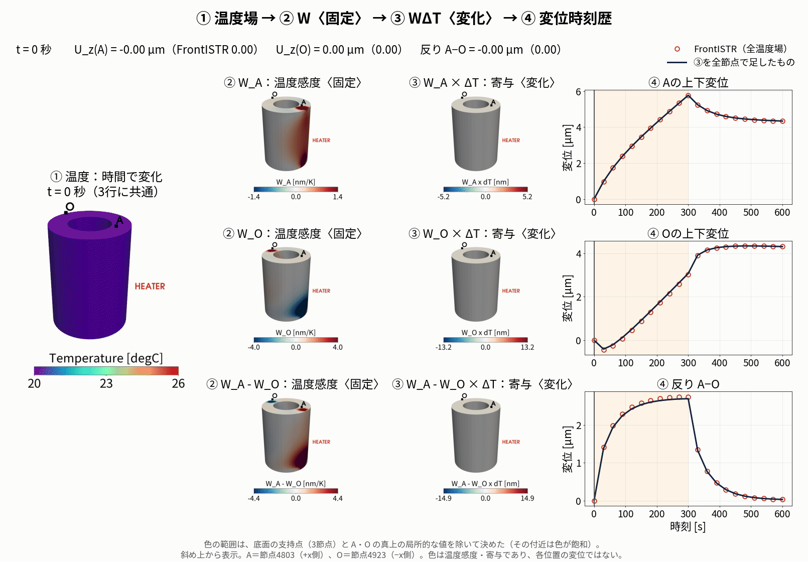

*斜め上から表示。最左列＝OpenFOAMの温度場（レインボー、時間で変わる）。その右の3行は上からAの上下変位・Oの上下変位・反りA−Oを評価する。各行は左から温度感度W（固定）、W×温度上昇（時間で変わる寄与）、寄与を全節点で足した変位の時刻歴。色と数値の対応は全時刻で固定する。感度図の色は、その場所の変位そのものではない。温度はOpenFOAMの15 W真値。詳細は下の行列式と `run/make_W_AO_vtk_anim.py`。*

- **A の上下変位**：熱感度はヒータ側の側面で高く、そこが実際に温まるので、ヒータ側の側面が A を持ち上げています。
- **O の上下変位**：熱感度は反対側の側面で正、ヒータ側の下部で負です。ヒータ側が温まると円筒が傾き、O を押し下げる向きに働きます（加熱の始め、O が一度下がるのはこのため）。
- **反り A−O**：ヒータ側の側面の温度が、反りの主な原因になっています。
- 全節点で足した値は FrontISTR の答えとほぼ一致しました（ $U_z(A)$ で最大 0.011 µm、反りで最大 0.049 µm の差。 $W$ は四面体に分けたメッシュ、FrontISTR の答えは六面体のメッシュで計算しているための差を含みます）。

**Wの行と、代表5点の重みを行列でつなぐ**

**ここで示す分布は、全節点の変位分布ではありません。** Aの上下変位という「1つの出力」に対して、各節点の温度がどれだけ効くかを並べたものです。行列Wの**行は評価する変位の自由度、列は温度を変える節点**に対応します。

全節点数を $N=5040$ とし、代表5点温度の基準場からの変化を $\delta\mathbf T_P$ 、全FEM節点温度の変化を $\delta\mathbf T_F$ とします。基準場にはPODの平均温度場を使います。

** $\delta T[P0]$ は「P0点での温度上昇」です。** この式では、PODの平均温度を基準にして、

$$
\delta T[P0]=T[P0]-\bar T[P0]
$$

と定義します。 $T[P0]$ は現在のP0点の温度、 $\bar T[P0]$ はP0点の学習データの時間平均温度です。平均温度より高ければ正、低ければ負になります。外気温や加熱開始時の温度からの上昇とは区別します。 $\delta T[P1],\ldots,\delta T[P4]$ も同じ意味で、角括弧 $[Pj]$ は「代表点Pjでの値」を表します。


$$
\delta\mathbf T_P=
\begin{bmatrix}\delta T[P0]\\\delta T[P1]\\\delta T[P2]\\\delta T[P3]\\\delta T[P4]\end{bmatrix},
\qquad
\delta\mathbf T_F=
\begin{bmatrix}\delta T_1\\\delta T_2\\\vdots\\\delta T_N\end{bmatrix}
$$

**① 代表5点の温度を、全節点の温度へ広げる。** gappy-PODとOpenFOAM→FEMの温度写像をまとめた行列を $R_T$ とします。**本記事の前半で $\mathbf w^{\mathsf T}=\mathbf l^{\mathsf T}W R_T$ と書いたときの $R_T$ と同じものです。**

$$
\underbrace{\delta\mathbf T_F}_{N\times1}=
\underbrace{\begin{bmatrix}
g_{1,0}&g_{1,1}&g_{1,2}&g_{1,3}&g_{1,4}\\
g_{2,0}&g_{2,1}&g_{2,2}&g_{2,3}&g_{2,4}\\
\vdots&\vdots&\vdots&\vdots&\vdots\\
g_{N,0}&g_{N,1}&g_{N,2}&g_{N,3}&g_{N,4}
\end{bmatrix}}_{R_T:\ N\times5}
\underbrace{\delta\mathbf T_P}_{5\times1}
$$

**前に出てきた gappy-POD の式とのつながり**は、次のとおりです。

$$
\begin{aligned}
\delta\mathbf T_P&=\mathbf T_P-\bar{\mathbf T}_P,\\
\mathbf a&=U_{rP}^{+}\delta\mathbf T_P,\\
\delta\mathbf T_{\mathrm{cell}}&=U_r\mathbf a =U_rU_{rP}^{+}\delta\mathbf T_P,\\
\delta\mathbf T_F&=M\delta\mathbf T_{\mathrm{cell}} =\underbrace{M U_rU_{rP}^{+}}_{R_T}\delta\mathbf T_P.
\end{aligned}
$$

| 記号 | サイズ | 前の説明との対応 |
|---|---|---|
| $U_r=\Phi$ | $20{,}696\times5$ | PODの5本のモード。blog_004では $\Phi$ とも表記 |
| $U_{rP}=P\Phi$ | $5\times5$ | 本節の直前で展開した、代表5点でのモードの値 |
| $U_{rP}^{+}$ | $5\times5$ | 5点の温度差をモード係数へ戻す疑似逆行列。正則なら以前の $U_{rP}^{-1}$ と同じ |
| $M$ | $5{,}040\times20{,}696$ | OpenFOAMセル温度をFrontISTR節点温度へ渡す写像。近傍8セルをIDWで加重平均する |
| $R_T=M U_rU_{rP}^{+}$ | $5{,}040\times5$ | 代表5点から全FEM節点までの操作をまとめた復元行列 |
| $g_{n,j}$ （ $R_T$ の $n$ 行 $j$ 列） | 無次元 | 上に展開した行列の各成分。別の補間方法ではない |

つまり、**代表5点 → モード係数 → OpenFOAM全セル → FEM全節点**を、1つの行列 $R_T$ にまとめています。blog_004の $\Phi(P\Phi)^+$ は「全セルまで」、ここでの $R_T$ はさらに $M$ を掛けた「FEM全節点まで」です。 $N=5{,}040$ は本節のFEM節点数であり、blog_004のセル数 $20{,}696$ とは区別してください。

コードでは `temperature_map` が疎行列 $M$ 、`map_temperature(temperature_map, U)` が $M U_r$ に対応します。各節点について近傍8セルの重みだけを保存します。

例えば節点nの温度は、

$$
\delta T_n=g_{n,0}\delta T[P0]+g_{n,1}\delta T[P1]+\cdots+g_{n,4}\delta T[P4]
$$

です。 $g_{n,j}$ は代表点Pjを1 K変え、ほかの4点を固定したときの、節点nの温度変化を表す係数です。空間距離だけで決める補間重みではなく、POD復元と温度写像から求めます。

**② 全節点温度から、AとOの上下変位を求める。** WからA・Oの上下方向に対応する2行を取り出します。

$$
\underbrace{\begin{bmatrix}\delta U_z(A)\\\delta U_z(O)\end{bmatrix}}_{2\times1} =
\underbrace{\begin{bmatrix}
W_{A,z;1}&W_{A,z;2}&\cdots&W_{A,z;N}\\
W_{O,z;1}&W_{O,z;2}&\cdots&W_{O,z;N}
\end{bmatrix}}_{W_{AO,z}:\ 2\times N}
\underbrace{\delta\mathbf T_F}_{N\times1}
$$

（右辺の 2×5 の行列は、代表5点から A・O への重み。）

$W_{A,z;n}$ は「節点nの温度が1 K変わると、Aの上下変位が何µm変わるか」です。**Aを評価する1行を、温度側の節点位置に色付けしたものが『Aの温度感度分布』**です。

**③ ①を②に代入すると、代表5点の重みになる。**

$$
\begin{bmatrix}\delta U_z(A)\\\delta U_z(O)\end{bmatrix} =
\underbrace{W_{AO,z}R_T}_{2\times5}\delta\mathbf T_P =
\underbrace{\begin{bmatrix}
h_{A,z;0}&h_{A,z;1}&h_{A,z;2}&h_{A,z;3}&h_{A,z;4}\\
h_{O,z;0}&h_{O,z;1}&h_{O,z;2}&h_{O,z;3}&h_{O,z;4}
\end{bmatrix}}_{2\times5}\delta\mathbf T_P
$$

行列積の各成分を展開すると、

$$
h_{A,z;j}=W_{A,z;1}g_{1,j}+W_{A,z;2}g_{2,j}+\cdots+W_{A,z;N}g_{N,j}
$$

となります。これが、全節点に対する感度Wを、代表5点に対する重みhにまとめる手続きです。変位そのものは、上の変化量に基準温度場の変位を足して求めます。

**④ 反りA−Oは、Aの行からOの行を引く。**

$$
\delta d=
\begin{bmatrix}1&-1\end{bmatrix}
W_{AO,z}R_T\delta\mathbf T_P =
\underbrace{\begin{bmatrix}
h_{A,z;0}-h_{O,z;0}&\cdots&h_{A,z;4}-h_{O,z;4}
\end{bmatrix}}_{\mathbf w^{\mathsf T}:\ 1\times5}\delta\mathbf T_P
$$

**FrontISTRのDUMPW出力との対応。** DUMPW版FrontISTRは `sensitivity_points.dat` のA・Oのグローバル節点番号を読み、次の「差の3行」を直接VTK出力します。

$$
W_{\mathrm{diff}}=
\begin{bmatrix}
W_{A,x;1}-W_{O,x;1}&\cdots&W_{A,x;N}-W_{O,x;N}\\
W_{A,y;1}-W_{O,y;1}&\cdots&W_{A,y;N}-W_{O,y;N}\\
W_{A,z;1}-W_{O,z;1}&\cdots&W_{A,z;N}-W_{O,z;N}
\end{bmatrix}\quad(3\times N)
$$

VTKの各温度節点nに、この列の3成分が `Sensitivity` として入ります。これは**A−Oの相対変位の温度感度**で、節点n自身の変位ベクトルではありません。円筒の指定はA＝4803、O＝4923です。参照した `011_Tji_DUMPW` の19・103は別形状の節点番号で、円筒には使いません。

今回の図のA・O個別の行は、FrontISTRが出したK・HからPythonの随伴計算で求めています。反りの行はFrontISTR直接出力と照合し、相対差約 $1.8\times10^{-7}$ を確認して直接出力を使用しました。これと、六面体モデルの変位真値との比較は別の検証です。

実装・出力：`105_0_sensor_placement_sensitivity/run/dumpw_cylinder.py`、同ケースの `sensitivity_points.dat`、`paraview/sensitivity_Wdiff_cylinder.vtk`。106側の照合と描画は `run/make_W_AO_vtk_anim.py`、ParaView用のコピーは `results/vtk/FrontISTR_sensitivity_Wdiff.vtu` です。

知りたい反り $d=U_z(A)-U_z(O)$ も、同じ形の重み $\mathbf w$ で書けます。

$$
d=d_0+\mathbf w^{\mathsf T}\mathbf T,\qquad \mathbf w=\mathbf h_{A,z}-\mathbf h_{O,z}
$$

**重みとは何か（具体的に）。** 例えば点 A の上下変位 $U_z(A)$ の重みは次の5つの数です。

$$
U_z(A)=U_z(A)_0+0.33\,T_0-0.13\,T_1+0.26\,T_2+0.64\,T_3+0.12\,T_4\quad[\mu\mathrm m]
$$

（ $T_j$ は代表点 $P_j$ の温度の、基準からの上昇 [K]。係数の単位は µm/K）

- $h_{A,j}$ は「**代表点 $P_j$ だけを 1 K 上げ、ほかの4点は変えない**温度分布（点と点の間は gappy-POD で埋める）を FrontISTR に入れたとき、A が何 µm 動くか」です。
- 重みが負になる点もあります。 $P_1$ （反対側寄り）だけが温まると、反対側が伸びて円筒がヒータ側へ傾き、ヒータ側の A が下がる、と考えられます（この解釈は確かめていません）。
- **検算**：5点とも 1 K 上げる（全体が一様に 1 K 上がる）と、 $0.33-0.13+0.26+0.64+0.12=1.21$ µm。鋼の線膨張係数 $1.2\times10^{-5}$ /K × 高さ 100.5 mm ＝ 1.21 µm と一致します。

ほかの例：

| 量 | $P_0$ | $P_1$ | $P_2$ | $P_3$ | $P_4$ | 合計（全体 1 K） |
|---|---:|---:|---:|---:|---:|---:|
| $U_z(A)$ （ヒータ側の上面） | 0.33 | −0.13 | 0.26 | 0.64 | 0.12 | 1.21 |
| $U_z(O)$ （反対側の上面） | −0.14 | 0.52 | −0.34 | 0.60 | 0.57 | 1.21 |
| **反り $d=U_z(A)-U_z(O)$ の重み $\mathbf w$ ** | **0.47** | **−0.65** | **0.60** | **0.04** | **−0.46** | **0.00** |
| 変位計 S1（上面、横方向）の重み $\mathbf h_{S1}$ | −0.53 | 0.60 | −0.76 | 0.29 | 0.29 | −0.12 |
| 底面近くの変位計の重み | −0.09 | −0.07 | −0.38 | 0.74 | −0.15 | 0.06 |

- 反りの重み $\mathbf w$ の合計は 0：全体が一様に温まっても、反りは出ません。反りは「ヒータ側（P0・P2、＋）と反対側（P1・P4、−）の温度差」で決まります。
- S1 の重みは、 $\mathbf w$ とほぼ逆向き（符号が逆で形が似ている）です。だから S1 の値は反りと強く（逆向きに）一緒に動きます（ステップ3の散布図①）。

#### ステップ2：5点の温度の「分からなさ」を作る（図の②）

発熱量や初期温度が分からないので、測る前は5点の温度も分かりません。
その分からなさを、ROM を条件を変えて **4,000 本**回して作ります（観測なしで回すだけ。データ同化はしない）。

| 振ったもの | 振り方 | 範囲 | 正解の値 |
|---|---|---|---|
| 初期温度（代表5点） | 5点それぞれ別々に一様乱数 | 気温 20 °C の −3〜+12 K | 20 °C |
| 発熱量 | 倍率 $q$ を一様乱数（ $Q=15q$ W） | $q$ ＝0.3〜1.8（4.5〜27 W） | 15 W |
| 放熱 $h_{\mathrm{ROM}}$ | 正規乱数（平均 0.02、標準偏差 0.01 W/K）を 0.001〜0.1 で切る | | 0.01535 W/K |

熱源の位置（P2）、ROM の係数、気温、熱感度は変えていません。これは EnKF の60メンバーを最初に作るときと同じ分布です。

4,000 本を 0 秒から 300 秒まで進め、30 秒ごと（ $t_k=30k$ 秒、 $k=1,\dots,10$ ）に、5点の温度の共分散を数えます。

$$
B(t_k)=\begin{pmatrix}
\mathrm{Var}(T_0) & \mathrm{Cov}(T_0,T_1) & \cdots & \mathrm{Cov}(T_0,T_4)\\
\mathrm{Cov}(T_1,T_0) & \mathrm{Var}(T_1) & \cdots & \mathrm{Cov}(T_1,T_4)\\
\vdots & \vdots & \ddots & \vdots\\
\mathrm{Cov}(T_4,T_0) & \mathrm{Cov}(T_4,T_1) & \cdots & \mathrm{Var}(T_4)
\end{pmatrix}
$$

$$
\mathrm{Cov}(T_i,T_j)=\frac{1}{N-1}\sum_{m=1}^{N}\big(T_i^{(m)}(t_k)-\bar T_i(t_k)\big)\big(T_j^{(m)}(t_k)-\bar T_j(t_k)\big),\qquad N=4000
$$

$m$ は何本目の計算か、 $\bar T_i$ は 4,000 本の平均です。

- **対角** $\mathrm{Var}(T_i)$ ：点 $P_i$ の温度が、どれだけ分からないか。
- **非対角** $\mathrm{Cov}(T_i,T_j)$ ：点 $P_i$ と $P_j$ の温度が、一緒に上がり下がりするか。大きいほど、片方を測るともう片方も分かる。

測る前の反りの分からなさ $\sigma_0$ は、各点の温度の分からなさに重み $\mathbf w$ を掛けて足し合わせたものです。

$$
\sigma_0^2=\mathbf w^{\mathsf T}B\,\mathbf w=\sum_i\sum_j w_iw_j\,\mathrm{Cov}(T_i,T_j)
$$

#### ステップ3：候補を採点する ― 測った後に残る反りの不確かさσ

**この場所を測れば、知りたい反りA−Oをどれだけ正確に推定できそうか。** その目安がσです。小さい候補ほど優先します。

ステップ2で作った4,000ケースは、初期温度・発熱量・放熱条件が異なるROM計算です。同じ時刻の4,000ケースについて、候補センサの予測値と反りの関係を調べます。


*横軸＝候補センサの予測値（仮定したノイズを含む）、縦軸＝反り。点1つが1ケース。細い帯になる候補ほど、センサの値から反りを推定しやすい。灰色の±σは誤差の標準偏差の目安で、必ずその範囲に入るという意味ではありません。*

**「測ったと仮定する」とは、仮の測定値を決めることではありません。** センサの感度とノイズから、測定でどれだけ不確かさが減るかを予測します。散布図は説明用で、全候補について図を描く必要はありません。

##### 実際の採点は、次の2式で行う

$$
P_c=B-BH_c^{\mathsf T}
\left(H_cBH_c^{\mathsf T}+R\right)^{-1}H_cB
$$

$$
\sigma_c=\sqrt{\mathbf w^{\mathsf T}P_c\mathbf w}
$$

| 記号 | 何を表すか |
|---|---|
| $B$ | 測定前の5点温度の共分散。4,000ケースから計算する（5×5） |
| $H_c$ | 5点温度からセンサの値を求める重み。本節では温度計P2・P0と候補の変位計を並べる（3×5） |
| $R$ | センサのノイズ共分散。温度・変位とも標準偏差0.3を仮定し、それぞれの単位で分散を入れる |
| $P_c$ | **そのセンサを測った後に残ると予測した、5点温度の共分散**（5×5）。点の名前P0〜P4とは別の記号 |
| $\mathbf w$ | 5点温度から反りA−Oへの感度（5成分）。FrontISTRの応答とPOD復元から作る |
| $\sigma_c$ | 残る温度の不確かさを反りに換算した標準偏差 [µm] |

##### 候補点を指定すると、何が決まり、どうPcとσを計算できるのか

**候補点を入れると、そのセンサの値を代表5点温度から計算する「重みの1行」が決まります。** 測定値を仮に決めるのではありません。計算の入力は、次の3つです。

1. **B**：同じ時刻の4,000ケースから既に求めた5点温度の共分散（5×5）。
2. **候補センサの重み**：温度計ならセル番号から温度復元行列Gの1行、変位計なら節点番号・測定方向からFrontISTR応答の1行を取り出す（1×5）。
3. **観測ノイズの分散**：温度計なら $(0.3\ \mathrm K)^2$ 、変位計なら $(0.3\ \mathrm{µm})^2$ 。

本節の例は、温度P2・P0を既に測る条件です。候補cを変位計として加えるなら、候補の位置・方向から取り出した重みを3行目に入れます。

$$
\underbrace{H_c}_{3\times5} =\begin{bmatrix}
0&0&1&0&0\\
1&0&0&0&0\\
h_{c,0}&h_{c,1}&h_{c,2}&h_{c,3}&h_{c,4}
\end{bmatrix},
\qquad
\underbrace{R}_{3\times3} =\mathrm{diag}(\sigma_T^2,\sigma_T^2,\sigma_u^2)
$$

1行目は温度P2、2行目は温度P0、3行目が候補cです。**候補を別の点・方向に変えると3行目が変わり、その結果Pcとσも変わります。** 既に変位1点を選んで2点目を採点する場合は、選定済み変位の行と新しい候補の行を追加し、Hは4×5、Rは4×4になります。

**Pcは、観測を使って温度を補正した後の「誤差の共分散」です。** まず、何を温度誤差と呼ぶかを定義してから、その式を導きます。

ここで補正するのは、ROMの代表5点P0〜P4の温度です。各点について、次の2つを区別します。

- $T[Pj]$ ：その点の未知の正しい温度。
- $\widehat T[Pj]$ ：観測で補正する前に、ROMが推定している温度。ハット $\widehat{\phantom T}$ は推定値の印です。

**「正しい温度 − 推定温度」を、その点の温度誤差と定義します。**

$$
e_j=T[Pj]-\widehat T[Pj],\qquad j=0,1,2,3,4
$$

正なら推定温度が低すぎ、負なら高すぎる、という符号です。これを5点分、縦に並べたものが $\mathbf e$ です。

$$
\underbrace{\mathbf e}_{5\times1} =\underbrace{\begin{bmatrix}
T[P0]\\T[P1]\\T[P2]\\T[P3]\\T[P4]
\end{bmatrix}}_{5\times1} -\underbrace{\begin{bmatrix}
\widehat T[P0]\\\widehat T[P1]\\\widehat T[P2]\\\widehat T[P3]\\\widehat T[P4]
\end{bmatrix}}_{5\times1} =\underbrace{\begin{bmatrix}
e_0\\e_1\\e_2\\e_3\\e_4
\end{bmatrix}}_{5\times1}
$$

（左から、補正前の温度誤差、未知の正しい温度、補正前の推定温度。）

つまり、 $\mathbf e$ は新しい物理量ではなく、**既にある5点温度について、どれだけ推定が外れているかをまとめた記号**です。「補正前」は同じ時刻で観測を使う前を指します。

実際の配置選定では、正しい温度がまだ分からないため、この誤差ベクトルの実現値も分かりません。そこで、4,000ケースの温度のばらつきを、推定誤差のばらつきBとして使う仮定を置いています。平均誤差をゼロとすると、

$$
\underbrace{B}_{5\times5} =\mathbb E[\mathbf e\mathbf e^{\mathsf T}],
\qquad B_{ij}=\mathbb E[e_i e_j]
$$

です。ケースの温度から同時刻のケース平均を引いて標本共分散を求める操作は、このBを見積もるためのものです。**4,000ケースから実際の推定誤差が判明したという意味ではありません。**

この温度誤差がセンサの値にどう現れるかを、先ほどのHを使って書きます。観測ノイズを $\boldsymbol\varepsilon$ （3×1）とすると、観測値と予報値の差は、同じ線形モデル内で

$$
\underbrace{\Delta\mathbf y}_{3\times1} =\underbrace{H_c}_{3\times5}\underbrace{\mathbf e}_{5\times1} +\underbrace{\boldsymbol\varepsilon}_{3\times1}
$$

です。

**温度P2・P0と、候補点 $S_c$ のUxを測る場合で、全成分を書く。** 候補cは「 $S_c$ という節点のx方向変位を測るセンサ」を指します。 $h_{c,j}$ は代表点Pjの温度変化から、そのUxへの変換係数 [µm/K] です。

まず、観測値と予報値は次の3成分です。

$$
\underbrace{\mathbf y^{\mathrm{obs}}}_{3\times1} =\begin{bmatrix}
T^{\mathrm{obs}}[P2]\\
T^{\mathrm{obs}}[P0]\\
U_x^{\mathrm{obs}}(S_c)
\end{bmatrix},
\qquad
\underbrace{\widehat{\mathbf y}}_{3\times1} =\begin{bmatrix}
\widehat T[P2]\\
\widehat T[P0]\\
\widehat U_x(S_c)
\end{bmatrix}.
$$

温度の誤差は $e_j=T[Pj]-\widehat T[Pj]$ 、観測ノイズは温度計P2・P0と変位計cでそれぞれ $\varepsilon_{T,P2},\varepsilon_{T,P0},\varepsilon_{u,c}$ と書きます。すると、先ほどの $\Delta\mathbf y=H_c\mathbf e+\boldsymbol\varepsilon$ は、

$$
\underbrace{\begin{bmatrix}
T^{\mathrm{obs}}[P2]-\widehat T[P2]\\
T^{\mathrm{obs}}[P0]-\widehat T[P0]\\
U_x^{\mathrm{obs}}(S_c)-\widehat U_x(S_c)
\end{bmatrix}}_{\Delta\mathbf y:\ 3\times1} =
\underbrace{\begin{bmatrix}
0&0&1&0&0\\
1&0&0&0&0\\
h_{c,0}&h_{c,1}&h_{c,2}&h_{c,3}&h_{c,4}
\end{bmatrix}}_{H_c:\ 3\times5}
\underbrace{\begin{bmatrix}
T[P0]-\widehat T[P0]\\
T[P1]-\widehat T[P1]\\
T[P2]-\widehat T[P2]\\
T[P3]-\widehat T[P3]\\
T[P4]-\widehat T[P4]
\end{bmatrix}}_{\mathbf e:\ 5\times1} +
\underbrace{\begin{bmatrix}
\varepsilon_{T,P2}\\
\varepsilon_{T,P0}\\
\varepsilon_{u,c}
\end{bmatrix}}_{\boldsymbol\varepsilon:\ 3\times1}
$$

です。Hの各行と温度誤差の列を掛けると、

$$
\underbrace{\Delta\mathbf y}_{3\times1} =\underbrace{\begin{bmatrix}
e_2+\varepsilon_{T,P2}\\
e_0+\varepsilon_{T,P0}\\
h_{c,0}e_0+h_{c,1}e_1+h_{c,2}e_2+h_{c,3}e_3+h_{c,4}e_4+\varepsilon_{u,c}
\end{bmatrix}}_{3\times1}
$$

となります。

- **1行目**：P2の温度計のずれ＝P2の温度誤差＋その温度計のノイズ。
- **2行目**：P0の温度計のずれ＝P0の温度誤差＋その温度計のノイズ。
- **3行目**：候補点ScのUxのずれ＝5点温度の誤差がUxに現れた分＋変位計のノイズ。

ノイズ共分散Rも省略せずに書くと、独立な3本のノイズを仮定して、

$$
\underbrace{R}_{3\times3} =\mathbb E[\boldsymbol\varepsilon\boldsymbol\varepsilon^{\mathsf T}] =\begin{bmatrix}
\sigma_T^2&0&0\\
0&\sigma_T^2&0\\
0&0&\sigma_u^2
\end{bmatrix}
$$

です。対角の順番は **P2の温度計、P0の温度計、候補ScのUx変位計** で、観測ベクトルと一致させます。最初の2つの対角成分はK²、最後はµm²です。候補がUy・Uzなら、上のUxと対応する重みの行を、その方向のものに置き換えます。

温度を $K_c\Delta\mathbf y$ だけ補正すれば、残る誤差は

$$
\underbrace{\mathbf e_{\mathrm{after}}}_{5\times1} =\underbrace{\mathbf e}_{5\times1} -\underbrace{K_c}_{5\times3}\underbrace{\Delta\mathbf y}_{3\times1} =(I-K_cH_c)\mathbf e-K_c\boldsymbol\varepsilon
$$

となります。Iは5×5の単位行列です。温度誤差とノイズが独立で平均ゼロなら、残る誤差の共分散は

$$
\underbrace{P_c}_{5\times5} =\mathbb E[\mathbf e_{\mathrm{after}}\mathbf e_{\mathrm{after}}^{\mathsf T}] =(I-K_cH_c)B(I-K_cH_c)^{\mathsf T}+K_cRK_c^{\mathsf T}.
$$

ここで線形補正の誤差を最小にするゲイン

$$
\underbrace{K_c}_{5\times3} =\underbrace{BH_c^{\mathsf T}}_{5\times3}
\underbrace{(H_cBH_c^{\mathsf T}+R)^{-1}}_{3\times3}
$$

を代入して整理したものが、冒頭の $P_c=B-BH_c^{\mathsf T}(H_cBH_c^{\mathsf T}+R)^{-1}H_cB$ です。1観測で補正係数を求める式展開は、[blog009 §3-2](blog_009_two_sensors_nonrep.md)に全成分で示しています。

**実際の掛け算の順序**は、次のように分けると分かります。

$$
\underbrace{A_c}_{5\times3}=\underbrace{B}_{5\times5}\underbrace{H_c^{\mathsf T}}_{5\times3},
\qquad
\underbrace{S_c}_{3\times3}=\underbrace{H_c}_{3\times5}\underbrace{A_c}_{5\times3}+\underbrace{R}_{3\times3}
$$

$$
\boxed{\underbrace{P_c}_{5\times5} =\underbrace{B}_{5\times5} -\underbrace{A_c}_{5\times3}\underbrace{S_c^{-1}}_{3\times3}\underbrace{A_c^{\mathsf T}}_{3\times5}}
$$

Aは温度誤差とセンサ予報誤差の共分散、Sはセンサのずれの共分散です。候補の座標が直接Pcの式に入るのではなく、**座標と方向 → 重みの行 → H → AとS → Pc**という順序です。逆行列を作る必要はなく、線形方程式を解けます。

```python
A = B @ H.T                       # (5, 3)
S = H @ A + R                     # (3, 3)
Pc = B - A @ np.linalg.solve(S, A.T)  # (5, 5)
sigma2 = w @ Pc @ w               # スカラー：反りの分散 [µm²]
sigma = np.sqrt(max(sigma2, 0.0))  # スカラー：標準偏差 [µm]
```

この計算を、150秒の再計算スクリプトでも行っています。通常の候補探索コードは同じ計算をセンサ1本ずつのランク1更新で行い、事後共分散が一致することも再計算時に確認しています。

**最後に、残る温度誤差を反りの誤差に換算します。** 反りへの重みは候補によらず固定した $\mathbf w$ （5×1）です。

$$
e_d=\mathbf w^{\mathsf T}\mathbf e_{\mathrm{after}}
$$

その二乗を平均すると、

$$
\begin{aligned}
\sigma_c^2
&=\mathbb E[e_d^2]\\
&=\mathbf w^{\mathsf T}\mathbb E[\mathbf e_{\mathrm{after}}\mathbf e_{\mathrm{after}}^{\mathsf T}]\mathbf w\\
&=\underbrace{\mathbf w^{\mathsf T}}_{1\times5}
\underbrace{P_c}_{5\times5}
\underbrace{\mathbf w}_{5\times1}.
\end{aligned}
$$

**この分散の平方根がσです。** ここでいう「観測した後」は、単に測定した時点という意味ではありません。次の補正をした後を指します。

1. 候補センサcの観測値と、温度から計算した予報値との差 $\Delta\mathbf y$ を求める。
2. その差にゲイン $K_c$ を掛け、代表5点の推定温度を補正する。
3. 補正した5点温度から、反りA−Oを計算し直す。

$$
\underbrace{\widehat{\mathbf T}_{P,\mathrm{after}}}_{5\times1} =\underbrace{\widehat{\mathbf T}_{P,\mathrm{before}}}_{5\times1} +\underbrace{K_c}_{5\times3}
\underbrace{(\mathbf y^{\mathrm{obs}}-\widehat{\mathbf y})}_{3\times1}
$$

上の大きさは、本節の温度P2・P0と候補変位1点の計3観測の場合です。この補正後の温度誤差の共分散がPcで、その温度誤差から生じる反りの誤差の標準偏差がσです。

**配置の採点時には、まだ観測値を入れてこの補正を実行してはいません。** 「もしここを測り、その値を使って上の補正をしたら、どれだけ誤差が残ると予測されるか」を、B・H・Rから計算しています。この線形モデルでは、観測値の大小は補正量を変えますが、補正後の誤差共分散PcはB・H・Rで決まります。そのため、仮の測定値を1つ決めずにσを予測できます。

また、「後」は次の観測時刻まで時間を進めたという意味でもありません。150秒の例なら、**同じ150秒で、観測を使って補正する前と補正した後**を比べています。σは実際のEnKF誤差そのものではなく、仮定した線形モデル・共分散・ノイズの下での予測値です。

##### 150秒の共分散から再計算した結果（2026-10-12）

同じ事前分布で4,000ケースを0秒から150秒まで再計算しました。下は**実際のEnKF誤差ではなく、観測後に残る不確かさの予測**です。旧S1・S2は本節のP2・P0固定試験の配置で、blog009の選定変位点とは異なります。

| 測るセンサ | 反りの分散 σ² [µm²] | 標準偏差σ [µm] |
|---|---:|---:|
| なし | 1.4489 | 1.2037 |
| 温度P2・P0 | 0.9424 | 0.9708 |
| 温度P2・P0＋旧S1（Ux） | 0.1014 | 0.3185 |
| 温度P2・P0＋旧S1（Ux）・旧S2（Uz） | 0.0472 | 0.2171 |

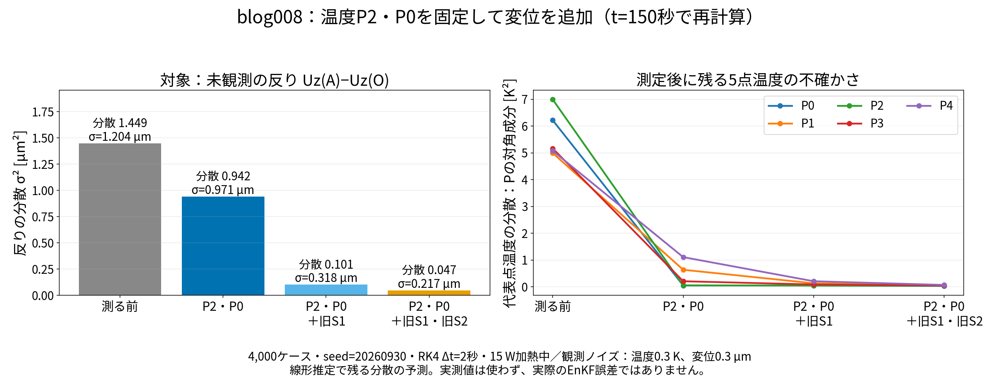

*左：反りの分散σ²と標準偏差σ。右：Pcの対角成分である、代表5点温度に残る分散。4,000ケース、seed=20260930、15 W、RK4刻み2秒。温度・変位の観測ノイズはそれぞれ0.3 K・0.3 µm。150秒の1時刻の値で、30〜300秒の平均採点値Jとは異なります。*

再計算：`run/recalculate_posterior_t150.py`。入力B、各段階のH・R・Pc・σは `results/posterior_t150.json`、4,000ケースの温度と共分散は `results/posterior_t150.npz` に保存しています。散布図 `img/sigma_scatter.png` も現行のIDW変位応答で再計算しました。

片側の温度P2・P0だけでは、反対側の温度に不確かさが残ります。反りに関係する変位を追加すると、その不確かさも減らせる、という予測です。

**30, 60, …, 300秒の10時刻でσを計算し、平均を候補の点数にします。** 点数が最小の候補を1本選び、2本目は1本目で減らした後の不確かさに対して採点し直します。似た情報しか持たない候補を、感度の大きさだけで選ばないためです。

この式はOI・カルマン更新と同じ構造ですが、ここでは観測前の配置選定に使っています。仮定した共分散・ノイズの下での線形推定の基準であり、逐次EnKFの最終誤差や全ペアの最適性を保証するものではありません。

式展開・観測行列の具体例・プログラムとの対応は、[詳細な導出](24_sensor_score_derivation.md)にまとめました。

#### ステップ4：1位を選ぶ（1点目）

14,754 通りの点数 $J_c$ を小さい順に並べます。温度計 P2・P0 だけ（変位計なし）の点数は 1.186 µm です。

| 順位 | 候補 | $\sigma$ |
|---|---|---:|
| **1位** | **(9.7, −36.2, 100.5) mm の $U_x$ ** | **0.347 µm** |
| 2位 | (9.7, **+36.2**, 100.5) mm の $U_x$ | 0.347 µm |
| 3位 | (14.4, −34.6, 100.5) mm の $U_x$ | 0.347 µm |
| …（中央値） | ― | 1.026 µm |
| 最下位 | (37.5, 0, 0) mm の $U_y$ | 1.186 µm ＝ 測らないのと同じ |

1位を採用します。これで 1.186 → **0.347 µm**。1本測るだけで3分の1以下になりました。

#### ステップ5：**採点をやり直して**、2点目を選ぶ

ここが肝心です。**2位をそのまま選んではいけません。**

2位は (9.7, **+36.2**, 100.5) で、1位とは y の符号が違うだけの**ほぼ同じ場所**です。
1点目で分かったことと同じことしか分からないので、足しても意味がありません。

そこで、**1点目を測ったことにして、14,753 通りを採点し直します**。観測行列 $H_c$ に1点目の行 $\mathbf h_{S_1}$ を足して4行にし、ステップ3と同じ計算をします。

| 順位 | 候補 | $\sigma$ |
|---|---|---:|
| **1位** | **(−34.6, 14.4, 100.5) mm の $U_z$ ** | **0.256 µm** |
| 2位 | (−36.2, 9.7, 100.5) mm の $U_z$ | 0.256 µm |
| …（中央値） | ― | 0.330 µm |

0.347 → **0.256 µm**。これで2点決まりました。

#### 採点し直すと、良い場所が変わる


> 左＝1点目を選ぶときの採点（色が薄いほど良い）、中＝1点目を測った前提で採点し直したとき、右＝ $\sigma$ が下がる様子。

左と中を見比べてください。**良い場所（薄い色）が移動しています。**

| | 良い場所 | なぜ |
|---|---|---|
| 1点目のとき | 上面の ±y 側 | ヒータ側と反対側の両方の影響を受ける |
| 2点目のとき | **ヒータの反対側（−x 側）** | 1点目で分からなかった「反対側の情報」が欲しくなる |

#### 選んだ2点で、観測していない温度・変位はどう合ったか

選んだ S1・S2 を実際にデータ同化に入れて、**観測していない場所**を見ます。
反り A−O だけでなく、**A・O それぞれの $U_z$ **、**ほかの未観測点の $U_z$ **（D・E・F）、**観測していない温度**（代表点 P1・P3・P4 と、代表点以外のセル4点）、**温度場全体**も比べます。

**条件**：真値＝OpenFOAM（温度場）＋FrontISTR（全節点の変位）、15 W。ROM＋EnKF（60メンバー、30 秒ごと、5 seed）。観測は温度計 P2・P0 ＋ 変位計2点だけで、グラフの点はすべて観測に使っていません（ `run/selected_pair_unobserved_check.py` ）。


*温度場RMSEと未観測温度・変位を主要条件だけで比較。黒＝真値。その他の線は上部凡例を参照。色付きの背景は0〜300秒。*

| 観測していない量（30〜300 秒の平均誤差） | データ同化なし | 温度 P2・P0 のみ | ＋底面近く（悪い例） | **＋選定 S1・S2** |
|---|---:|---:|---:|---:|
| 温度場全体（20,696 セルの RMSE） | 4.58 K | 0.54 K | 0.43 K | **0.13 K** |
| 未観測の温度7点のうち最大 | 4.61 K | 0.90 K | 0.70 K | **0.19 K** |
| 反り A−O | 0.24 µm ※ | 0.77 µm | 0.58 µm | **0.075 µm** |
| $U_z(A)$ | 5.60 µm | 0.24 µm | 0.20 µm | **0.10 µm** |
| $U_z(O)$ | 5.37 µm | 0.94 µm | 0.74 µm | **0.09 µm** |
| D（上面・+y 側）の $U_z$ | 5.50 µm | 0.64 µm | 0.49 µm | **0.12 µm** |
| E（ヒータ側・中段）の $U_z$ | 2.82 µm | 0.10 µm | 0.08 µm | **0.05 µm** |
| F（反対側・中段）の $U_z$ | 2.64 µm | 0.52 µm | 0.41 µm | **0.06 µm** |

- **データ同化なし（ROM だけで予測）では、温度が約 4.6 K、変位が 2.6〜5.6 µm ずれます。** 選定 S1・S2 でデータ同化すると、温度は 0.2 K 以下、変位は 0.1 µm 前後まで直ります。
- ※ 反り A−O だけは、データ同化なしでも 0.24 µm と小さく見えます。A と O が同じ向きに約 5.5 µm ずれ、差を取ると打ち消し合うためです（§6-2 と同じ注意）。
- **σ で選んだ S1・S2 は、反りだけでなく、観測していない温度・個別の変位のすべてで一番良い結果**でした。
- 温度 P2・P0 だけだと、**反対側（O 側）の温度と変位が外れます**（P4 0.90 K、 $U_z(O)$ 0.94 µm）。ヒータ側の $U_z(A)$ や E は、もともとそこそこ合っています。
- 底面近くの変位計は、ほとんど効きません。


#### まとめ

> **やったこと**：候補 14,754 通りを全部採点して1位を選ぶ。選んだら採点をやり直して、また1位を選ぶ。
>
> **考え方**：いま分かっていないことを、いちばん多く教えてくれる点を選ぶ。選んだら「何が分かっていないか」を更新して、また選ぶ。

**ここまで測定値は一切使っていません。** FrontISTR の計算と ROM の計算だけで、机上で場所が決まります。
本当に当たるかは、このあとデータ同化を回して確かめます。

### 5-3. 結果

まず、**どこを測って、温度と変位がどう合ったか**を見ます。


*左＝観測点と評価点／中＝**温度**：温度計を置いていない P4／右＝**変位**：一度も観測していない反り A−O。
黒が真値、色が変位2点の置き場所。*

- **中**：変位なし（灰）は 300 秒まで真値より高めに外れ続けますが、**選定した変位2点を足すと真値に近づきます**。
  底面近く（紫）だけは外れたままです。
- **右**：反りは置き場所で大きく変わります。選んだ2点（赤）は**黒い真値にほぼ重なり**、
  変位なし（灰）は加熱中ずっと下に外れています。

誤差を加熱期で平均すると次のようになります。

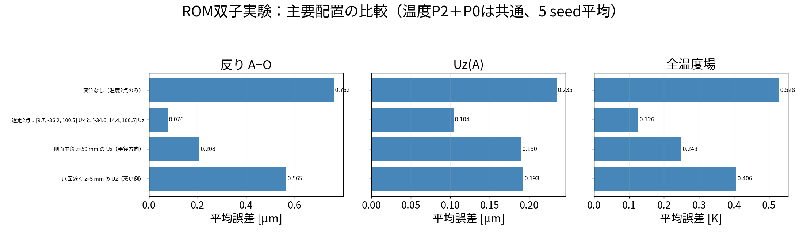

| 変位2点をどこに置くか | **観測していない反り A−O** | **観測していない Uz(A)** | 温度場全体 |
|---|---:|---:|---:|
| 変位なし（温度2点のみ） | 0.756 µm | 0.234 µm | 0.528 K |
| **選定2点**（(9.7, −36.2, 100.5) の $U_x$ と (−34.6, 14.4, 100.5) の $U_z$ ） | **0.076 µm** | **0.103 µm** | **0.126 K** |
| 側面中段 z=50 mm の $U_x$ | 0.207 µm | 0.189 µm | 0.248 K |
| 底面近く z=5 mm の $U_z$ （悪い例） | 0.559 µm | 0.196 µm | 0.408 K |

### 5-4. 分かったこと


*左＝真値、中＝温度2点だけ、右＝温度2点＋変位2点（A・O は一度も測らない）。
**色＝温度、形＝熱変形**（約4,000倍に誇張）。*

| 印 | 意味 |
|---|---|
| **●赤い球** | 温度センサ（P2・P0。3枚とも共通） |
| **■緑の立方体** | 変位計（右のパネルにだけ現れる。選定した2点） |
| **●黒い球** | 評価点 A・O（**一度も測らない**。3枚とも共通） |

（seed 20260913）

形と色で、何が起きているか一目で分かります。例えば $t=150$ 秒では

| | 反り A−O | 誤差 |
|---|---:|---:|
| 真値 | 2.57 µm | ― |
| 温度2点のみ（中） | 1.38 µm | 1.19 µm |
| **温度2点＋別の場所の変位2点（右）** | **2.56 µm** | **0.01 µm** |

- **中（温度2点のみ）**：全体が緑がかっていて、真値（左）より温度が高めに出ています。形も反りが足りません。
- **右（変位2点を足す）**：色も形も左の真値とほとんど同じです。**A・O（黒球）は一度も測っていません。**

1. **A・O を一度も測らずに、反りを 0.076 µm で当てられました。** 真値の振幅 2.74 µm に対して 2.8 % です。
2. **A・O を直接測った場合（0.135 µm）より正確です。** 測る場所を選べば、知りたい場所を測らないほうが良い結果になりました。
   - 理由は信号対雑音比と考えています。A・O の反りは最大 2.7 µm ですが、変位計のノイズは 0.3 µm あります。
     選定した点は変位がもっと大きく動くので、同じノイズでも情報が多く取れます。**この解釈は確かめていません。**
3. **置き場所で大きく変わります。** 底面近く（0.559 µm）は、変位なし（0.756 µm）から少ししか改善しません。底面は支持点（3節点）の近くで、ほとんど動かないためです。
4. 選定は**データ同化を回す前**に、FrontISTR の熱感度と ROM で作った温度のばらつきだけで計算しています（[blog_005 §4-6](blog_005_optimal_sensor_placement.md) と同じ方法）。

> **これが本研究のいちばん強い結果だと考えています。**
> 工作機械で本当に知りたいのは工具先端の変位ですが、加工中にそこは測れません。
> **測れる場所で変位を測り、測れない場所の変形を当てる**ことを、計算で示せました。

### 5-5. 注意（未確認）

- 上の表（0.076 µm など）は ROM の双子実験です。実ソルバ真値での結果は §6 のとおりで、同じ結論でした。
- 「直接測るより正確」の理由（信号対雑音比）は解釈で、別の計算では確かめていません。
- 選定した2点は上面にあります。この形状では上面がよく動くためで、他の形状では変わります。

> **この節で分かったこと**
> - **A・O を一度も測らずに、反りを 0.076 µm で当てられた**（振幅 2.74 µm の 2.8 %）。
> - **A・O を直接測った場合（0.135 µm）より正確**。測る場所を選べば、知りたい場所を測らないほうが良い結果になった。
> - 置き場所で大きく変わる。底面近く（0.559 µm）は、変位なし（0.756 µm）から少ししか改善しない。
> - 置き場所は**データ同化を回す前**に、FrontISTR の熱感度と ROM の温度のばらつきだけで決められる。


---

## 6. 【検証3】真値を OpenFOAM＋FrontISTR にしても同じか
> **この節で知りたいこと**：§5 は真値も ROM の双子実験だった。**モデル誤差がある条件**でも同じ結論になるか
>
> **条件**：温度の真値＝OpenFOAM の固体温度場、変位の真値＝その温度を各時刻 FrontISTR に入れて計算した全節点の変位。
> データ同化モデルは ROM のまま。A・O は一度も観測しない。15 W・25 W・間欠加熱の3条件 × 5 seed


### 6-1. やったこと

[§5](#5-検証2別の場所の変位で測っていない-ao-を当てられるか) の結果は真値も ROM の双子実験でした。
データ同化に使うのと同じモデルで正解を作っているので、**都合が良すぎます**。
そこで**真値を OpenFOAM＋FrontISTR にして**、同じ試験をやり直しました（`run/holdout_AO_realsolver.py`）。

- 温度の真値＝OpenFOAM の固体温度場
- **変位の真値＝その温度場を各時刻 FrontISTR に入れて計算した全節点の変位**（21 時刻 × 3 条件）
- データ同化モデルは ROM のまま。A・O は一度も観測しない

### 6-2. 結果

3条件それぞれで、**温度と変位がどう合ったか**を見ます。


**「5seed平均」の意味**：乱数seedを20260913〜20260917に変えて、同じ条件のデータ同化を5回行いました。1回につき60メンバーです。図の各時刻の線は「各試行の60メンバー平均」をさらに5試行で平均したものです。初期アンサンブル・観測ノイズ・更新時の観測摂動が乱数で変わります。正解、モデル、センサ位置、ノイズの標準偏差は共通です。

$$
\widehat x_s(t)=\frac{1}{60}\sum_{m=1}^{60}x_s^{(m)}(t),
\qquad
\widehat x_{\mathrm{plot}}(t)=\frac{1}{5}\sum_{s=1}^{5}\widehat x_s(t)
$$

$s$ は試行番号、 $m$ はメンバー番号、 $x$ は図の温度または変位です。**誤差の表は、5試行の線を平均してから誤差を出すのではなく、各試行で求めた誤差を5回分平均しています。** 線の見た目と誤差の数値は、この点を区別します。


*15 W。上部凡例の4条件で比較。黒＝真値、黄＝同化なし、灰＝温度のみ、紫＝底面近くの悪い配置、赤＝選定S1・S2。どの同化条件も温度P2・P0は共通。A・O自身を観測する参考条件と中段B・Cは、この図には含めない。25 W・間欠加熱の比較図は後掲。*

**まず、データ同化しないとどれだけずれるか（黄）。** 発熱量・放熱・初期温度が分からないまま ROM で予測すると、次のようにずれます。

| 観測していない量（30〜300 秒の平均誤差） | **データ同化なし**（15 W／25 W／間欠） | 温度 P2・P0 だけでデータ同化 | **＋選んだ別の2点 S1・S2** |
|---|---|---|---|
| 温度場全体（RMSE） | **4.58／3.12／4.51 K** | 0.54／0.88／0.53 K | **0.13／0.14／0.12 K** |
| P4 の温度 | 4.46／3.69／4.42 K | 0.90／1.48／0.85 K | **0.19／0.19／0.18 K** |
| $U_z(A)$ | **5.60／3.22／5.49 µm** | 0.24／0.31／0.28 µm | **0.10／0.12／0.09 µm** |
| $U_z(O)$ | **5.37／4.59／5.35 µm** | 0.94／1.69／0.87 µm | **0.09／0.10／0.09 µm** |
| F の $U_z$ | 2.64／2.48／2.65 µm | 0.52／0.94／0.46 µm | **0.06／0.10／0.06 µm** |
| 反り A−O | 0.24／1.38／0.14 µm ※ | 0.77／1.41／0.63 µm | **0.075／0.083／0.071 µm** |

- **データ同化なしでは、温度が 3〜4.6 K、変位が 2.5〜5.6 µm ずれます。** $U_z(A)$ の真値は最大 6 µm（25 W では 10 µm）程度なので、変位そのものと同じくらいの大きさでずれています。
- **温度計 P2・P0 と、選んだ変位計2点でデータ同化すると、温度は 0.2 K 以下、変位は 0.1 µm 前後まで直ります。** ずれが **1/20〜1/60** になりました。A・O や F、P4 は一度も観測していません。
- ※ **反り A−O だけは、データ同化なしでも小さく見えます**（15 W で 0.24 µm）。A も O も同じ向きに約 5.5 µm ずれているので、差を取ると打ち消し合うためです。個別の $U_z(A)$ ・ $U_z(O)$ を見れば、大きくずれていることが分かります。**差だけで評価してはいけない**例です（[blog_004 §7-4b](blog_004_pod_selected_rom.md) と同じ注意）。
- 温度計 P2・P0 だけでデータ同化しても、温度場はかなり直ります（0.54 K）。しかしヒータの反対側（P4、 $U_z(O)$ 、F）は外れたままで、反りは 0.77 µm ずれます。変位計2点を足すと、反対側まで直ります。
- 選んだ2点（赤）は、A・Oを一度も測らずに、個別の $U_z(A)$ ・ $U_z(O)$ と変位差を改善しました。底面近くの悪い配置（紫）と比べて効果が分かります。
- 後掲の25 WはROMの係数を決めていない条件ですが、同じ傾向です。間欠加熱では、2回目の加熱の山まで追えています（ヒータの ON/OFF をモデルに与えているため）。

誤差を加熱期で平均すると次のようになります。

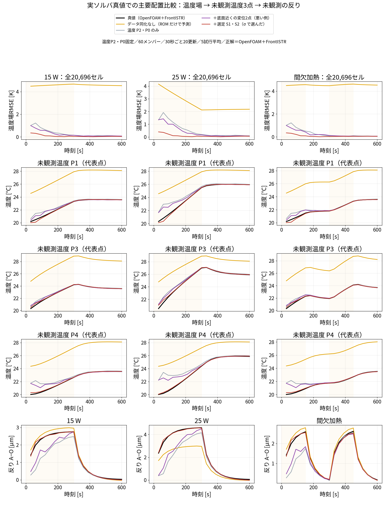

*列は15 W・25 W・15 W間欠加熱。上から、全20,696セルの温度場RMSE、未観測温度P1・P3・P4、未観測の反りUz(A)−Uz(O)。この図は温度P2・P0を固定した配置比較です。正解と同化なしも重ね、線は60メンバー平均を5試行で平均しています。温度位置を先に選ぶ新しい試験とは区別します。*

*黒＝真値、黄＝同化なし、灰＝温度のみ、紫＝底面近く、赤＝選定S1・S2。温度はP2・P0、保存済みの5 seed平均。*

**反り A−O の誤差 [µm]**（加熱期 30〜300 秒の平均）

| 変位2点をどこに置くか | 15 W | 25 W | 間欠加熱 |
|---|---:|---:|---:|
| 変位なし（温度2点のみ） | 0.769 | 1.408 | 0.630 |
| **選定2点（上面）** | **0.075** | **0.083** | **0.071** |
| 底面近く z=5 mm（悪い例） | 0.581 | 1.096 | 0.480 |

**反り以外の、観測していない量も3条件で見る**（ `run/selected_pair_unobserved_check.py` 、同じ真値・同じ設定）

| 観測していない量 | データ同化なし（15 W／25 W／間欠） | 温度2点のみ（15 W／25 W／間欠） | **＋選定2点（15 W／25 W／間欠）** |
|---|---|---|---|
| 温度場全体（RMSE） | 4.58／3.12／4.51 K | 0.54／0.88／0.53 K | **0.13／0.14／0.12 K** |
| 未観測の温度7点のうち最大 | 4.61／3.72／4.54 K | 0.90／1.48／0.85 K | **0.19／0.19／0.18 K** |
| $U_z(A)$ | 5.60／3.22／5.49 µm | 0.24／0.31／0.28 µm | **0.10／0.12／0.09 µm** |
| $U_z(O)$ | 5.37／4.59／5.35 µm | 0.94／1.69／0.87 µm | **0.09／0.10／0.09 µm** |
| 未観測の $U_z$ （D・E・F）のうち最大 | 5.50／3.84／5.42 µm | 0.64／1.06／0.64 µm | **0.12／0.12／0.12 µm** |

15 W の図は §5-2 にあります。25 W と間欠加熱の図は次のとおりです。

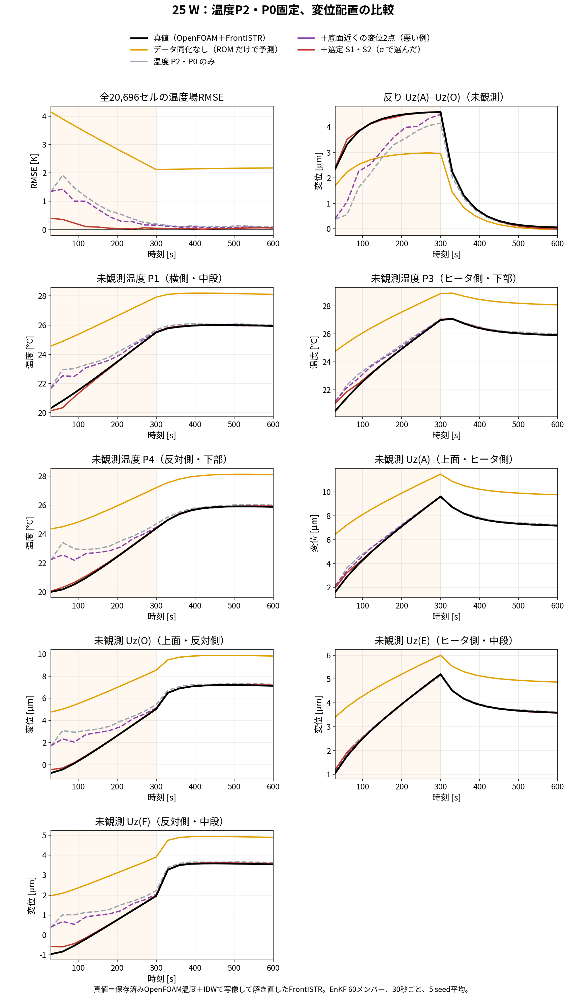

*25 W（ROM の係数を決めていない条件）。見方は §5-2 の図と同じ。*

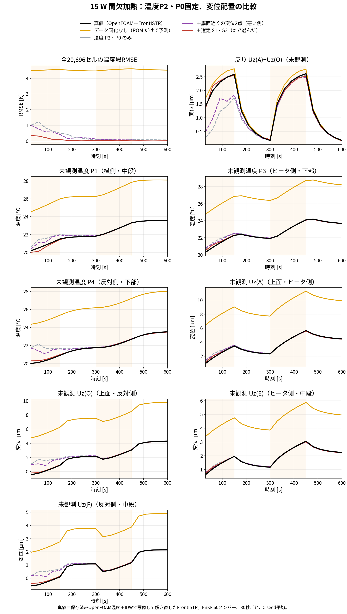

*15 W 間欠加熱（ヒータ ON は 0〜150 秒と 300〜450 秒）。見方は §5-2 の図と同じ。*

### 6-3. 分かったこと

**ROM 真値のときと同じ結論が、実ソルバ真値でも得られました。**

1. **A・O を一度も測らずに、3条件すべてで 0.07〜0.08 µm** で当てられました。
2. **3条件すべてで、A・O を直接測る（0.10〜0.15 µm）より正確**です。
3. 係数を決めていない条件（25 W・間欠加熱）でも成立します。25 W では変位なしの 1.408 µm から **17 倍**改善しました。
4. 置き場所で大きく変わります。底面近くは 25 W で 1.096 µm と、ほとんど改善しません。

> **これで切り口B（測れない場所を、測れる場所から当てる）が、実ソルバ真値でも裏づけられました。**

> **この節で分かったこと**
> - 真値を実ソルバ（OpenFOAM＋FrontISTR）にしても、**3条件すべてで 0.07〜0.08 µm** で当てられた。
> - **3条件すべてで、A・O を直接測る（0.10〜0.15 µm）より正確**。§5 と同じ結論。
> - 係数を決めていない 25 W でも成立し、変位なし（1.408 µm）から **17 倍**改善した。
> - 置き場所が悪いと 25 W で 1.096 µm ＝ ほとんど改善しない。**置き場所の設計に意味がある。**

### 6-4. 温度計も代表点以外から選ぶと、どうなるか

> **この節で知りたいこと**：ここまでの温度計 P2・P0 は ROM の代表点で、しかも2本ともヒータ側にある。温度計も**代表点以外の全セル**から σ で選び、変位計2点と一緒に決めたら、もっと良くなるか
>
> **条件**：選び方は §5-2 と同じ（4000 本の事前分布、反り A−O の σ を 30〜300 秒で平均）。真値は OpenFOAM＋FrontISTR（15 W・25 W・間欠加熱）、EnKF・5 seed

#### やったこと

1. **候補を広げる。** 温度計の候補＝代表5点を除く全セル（20,691 個）。変位計の候補＝§5-2 と同じ 14,754 個。
2. **温度計の観測行列の行を作る。** 代表点以外のセル $j$ の温度は、gappy-POD で代表5点の温度の一次式になるので、行は $\mathbf g_j=\boldsymbol\psi_jU_{rP}^{-1}$ です（代表点なら $(0,0,1,0,0)$ のような行になる）。
3. **何も測らない状態から、σ が一番小さくなる候補を1本ずつ足す。** 温度計・変位計がそれぞれ2本になったら、その種類は候補から外す（ `run/select_nonrep_temp_disp.py` ）。
4. **選んだ4本でデータ同化し、観測していない量を比べる**（ `run/selected_pair_unobserved_check.py` ）。

#### 選ばれた場所

| 順番 | 種類 | 座標 [mm] | 位置 | 足した後の σ （予測） |
|---:|---|---|---|---:|
| ― | 何も測らない | | | 1.451 µm |
| 1 | 変位 $U_x$ | (18.8, 32.5, 100.5) | 上面・+y 側 | 0.368 µm |
| 2 | 変位 $U_x$ | (18.8, −32.5, 100.5) | 上面・−y 側（1本目と鏡写し） | 0.296 µm |
| 3 | 温度 | (−30.1, −20.6, 51.6) | **反対側**・中段 | 0.280 µm |
| 4 | 温度 | (36.7, 0.8, 72.7) | **ヒータ側**・やや上 | **0.220 µm** |

- **温度計は、ヒータ側と反対側に1本ずつ**選ばれました（§0-11 の「両側に分ける」と同じ）。
- **変位計2本は、y=0 の面について鏡写しの位置**で、5点の温度への重みもほぼ同じでした。同じ量を2回測ってノイズを平均する形です。

測る前の予測 σ では、今の配置（温度 P2・P0 ＋ 変位 S1・S2）の 0.256 µm より小さくなりました。

| 配置 | 予測 σ （測る前） |
|---|---:|
| 温度 P2・P0 のみ | 1.186 µm |
| 温度 P2・P4 のみ（代表点・両側） | 0.590 µm |
| 代表点以外の温度2点のみ（σ で選んだ） | 0.499 µm |
| 温度 P2・P0 ＋ 変位 S1・S2（今の配置） | 0.256 µm |
| **代表点以外の温度2点＋変位2点（σ で選んだ）** | **0.220 µm** |

#### データ同化した結果


*上から全温度場RMSE、反りA−O、未観測温度P1・P3・P4、Uz(A)・Uz(O)・Uz(E)・Uz(F)を比較します。Eはヒータ側中段、Fは反対側中段のFEM節点です。温度P1・P3・P4と変位A・O・E・Fは、ここで比較する配置の観測には使っていません。詳細な位置は [blog009の評価点表](blog_009_two_sensors_nonrep.md) を参照してください。*

*15 W。見方は §5-2 の図と同じ。黄＝データ同化なし、青＝代表点以外の温度2点のみ、赤＝代表点以外の温度2点＋変位2点、橙＝今の配置（温度 P2・P0 ＋ 変位 S1・S2）。*

| 観測していない量（15 W／25 W／間欠） | データ同化なし | 温度 P2・P0 のみ | 代表点以外の温度2点のみ | 今の配置（P2・P0 ＋ S1・S2） | 代表点以外の温度2点＋変位2点 |
|---|---|---|---|---|---|
| 温度場全体（RMSE） | 4.58／3.12／4.51 K | 0.54／0.88／0.53 K | 0.24／0.27／0.24 K | **0.13／0.14／0.12 K** | 0.20／0.18／0.20 K |
| 反り A−O | 0.24／1.38／0.14 µm ※ | 0.77／1.41／0.63 µm | 0.23／0.26／0.19 µm | **0.075／0.083／0.071 µm** | 0.089／0.094／0.073 µm |
| $U_z(A)$ | 5.60／3.22／5.49 µm | 0.24／0.31／0.28 µm | 0.23／0.25／0.22 µm | **0.10／0.12／0.09 µm** | 0.18／0.17／0.18 µm |
| $U_z(O)$ | 5.37／4.59／5.35 µm | 0.94／1.69／0.87 µm | 0.24／0.28／0.24 µm | **0.09／0.10／0.09 µm** | 0.19／0.17／0.19 µm |

※ データ同化なしの反りが小さく見えるのは、A と O が同じ向きにずれて打ち消し合うためです（§6-2）。

25 W と間欠加熱の図：[unobserved_n_q25.png](img/unobserved_n_q25.png)、[unobserved_n_intermittent.png](img/unobserved_n_intermittent.png)

#### 分かったこと

1. **温度計は代表点以外から選んでも、データ同化できる。** 両側に分けた代表点以外の温度2点だけで、温度場 0.24 K・反り 0.23 µm。代表点 P2・P0（片側）の 0.54 K・0.77 µm より、ずっと良い結果でした。
2. **ただし、予測 σ が一番小さかった「代表点以外の温度2点＋変位2点」は、実際には今の配置より良くなりませんでした。**
   - 反り A−O は今の配置とほぼ同じか、わずかに悪い（0.089 対 0.075 µm など）。
   - 温度場、 $U_z(A)$ ・ $U_z(O)$ は、はっきり悪い（温度場 0.20 対 0.13 K、 $U_z(A)$ 0.18 対 0.10 µm）。
   - **予測 σ の順位（0.220 ＜ 0.256）が、実際の順位と逆になりました。** σ で順位が当たらない例です。
3. **考えられる理由**（どれも確かめていません）
   - **σ は反り A−O だけを見て選んでいる。** 鏡写しの変位計2本は、反り（A と O の差）にはよく効きますが、A・O それぞれの値や温度場の情報は少ない。目的を反りだけにすると、反り以外の量が犠牲になり得ます。
   - **鏡写しの2本は、ほぼ同じことを測っている。** σ の計算では「ノイズが独立なら2回測ると平均で減る」と扱いますが、実際には ROM と真値のずれ（モデル誤差）が2本に共通に乗るので、平均しても減りません。
   - **代表点以外の温度計には、復元の誤差が乗る。** 代表点以外のセルの温度は POD の5つの型で表した近似です。真値（OpenFOAM）とのずれは σ の計算のノイズ $R$ に入れていません。

> **この節で分かったこと**
> - 温度計も**代表点以外から選べる**。σ で選ぶと、ヒータ側と反対側に1本ずつ選ばれた。
> - 代表点以外の温度2点＋変位2点は、**予測 σ では今の配置より良かったが、実際のデータ同化では反りがほぼ同じ、温度場と個別の変位は悪かった**。
> - σ で選ぶときは、**目的（反りだけか、温度場や個別の変位も含むか）**と、**同じ量を測るセンサの重複・モデル誤差**を考える必要がある。今回の σ はどちらも入れていない。

---

## 7. 【検証4】配置の決め方は、既存の方法より良いか
> **この節で知りたいこと**：§5・§6 で「選定2点が良かった」のは、**決め方が良かったから**なのか。既存の配置法と比べてどうか
>
> **条件**：同じ候補集合（14,754 通り）に6つの決め方を適用し、**同じ holdout 試験**（A・O は一度も観測しない）にかける。
> 真値＝OpenFOAM＋FrontISTR、3条件 × 5 seed（`run/placement_method_comparison.py`）


### 7-1. この節は何をしたか

変位計を**どこに置くか決める方法**を6通り用意し、**決め方だけを変えて、ほかの条件は全部そろえて**比べました。

| | |
|---|---|
| **なぜやったか** | 前の節は「選定2点」と「底面近く（悪い例）」を比べただけで、**選び方そのものが良い**という証拠になっていなかった |
| **何をしたか** | 同じ候補 14,754 通りに6つの決め方を適用し、**同じ holdout 試験**（A・O を一度も観測しない）にかけた |
| **比べた相手** | 無作為配置／「よく動く点に置く」／Q-DEIM／A最適／D最適（後ろ3つは教科書的な方法） |
| **真値** | OpenFOAM＋FrontISTR。15 W・25 W・間欠加熱の3条件 × 5 seed |
| **何が得られたか** | 本研究の決め方が**3条件とも最小**（0.075／0.083／0.071 µm）。ただし2位の A最適（0.090 µm）との差は **15〜20 %** |
| **いちばんの収穫** | 「温度場全体を良く知る配置」と「反りを良く知る配置」は**別物**だと示せたこと。そして「よく動く点に置く」は**無作為より悪い**こと |

### 7-2. なぜやるか ― ここまでの比較の弱点

[§5](#5-検証2別の場所の変位で測っていない-ao-を当てられるか) で比べたのは、この4つでした。

| 比べた相手 | 反り A−O の誤差（15 W） |
|---|---:|
| 変位なし | 0.769 µm |
| **選定2点** | **0.075 µm** |
| 底面近く（悪い例） | 0.581 µm |

これで言えるのは「**選んだ点は、適当に決めた点より良かった**」だけです。
底面近くは支持点の近くでほとんど動かないので、負けて当たり前です。

> **本当に知りたいのは「σ を最小化するという選び方そのものが良いのか」です。**
> センサ配置の決め方には教科書的な方法がいくつもあります。それらと比べて初めて、
> 「この選び方が効いている」と言えます。

そこで、**選び方だけを変えて、ほかは全部同じにした比較**を行いました。

### 7-3. 土俵をそろえる

比べるときに変えてよいのは「選び方」だけです。それ以外は全部そろえます。

| そろえるもの | 中身 |
|---|---|
| 候補集合 | 全 5,040 節点 × 3 方向のうち、A・O から 12 mm 以上離れた **14,754 通り**（全手法で共通） |
| 使う情報 | FrontISTR の熱感度 $W$ と、ROM を 4,000 通り回して作った温度のばらつき $B$ だけ。**測定値は使わない** |
| センサの本数 | 温度2点（P2・P0）＋ **変位2点**（全手法で共通） |
| 試験 | A・O を**一度も観測しない** holdout。データ同化は EnKF・60 メンバー・30 秒ごと |
| 真値 | OpenFOAM の温度場 ＋ それを FrontISTR に入れた全節点変位。15 W／25 W／間欠加熱の3条件 |
| 乱数 | 同じ 5 seed |

### 7-4. 比べる6つの決め方

**「何を小さくしようとしているか」で分類**すると、次の6つになります。

| 選び方 | 何を小さくするか | 狙っている対象 |
|---|---|---|
| **ランダム** | ― （20 通りの無作為な2点） | ― （下限の目安） |
| **よく動く点に置く** | ― 温度が変わったとき**変位がいちばん大きく動く**点 | ― |
| **Q-DEIM（QR 列ピボット）** | モード応答の独立性を確保する（条件数の全球最小を保証する方法ではない） | モード係数の復元 |
| **A最適** | 温度5点の事後共分散の **trace** | **代表5点温度の分散の和** |
| **D最適** | 温度5点の事後共分散の **det** | **代表5点温度の不確かさの体積** |
| **目的指向（本研究）** | $\sigma_S^2=w^{\mathsf T}(\cdots)w$ | **反り A−O** |

A最適・D最適は実験計画法の教科書に出てくる基準です。Q-DEIM は ROM の分野で標準的な点の選び方で、
[blog_004 §4](blog_004_pod_selected_rom.md) で ROM の代表5点を選んだのと同じ方法です。

> **比較の軸はここです。**
> 今回のA最適・D最適は**代表5点の温度共分散**、Q-DEIMは**モード応答の独立性**を基準にします。全20,696セルの温度RMSEを直接最小化する方法ではありません。
> 今回の比較法のうち、目的指向は**反り A−O の予測事後分散**を基準にします（ $w$ で目的を指定）。仮定した共分散・ノイズの下での予測値であり、EnKFの実際の誤差の最小を保証するものではありません。
>
> **温度場を良く知れば、反りも良く分かるはずだ** ― これが正しいなら、A最適と本研究は同じ答えになるはずです。
> 違う答えになるなら、「目的を指定すること」に意味があることになります。

### 7-5. どこが選ばれたか ― データ同化を回す前に、場所を見る

データ同化を回す前に、**選ばれた場所そのもの**を見ます。選定はすべて机上の計算だけで終わっています。

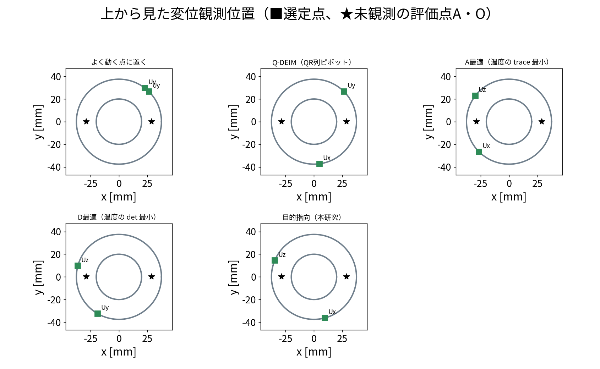

> 上面（z=100.5 mm）を真上から見た図。□＝選ばれた変位計、矢印＝測る方向（ $U_z$ は紙面に垂直なので矢印なし）、
> ●＝評価点 A・O（測らない）、赤い弧＝ヒータ側。

| 選び方 | 1点目 | 2点目 | **2点の間隔** | 測る前の予測 $\sigma$ |
|---|---|---|---:|---:|
| よく動く点に置く | (26.5, 26.5) $U_y$ | (22.8, 29.8) $U_y$ | **5.0 mm** | 1.007 µm |
| Q-DEIM | (26.5, 26.5) $U_y$ | (4.9, −37.2) $U_x$ | 67.3 mm | 0.324 µm |
| A最適 | (−29.8, 22.8) $U_z$ | (−29.8, −22.8) $U_x$ | 45.6 mm | 0.277 µm |
| D最適 | (−36.2, 9.7) $U_z$ | (−18.8, −32.5) $U_y$ | 45.6 mm | 0.353 µm |
| **目的指向（本研究）** | (9.7, −36.2) $U_x$ | (−34.6, 14.4) $U_z$ | 67.3 mm | **0.256 µm** |

座標は mm、上面なので z は省略しています。

**この時点で2つ分かります。**

**(1) 「よく動く点に置く」は、2点が 5 mm しか離れていません。**
左上のパネルで、2つの□がほとんど重なっているのが見えます。
「よく動く点」は上面の特定の向きに**固まって存在する**ので、単純に上位2つを採ると
**ほとんど同じ場所を2回測る**ことになります。 [§5-2 のステップ4](#ステップ4採点をやり直して2点目を選ぶ) で
「2位をそのまま選んではいけない」と書いたのは、まさにこれです。

**(2) 式は「A・O を直接測るのは最善ではない」と、データ同化を回す前に言っています。**
A・O 自身を測る構成の予測は 0.319 µm で、目的指向の 0.256 µm より大きい。
[§5](#5-検証2別の場所の変位で測っていない-ao-を当てられるか) の「直接測るより正確」という結果は、
**測定の前に式が予言していた**ことになります。

### 7-6. 同じ試験にかけた結果

選ばれた2点それぞれで、A・O を一度も観測しない holdout を回します。
まず、**温度と変位がどう合ったか**を見ます。


*左＝観測点（緑は目的指向が選んだ2点。他の決め方は別の場所）／中＝**温度**（P4）／右＝**変位**（反り A−O）。
真値＝OpenFOAM＋FrontISTR、15 W。*

- **中**：「よく動く点に置く」（紫）は、温度でも真値から離れたままです。2点が 5 mm しか離れておらず、
  同じ情報しか入らないためです。
- **右**：反りでは差がはっきり出ます。目的指向（赤）が真値にいちばん近く、A最適（緑）がそれに続きます。

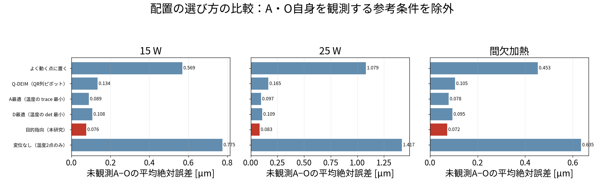

**観測していない反り A−O の誤差 [µm]**（加熱期 30〜300 秒の平均、5 seed）

| 選び方 | 15 W | 25 W | 間欠加熱 |
|---|---:|---:|---:|
| 変位なし（温度2点のみ） | 0.769 | 1.408 | 0.630 |
| ランダム（20 通りの中央値） | 0.315 | 0.471 | 0.246 |
| よく動く点に置く | 0.564 | 1.075 | 0.448 |
| Q-DEIM（QR 列ピボット） | 0.137 | 0.170 | 0.107 |
| D最適（det 最小） | 0.108 | 0.109 | 0.094 |
| A最適（trace 最小） | 0.090 | 0.098 | 0.080 |
| **目的指向（本研究）** | **0.075** | **0.083** | **0.071** |

ランダムの散らばり（20 通り）：15 W で最良 0.140 / 最悪 0.655、25 W で最良 0.153 / 最悪 1.213 µm。

### 7-7. 分かったこと

**① 「温度場を良く知れば反りも分かる」は、だいたい正しいが、最善ではありません。**
A最適（温度場を狙う）は 0.090 µm、目的指向（反りを狙う）は 0.075 µm。
**目的を指定したほうが良かった**ものの、差は 15〜20 % で、劇的ではありません。
ステップ2で立てた問いへの答えは「**目的の指定には意味があるが、効き目は限定的**」です。

**② はっきり差がつくのは「よく動く点に置く」に対してです。**
「よく動く点に置く」は 0.448〜1.075 µm で、**ランダム（0.246〜0.471 µm）より悪い**。
理由はステップ3で見たとおり、2点が 5 mm しか離れていないからです。
**よく動く点を2つ選ぶのではなく、違うことを教えてくれる2点を選ぶ**必要があります。

**③ 「何を最小化するか」が結果を決めます。**
D最適は自分の指標（logdet −25.284）では6つの中で最良です。**自分の土俵では勝っています。**
それでも反りの誤差では A最適にも目的指向にも負けました。
**温度場全体を良く知ることと、反りを良く知ることは別**だということです。

**④ 良い配置はすべて「ヒータの反対側（−x 側）」を含みます。**
図を見ると、上位4つ（Q-DEIM・A最適・D最適・目的指向）はどれも −x 側に点を持っています。
「よく動く点に置く」だけが両方とも +x 側（ヒータ側）を選び、失敗しました。
反りは「ヒータ側と反対側の温度差」で決まるので、**片側だけ見ていては差が分からない**、ということです。

**⑤ 測る前の予測 $\sigma$ の順位は、実際の順位をほぼ当てました。**

| | 1位 | 2位 | 3位 | 4位 | 5位 |
|---|---|---|---|---|---|
| 予測 $\sigma$ | 目的指向 0.256 | A最適 0.277 | Q-DEIM 0.324 | D最適 0.353 | よく動く点 1.007 |
| 実際（15 W） | 目的指向 0.075 | A最適 0.090 | **D最適 0.108** | **Q-DEIM 0.137** | よく動く点 0.564 |

**D最適と Q-DEIM だけが入れ替わりました**（順位相関 0.9）。完全ではありませんが、
**買う前・取り付ける前に、おおよその優劣は分かる**ということです。

**⑥ どの「まともな」選び方でも、A・O を直接測るより良い結果でした。**
Q-DEIM 0.137、D最適 0.108、A最適 0.090、目的指向 0.075 に対し、A・O 自身は 0.137 µm。
「**知りたい場所を測らないほうが良い**」のは、特定の選び方に固有の話ではなく、
**この問題の性質**だと考えられます（A・O の反りは 2.7 µm しかないのに、ノイズは 0.3 µm あるため）。

### 7-8. 言えること・言えないこと

| 言える | 言えない |
|---|---|
| この形状・この目的（反り A−O）・変位2点の場合、目的指向が3条件とも最小だった | 目的指向が一般に最適だということ（**2点・1形状・1目的量しか試していない**） |
| 「よく動く点に置く」は危険（ランダムより悪いことがある） | A最適が常に2位だということ |
| 目的を指定すると、温度場だけを狙う配置より良くなる（15〜20 %） | その差が実用上の意味を持つかどうか |
| 測る前の予測で順位をほぼ当てられる（順位相関 0.9） | 順位が完全に当たること（D最適と Q-DEIM は入れ替わった） |

---

## 8. 工作機械の研究全体の中での位置づけ

ここまでの検証をふまえ、**工作機械の熱変形研究のどこに本研究が入るか**を整理します。

### 8-1. 既存の4つの流派

| 流派 | やり方 | 弱点 |
|---|---|---|
| **① 回帰・機械学習** | 温度センサ多点 → 変位を回帰／CNN で予測 | 学習した運転条件の外で外れる。物理が入っていない |
| **② FEM ベースの補償** | 詳細 FEM をオフラインで解き、温度から変位を計算 | 境界条件（熱伝達率・発熱量）が合わないと外れる |
| **③ 低次元化＋状態推定** | ROM＋カルマンフィルタで温度場を推定（[ETH 2024](https://www.research-collection.ethz.ch/entities/publication/a1ddda1a-3cd6-41ad-8590-be31b19896fb) など） | **観測は温度のみ。変位は出力** |
| **④ 直接測定による補償** | 変位計で TCP を測って直接補正（[NIST の整理](https://tsapps.nist.gov/publication/get_pdf.cfm?pub_id=957076) の「直接法」） | 加工中は測れない。状態推定には戻さない |

> **③と④の間が空いています。**
> ③は変位を「出力」、④は変位を「補正対象」として扱っていて、
> **変位を「観測」として状態推定に戻す流派がありません。**

### 8-2. 切り口A：変位は「結果」ではなく「情報源」である

> **熱変形は補正すべき誤差であると同時に、温度場を知るための情報源でもある。**

**根拠は §2 の一覧表にまとめてあります。**
要点は、変位計1本が5点すべての温度に触れるので、**温度計のない点の温度まで直る**ことです。

**なぜ新しいか**：④では変位は補正量として消費され、③では観測に入っていません。
**「変位を測ると温度が分かる」という逆方向の情報の流れ**は、調べた範囲（§3）で報告が見当たりません。

> **発表での言い方**
> 従来、熱変形は補正すべき対象であった。本研究は、**熱変形を温度場推定の観測情報として用いる**ことで、
> 温度センサのない位置の温度・発熱量まで同時に推定できることを示す。

### 8-3. 切り口B：測れない場所を、測れる場所から当てる設計論（目玉）

> **工具先端は測れない。測れる場所をどこにすれば、測れない場所が当たるかを設計できる。**

| 構成 | 測っていない A−O の反りの誤差 |
|---|---:|
| 温度2点のみ | 0.756 µm |
| **選定した別の2点を測る** | **0.076 µm** |

**知りたい場所を直接測るより正確**という結果です（§5）。
しかも置き場所は、**データ同化を回す前に机上計算だけで決められます**（全 15,120 候補から選定）。

**なぜ新しいか**：④は「測れる場所を測って、そこを補正する」。
本研究は「**測れる場所を測って、測れない場所を当てる**」。さらに**その場所を設計できる**。

> **発表での言い方**
> 加工中の工具先端に変位計は置けない。本研究は、置ける位置での変位観測から、
> **一度も測らない位置の熱変形を振幅の 2.8 % の誤差で推定**し、
> さらに**その観測位置を事前計算で設計できる**ことを示す。

### 8-4. 切り口C：運転条件が変わっても使える（①への差別化）

> **回帰モデルは学習した条件を外れると外れる。物理モデル＋データ同化は外挿できる。**

真値は OpenFOAM＋FrontISTR（[blog_007](blog_007_rom_applicability.md)、[21_advantage_verification.md](21_advantage_verification.md)）。

| 条件 | 回帰式 | データ同化（温度2点＋変位2点） |
|---|---:|---:|
| 15 W（回帰式の係数を決めた条件） | 0.30 µm | **0.09 µm** |
| **25 W（決めていない条件）** | 0.29 µm | **0.10 µm** |
| 間欠加熱（ON/OFF を与える） | 0.30 µm | **0.08 µm** |

**約3分の1の誤差**です。さらに**発熱量そのものを 25.07 W と推定**できています（真値 25 W）。
これは回帰モデルには原理的にできません。

**なぜ新しいか**：①の弱点（外挿できない）を、実ソルバを真値にした試験で定量的に示しています。

### 8-5. 組み立て方の提案

**A を主、B を目玉、C を裏づけ**にするのが強いと考えます。

| 役割 | 内容 |
|---|---|
| **主張（A）** | 熱変形を「補正対象」から「**観測情報**」に位置づけ直す |
| **目玉（B）** | 測れない場所の変形を、測れる場所から**直接測定より正確に**推定（0.076 対 0.135 µm）。しかも置き場所を事前設計できる |
| **裏づけ（C）** | 係数を決めていない運転条件でも、従来の回帰補正の **1/3** の誤差。発熱量も同定できる |

### 8-6. 今の弱点と、埋める手段

| 弱点 | 埋める手段 | 状況 |
|---|---|---|
| 真値がすべて計算（実機なし） | `IoT/thermal_expansion_experiment/` の実験 | **未実施**（設計・試作案のみ） |
| 文献調査が英語5回・日本語1回 | 精密工学会・日本機械学会の論文を追加調査 | **未実施** |
| 切り口Bの holdout が ROM 真値のみ | §5 を OpenFOAM 真値でやり直す | **実施済み（§6）** |

目玉である切り口Bは、ROM の双子実験（§5）だけでなく実ソルバ真値（§6）でも確かめ、
配置の決め方も既存法と比べました（§7）。
**実ソルバを真値にした holdout 試験は実施済み**で（§6）、3条件とも同じ結論でした。残るのは実機検証と文献調査です。

---

## 9. 主張の書き方

### 9-1. 言ってよいこと

> 工作機械の熱変形補正では、温度を観測して変位を推定する形か、変位を直接測って補正する形が一般的である。
> 本研究は**温度と変位を同時に観測としてデータ同化に入れ**、温度センサのない点の温度・測っていない点の熱変形・発熱量を同時に推定した。
> とくに、**A・O を一度も観測せずに、別の場所の変位2点から反りを 0.076 µm（振幅の2.8 %）で推定**できた。これは A・O を直接測った場合（0.135 µm）より正確である。
> **調べた範囲では、この形の報告は見当たらない。**

「調べた範囲では」を必ず付けます。英語5回・日本語1回の検索だけが根拠だからです。

### 9-2. 言ってはいけないこと

| 言わない | 理由 |
|---|---|
| 「初めて提案した」 | 網羅的な文献調査をしていない |
| 「EnKF／POD／変位のデータ同化が新しい」 | いずれも既知の手法 |
| 「変位計は常に温度計より情報量が多い」 | 今回の温度場RMSEは近いが、反りの誤差には差がある。情報は推定対象・ノイズ・配置に依存（§4） |
| 「実機で有効」 | 真値はすべて計算で作ったもの |
| 「どんな機械でも有効」 | 熱源の位置が変わると配置も変わる（[blog_007](blog_007_rom_applicability.md)） |

### 9-3. 主張を強くするには（未実施）

1. **文献調査を広げる**：精密工学会・日本機械学会の論文、構造ヘルスモニタリング分野。
2. **センサ数をそろえた比較**：「温度計3本」対「温度計2本＋変位計1本」。変位計が温度計の代わりになるかを示す。
3. ~~実ソルバを真値にした holdout 試験~~ → **実施済み**（§6）。
4. **実機での検証**：`IoT/thermal_expansion_experiment/` に計画があるが、未実施。

---

## 10. 発表での位置づけ（案）

| 章 | 言うこと |
|---|---|
| 背景 | 熱変形補正では温度を測って変位を推定するのが一般的 |
| 課題 | 温度計は1本で1点しか見られない。置けない場所もある |
| **本研究の主張** | **変位も観測としてデータ同化に入れる**。変位計は5点すべての温度に触れるので、温度計のない点の温度まで直る。しかも**知りたい場所に置く必要がない** |
| 結果 | 温度場 0.503 → 0.160 K、発熱量 14.05 → 14.89 W。**A・O を測らずに反り 0.076 µm**（直接測るより正確） |
| 限界 | 計算で作った真値のみ。実機は未実施。文献調査も網羅的ではない |


## 付録：先行研究の調査

2026-10-03 に、英語5回・日本語1回の検索を行いました。**網羅的な調査ではありません。**

### 3-1. 見つかった近い研究

| 研究 | 手法 | **観測に使うもの** | 変位の扱い |
|---|---|---|---|
| [ETH Zurich (2024)](https://www.research-collection.ethz.ch/entities/publication/a1ddda1a-3cd6-41ad-8590-be31b19896fb) | カルマンフィルタ＋低次元化FEM | **温度のみ**（5軸機で25本中13本） | 推定結果（出力） |
| [Teshima et al. (2024) CIRP JMST](https://doi.org/10.1016/j.cirpj.2024.10.015) | ROM＋回帰、センサ配置指針 | 温度のみ | 出力 |
| [Tekniker](https://tekniker.es/es/methodology-for-the-design-of-a-thermal-distortion-compensation-for-large-machine-tools-based-in-state-space-representation-with-Kalman-filter) | 状態空間＋カルマンフィルタ | 主軸回転数・温度 | 出力 |
| [NIST の整理](https://tsapps.nist.gov/publication/get_pdf.cfm?pub_id=957076) | 直接法／間接法の分類 | 温度（間接法）**または**変位（直接法） | 直接法は変位を測って直接補正。状態推定はしない |
| [逆熱伝導問題（EKF）](https://openbooks.itmo.ru/en/article/18553/USING_THE_EXTENDED_KALMAN_FILTER_IN_NONSTATIONARY_THERMAL_MEASUREMENT_WHEN_SOLVING_INVERSE_HEAT_TRANSFER_PROBLEMS.html) | 拡張カルマンフィルタ | 温度のみ | ― |
| [Displacement Data Assimilation](https://arxiv.org/pdf/1602.02209) | EnKF | **変位のみ**（流体分野） | 観測として使用 |
| 日本（特許・論文） | 回帰・CNN・多点温度計測（302点） | 温度のみ | 出力 |

### 3-2. いちばん近いのは ETH Zurich (2024)

| 項目 | ETH Zurich (2024) | 本研究 |
|---|---|---|
| モデル | 低次元化した FEM | POD/Q-DEIM の ROM |
| データ同化 | カルマンフィルタ | EnKF |
| **観測** | **温度のみ**（25本中13本） | **温度2本＋変位2本** |
| 推定するもの | 温度場 → 熱変位 | 温度場・熱変形・**発熱量** |
| 結果 | 未観測温度 RMSE 2.7 ℃、熱変位 67.4 → 33.3 µm（実機） | 温度場 0.16 K、未観測の反り 0.081 µm（計算で作った真値） |
| 実装 | 本調査では公開コードを未確認 | **オープンソースで公開** |

**手法の枠組みはほぼ同じです。** 違いは「観測に変位を入れたか」「発熱量まで推定するか」「実装が公開されているか」です。
ただし ETH は**実機**で検証しており、本研究は計算で作った真値だけです。ここは明確に劣ります。

### 3-3. 分かったこと

1. 今回調べた工作機械の研究例では、**温度観測から熱変位を予測する構成**が多く見られました。すべての先行研究を分類し尽くしたという意味ではありません。
2. 変位を測る方法（直接法）もありますが、表に挙げた直接補償例は変位を補正に使います。一方、変位から温度場を逆推定する先行研究もあるため、すべての変位計測法について「温度推定には戻さない」と一般化できません（§3-4）。
3. **温度と変位を同時に観測としてデータ同化に入れた例は見つかりませんでした。**
4. 変位を観測に使うデータ同化自体は、別分野（流体、き裂）にあります。**手法として新しいわけではありません。**

---

### 3-4. 2026-10-05の補足：変位から温度を求める先行研究もある

Ansariら（2025）は、有限要素モデルと随伴法を使い、変位・ひずみ観測から構造の温度場を逆推定しています。今回確認したのは[著者所属機関の論文要旨](https://portal.fis.tum.de/en/publications/adjoint-based-recovery-of-thermal-fields-from-displacement-or-str/)と書誌情報（[DOI](https://doi.org/10.1016/j.cma.2025.117818)）で、全文の式・実装まで精査したわけではありません。

したがって、**「変位観測から温度場へ情報を戻す」こと自体には先行研究があります。** ただし、これが今回と同じ温度＋変位の逐次EnKF、Q/h同時推定、ROM、未観測変位の配置設計をすべて備える手法かどうかは、要旨だけでは判定できません。検索で同じ組合せを見つけられなかったことを、新規性の証明として使いません。

本研究の主張は、中空円筒に対するオープンソース実装と、観測配置ごとの未観測変位の改善を具体的な条件・比較結果で示したことに置きます。工作機械への応用可能性は議論しますが、実機での優位性は今後の検証です。

