# blog_008：本研究の主張 ―「温度だけでなく変位もデータ同化の観測に使う」

> **2026-10-05の読み直し：条件の区別**
> 研究対象は中空円筒の数値実験。工作機械への応用は将来の位置付けです。ROM双子実験と実ソルバ真値を区別し、温度場の精度と未観測変位の精度を別々に評価します。文献検索で見つからないことは新規性の証明ではありません。

更新日：2026-10-12（点の名前・観測条件・代表点で取り出す行列の説明を補足）

これまでの記事で、温度2点に変位2点を足すと推定が良くなることを示してきました。
この記事は、**それが研究の主張として成り立つのか**を、先行研究を調べたうえで整理したものです。

> **この記事は、本研究の「主張」と「先行研究との関係」をまとめた記事です。**
> 計算の中身は [blog_006](blog_006_temp2_disp2_step_by_step.md)（データ同化の手順）、
> [blog_007](blog_007_rom_applicability.md)（ROM の適用範囲）にあります。
> **工作機械の研究全体の中でどこに位置するか**は §8 です。

> **blog_006〜008 の役割分担**
>
> | 記事 | 扱うこと | 真値 |
> |---|---|---|
> | [blog_006](blog_006_temp2_disp2_step_by_step.md) | **データ同化の手順**。温度2点＋変位2点をどう使い、なぜ発熱量が直るか | ROM の双子実験 |
> | [blog_007](blog_007_rom_applicability.md) | **ROM の適用範囲**。条件が変わっても使えるか | **OpenFOAM＋FrontISTR** |
> | [blog_008](blog_008_novelty_displacement_assimilation.md) | **主張と先行研究**。研究としてどこが新しいか | ROM（§4・§5）と<br>**OpenFOAM＋FrontISTR**（§6・§7） |
>
> 数値は重複を避け、各記事が担当する検証だけを載せています。

## 先に、点の名前を整理する

**P0〜P4は、円筒の中で温度を計算する「代表5点」の名前です。5本の温度計を常に置いている、という意味ではありません。** ROMは5点すべての温度を計算しますが、実際に観測として使う点は、試験ごとにその一部を選びます。

| 点の名前 | どこの点か（概略座標、単位mm） | 何のための点か |
|---|---|---|
| P0 | ヒータ側・中段 $(21.3,-1.6,51.6)$ | ROMの温度代表点。P2と同じ側に温度計を置く比較で使う |
| P1 | 反対側寄り・中段 $(-14.1,33.1,51.6)$ | ROMの温度代表点・温度計の候補 |
| P2 | ヒータ側・中段 $(36.5,6.9,50.8)$ | ROMの温度代表点。ROMの発熱入力を与える点で、主な温度観測位置 |
| P3 | ヒータ側・底面近く $(35.1,0.8,0.8)$ | ROMの温度代表点・温度計の候補 |
| P4 | 反対側・底面近く $(-35.1,0.8,0.8)$ | ROMの温度代表点。ヒータ側と反対側に分けて温度計を置く比較で使う |
| S1・S2 | 円筒の上面に選んだ、別々の2点 | 変位を観測する位置。S1では横方向 $U_x$ 、S2では上下方向 $U_z$ を測る |
| A・O | 上面のヒータ側と反対側 | 推定したい変位差 $d=U_z(A)-U_z(O)$ の評価位置。§5〜7のS1・S2を使う試験ではA・Oを観測しない |

座標は $(x,y,z)$ の順で、 $z$ が高さです。P0〜P4はOpenFOAMのセル、S1・S2とA・OはFrontISTRの節点です。A・Oを観測する参考比較もあるため、**点の名前と「観測に使ったかどうか」は分けて読みます。**

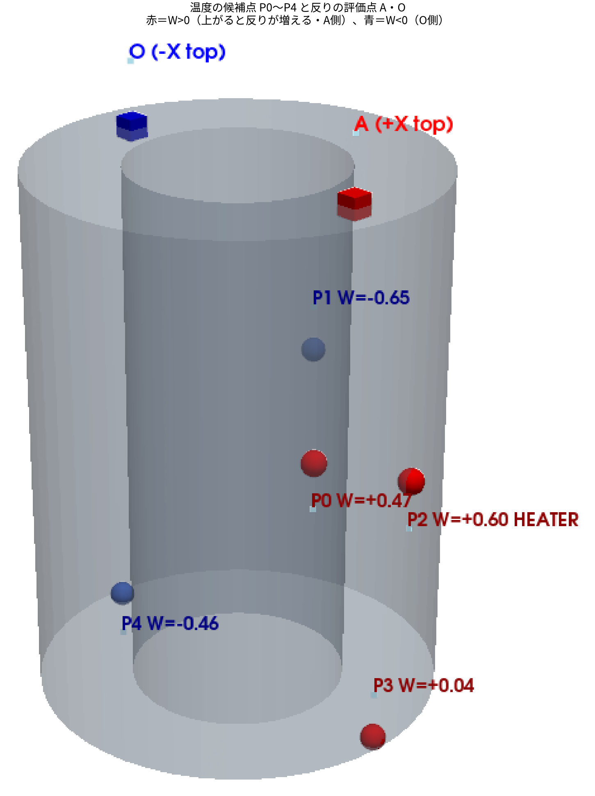

例えば「温度P2＋P4」とは、**ヒータ側の中段と、反対側の底面近くに温度計を1本ずつ置く**ことです。「温度P2＋P0」は、**ヒータ側の中段に2本置く**ことです。どちらもROM内部では、測っていない残り3点を含む5点すべてを計算・補正します。

| 本記事で出てくる比較 | 温度計の位置 | 変位計の位置 | 確かめること |
|---|---|---|---|
| 温度計の配置比較（blog_005） | 代表5点から2点を選ぶ全10組 | なし | 同じ側に2本か、両側に1本ずつか |
| §0-8の観測の組合せ比較 | P2のみ、またはP2＋P4 | なし、またはS1＋S2 | 温度観測に変位観測を加える効果 |
| §5〜7の変位計の配置比較 | **P2＋P0に固定** | S1＋S2など、置き場所を変える | 同じ温度観測の下で、変位計はどこが良いか |

**P2＋P4の結果とP2＋P0の結果は、温度計の位置が違う試験です。** 数値だけを横並びにして、変位計の効果や配置の優劣を判断しないようにします。

## この記事で確かめること

| | 内容 |
|---|---|
| **確かめたいこと** | 「温度だけでなく**変位も観測としてデータ同化に入れる**」ことが、研究の主張として成り立つか。先行研究にないか、そして実際に効果があるか |
| **検証1（§4）** | **同じ場所**に温度計を置くか変位計を置くかで差が出るか。センサの本数（4本）と場所をそろえ、**測る量だけ**を変える |
| **検証2（§5）** | 評価点 A・O を**一度も観測せず**、別の場所の変位2点だけで A・O の変形を当てられるか（[blog_004 §7-4](blog_004_pod_selected_rom.md) の未観測点で独立に評価する） |
| **検証3（§6）** | 検証2 を、真値を **OpenFOAM＋FrontISTR** にしてやり直しても同じ結論か |
| **検証4（§7）** | 変位計の**置き場所の決め方**は、既存の配置法（A最適・D最適・Q-DEIM など）より良いか |
| **真値（正解）** | 検証1・2 は ROM の双子実験、**検証3・4 は OpenFOAM＋FrontISTR**。いずれも実機ではありません |
| **共通の観測** | 温度2点（P2・P0）。ここに変位2点を足したり、場所を変えたりする |
| **ノイズ** | 温度 0.30 K、変位 0.30 µm |
| **データ同化の設定** | EnKF・60メンバー・30 秒ごと20回・seed 20260913〜17 の5回平均 |
| **評価** | 加熱期 30〜300 秒の平均。全 20,696 セルの温度、反り $U_z(A)-U_z(O)$ 、個別の $U_z(A)$ ・ $U_z(O)$ |
| **文献調査の範囲** | 2026-10-03 に英語5回・日本語1回の検索。**網羅的ではありません**（§3） |

---

> **この記事の結論**
> 1. 工作機械の熱変形補正では、**温度を観測して変位を推定する**か、**変位を直接測って補正する**かのどちらかが一般的。
> 2. **温度と変位を同時に観測としてデータ同化に入れ、温度場・発熱量まで推定した例は、調べた範囲では見当たらない。**
> 3. 手法そのもの（EnKF、POD、変位のデータ同化）は既知。本研究の貢献候補は**オープンソースでの一貫実装、未観測変位の評価、推定対象に合わせた配置の検証**。対象は工作機械を想定した中空円筒であり、工作機械実機への適用を実証したものではない。
> 4. **今回の同じ位置・同じ本数の比較では、温度場RMSEは近い値**だった（§4）。反りの推定では差があり、温度計と変位計が同じ情報を持つという結論ではない。計測可能位置が異なる利点は実務上の仮説で、実機の設置可能性は未検証。
> 5. **別の場所で変位を測れば、一度も測っていない場所の変形を、直接測るより正確に当てられた**（0.076 µm 対 0.135 µm、§5）。
> 6. 真値を **OpenFOAM＋FrontISTR** にしても、3条件すべてで同じ結論だった（§6）。
> 7. 置き場所の決め方は、**既存の配置法より良かった**（0.075 対 A最適 0.090・D最適 0.108 µm）。ただし差は 15〜20 %（§7）。

---

## この記事の構成

| 節 | 何を書いているか | そこで分かること |
|---|---|---|
| **0. 研究全体のまとめ** | 発表の流れ（9項目）に沿った全体のまとめ | 正解データ → データ同化 → ROM → 変位を使う意味 → センサ位置の選び方 |
| **1. 主張したいこと** | 一言でいうと何を言いたいのか | 記事全体の結論 |
| **2. 主張を支える計算** | どの数値がどの記事にあるかの一覧 | 根拠の所在 |
| **3. 先行研究の調査** | 英語5回・日本語1回の検索結果と、いちばん近い研究 | **温度と変位を同時に観測に入れた例は見当たらない** |
| **4.【検証1】** | 同じ場所に温度計か変位計か（本数・場所をそろえる） | **温度場RMSEは近いが、反りの誤差には差がある**。温度場と反りで評価を分ける。設置可能性は実機で未検証 |
| **5.【検証2】** | A・O を一度も測らず、別の場所の変位2点で当てる | **0.076 µm。直接測る（0.135 µm）より正確** |
| **6.【検証3】** | 検証2 を、真値を OpenFOAM＋FrontISTR にしてやり直す | **3条件とも同じ結論**（0.07〜0.08 µm） |
| **7.【検証4】** | 置き場所の決め方を、既存の配置法と比べる | **目的指向が3条件とも最小**。ただし差は 15〜20 % |
| **8. 位置づけ** | 工作機械の研究4流派と、本研究の切り口A・B・C | どこが空いていて、どこに入るのか |
| **9. 主張の書き方** | 言ってよいこと／言ってはいけないこと | 発表で使う言い方 |
| **10. 発表での位置づけ** | 章ごとに何を言うか | スライドの骨子 |

**検証の節（4〜7）はすべて同じ並びです。**
「この節で知りたいこと・条件」→「やったこと」→「結果」→「分かったこと」。

---

## 0. 研究全体のまとめ ― 発表の流れに沿って

オープンCAE学会で話す流れ（9項目）に沿って、研究全体を1か所にまとめます。各項目は「何をしたか → 結果 → 分かったこと」の順で、詳しい説明の記事にリンクしています。
§1 以降は、このうち **0-7〜0-9** を深く掘り下げた検証です。

| # | 項目 | ひとことで | 詳しく |
|---|---|---|---|
| 0-1 | OpenFOAM と FrontISTR の連携で正解データを作る | 温度場 → 熱変形を計算し、データ同化の「正解」にする | [blog_001](blog_001_cht_thermal_expansion_and_htc.md) |
| 0-2 | データ同化（OI と EnKF） | OI は発熱量が当たりにくい。EnKF は当たるが、実ソルバだと計算が重い | [blog_002](blog_002_oi_data_assimilation.md)、[blog_003](blog_003_ensemble_kalman_filter.md) |
| 0-3 | POD でモード分解 | 温度場は2つの型で 99.9 % 表せる | [blog_004 §2・§5](blog_004_pod_selected_rom.md) |
| 0-4 | Q-DEIM で代表5点を決める | 型の強さを決めるのに都合のよい5点を自動で選ぶ | [blog_004 §4](blog_004_pod_selected_rom.md) |
| 0-5 | ROM の構築 | 5点の熱回路の係数を OpenFOAM に合わせて決める。600 秒が約 31 ms | [blog_004 §6](blog_004_pod_selected_rom.md) |
| 0-6 | ROM の適用範囲 | 発熱量や加熱のしかた（間欠運転）が変わっても使える。熱源の位置が変わると作り直し | [blog_007](blog_007_rom_applicability.md) |
| 0-7 | 温度を測っても変位が合わないことがある | 温度1点だけでは、反りが 0.9〜1.7 µm 外れる | 本節、[§4](#4-検証1同じ場所なら温度計と変位計のどちらが良いか) |
| 0-8 | **温度1点＋変位2点でもデータ同化でき、精度が上がる** | 温度2点より、温度1点＋変位2点のほうが温度も反りも良い | 本節 |
| 0-9 | 何を推定したいかで、適切なセンサ位置は変わる | 推定したい量のあいまいさ σ を、熱感度 $W$ とばらつきから測る前に計算して選ぶ | [§5・§7](#5-検証2別の場所の変位で測っていない-ao-を当てられるか)、[blog_005](blog_005_optimal_sensor_placement.md) |
| 0-10 | 発表の結論：どのセンサ配置が良く、なぜ良かったのか | 温度計はヒータ側と反対側、変位計は上面の S1・S2。 $W$ と温度のばらつきから配置を選ぶ | 本節 |
| 0-11 | ブログ全体の結果で確かめる | 未観測点も合う。悪い置き方（底面・同じことを2回測る）。 $W$ だけでは決まらず、 $\sigma$ で順位が当たる | 本節 |

真値はすべて計算（ROM の双子実験、または OpenFOAM＋FrontISTR）で、**実機の測定ではありません**。

### 0-1. OpenFOAM と FrontISTR の連携で、正解データを作る

**何をしたか**：片側にヒータ（15 W）を付けた中空円筒を、OpenFOAM で空気と固体を連成して解き（CHT）、固体の温度場を求めました。その温度を FEM の節点に写して FrontISTR に入れ、熱変形を計算しました。

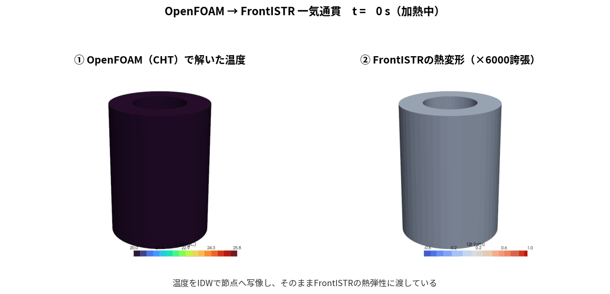

*左：OpenFOAM の温度場、右：FrontISTR の熱変形（誇張表示）。*

**分かったこと**：この温度と変形を「正解」とし、そこから取り出したセンサの値（＋ノイズ）だけで、どこまで推定できるかを以降で調べます。

### 0-2. データ同化を行った ― OI と EnKF

**何をしたか**：センサの値で計算を直す方法として、OI（最適内挿）と EnKF（アンサンブルカルマンフィルタ）を実ソルバで試しました。

| 手法 | 結果 | 問題 |
|---|---|---|
| OI | 最終温度場RMSEは約 0.09 K | 今回の固定共分散・観測条件では、**発熱量が約 8.9 W**（正解 15 W）。共分散の調整だけでは改善しなかったが、OI一般の限界を証明した結果ではない |
| EnKF | 104では最終発熱量が約 14.93 W（正解 15 W） | **5メンバー・60秒ごと10更新**でも、600秒間の現象を扱う一連の計算に**約13時間**かかった。1回の更新の時間ではない |

**分かったこと**：EnKF を使うには、予報モデルを軽くする必要がある（→ 0-3〜0-5）。

### 0-3. POD でモード分解

**何をしたか**：OpenFOAM の温度場（20,696 セル × 121 時刻）を特異値分解し、場を「型 × 時間の係数」の足し算に分けました。

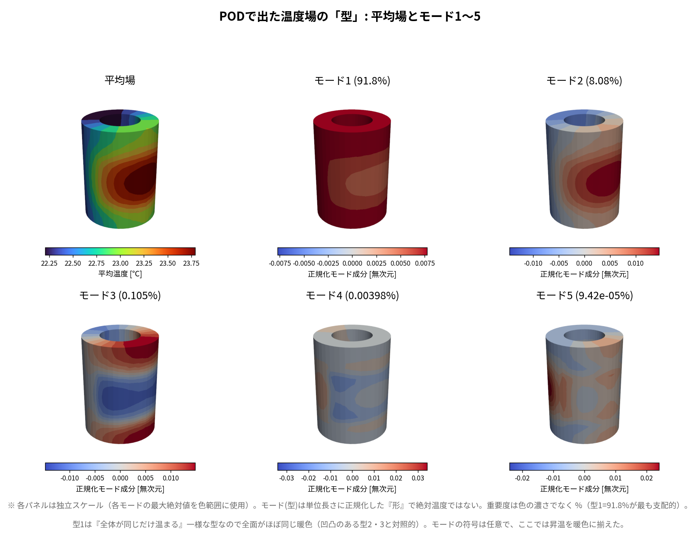

**分かったこと**：**2つの型で 99.9 %**。1つ目は全体が温まる型、2つ目はヒータ側と反対側の温度差の型（反りを決める）。安全をみて5つの型を使います。

### 0-4. Q-DEIM で代表点5点を決める

**何をしたか**：5つの型の強さを決めるのに都合のよい5点を、型の行列の QR 分解（列ピボット）で自動的に選びました。

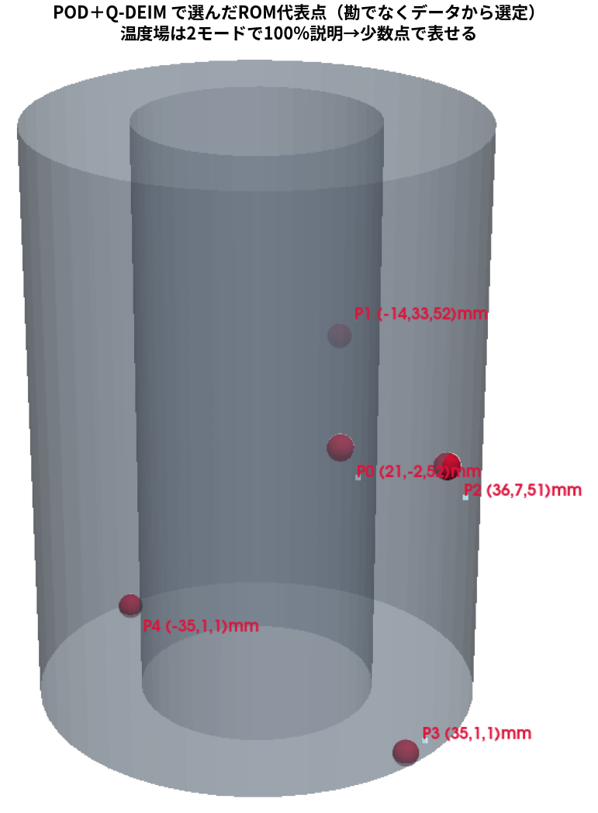

**分かったこと**：5点の温度が分かれば、gappy-POD で全 20,696 セルの温度を復元できます。

### 0-5. ROM の構築（パラメータの決定）

**何をしたか**：代表5点を熱容量 $C$ と熱の通りやすさ $K$ でつないだ熱回路（ROM）を作り、係数を OpenFOAM の温度に合うよう最小二乗で決めました。

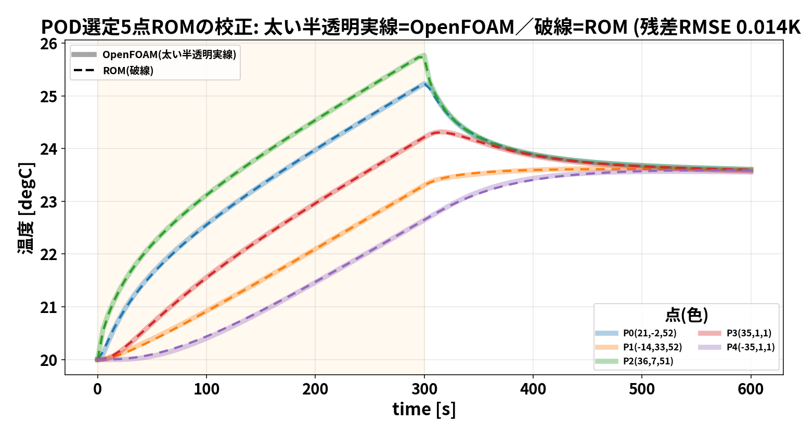

**分かったこと**：校正の残差 0.014 K。**600 秒の計算が約 31 ms**（OpenFOAM なら分〜時間のオーダー）。発熱は代表点 P2 の1点に入れる近似です（[blog_004 §6-1b](blog_004_pod_selected_rom.md)）。

### 0-6. ROM の適用範囲

**何をしたか**：ROM を作るのに使っていない条件（25 W、間欠運転）で、データ同化なしの ROM と OpenFOAM を比べました。

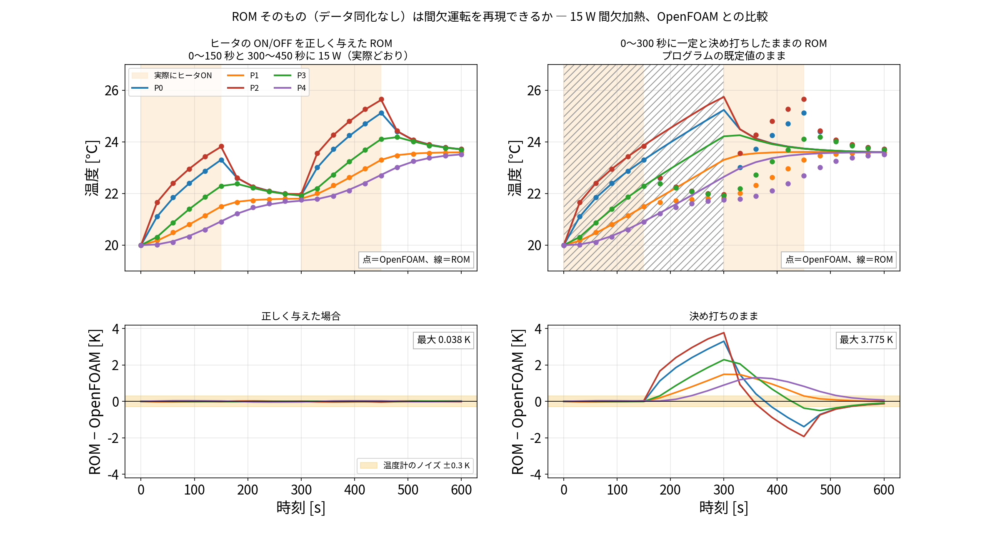

*左：ヒータの ON/OFF を OpenFOAM と同じに与えた ROM（細い破線）と OpenFOAM（太い薄い線）。右：比較のため、ON/OFF を与えなかった ROM。*

**分かったこと**

- **同じ 15 W で間欠運転にしても、ON/OFF を与えれば ROM はそのまま使える**（最大 0.038 K、温度計のノイズ 0.3 K の約 1/8）。
- 25 W でも最大 0.11 K。
- **熱源の位置や形が変わると作り直しが必要**（発熱を P2 の1点に入れ、係数をその条件で決めているため）。

### 0-7. 温度を測っても、変位が合わないことがある

**何をしたか**：従来は「温度を測って、変位は計算で出す」のが普通です。温度計1本（P2）だけでデータ同化して、観測していない反り A−O がどれだけ合うかを見ました（真値＝OpenFOAM＋FrontISTR）。

**結果**（下の 0-8 の図の灰色）

| 条件 | 温度1点だけのときの反り A−O の誤差 |
|---|---:|
| 15 W | 0.92 µm |
| 25 W | 1.70 µm |
| 15 W 間欠加熱 | 0.64 µm |

反りの大きさは最大 2.7 µm（25 W では約 4.6 µm）なので、**温度1点では反りが大きく外れます**。温度計のある P2 は合っていても、反対側の温度が分からないためです。

### 0-8. 温度1点＋変位2点でもデータ同化でき、精度が上がる

**何をしたか**：温度計1本（P2）に、上面の変位計2本（S1・S2。§5 で選んだ点）を足してデータ同化しました。比較として、温度計2本（P2・P4）の場合も回しました。真値は OpenFOAM＋FrontISTR、5 seed 平均、評価時刻は 30, 60, …, 300 秒（ `run/temp1_disp2.py` ）。S1は上面の $(x,y)\simeq(9.7,-36.2)$ mm の $U_x$ 、S2は $(-34.6,14.4)$ mm の $U_z$ です。**2点とも $U_z$ を測る構成ではありません**。

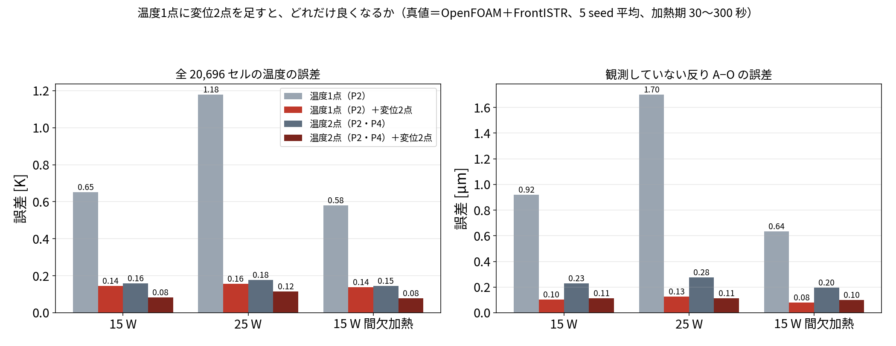

| 観測 | 温度場（15 W／25 W／間欠） | 反り A−O（15 W／25 W／間欠） | 発熱量 300 秒時点（正解 15／25／15 W） |
|---|---|---|---|
| 温度1点 | 0.65／1.18／0.58 K | 0.92／1.70／0.64 µm | 13.2／22.1／15.3 W |
| **温度1点＋変位2点** | **0.15／0.16／0.14 K** | **0.10／0.13／0.08 µm** | **14.8／24.8／14.5 W** |
| 温度2点 | 0.16／0.18／0.15 K | 0.23／0.28／0.20 µm | 14.7／24.7／14.6 W |
| 温度2点＋変位2点 | 0.08／0.12／0.08 K | 0.11／0.11／0.10 µm | 15.4／25.4／15.2 W |

（間欠加熱は、ヒータの ON/OFF を ROM に与えた場合。0〜150秒と300〜450秒がONなので、この表の30〜300秒には冷却区間も含まれます。QはON時の発熱量パラメータで、OFF時の瞬間の発熱量とは区別します。）

**表の誤差の計算方法**：温度は各時刻で全セルのRMSEを計算してから時間平均、反りは絶対誤差の時間平均（MAE）です。反りの値をRMSEと呼ばないようにします。

$$
E_T^{(s)}=\frac{1}{10}\sum_{k=1}^{10}\sqrt{\frac{1}{20696}\sum_{i=1}^{20696}\left(\widehat T_i^{(s)}(30k)-T_i^{\mathrm{true}}(30k)\right)^2}
$$

$$
E_{A-O}^{(s)}=\frac{1}{10}\sum_{k=1}^{10}\left|\widehat d^{(s)}(30k)-d^{\mathrm{true}}(30k)\right|,
\qquad d=U_z(A)-U_z(O)
$$

$s$ は5個の乱数seedの番号、 $i$ はセル番号、 $k$ は評価時刻の番号、 $\widehat T$ ・ $\widehat d$ は同化後60メンバー平均から求めた推定値です。表はさらに $\frac{1}{5}\sum_{s=1}^{5}E^{(s)}$ を載せています。A・Oの変位は観測に使っていません。発熱量の列は時間平均ではなく、**300秒の更新後のQ推定値の5 seed平均**です。

**分かったこと**

- **温度1点に変位2点を足すと、温度場の誤差は約 1/4〜1/7、反りの誤差は約 1/8〜1/13 になった**（3条件とも）。
- **温度1点＋変位2点は、温度2点よりも、温度場・反りともに良かった**（センサの合計本数は 3 本 対 2 本なので、本数をそろえた比較ではない）。
- 変位計1本の値は、5点すべての温度に重みを掛けて足したものなので、温度計のない反対側の温度まで直るためです（[blog_006 §3](blog_006_temp2_disp2_step_by_step.md)）。

### 0-9. 何を推定したいかで、適切なセンサ位置は変わる

**問い**：「〇〇に対する△△の感度」から、測る前にセンサ位置を決められないか。

**この研究で確認した答え**：反り A−O の配置設計には、温度から反りへの感度と、温度からセンサの値への感度を使います。どちらも5点温度の線形写像で表せます。ここで使う5点温度の重みは、FrontISTRの熱弾性応答にPOD復元を組み合わせたものです。

**ただし発熱量Qは、温度に重みを掛けるだけの出力ではありません。** Qや放熱コンダクタンス $h_{\mathrm{ROM}}$ の配置設計には、熱モデルを微分した $\partial T/\partial Q$ 、 $\partial T/\partial h_{\mathrm{ROM}}$ と、必要に応じて変位への写像を使います。この反りの配置試験だけでQ/hの最適配置まで実証したとは言えません。
そこで、**そのセンサを測ったとしたら、推定したい量のあいまいさ σ がどこまで小さくなるか**を、熱感度と ROM で作った温度のばらつきから計算します（測定値は使わない）。

**推定対象と使う感度の対応**（既に試したことと、今後の検証を分けます）

| 推定したい量 | 使う感度・基準 | 本研究での確認範囲 |
|---|---|---|
| 温度場 | POD基底と観測位置の関係、復元誤差 | Q-DEIM代表点と全場復元を実装。全候補配置の最適性は未証明 |
| 発熱量Q | 観測値の $\partial y/\partial Q$ を観測ノイズで規格化 | QのEnKF更新は実装済み。直接感度によるQ専用配置の性能比較は別途必要 |
| 放熱 $h_{\mathrm{ROM}}$ | $\partial y/\partial h_{\mathrm{ROM}}$ の時刻歴 | h推定は実装済み。加熱・冷却の時間情報を含む配置検証が必要 |
| Qとhの同時推定 | 両感度の独立性、ノイズ・パラメータ尺度をそろえたFisher情報 | 大きい感度だけでは識別できない。配置ごとの推定試験で確認する課題 |
| 未観測の反りA−O | 温度→反りの重み $w$ と観測感度、事後分散 $w^{\mathsf T}B^a w$ | 本記事§5〜7で配置選定とEnKFによる比較を実施 |

感度最大点が最適になる条件の導出は [blog_005 §1-2](blog_005_optimal_sensor_placement.md) に残しています。**単一パラメータ・局所線形・既知の他パラメータ・同じ観測ノイズ**という条件付きの説明です。複数パラメータや未観測変位には、そのまま一般化しません。

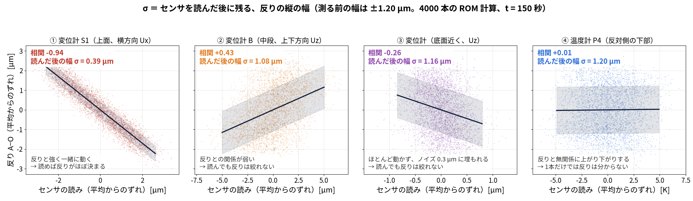

*σ ＝ センサの値が分かったときに残る、反りの縦の幅（散布図の帯の幅）。値が反りと一緒に動く（散布図が細い直線）候補ほど σ が小さい。詳しい見方と式の導き方は §5-2 ステップ3。*

**分かったこと**

- 反り A−O を狙うと、選ばれる変位計の位置は上面（S1・S2）。A・O を直接測るより正確だった（§5・§6）。
- **代表5点温度の不確かさを狙う配置（A最適）と、反りを狙う配置（目的指向）は別の場所**になり、反りの誤差は目的指向のほうが小さかった（§7）。
- 「よく動く点に置く」だけでは、2点が近くに固まって失敗した（§7）。
- 温度センサについても、反りを当てたいなら「ヒータ側と反対側に分けて置く」が良かった（[blog_005 §4-6](blog_005_optimal_sensor_placement.md)）。
- **推定したい量が変わると、選ばれる位置が変わる**。ただし試したのは主に反り A−O で、ほかの量では限られた比較のみです。

### 0-10. 発表の結論：どのセンサ配置が良く、なぜ良かったのか

**今回示したのは、温度と変位を観測として組み合わせることで、観測していない場所の温度場・熱変位も、温度だけを使う同化より良く推定できたことです。** 観測点に合うことに加え、同化に使っていない2点間変位差で効果を確かめた点が重要です。ここでの「正解」は数値解析で作ったもので、実機実験ではありません。

#### どこにセンサを置くと良かったか

| センサ | 今回良かった配置 | 分かったこと |
|---|---|---|
| 温度2点 | **ヒータ側P2と反対側P4**。概略位置はP2： $(36,7,51)$ mm、P4： $(-35,1,1)$ mm | 片側に2本置くより、両側に分ける方が良かった。ただしP2＋P4が唯一の最適配置とまでは言えない |
| 変位2点 | **上面S1の横方向変位 $U_x$ と、S2の上下方向変位 $U_z$**。S1： $(9.7,-36.2,100.5)$ mm、S2： $(-34.6,14.4,100.5)$ mm | 未観測の反りA−Oを推定する目的で選んだ配置が良かった。2本とも上下方向の変位計ではない |

座標はモデルの $(x,y,z)$ 、単位はmmです。温度点はOpenFOAMのセル、変位点はFrontISTRの節点です。**Q-DEIMで決めるROM代表点と、観測センサの位置を決めることは別の手続き**です。今回の温度配置比較では、代表5点を候補にしただけで、観測が代表点に限られるわけではありません。


*温度配置の比較：ヒータ側と反対側を測り分ける。A・Oは変位差の評価位置。*

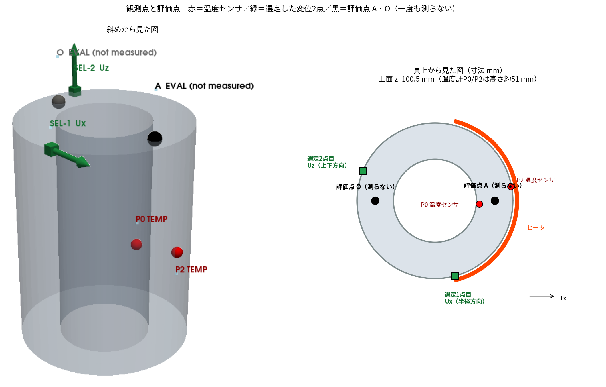

*変位配置の比較：A・Oとは別のS1・S2を測り、A・Oの変位差を評価する。*

**この2行は、別々の試験で得た知見です。** 「P2＋P4とS1＋S2を組み合わせた配置が、すべての候補の中で最適だと証明した」という意味ではありません。

- **温度配置の試験**：同じROMを正解・推定モデルにした双子実験。温度2本の全10組を比較し、P2＋P4はP0＋P2より温度場・変位の誤差が小さくなりました。両側に置く組み合わせ同士の差は、乱数によるばらつきもあり、優劣を断定できません（[blog_005 §4-6](blog_005_optimal_sensor_placement.md)）。
- **変位配置の試験**：温度P2＋P0を共通にし、変位2点の置き場所を比較しました。OpenFOAM＋FrontISTRを正解とする15 W条件では、未観測のA−Oの平均絶対誤差が、底面近くの2点で **0.581 µm**、選定した上面S1＋S2で **0.075 µm** でした（本記事§6）。

別途、P2＋P4とS1＋S2を組み合わせた試験も行っています。本記事§0-8の15 W条件では、温度2点のみから変位2点を追加すると、全温度場の誤差は **0.16 → 0.08 K**、未観測A−Oの誤差は **0.23 → 0.11 µm** に改善しました。ただし、この試験は全配置を比較した最適性の証明ではありません。

#### 理論では、Wをどう使って配置を考えるか

**「大きく動く点」ではなく、「知りたい変位差の不確かさを減らせる点」を選びます。** 手順は、感度で誤差の伝わり方を表し、候補センサを測った後に残る誤差分散を予測する、というものです。

> **σ の意味を先に一言で**：4,000 本の ROM 計算で「センサの値」と「反り」の散布図を描いたとき、値が分かった後に残る反りの縦の幅が σ です。散布図が細い直線になるセンサほど良い（§5-2 ステップ3の図）。以下はそれを行列で書いたものです。

代表5点の温度誤差を $\delta\mathbf T\in\mathbb R^5$ とします。反り $d=U_z(A)-U_z(O)$ の誤差は、線形な熱弾性応答と固定したPOD復元を用いると、

$$
\delta d=\mathbf w^{\mathsf T}\delta\mathbf T
$$

です。 $\mathbf w\in\mathbb R^5$ は、**代表5点の温度が1 Kずれたとき、A−Oが何µmずれるか**を表す感度です。

FrontISTRの全温度自由度から全変位への行列を $W$ 、代表5点の温度差からFrontISTRに渡す全温度差への復元・写像を $R_T$ 、全変位から $U_z(A)-U_z(O)$ を取り出す行ベクトルを $\mathbf l^{\mathsf T}$ とすると、

$$
\mathbf w^{\mathsf T}=\mathbf l^{\mathsf T}W R_T
$$

となります。**全場のWそのものと、代表5点への合成感度wは区別します。** 実装では、FrontISTRで事前計算したPODモードの変位応答から、この合成感度を作っています（本記事§5、[blog_006](blog_006_temp2_disp2_step_by_step.md)）。

温度誤差の共分散を $B=\mathrm{Cov}(\delta\mathbf T)$ とすると、反りの誤差分散は、

$$
\mathrm{Var}(\delta d)=\mathbf w^{\mathsf T}B\mathbf w
$$

です。したがって、**WだけでなくBも必要**です。Wは「どの温度誤差が変位に効くか」、Bは「どの温度が、どれだけ一緒に不確かになるか」を表します。

候補センサ集合 $S$ の値を温度から求める行列を $H_S$ 、観測ノイズの共分散を $R_S$ とします。温度計の行は温度の取り出し・POD復元、変位計の行は温度からその方向の変位への合成感度です。線形・ガウスの仮定では、センサを付けた後でも残る温度の分からなさの表（共分散）は、

$$
B_S^a=B-BH_S^{\mathsf T}
\left(H_SBH_S^{\mathsf T}+R_S\right)^{-1}H_SB
$$

と予測できます。ここで上付き $a$ は補正後を表します。温度と変位を混ぜる場合も、それぞれのノイズ分散を $R_S$ に入れて単位・精度の違いを反映します。今回の標準偏差は温度0.30 K、変位0.30 µmです。

最後に、候補ごとの

$$
\sigma_{d,S}^2=\mathbf w^{\mathsf T}B_S^a\mathbf w
$$

を比べます。**同じセンサ数で、この値が小さい配置を優先する**のが今回の考え方です。実際には30〜300秒の各時刻で予測した標準偏差を平均して採点し、変位2点は1点ずつ貪欲に追加しています。全ペアの総当たりによる最適解とは区別します。

直感的には、ヒータ側だけを測ると、反対側の温度が不確かなまま残り、左右の伸びの差が外れます。両側の温度、あるいはその温度分布の違いを映す変位を測れば、反りに効く不確かさを減らせます。ただし、互いに似た情報しか持たないセンサを増やしても効果は限られるため、感度の大きさだけでは選べません。

**理論と計算結果の一致は、どこまで確認したか。** 温度2点のROM双子実験では、この基準による予測順位とEnKFで得た反り誤差の順位相関は0.98でした。一方、温度1点では順位相関は0.5にとどまりました。したがって、配置を物理・統計的に説明する基準にはなりますが、有限メンバーの逐次EnKFの最終誤差を常に最小にする保証ではありません。

> **OpenCAE発表での結論**
> 温度・変位観測を併用したEnKFにより、未観測の温度場と2点間熱変位差の推定精度が改善した。さらに、FrontISTR由来の熱感度とROMの予報共分散を組み合わせ、推定したい変位差に適した観測配置を事前に選定できることを、今回の数値実験で示した。

### 0-11. ブログ全体の結果で確かめる ― 3つの問いへの答え

0-10 の結論を、blog_001〜008 の結果を集めて確かめます。問いは次の3つです。

| 問い | 答え（先に） |
|---|---|
| **問い1**：データ同化で、**観測していない点**の温度と変位も合うようになったか | **なった。** 温度計の少ない状態に変位計を足すと、未観測の温度場と反りの誤差が数分の1〜1/10程度になった |
| **問い2**：センサはどこに置くと良く、どこに置くと悪かったか | 良い：温度計は**ヒータ側と反対側に分ける**、変位計は**上面（自由端）で、ヒータの反対側を含む離れた2点**。悪い：**底面の近く**、**同じことを2回測る置き方** |
| **問い3**：熱感度 $W$ だけで場所は決まるか。理論はどこまで当たったか | **$W$ だけでは決まらない。** $W$ と温度のばらつきから計算した $\sigma$ （0-10）で、**順位なら**予測できた |

#### 問い1：観測していない点も合うようになったか

**観測した点が合うのは、データ同化なら当たり前です。** 大事なのは、観測していない点が合うかどうかです。
各記事で観測に使わない点（未観測点）を評価してきました。並べると、どれも同じ向きの結果です。

| 何を足したか | 真値 | 観測していない量の誤差 | 詳しく |
|---|---|---|---|
| 温度1点 → ＋変位2点 | OpenFOAM＋FrontISTR（15 W） | 温度場 0.65 → **0.15 K**、反り A−O 0.92 → **0.10 µm** | 0-8 |
| 温度2点 → ＋変位2点（A・O は測らない） | OpenFOAM＋FrontISTR（15 W・25 W・間欠） | 反り 0.63〜1.41 → **0.07〜0.08 µm** | §6 |
| 温度1点 → 2点 → ＋変位2点 | ROM | 温度 0.617 → 0.197 → **0.159 K**、反り 0.869 → 0.151 → **0.077 µm** | [blog_003 §6-1](blog_003_ensemble_kalman_filter.md) |
| 観測していない向き（ $U_x$ ）と点（B・C） | ROM | 17〜195 倍改善。**観測点と同じくらいの割合で直る** | [blog_004 §7-5](blog_004_pod_selected_rom.md) |
| 温度計を1本も使わず、変位計2本だけ | ROM | 温度場 **0.207 K**（温度計2本 P2＋P0 だけの 0.453 K より良い） | [blog_004 §7-4c](blog_004_pod_selected_rom.md) |

**なぜ観測していない点まで合うのか。** データ同化が直しているのは、センサの値そのものではなく、**ROM の代表5点の温度と発熱量・放熱**です。
そこから全セルの温度（gappy-POD）と全節点の変位（FrontISTR の応答）を計算し直すので、観測していない点も一緒に直ります（[blog_006 §3](blog_006_temp2_disp2_step_by_step.md)）。

```
センサの値と予測のずれ
   ↓ カルマンゲイン（60メンバーの共分散から計算）
代表5点の温度・発熱量・放熱を直す
   ↓ gappy-POD／FrontISTR の応答
全セルの温度・全節点の変位が直る（観測していない点も）
```

**注意**

- 真値はすべて計算です。実機では確かめていません。
- 「変位計を足すと良くなる」比較では、センサの本数が増えています。
- **同じ場所・同じ本数なら、温度場では温度計と変位計は互角**でした（0.132 対 0.145 K）。反りでは変位計のほうが良い結果でした（0.135 対 0.201 µm、§4）。変位計の価値は「情報量が多い」ことではなく、**温度計を置けない場所に置けること**です。

#### 問い2：どこに置くと良く、どこに置くと悪かったか

0-10 では「良かった配置」を示しました。ここでは**悪かった配置も並べて**、何が効いているのかを見ます。

**温度計**

| 試したこと | 良かった置き方 | 悪かった置き方 | 詳しく |
|---|---|---|---|
| 温度計2本の全10通り（ROM） | **両側に分ける**（P2＋P4：温度場 0.16 K、反り 0.24 µm） | 同じ側に2本（P0＋P2：0.33 K、0.53 µm） | [blog_005 §4-6](blog_005_optimal_sensor_placement.md) |
| 代表点でないセルに置く（ROM） | 両側に分ける（0.258 K） | 同じ側に2本（0.306 K） | [blog_007 §10](blog_007_rom_applicability.md) |
| 「よく効く点」を上から2つ選ぶ（ROM） | 30 mm 離した2点（0.35 K） | 1.6 mm しか離れていない隣どうし（0.91 K。2点の温度の相関 1.00000） | [blog_005 §4-2](blog_005_optimal_sensor_placement.md) |

効いているのは「代表点かどうか」ではなく、**ヒータ側と反対側に分かれているか、2本が同じことを測っていないか**です。

**変位計**

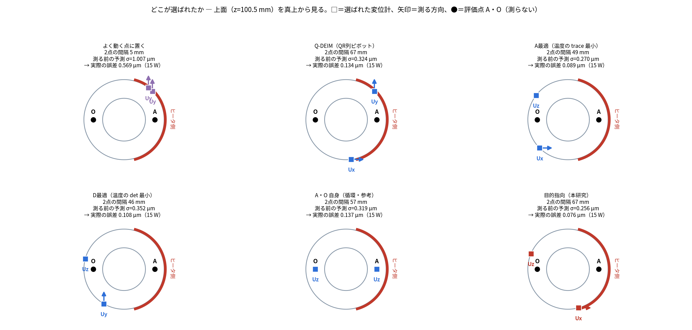

*上面を真上から見た図。□＝選ばれた変位計、矢印＝測る向き、●＝評価点 A・O（測らない）、赤い弧＝ヒータ側。「よく動く点に置く」だけ、2つの□がほぼ重なっている。*

| 試したこと | 良かった置き方 | 悪かった置き方 | 詳しく |
|---|---|---|---|
| 熱感度 $W$ が大きい点と小さい点（OI、ROM） | 上端の2点（温度 0.86 K） | 底面近くの2点（2.43 K。変位なしは 3.52 K） | [blog_002 §5](blog_002_oi_data_assimilation.md) |
| 置く高さ（OpenFOAM＋FrontISTR） | 上面の S1・S2（反り 0.075 µm） | 底面近く（0.58〜1.10 µm） | §6 |
| 選び方6通り（OpenFOAM＋FrontISTR） | 本研究の選び方 0.075 µm、A最適 0.090 µm | 「よく動く点」の上位2つ（2点の間隔 5 mm）0.564 µm。**ランダム（0.315 µm）より悪い** | §7 |

- **底面の近くは置いても効きません。** 底面は支持点（3節点）の近くで、温度が変わってもほとんど動かないからです。
- **「よく動く点」を上から2つ選ぶと失敗します。** よく動く点は一か所に固まっているので、ほとんど同じ場所を2回測ることになります。
- 良い配置は、どれも**ヒータの反対側**に点を持っていました。反りは「ヒータ側と反対側の温度差」で決まるので、片側だけ見ていては差が分かりません。

> **温度計にも変位計にも共通するのは、「ヒータ側と反対側の両方の情報を取る」「同じことを2回測らない」の2つです。**

#### 問い3：熱感度 $W$ だけで場所は決まるか。理論はどこまで当たったか

**段階① $W$ だけで分かるのは「置いても無駄な場所」**

$W$ が小さい場所（底面の近く）には、変位計を置いても効きません（[blog_002 §4・§5](blog_002_oi_data_assimilation.md)）。
しかし、 **$W$ が大きい順に選ぶと失敗します。**

| センサ | $W$ が大きい順に選んだ結果 | 詳しく |
|---|---|---|
| 変位計 | 上位2点が 5 mm しか離れておらず、ランダムより悪い（0.564 µm） | §7 |
| 温度計1本 | 反りへの $W$ が最大の P1 に置いても反りは当たらない（0.92 µm）。一番良かったのは $W$ が最小の P3（0.68 µm） | [blog_005 §4-6](blog_005_optimal_sensor_placement.md) |

温度計について $W$ が教えてくれるのは、「**温度の推定がずれると、反りが大きくずれる点はどこか**」＝「**温度を正確に推定しておく必要がある点はどこか**」です。センサを置くべき点そのものではありません。

**段階② $W$ ＋ 温度のばらつきで、測った後に残る誤差 $\sigma$ を計算する**

σ は「センサの値が分かったときに残る、反りの縦の幅」です（§5-2 ステップ3の散布図）。センサが1本だけなら、

$$
\sigma^2=\mathrm{Var}(d)-\frac{\mathrm{Cov}(d,\,y)^2}{\mathrm{Var}(y)+r},\qquad
\Delta\sigma_d^2=\frac{\mathrm{Cov}(d,\,y)^2}{\mathrm{Var}(y)+r}
$$

（ $\Delta\sigma_d^2$ ：測ることで減る反りの分散。導き方は §5-2 ステップ3 (b′)。 $d$ ：反り、 $y$ ：センサの値、 $r$ ：センサのノイズの分散）

効くのは「 $W$ が大きいこと」ではなく、**「推定したい反り $d$ と一緒に動くこと（共分散が大きい）」**です。2本目以降は、**1本目で分かったことと重ならないこと**も必要です。
問い2の「両側に分ける」「同じことを2回測らない」は、この式から出てきます。「両側に分ける」は勘ではなく、反りへの感度 $w$ の符号（ヒータ側の P0・P2 が＋、反対側の P1・P4 が−）から出てきます。

**段階③ 実際にどこまで当たったか**

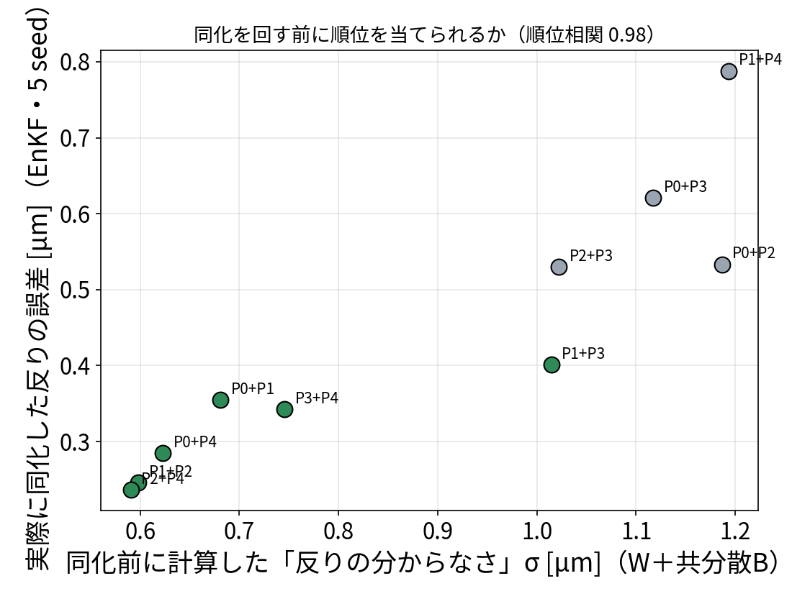

*横軸：データ同化の前に計算した $\sigma$ 、縦軸：データ同化した後の実際の反りの誤差。温度計2本の全10通り（ROM の双子実験）。*

| 対象 | 測る前の予測と、実際の順位の相関 | 真値 | 詳しく |
|---|---:|---|---|
| 温度計2本の全10通り | **0.98** | ROM | [blog_005 §4-6](blog_005_optimal_sensor_placement.md) |
| 変位計の選び方6通り | **0.9** | OpenFOAM＋FrontISTR | §7 |
| 温度計1本 | 0.5（**当たらない**） | ROM | [blog_005 §4-6](blog_005_optimal_sensor_placement.md) |

**この理論で言えないこと**

| 限界 | 内容 |
|---|---|
| 当たるのは順位だけ | 予測の値（例：0.59 µm）と実際の誤差（0.24 µm）は合わない |
| 1回の更新だけで計算すると当たらない | 最初の予報だけで計算した値は、20回データ同化した後の誤差の順位と一致しなかった（[blog_005 §6-1](blog_005_optimal_sensor_placement.md)）。**30〜300 秒の各時刻で計算して平均する**必要がある |
| 温度計1本では差が出ない | 1本の候補どうしでは $\sigma$ がほとんど変わらず、順位を当てられなかった |
| 熱源の位置が前提 | 熱源の位置を間違えると、順位相関が 0.72〜0.73 に下がった。発熱量・放熱・初期温度のずれには強い |
| 確かめた目的は反り A−O だけ | 発熱量や放熱を推定したい場合の配置は、比較試験をしていない |
| 温度計と変位計を同時には選んでいない | 温度計は温度計だけで、変位計は温度計 P2＋P0 を固定して選んだ |

#### まとめと、残っている課題

> 1. **データ同化で、観測していない点の温度と反りも合うようになった。** 温度計の少ない状態に変位計を足すと、未観測の温度場と反りの誤差が数分の1〜1/10程度になった（OpenFOAM＋FrontISTR を真値にした3条件でも同じ）。
> 2. **良い置き方は、温度計は「ヒータ側と反対側に分ける」、変位計は「上面で、ヒータの反対側を含む離れた2点」。** 底面の近くや、同じことを2回測る置き方は効かない。
> 3. **熱感度 $W$ だけでは決まらない。 $W$ と ROM の温度のばらつきから計算した $\sigma$ で、測る前に順位を予測できた**（順位相関 0.9〜0.98）。ただし順位まで、反りが目的の場合、熱源の位置が分かっている場合に限る。

**残っている課題**

- §5〜§7 の温度計 P2＋P0 は、**2本ともヒータ側にある**組み合わせです。温度だけでデータ同化すると、両側に分けた P2＋P4 の約2倍の誤差になります。§5〜§7 の変位計の比較を P2＋P4 でやり直す計算はしていません（0-8 の P2＋P4＋S1・S2 は、変位計の置き場所を比較した試験ではありません）。
- 温度計と変位計の置き場所を、同じ $\sigma$ の式でまとめて選ぶ試験はしていません。
- 数値を比べるときは、同じ表の中で比べてください。例えば A・O を直接測った場合の反りの誤差は、[blog_004 §7-4b](blog_004_pod_selected_rom.md) では 0.077 µm、§5 では 0.135 µm です。変位の計算方法と集計時間が違うためです。

---

## 1. 主張したいこと

> **今回比較した中空円筒の条件では、適切に選んだ変位観測を温度観測に加えると、未観測の熱変位推定が改善しました。** 全対象・全配置で併用が最良という主張ではありません。
> 変位観測と温度状態の共分散により、温度計のない点も更新できます。ただし、更新が必ず改善を意味するわけではなく、発熱量の同定には主に温度観測が寄与した試験もあります。
> そして**変位計は、知りたい場所に置く必要がない**。別の場所で測って、測っていない場所の変形を当てられる。

この主張を支える計算結果と、先行研究との関係を以下にまとめます。

---

## 2. 主張を支える計算 ― どこに何があるか

この記事は**主張と位置づけ**を扱います。計算の中身はそれぞれの記事にあるので、ここでは一覧だけ示します。

| 主張を支える事実 | 数値 | どの記事に |
|---|---|---|
| 変位は5点の温度の足し算なので、**変位計1本が5点すべてに触れる** | 熱感度 $W$ の行が全点に非ゼロ | [blog_006 §7-1](blog_006_temp2_disp2_step_by_step.md) |
| **温度計のない点の温度が、変位計だけで直る** | $t=30$ 秒で P3 を −4.97 K、P4 を −7.67 K | [blog_006 §7-5b](blog_006_temp2_disp2_step_by_step.md) |
| 温度計のずれが 0 になった後も、変位計だけが温度場を直す | $t=150$ 秒で温度の寄与 0.000 K | 同上 |
| **変位を足すと温度も発熱量も当たる** | 温度場 0.503 → **0.160 K**、 $Q$ 14.05 → **14.89 W**（真値 15 W） | [blog_004 §7-6](blog_004_pod_selected_rom.md)、[blog_006 §15](blog_006_temp2_disp2_step_by_step.md) |
| **係数を決めていない条件でも成立**（実ソルバ真値） | 25 W で反り 0.74 → **0.09 µm**、発熱量 **24.91 W**（真値 25 W） | [blog_007](blog_007_rom_applicability.md)、[21](21_advantage_verification.md) |
| **ROM は条件が変わっても使える** | 25 W・間欠加熱とも全セルがノイズ 0.3 K 未満 | [blog_007 §6](blog_007_rom_applicability.md) |
| **配置の選び方が既存法より良い** | 目的指向 0.075 対 A最適 0.090・D最適 0.108・Q-DEIM 0.137 µm（15 W） | §7 |

この記事で**新しく行った検証**は4つです。

| 検証 | 知りたいこと | 真値 |
|---|---|---|
| **§4** | 同じ場所に温度計を置いたらどうなるか（変位計は本当に有利か） | ROM |
| **§5** | A・O を一度も測らずに、別の場所の変位2点で当てられるか | ROM |
| **§6** | §5 を、真値を実ソルバにしてやり直しても同じか | OpenFOAM＋FrontISTR |
| **§7** | 置き場所の決め方は、既存の配置法より良いか | OpenFOAM＋FrontISTR |

---

## 3. 先行研究の調査

2026-10-03 に、英語5回・日本語1回の検索を行いました。**網羅的な調査ではありません。**

### 3-1. 見つかった近い研究

| 研究 | 手法 | **観測に使うもの** | 変位の扱い |
|---|---|---|---|
| [ETH Zurich (2024)](https://www.research-collection.ethz.ch/entities/publication/a1ddda1a-3cd6-41ad-8590-be31b19896fb) | カルマンフィルタ＋低次元化FEM | **温度のみ**（5軸機で25本中13本） | 推定結果（出力） |
| [Teshima et al. (2024) CIRP JMST](https://doi.org/10.1016/j.cirpj.2024.10.015) | ROM＋回帰、センサ配置指針 | 温度のみ | 出力 |
| [Tekniker](https://tekniker.es/es/methodology-for-the-design-of-a-thermal-distortion-compensation-for-large-machine-tools-based-in-state-space-representation-with-Kalman-filter) | 状態空間＋カルマンフィルタ | 主軸回転数・温度 | 出力 |
| [NIST の整理](https://tsapps.nist.gov/publication/get_pdf.cfm?pub_id=957076) | 直接法／間接法の分類 | 温度（間接法）**または**変位（直接法） | 直接法は変位を測って直接補正。状態推定はしない |
| [逆熱伝導問題（EKF）](https://openbooks.itmo.ru/en/article/18553/USING_THE_EXTENDED_KALMAN_FILTER_IN_NONSTATIONARY_THERMAL_MEASUREMENT_WHEN_SOLVING_INVERSE_HEAT_TRANSFER_PROBLEMS.html) | 拡張カルマンフィルタ | 温度のみ | ― |
| [Displacement Data Assimilation](https://arxiv.org/pdf/1602.02209) | EnKF | **変位のみ**（流体分野） | 観測として使用 |
| 日本（特許・論文） | 回帰・CNN・多点温度計測（302点） | 温度のみ | 出力 |

### 3-2. いちばん近いのは ETH Zurich (2024)

| 項目 | ETH Zurich (2024) | 本研究 |
|---|---|---|
| モデル | 低次元化した FEM | POD/Q-DEIM の ROM |
| データ同化 | カルマンフィルタ | EnKF |
| **観測** | **温度のみ**（25本中13本） | **温度2本＋変位2本** |
| 推定するもの | 温度場 → 熱変位 | 温度場・熱変形・**発熱量** |
| 結果 | 未観測温度 RMSE 2.7 ℃、熱変位 67.4 → 33.3 µm（実機） | 温度場 0.16 K、未観測の反り 0.081 µm（計算で作った真値） |
| 実装 | 本調査では公開コードを未確認 | **オープンソースで公開** |

**手法の枠組みはほぼ同じです。** 違いは「観測に変位を入れたか」「発熱量まで推定するか」「実装が公開されているか」です。
ただし ETH は**実機**で検証しており、本研究は計算で作った真値だけです。ここは明確に劣ります。

### 3-3. 分かったこと

1. 今回調べた工作機械の研究例では、**温度観測から熱変位を予測する構成**が多く見られました。すべての先行研究を分類し尽くしたという意味ではありません。
2. 変位を測る方法（直接法）もありますが、表に挙げた直接補償例は変位を補正に使います。一方、変位から温度場を逆推定する先行研究もあるため、すべての変位計測法について「温度推定には戻さない」と一般化できません（§3-4）。
3. **温度と変位を同時に観測としてデータ同化に入れた例は見つかりませんでした。**
4. 変位を観測に使うデータ同化自体は、別分野（流体、き裂）にあります。**手法として新しいわけではありません。**

---

### 3-4. 2026-10-05の補足：変位から温度を求める先行研究もある

Ansariら（2025）は、有限要素モデルと随伴法を使い、変位・ひずみ観測から構造の温度場を逆推定しています。今回確認したのは[著者所属機関の論文要旨](https://portal.fis.tum.de/en/publications/adjoint-based-recovery-of-thermal-fields-from-displacement-or-str/)と書誌情報（[DOI](https://doi.org/10.1016/j.cma.2025.117818)）で、全文の式・実装まで精査したわけではありません。

したがって、**「変位観測から温度場へ情報を戻す」こと自体には先行研究があります。** ただし、これが今回と同じ温度＋変位の逐次EnKF、Q/h同時推定、ROM、未観測変位の配置設計をすべて備える手法かどうかは、要旨だけでは判定できません。検索で同じ組合せを見つけられなかったことを、新規性の証明として使いません。

本研究の主張は、中空円筒に対するオープンソース実装と、観測配置ごとの未観測変位の改善を具体的な条件・比較結果で示したことに置きます。工作機械への応用可能性は議論しますが、実機での優位性は今後の検証です。

## 4. 【検証1】同じ場所なら、温度計と変位計のどちらが良いか
> **この節で知りたいこと**：「変位計は5点すべての温度に触れるから有利」は本当か。同じ場所に温度計を置いたらどうなるか
>
> **条件**：センサの本数（計4本）と場所をそろえ、**測る量だけ**を変える。温度2点（P2・P0）は共通、A・O に温度計2本 or 変位計2本。真値＝ROM の双子実験、EnKF・5 seed・加熱期 30〜300 秒


「変位計のほうが情報量が多いから良い」のかを確かめるため、**同じ場所に温度計を置いた場合**と比べました。
センサの本数（計4本）と場所をそろえ、変えるのは「そこで何を測るか」だけです（`run/disp_vs_temp_same_place.py`）。

### 4-1. どこに何を置いたか

| 記号 | 座標 [mm] | 何を測るか |
|---|---|---|
| **P2** | (36.5, 6.9, 50.8) ヒータ側・中段 | 温度（4構成すべて共通） |
| **P0** | (21.3, −1.6, 51.6) 同じヒータ側・中段 | 温度（4構成すべて共通） |
| **A** | (28.7, 0, 100.5) 上面・ヒータ側 | 構成により **温度** または **変位 $U_z$** |
| **O** | (−28.7, 0, 100.5) 上面・反対側 | 同上 |

- **変位計**は A・O の FEM 節点そのものに置きます。
- **温度計**は A・O にいちばん近い OpenFOAM セル、(26.6, −1.6, 98.8) と (−26.6, −1.6, 98.8) mm に置きます（代表5点ではないセルですが、[blog_007 §10](blog_007_rom_applicability.md) のとおりデータ同化できます）。
- **評価しているのも同じ A・O** なので、この節の結果は循環を含みます。循環を断った試験は §5です。なお「直接測るより正確」は、A/Oにノイズ付き観測を与えて同化した比較ケースより誤差が小さかった、という意味です。計測器の精度を上回ると一般化した結論ではありません。

4つの構成は次のとおりです。

| 構成 | 観測の中身 | 本数 |
|---|---|---:|
| 温度2点のみ | 温度 P2・P0 | 2 |
| ＋A/O に温度計2本 | 温度 P2・P0・**A・O**（計4点とも温度） | 4 |
| ＋A/O に変位計2本（本番） | 温度 P2・P0 ＋ **変位 A・O の $U_z$** | 4 |
| ＋両方 | 温度 P2・P0・A・O ＋ 変位 A・O | 6 |

### 4-2. 結果

まず、**どこを測って、温度と変位がどう合ったか**を見ます。

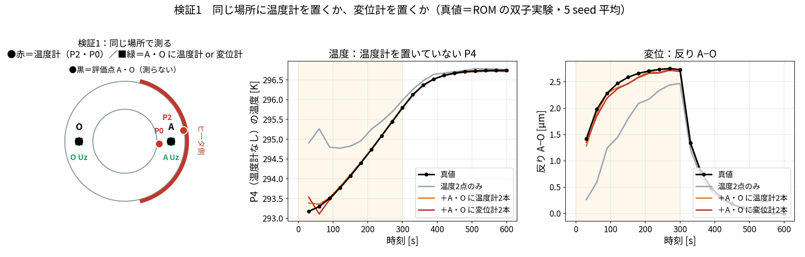

*左＝観測点と評価点（上面を真上から見た図）／中＝**温度**：温度計を置いていない代表点 P4 の時刻歴／
右＝**変位**：反り A−O の時刻歴。黒が真値、色が各構成。帯は加熱中（0〜300 秒）。*

- **中**：温度2点のみ（灰）は真値から離れますが、A・O に温度計を足しても変位計を足しても、ほぼ同じように真値に重なります。
- **右**：反りも同様で、**温度計（橙）と変位計（赤）の差はほとんど見えません**。

誤差を加熱期で平均すると次のようになります。

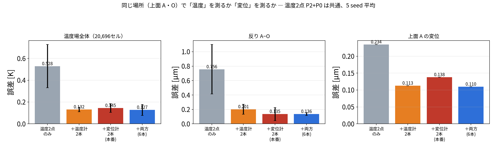

| 観測（温度2点 P2＋P0 は共通） | 温度場全体 | 反り A−O | Uz(A) | Uz(O) |
|---|---:|---:|---:|---:|
| 温度2点のみ | 0.528 K | 0.756 µm | 0.234 µm | 0.922 µm |
| ＋ A/O に**温度計**2本 | **0.132 K** | 0.201 µm | **0.113 µm** | 0.154 µm |
| ＋ A/O に**変位計**2本（本番） | 0.145 K | **0.135 µm** | 0.138 µm | **0.104 µm** |
| ＋ 両方（計6本） | 0.127 K | 0.136 µm | 0.110 µm | 0.117 µm |

seed ごとに対応をとった勝敗（変位計が温度計より良かった回数、5回中）：

| 評価する量 | 変位計が良かった回数 |
|---|---:|
| 温度場全体 | 2 / 5 |
| **反り A−O** | **4 / 5** |
| Uz(A) | 0 / 5 |
| **Uz(O)** | **5 / 5** |

### 4-3. 分かったこと（主張の修正）

- **温度場全体を当てるなら、同じ場所なら温度計と変位計はほぼ互角**です（0.132 対 0.145 K、差は seed のばらつきに埋もれる）。
- **反りを当てるなら変位計のほうが良い**（0.135 対 0.201 µm、5回中4回）。知りたい量を直接測っているためです。

> **したがって「変位計は情報量が多いから優れている」とは言えません。**
> 変位計の価値は、**温度計を置けない場所に置けること**にあります。
> 工作機械では、加工中の工具先端や内部に熱電対を入れられませんが、変位計なら外側から測れます。

> **この節で分かったこと**
> - **今回の同じ位置・同じ本数の比較では、温度場RMSEは近い値**。温度場全体では温度計がわずかに良い（0.132 対 0.145 K、差は seed のばらつき内）。
> - **反りを当てるなら変位計が良い**（0.135 対 0.201 µm、5 seed 中4回）。知りたい量を直接測っているため。
> - よって「変位計は情報量が多いから優れている」とは**言えない**。
> - 変位計の価値は、**温度計を置けない場所に置けること**にある（加工中の工具先端に熱電対は入れられない）。


---

## 5. 【検証2】別の場所の変位で、測っていない A・O を当てられるか
> **この節で知りたいこと**：評価点 A・O を**一度も観測せず**に、別の場所の変位2点だけで A・O の変形を当てられるか。変位計はどこに置けばよいか
>
> **条件**：温度2点（P2・P0）は共通。変位の候補は全 5,040 節点 × 3 方向＝15,120 通り（A・O から 12 mm 以内は除外）。真値＝ROM の双子実験、EnKF・5 seed・加熱期 30〜300 秒


[blog_004 §7-4](blog_004_pod_selected_rom.md) の構成は、評価している A・O をそのまま観測に使っていました（観測点での適合評価）。
そこで、**A・O を一度も観測せず**、別の場所の変位2点だけで A・O を当てられるかを調べました（`run/disp_elsewhere_predict_AO.py`）。

### 5-1. どこを測って、どこを評価したか


*赤＝温度センサ（P2・P0）／緑＝選定した変位2点（矢印＝測る方向）／橙＝B・C／黒＝評価点 A・O。
**A・O は一度も観測していません。***

| 役割 | 場所 | 測るもの |
|---|---|---|
| 温度センサ（共通） | P2 (36.5, 6.9, 50.8)、P0 (21.3, −1.6, 51.6) mm | 温度 |
| **選定した変位1点目** | (9.7, −36.2, 100.5) mm（上面、−y 寄り） | **$U_x$ （半径方向）** |
| **選定した変位2点目** | (−34.6, 14.4, 100.5) mm（上面、ヒータの反対側） | **$U_z$ （上下方向）** |
| B・C（比較用） | (±28, 0, 75) mm（A・O の真下、25 mm 下） | $U_z$ |
| **評価点 A・O** | (±28.7, 0, 100.5) mm（上面） | **測らない** |

### 5-2. 変位の候補はどう選んだか ― 実際にやった作業

やったことは**総当たり**です。難しいことはしていません。

#### 全体の流れ

まず、選び方の全体を1枚で示します。**データ同化も測定値も使わず、計算だけで選んでいます。**

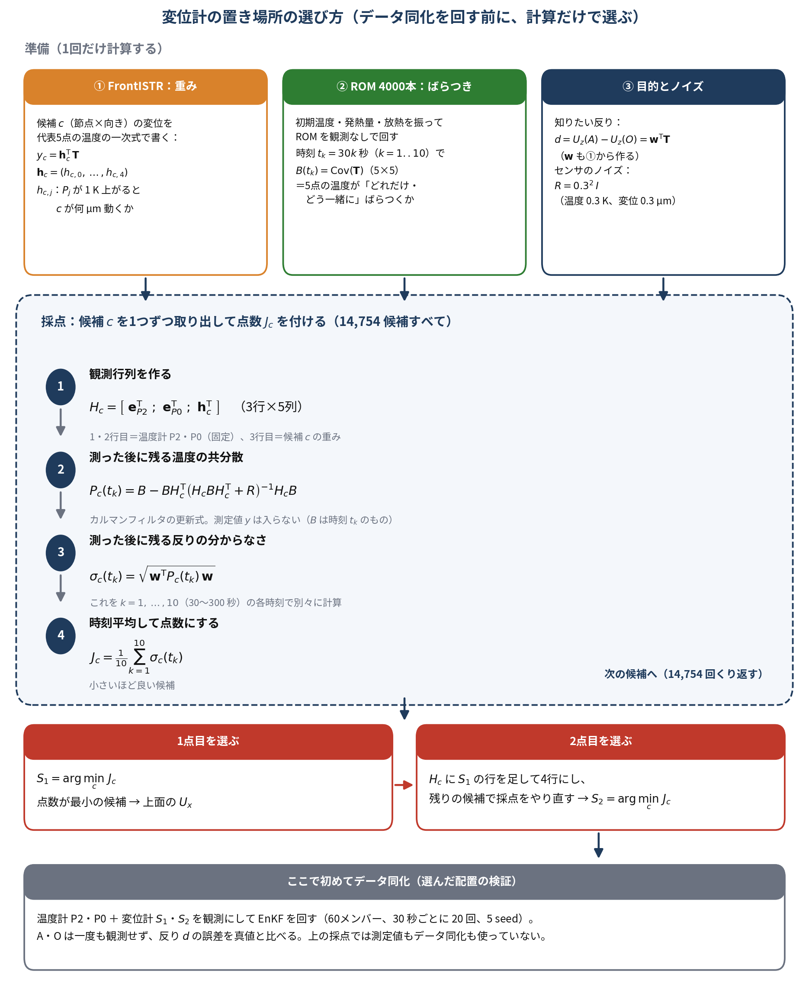

*上段＝最初に1回だけ計算する3つの材料。点線の枠＝候補1つごとの採点（14,754 回くり返す）。赤＝点数が最小の候補を選ぶ。灰＝選んだ後に、初めてデータ同化（EnKF）を回して確かめる。*

以下、図の順に1つずつ説明します。

#### ステップ1：候補を全部リストアップし、5点の温度への「重み」を作る（図の①）

変位計の候補は、FEM の全節点 5,040 個 × 3 方向（ $U_x, U_y, U_z$ ）＝ **15,120 通り**です。
A・O から 12 mm 以内の節点は「A・O を測ったのと同じ」になるので候補から外し、**14,754 通り**が残りました。

どの候補 $c$ の変位も、ROM の代表5点の温度 $\mathbf T=(T_0,\dots,T_4)^{\mathsf T}$ の一次式で書けます。

$$
y_c=y_{c,0}+\mathbf h_c^{\mathsf T}\mathbf T,\qquad
\mathbf h_c=(h_{c,0},\,h_{c,1},\,h_{c,2},\,h_{c,3},\,h_{c,4})
$$

$y_{c,0}$ は温度が基準のときの値（定数）、 $h_{c,j}$ は「代表点 $P_j$ の温度が 1 K 上がると、候補 $c$ の変位が何 µm 動くか」です。
この重みは、FrontISTR を**6回だけ**解いて作りました。15,120 通りの候補ごとに FEM を解く必要はありません。理由は「重ね合わせ」です。

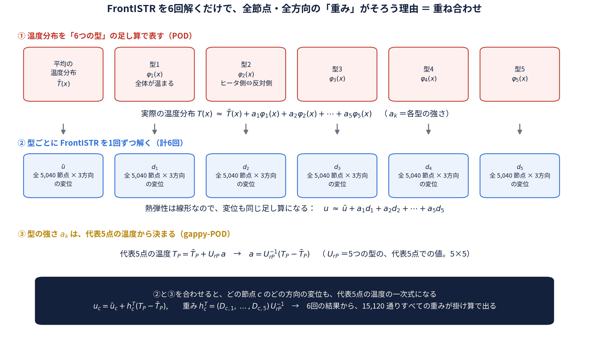

*① 温度分布を6つの型（平均＋POD の型5つ）の足し算で表す。② 型ごとに FrontISTR を1回ずつ解く。③ 型の強さ $a_k$ は代表5点の温度から決まる。②と③を合わせると、どの節点のどの方向の変位も、代表5点の温度の一次式になる（ `run/make_fem6_fig.py` ）。*

1. **温度分布を6つの型の足し算で書く。** OpenFOAM の温度場を POD で分解すると、どの時刻の温度分布も「平均の温度分布 $\bar T(x)$ ＋ 型 $\varphi_1(x),\dots,\varphi_5(x)$ をそれぞれ $a_1,\dots,a_5$ 倍したもの」でほぼ表せます（5つの型で 99.9 % 以上）。

$$
T(x)\approx\bar T(x)+a_1\varphi_1(x)+a_2\varphi_2(x)+\cdots+a_5\varphi_5(x)
$$

2. **型ごとに FrontISTR を1回ずつ解く（計6回）。** 平均の温度分布を入れた変位 $\mathbf u[\bar T]$ と、型 $\varphi_k$ だけを入れた変位 $\mathbf u[\varphi_k]$ です。FEM は1回解くと**全 5,040 節点 × 3方向の変位が一度に出る**ので、6回で全候補の答えがそろいます。

3. **変位も同じ足し算になる。** 熱弾性の計算は線形（温度が2倍なら変位も2倍、温度の足し算は変位の足し算）なので、

$$
\mathbf u\approx\mathbf u[\bar T]+a_1\,\mathbf u[\varphi_1]+a_2\,\mathbf u[\varphi_2]+\cdots+a_5\,\mathbf u[\varphi_5]
$$

4. **型の強さ $a_k$ は、代表5点の温度から決まる（gappy-POD）。** ここで添字 $P$ は「P0〜P4の代表5点で取り出した値」という目印です。この式の $P$ 自体が新しい未知数や行列という意味ではありません。

まず、代表5点の温度を並べます。

$$
\mathbf T_P=
\begin{bmatrix}T(P0)\\T(P1)\\T(P2)\\T(P3)\\T(P4)\end{bmatrix},
\qquad
\bar{\mathbf T}_P=
\begin{bmatrix}\bar T(P0)\\\bar T(P1)\\\bar T(P2)\\\bar T(P3)\\\bar T(P4)\end{bmatrix},
\qquad
\mathbf a=\begin{bmatrix}a_1\\a_2\\a_3\\a_4\\a_5\end{bmatrix}
$$

$T(Pj)$ は今の時刻の代表点Pjの温度、 $\bar T(Pj)$ はその点での学習データの時間平均温度です。**平均温度も各点で違う5個の値**です。 $a_k$ はPODの第 $k$ モードを何倍使うかを表します。

次に、各モードの値を代表5点で取り出して並べます。

$$
\Phi_P=
\begin{bmatrix}
\varphi_1(P0)&\varphi_2(P0)&\varphi_3(P0)&\varphi_4(P0)&\varphi_5(P0)\\
\varphi_1(P1)&\varphi_2(P1)&\varphi_3(P1)&\varphi_4(P1)&\varphi_5(P1)\\
\varphi_1(P2)&\varphi_2(P2)&\varphi_3(P2)&\varphi_4(P2)&\varphi_5(P2)\\
\varphi_1(P3)&\varphi_2(P3)&\varphi_3(P3)&\varphi_4(P3)&\varphi_5(P3)\\
\varphi_1(P4)&\varphi_2(P4)&\varphi_3(P4)&\varphi_4(P4)&\varphi_5(P4)
\end{bmatrix}
$$

**行は場所、列はモード**です。例えば1行目は「P0の温度を、5つのモードでどう表すか」を示し、 $T(P0)-\bar T(P0)=\sum_{k=1}^{5}\varphi_k(P0)a_k$ となります。これを5点についてまとめると、次の式になります。

$$
\mathbf T_P=\bar{\mathbf T}_P+\Phi_P\,\mathbf a\quad\Rightarrow\quad\mathbf a=\Phi_P^{-1}\big(\mathbf T_P-\bar{\mathbf T}_P\big)
$$

ここで $\Phi_P^{-1}$ は、5点の温度差から5モードの係数を逆に求める操作です。上式は正則な5×5行列の場合の表記で、コードでは `np.linalg.pinv()` による擬似逆行列を使います。**センサの観測値をここに直接代入して同化するのではなく、各メンバーのROMが計算した代表5点の温度から、センサ位置の予測値を作るために使います。**

5. **3と4を合わせると、重みが出る。** 節点 $c$ のある方向の変位は

$$
u_c=u_c[\bar T]+\mathbf h_c^{\mathsf T}\big(\mathbf T_P-\bar{\mathbf T}_P\big),\qquad
\mathbf h_c^{\mathsf T}=\big(u_c[\varphi_1],\dots,u_c[\varphi_5]\big)\,\Phi_P^{-1}
$$

つまり重み $\mathbf h_c$ は、6回の FrontISTR の結果のうち節点 $c$ の値を取り出して、5×5 の行列 $\Phi_P^{-1}$ を掛けるだけで出ます。15,120 通りすべてについて、掛け算だけで計算できます。

**近似が入るのは、1の「5つの型で表す」ところ（と、OpenFOAM のセルの温度を FEM の節点へ受け渡すところ）**です。2・3は FEM の線形性そのものなので、近似はありません。

**FrontISTR で実際にやったこと**（ `run/build_full_disp_operator.py` ）

| 項目 | 設定 |
|---|---|
| 形状・要素 | 中空円筒（外径 75 mm・内径 40 mm・高さ 100.5 mm）。半径 4 × 周 48 × 高さ 20 分割、節点 5,040 個 |
| 材料 | 鋼：ヤング率 205 GPa、ポアソン比 0.3、線膨張係数 $1.2\times10^{-5}$ /K |
| 解析 | 線形の静的熱応力解析。熱ひずみ ＝ 線膨張係数 ×（温度 − 基準温度 20 °C） |
| 支持 | **底面の3節点だけ**で、円筒が丸ごと動いたり回ったりするのを止める（1点は xyz、1点は yz、1点は z を固定）。底面全体を固定してはいないので、円筒は自由に熱膨張できる |
| 温度の渡し方 | FEM の各節点に、一番近い OpenFOAM のセルの温度を渡す |

| 回 | 入れる温度 | 出てくるもの |
|---|---|---|
| 1回目 | 平均の温度分布 $\bar T(x)$ （OpenFOAM の 121 時刻の平均） | 全節点 × 3方向の変位 $\mathbf u[\bar T]$ |
| 2〜6回目 | 基準温度 ＋ 型 $\varphi_k(x)$ （型をそのまま温度の上がり分として入れる） | 型を1倍入れたときの全節点 × 3方向の変位 $\mathbf u[\varphi_k]$ |

**例：点 A の上下変位の重み。** 2〜6回目の結果から節点 A の $U_z$ を取り出すと

$$
\big(u_A[\varphi_1],\dots,u_A[\varphi_5]\big)=(-0.0077,\,-0.0088,\,-0.0063,\,-0.0065,\,+0.0008)\ \mu\mathrm m
$$

（型は全セルで大きさ 1 にそろえた形なので、1か所あたりの温度は 0.01 K 程度と小さく、変位も小さくなります。）これに 5×5 の換算表 $\Phi_P^{-1}$ を掛けると

$$
\mathbf h_A^{\mathsf T}=\big(u_A[\varphi_1],\dots,u_A[\varphi_5]\big)\,\Phi_P^{-1}=(0.329,\,-0.134,\,0.261,\,0.639,\,0.115)\ \mu\mathrm m/\mathrm K
$$

になります。反りの重みは $\mathbf w=\mathbf h_{A,z}-\mathbf h_{O,z}$ です。

**確かめ：重み × 実際の温度の時刻歴は、FrontISTR の答えと合うか。** データ同化を使わずに、OpenFOAM の実際の5点の温度の時刻歴に重みを掛け、FrontISTR に全温度場を入れて解いた変位（真値）と比べました。

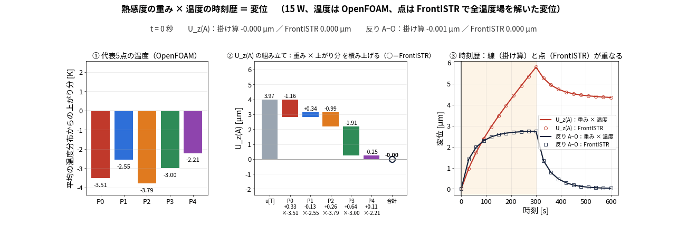

*15 W。① 代表5点の温度（平均の温度分布からの上がり分）。② $U_z(A)$ を「平均の温度分布での変位 3.97 µm ＋ 各点の 重み × 上がり分」で積み上げたもの（○＝FrontISTR の答え）。③ 時刻歴：線＝重み × 温度、点＝FrontISTR。（ `run/make_weight_times_temp_anim.py` ）*

$$
U_z(A)\approx u_A[\bar T]+\sum_{j=0}^{4}h_{A,j}\big(T_j-\bar T_j\big)
$$

| 条件 | $U_z(A)$ の最大値 | $U_z(A)$ の差（平均／最大） | 反り A−O の差（平均／最大） |
|---|---:|---:|---:|
| 15 W | 5.78 µm | 0.001／0.005 µm | 0.001／0.010 µm |
| 25 W | 9.62 µm | 0.002／0.009 µm | 0.002／0.013 µm |
| 15 W 間欠加熱 | 5.66 µm | 0.002／0.007 µm | 0.003／0.013 µm |

**重み × 実際の温度は、FrontISTR で全温度場を解いた変位と、反りで最大 0.013 µm（反りの約 0.5 %）しか違いません。** データ同化の推定の誤差（反りで 0.07〜0.08 µm など）のほとんどは、**5点の温度をどこまで正しく推定できたか**で決まり、温度から変位への換算の誤差はほぼ無視できます。

知りたい反り $d=U_z(A)-U_z(O)$ も、同じ形の重み $\mathbf w$ で書けます。

$$
d=d_0+\mathbf w^{\mathsf T}\mathbf T,\qquad \mathbf w=\mathbf h_{A,z}-\mathbf h_{O,z}
$$

**重みとは何か（具体的に）。** 例えば点 A の上下変位 $U_z(A)$ の重みは次の5つの数です。

$$
U_z(A)=U_z(A)_0+0.33\,T_0-0.13\,T_1+0.26\,T_2+0.64\,T_3+0.12\,T_4\quad[\mu\mathrm m]
$$

（ $T_j$ は代表点 $P_j$ の温度の、基準からの上昇 [K]。係数の単位は µm/K）

- $h_{A,j}$ は「**代表点 $P_j$ だけを 1 K 上げ、ほかの4点は変えない**温度分布（点と点の間は gappy-POD で埋める）を FrontISTR に入れたとき、A が何 µm 動くか」です。
- 重みが負になる点もあります。 $P_1$ （反対側寄り）だけが温まると、反対側が伸びて円筒がヒータ側へ傾き、ヒータ側の A が下がる、と考えられます（この解釈は確かめていません）。
- **検算**：5点とも 1 K 上げる（全体が一様に 1 K 上がる）と、 $0.33-0.13+0.26+0.64+0.12=1.21$ µm。鋼の線膨張係数 $1.2\times10^{-5}$ /K × 高さ 100.5 mm ＝ 1.21 µm と一致します。

ほかの例：

| 量 | $P_0$ | $P_1$ | $P_2$ | $P_3$ | $P_4$ | 合計（全体 1 K） |
|---|---:|---:|---:|---:|---:|---:|
| $U_z(A)$ （ヒータ側の上面） | 0.33 | −0.13 | 0.26 | 0.64 | 0.12 | 1.21 |
| $U_z(O)$ （反対側の上面） | −0.14 | 0.52 | −0.34 | 0.60 | 0.57 | 1.21 |
| **反り $d=U_z(A)-U_z(O)$ の重み $\mathbf w$** | **0.47** | **−0.65** | **0.60** | **0.04** | **−0.46** | **0.00** |
| 変位計 S1（上面、横方向）の重み $\mathbf h_{S1}$ | −0.53 | 0.60 | −0.76 | 0.29 | 0.29 | −0.12 |
| 底面近くの変位計の重み | −0.09 | −0.07 | −0.38 | 0.74 | −0.15 | 0.06 |

- 反りの重み $\mathbf w$ の合計は 0：全体が一様に温まっても、反りは出ません。反りは「ヒータ側（P0・P2、＋）と反対側（P1・P4、−）の温度差」で決まります。
- S1 の重みは、 $\mathbf w$ とほぼ逆向き（符号が逆で形が似ている）です。だから S1 の値は反りと強く（逆向きに）一緒に動きます（ステップ3の散布図①）。

#### ステップ2：5点の温度の「分からなさ」を作る（図の②）

発熱量や初期温度が分からないので、測る前は5点の温度も分かりません。
その分からなさを、ROM を条件を変えて **4,000 本**回して作ります（観測なしで回すだけ。データ同化はしない）。

| 振ったもの | 振り方 | 範囲 | 正解の値 |
|---|---|---|---|
| 初期温度（代表5点） | 5点それぞれ別々に一様乱数 | 気温 20 °C の −3〜+12 K | 20 °C |
| 発熱量 | 倍率 $q$ を一様乱数（ $Q=15q$ W） | $q$ ＝0.3〜1.8（4.5〜27 W） | 15 W |
| 放熱 $h_{\mathrm{ROM}}$ | 正規乱数（平均 0.02、標準偏差 0.01 W/K）を 0.001〜0.1 で切る | | 0.01535 W/K |

熱源の位置（P2）、ROM の係数、気温、熱感度は変えていません。これは EnKF の60メンバーを最初に作るときと同じ分布です。

4,000 本を 0 秒から 300 秒まで進め、30 秒ごと（ $t_k=30k$ 秒、 $k=1,\dots,10$ ）に、5点の温度の共分散を数えます。

$$
B(t_k)=\begin{pmatrix}
\mathrm{Var}(T_0) & \mathrm{Cov}(T_0,T_1) & \cdots & \mathrm{Cov}(T_0,T_4)\\
\mathrm{Cov}(T_1,T_0) & \mathrm{Var}(T_1) & \cdots & \mathrm{Cov}(T_1,T_4)\\
\vdots & \vdots & \ddots & \vdots\\
\mathrm{Cov}(T_4,T_0) & \mathrm{Cov}(T_4,T_1) & \cdots & \mathrm{Var}(T_4)
\end{pmatrix}
$$

$$
\mathrm{Cov}(T_i,T_j)=\frac{1}{N-1}\sum_{m=1}^{N}\big(T_i^{(m)}(t_k)-\bar T_i(t_k)\big)\big(T_j^{(m)}(t_k)-\bar T_j(t_k)\big),\qquad N=4000
$$

$m$ は何本目の計算か、 $\bar T_i$ は 4,000 本の平均です。

- **対角** $\mathrm{Var}(T_i)$ ：点 $P_i$ の温度が、どれだけ分からないか。
- **非対角** $\mathrm{Cov}(T_i,T_j)$ ：点 $P_i$ と $P_j$ の温度が、一緒に上がり下がりするか。大きいほど、片方を測るともう片方も分かる。

測る前の反りの分からなさ $\sigma_0$ は、各点の温度の分からなさに重み $\mathbf w$ を掛けて足し合わせたものです。

$$
\sigma_0^2=\mathbf w^{\mathsf T}B\,\mathbf w=\sum_i\sum_j w_iw_j\,\mathrm{Cov}(T_i,T_j)
$$

#### ステップ3：候補を1つずつ採点する ― σ とは何か（図の点線の枠）

候補を1つ取り出して、こう問います。

> **「ここにセンサを置いて値が分かったら、反り A−O の分からなさはどこまで小さくなるか」**

> **「センサの値」とは**：センサが示す数値のこと。温度計なら温度 [K]、変位計ならその点・その向きの変位 [µm] です。記号は $y$ 。実際の測定ではノイズ（標準偏差 0.3 K または 0.3 µm）が乗ります。

この「測った後に残る反りの分からなさ」が $\sigma$ です。**まず絵で見て、次に式にします。**

##### (a) 絵で見る：σ は散布図の「縦の幅」

ステップ2の 4,000 本の ROM 計算を、1本ずつ点にして描きます。
横軸＝その計算でセンサが示すはずの値（ノイズ 0.3 込み）、縦軸＝その計算の反り A−O です。


*4,000 本の ROM 計算（ $t=150$ 秒）。点1つ＝計算1本。黒い直線＝値から反りを予想する直線、灰色の帯＝直線から上下にずれる幅（±σ）。測定値もデータ同化も使っていません（ `run/make_sigma_scatter_fig.py` ）。*

読み方はこうです。**センサの値が分かると、横軸の位置が決まります。そのとき反りは、黒い直線のまわりの灰色の帯の中にあると分かります。** この帯の半分の幅が $\sigma$ です。

| 候補 | 散布図の形 | 測った後の σ （測る前は ±1.20 µm） |
|---|---|---:|
| ① 変位計 S1（上面、横方向） | 細い右下がりの帯。値と反りがほぼ1対1 | **0.39 µm** |
| ② 変位計 B（中段、上下方向） | 太い帯。値が同じでも反りがばらつく | 1.08 µm |
| ③ 変位計（底面近く） | 横幅が狭い。動きが小さく、ノイズ 0.3 µm に埋もれる | 1.16 µm |
| ④ 温度計 P4（反対側の下部） | 水平。値と反りが無関係 | 1.20 µm（縮まない） |

**良い候補＝散布図が細い直線に近い候補**です。そういう候補を、14,754 個の中から探します。

##### (b) 式にする：散布図を描かなくても σ は計算できる

散布図の帯の幅は、統計の基本的な式で計算できます（直線を引いたときに残るばらつき）。

$$
\sigma^2=\mathrm{Var}(d)-\frac{\mathrm{Cov}(d,\,y)^2}{\mathrm{Var}(y)+r}
$$

| 記号 | 意味 | 散布図では |
|---|---|---|
| $\mathrm{Var}(d)$ | 測る前の反りのばらつき（ $1.20^2$ µm²） | 縦方向の全体の幅 |
| $\mathrm{Cov}(d,y)$ | 反りと値が一緒に動く度合い | 帯の傾き |
| $\mathrm{Var}(y)+r$ | センサの値のばらつき（ノイズ $r=0.3^2$ 込み） | 横方向の全体の幅 |

反り $d$ もセンサの値 $y$ も「5点の温度の一次式」（ステップ1）なので、この3つはステップ2の共分散 $B$ と重みから**掛け算だけで**出せます。

$$
\mathrm{Var}(d)=\mathbf w^{\mathsf T}B\,\mathbf w,\qquad
\mathrm{Cov}(d,y_c)=\mathbf w^{\mathsf T}B\,\mathbf h_c,\qquad
\mathrm{Var}(y_c)=\mathbf h_c^{\mathsf T}B\,\mathbf h_c
$$

**だから $B$ が必要です。** $B$ は「5点の温度がどう一緒にばらつくか」で、そこから「反りと値がどう一緒にばらつくか」が計算できます。4,000 本の点を候補ごとに描き直す必要はありません。

##### (b′) σ の式を、省略なしで導く

**まず絵で、4段階で見ます。** 世界が5つだけの作り話の例です。上の段が良い場所 X、下の段が悪い場所 Y です。

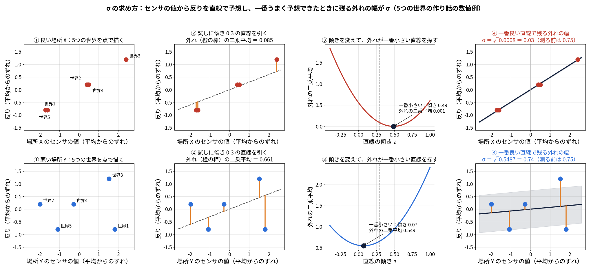

| 段階 | やること | 良い場所 X | 悪い場所 Y |
|---|---|---|---|
| ① | 5つの世界を、横＝センサの値、縦＝反り の点で描く | 点がほぼ一直線に並ぶ | 点がばらばら |
| ② | 試しに直線を1本引き、点と直線の縦のずれ（橙の棒）を測る。棒の長さを二乗して平均する | 0.085 | 0.661 |
| ③ | 直線の傾きを少しずつ変えて、②の値が一番小さくなる傾きを探す | 傾き 0.49 で 0.0008 | 傾き 0.07 で 0.549 |
| ④ | そのとき残る外れの平方根が σ 。「センサの値から反りを一番うまく予想しても、まだこれだけ外れる」という幅 | **σ ＝ 0.03**（測る前 0.75） | **σ ＝ 0.74**（ほとんど縮まない） |

**σ が小さい場所 ＝ センサの値から反りをうまく予想できる場所 ＝ 良い場所**です。
4,000 本の計算で、これと同じことを 14,754 個の候補それぞれについて行い、σ が一番小さい場所を選びました（ `run/make_sigma_steps_fig.py` ）。

**以下は、同じことを式で書いたものです**（③の「一番小さくなる傾き」を、探さずに計算で出す方法）。

**0. 記号を決める。** すべて「4,000 本の平均からのずれ」で書きます。

- $d$ ：反りの、平均からのずれ
- $y$ ：センサの値の、平均からのずれ
- $\langle\ \rangle$ ：4,000 本の平均をとる記号

平均からのずれなので、分散と共分散は「掛けて平均するだけ」になります。

$$
\mathrm{Var}(d)=\langle d^2\rangle,\qquad
\mathrm{Var}(y)=\langle y^2\rangle,\qquad
\mathrm{Cov}(d,y)=\langle d\,y\rangle
$$

**1. センサの値から反りを予想する式を決める。** 傾き $a$ の直線で予想します（散布図の黒い直線）。

$$
\hat d=a\,y
$$

予想の外れは

$$
d-\hat d=d-a\,y
$$

**2. 外れを二乗して、展開する。**

$$
(d-a\,y)^2=d^2-2a\,d\,y+a^2\,y^2
$$

**3. 4,000 本で平均する。** $a$ は定数なので平均の外に出せます。

$$
\langle(d-a\,y)^2\rangle=\langle d^2\rangle-2a\,\langle d\,y\rangle+a^2\,\langle y^2\rangle
=\mathrm{Var}(d)-2a\,\mathrm{Cov}(d,y)+a^2\,\mathrm{Var}(y)
$$

**4. $a$ について平方完成する。** 見やすくするため $V_d=\mathrm{Var}(d)$ 、 $C=\mathrm{Cov}(d,y)$ 、 $V_y=\mathrm{Var}(y)$ と書きます。

$$
V_d-2aC+a^2V_y
=V_y\Big(a^2-2a\frac{C}{V_y}\Big)+V_d
=V_y\Big(a-\frac{C}{V_y}\Big)^2-\frac{C^2}{V_y}+V_d
$$

（右辺の括弧を展開すると $V_y a^2-2aC+C^2/V_y$ なので、 $-C^2/V_y$ で打ち消すと左辺に戻ります。）

**5. 外れが一番小さくなる $a$ と、そのときの外れ。** 第1項 $V_y(a-C/V_y)^2$ は 0 以上で、 $a=C/V_y$ のとき 0 になります。

$$
a=\frac{C}{V_y}=\frac{\mathrm{Cov}(d,y)}{\mathrm{Var}(y)}
$$

これが散布図の黒い直線の傾きです。このときの外れが σ² （散布図の帯の幅の二乗）です。

$$
\sigma^2=\langle(d-a\,y)^2\rangle_{\min}=V_d-\frac{C^2}{V_y}=\mathrm{Var}(d)-\frac{\mathrm{Cov}(d,y)^2}{\mathrm{Var}(y)}
$$

**6. 小さな数値例で確かめる。** 世界が5つだけ、と考えます（数字は説明用の作り話）。

| 世界 | 反り | 反りのずれ $d$ | 場所 X の値 | X のずれ $y$ | $d\,y$ | $y^2$ |
|---:|---:|---:|---:|---:|---:|---:|
| 1 | 1.0 | −0.8 | 2.0 | −1.6 | 1.28 | 2.56 |
| 2 | 2.0 | 0.2 | 4.0 | 0.4 | 0.08 | 0.16 |
| 3 | 3.0 | 1.2 | 6.0 | 2.4 | 2.88 | 5.76 |
| 4 | 2.0 | 0.2 | 4.1 | 0.5 | 0.10 | 0.25 |
| 5 | 1.0 | −0.8 | 1.9 | −1.7 | 1.36 | 2.89 |
| 平均 | 1.8 | 0 | 3.6 | 0 | **1.14** | **2.324** |

$d^2$ の平均は $(0.64+0.04+1.44+0.04+0.64)/5=0.56$ です。よって

$$
V_d=0.56,\qquad C=1.14,\qquad V_y=2.324,\qquad a=\frac{1.14}{2.324}=0.491
$$

$$
\sigma^2=0.56-\frac{1.14^2}{2.324}=0.56-0.559=0.0008,\qquad \sigma=0.03
$$

測る前の幅 $\sqrt{0.56}=0.75$ が、X の値を知ると 0.03 まで縮みます。
同じ計算を、反りと関係のない場所 Y（値 5.1, 1.3, 4.8, 3.0, 2.2）でやると $C=0.156$ 、 $V_y=2.158$ 、 $\sigma^2=0.56-0.011=0.549$ 、 $\sigma=0.74$ で、ほとんど縮みません。

**7. センサのノイズを入れる。** 実際の値には、温度とは無関係なノイズ $\varepsilon$ （分散 $r$ ）が乗ります： $y=y_0+\varepsilon$ （ $y_0$ ＝ノイズのない値）。

$$
\langle d\,y\rangle=\langle d\,y_0\rangle+\langle d\,\varepsilon\rangle=\langle d\,y_0\rangle+0
$$

$$
\langle y^2\rangle=\langle y_0^2\rangle+2\langle y_0\,\varepsilon\rangle+\langle\varepsilon^2\rangle=\langle y_0^2\rangle+0+r
$$

ノイズは共分散を変えず、分母に $r$ を足すだけです。

$$
\sigma^2=\mathrm{Var}(d)-\frac{\mathrm{Cov}(d,y_0)^2}{\mathrm{Var}(y_0)+r}
$$

**8. 反りとセンサの値を、温度で書き直す。** 代表点が2つ（温度のずれ $\Delta T_1,\Delta T_2$ ）の場合で書きます。ステップ1の重みを使うと

$$
d=w_1\Delta T_1+w_2\Delta T_2,\qquad y_0=h_1\Delta T_1+h_2\Delta T_2
$$

温度の分散・共分散を $B_{11}=\langle\Delta T_1^2\rangle$ 、 $B_{22}=\langle\Delta T_2^2\rangle$ 、 $B_{12}=\langle\Delta T_1\Delta T_2\rangle$ と書きます。

**$\mathrm{Var}(d)$** ：二乗を展開して平均します。

$$
d^2=w_1^2\Delta T_1^2+2w_1w_2\,\Delta T_1\Delta T_2+w_2^2\Delta T_2^2
$$

$$
\mathrm{Var}(d)=\langle d^2\rangle=w_1^2B_{11}+2w_1w_2B_{12}+w_2^2B_{22}
$$

**$\mathrm{Cov}(d,y_0)$** ：積を4項に展開して平均します。

$$
d\,y_0=w_1h_1\Delta T_1^2+w_1h_2\,\Delta T_1\Delta T_2+w_2h_1\,\Delta T_2\Delta T_1+w_2h_2\Delta T_2^2
$$

$$
\mathrm{Cov}(d,y_0)=w_1h_1B_{11}+(w_1h_2+w_2h_1)B_{12}+w_2h_2B_{22}
$$

**$\mathrm{Var}(y_0)$** ： $\mathrm{Var}(d)$ の $w$ を $h$ に置き換えたものです。

$$
\mathrm{Var}(y_0)=h_1^2B_{11}+2h_1h_2B_{12}+h_2^2B_{22}
$$

**9. 7に代入すると、σ が温度の共分散 $B$ と重みだけで書ける。**

$$
\sigma^2=\big(w_1^2B_{11}+2w_1w_2B_{12}+w_2^2B_{22}\big)
-\frac{\big(w_1h_1B_{11}+(w_1h_2+w_2h_1)B_{12}+w_2h_2B_{22}\big)^2}{h_1^2B_{11}+2h_1h_2B_{12}+h_2^2B_{22}+r}
$$

- 重み $w,h$ は FrontISTR、 $B$ は ROM 4,000 本、 $r$ はセンサの仕様から決まります。測定値はどこにも出てきません。
- 本研究は代表点が5つなので、和が 5×5＝25 項になるだけで、形は同じです： $\mathrm{Var}(d)=\sum_i\sum_j w_iw_jB_{ij}$ 、 $\mathrm{Cov}=\sum_i\sum_j w_ih_jB_{ij}$ 、 $\mathrm{Var}(y_0)=\sum_i\sum_j h_ih_jB_{ij}$ 。
- ここでは平均を「÷本数」で書きました。プログラムは「÷(本数−1)」で計算していますが、4,000 本では差は 0.03 % で、結果は変わりません。

##### (c) 温度計と一緒に測る場合、2本目を選ぶ場合

実際の採点では、温度計 P2・P0 も一緒に測ります。また2本目は、1本目を測った後に選びます。
考え方は (a) と同じで、**「すでに測ったセンサで分かったことを除いた、残りのばらつき」について、同じことを繰り返します**。
これを1つの式にまとめたのが、カルマンフィルタの更新式です。

**観測行列 $H$ とは**：代表5点の温度から、各センサが示す値を計算するための「換算表」です。

- **行＝センサ1本**（ここでは温度計 P2、温度計 P0、候補の変位計の3本なので3行）
- **列＝代表点1つ**（P0〜P4 なので5列）
- **各マスの数＝「その代表点の温度が 1 K 上がると、そのセンサの値がいくつ変わるか」**

| センサ ＼ 代表点 | P0 | P1 | P2 | P3 | P4 |
|---|---:|---:|---:|---:|---:|
| 温度計 P2 | 0 | 0 | 1 | 0 | 0 |
| 温度計 P0 | 1 | 0 | 0 | 0 | 0 |
| 変位計 S1 | −0.532 | 0.596 | −0.763 | 0.286 | 0.290 |

温度計 P2 の行は「P2 の温度をそのまま示し、ほかの点には反応しない」。変位計 S1 の行はステップ1の重み $\mathbf h$ で、5点すべての温度に反応します。

**使い方**：温度に掛けると、センサの値が出ます（ $\mathbf y=H\mathbf T$ ）。例えば5点の温度上昇が $\mathbf T=(2,1,3,1,1)$ K なら、

| センサ | 計算（行の数 × 温度 を足す） | 値 |
|---|---|---:|
| 温度計 P2 | $0\cdot2+0\cdot1+1\cdot3+0\cdot1+0\cdot1$ | 3 K |
| 温度計 P0 | $1\cdot2+0\cdot1+0\cdot3+0\cdot1+0\cdot1$ | 2 K |
| 変位計 S1 | $(-0.532)(2)+(0.596)(1)+(-0.763)(3)+(0.286)(1)+(0.290)(1)$ | −2.18 µm |

（この温度は説明用の例です。）データ同化では、ROM が計算した温度にこの換算表を掛けて「センサが示すはずの値」を出し、実際の値と比べて温度を直します。

| センサの種類 | その行の中身 | どこから |
|---|---|---|
| 代表点にある温度計 | 1か所だけ 1、ほかは 0 | ― |
| 代表点以外のセルにある温度計 | gappy-POD の重み（5つとも 0 でない） | POD |
| 変位計 | 重み $\mathbf h$ | FrontISTR 6回（ステップ1） |

**行列でまとめると**：測るセンサの重みを縦に並べた観測行列（温度計 P2・P0 ＋ 候補 $c$ ）：

$$
H_c=\begin{pmatrix}
0&0&1&0&0\\
1&0&0&0&0\\
h_{c,0}&h_{c,1}&h_{c,2}&h_{c,3}&h_{c,4}
\end{pmatrix}
$$

温度計の行が $(0,0,1,0,0)$ のように「1か所だけ1」なのは、P2・P0 が ROM の代表点そのものだからです。代表点以外のセル $j$ に温度計を置く場合は、この行が gappy-POD の重み $\boldsymbol\psi_j U_{rP}^{-1}$ に変わるだけです（[blog_007 §10](blog_007_rom_applicability.md)）。

**$P_c$ を言葉で言うと**：「センサを付けたとしたら、それでもまだ、5点の温度がそれぞれ何 K くらい分からないまま残るか」の表です。

- 測る前の表が $B$ 、センサを付けた後の表が $P_c$ です。形は同じ 5×5 です。
- **対角の数の平方根 ＝ その点の温度が、まだ ± 何 K 分からないか**（下の表の数字）。
- 対角以外の数 ＝ 2つの点の温度が「一緒にずれる」かどうか。一緒にずれる点どうしは、片方が分かればもう片方も分かります。

実際の数字（ $t=150$ 秒、4,000 本の ROM 計算から）：

| 付けたセンサ | P0 | P1 | P2 | P3 | P4 | 反りの σ |
|---|---:|---:|---:|---:|---:|---:|
| なし（測る前、 $B$ ） | ±2.49 K | ±2.23 K | ±2.64 K | ±2.27 K | ±2.25 K | 1.20 µm |
| 温度計 P2・P0 | ±0.22 K | ±0.80 K | ±0.23 K | ±0.46 K | **±1.05 K** | 0.97 µm |
| ＋変位計 S1 | ±0.22 K | ±0.36 K | ±0.22 K | ±0.29 K | ±0.46 K | 0.32 µm |
| ＋変位計 S2 | ±0.18 K | ±0.24 K | ±0.20 K | ±0.22 K | ±0.26 K | 0.22 µm |

- 温度計 P2・P0 を付けると、**付けた P0・P2 は ±0.2 K まで分かる**ようになります。でも、**反対側の P1・P4 は ±0.8〜1.05 K 分からないまま**です。反りは「ヒータ側と反対側の温度差」で決まるので、反りの σ はあまり縮みません（1.20 → 0.97 µm）。
- 変位計 S1・S2 を足すと、**温度計のない P1・P4 も ±0.2〜0.3 K まで分かる**ようになり、反りの σ も 0.22 µm まで縮みます。
- 反りの σ は、この表の分からなさを、反りへの重み $\mathbf w$ で反りに換算したものです（ $\sigma_c^2=\mathbf w^{\mathsf T}P_c\mathbf w$ ）。

式で書くと、センサを付けた後でも残る温度の分からなさの表 $P_c$ と、反りの σ は：

$$
P_c=B-BH_c^{\mathsf T}\big(H_cBH_c^{\mathsf T}+R\big)^{-1}H_cB,\qquad
\sigma_c=\sqrt{\mathbf w^{\mathsf T}P_c\,\mathbf w}
$$

$R$ はセンサのノイズ（対角に $0.3^2$ ）。センサが候補1本だけなら、この式は (b) の式と同じになります。

##### (c′) $P_c$ の導き方

$P_c$ は、(b′) で1本のセンサについてやった「直線で予想して、残る外れを計算する」を、**センサが複数の場合に行列でやったもの**です。段階も (b′) と同じです。

**0. 記号**（センサ3本の場合。すべて 4,000 本の平均からのずれ）

| 記号 | 中身 | 大きさ |
|---|---|---|
| $\mathbf T$ | 代表5点の温度 | 5×1 |
| $\mathbf y$ | センサ3本の値（温度計 P2、温度計 P0、候補の変位計） | 3×1 |
| $H_c$ | 温度 → センサの値の重み（各行がセンサ1本） | 3×5 |
| $\boldsymbol\varepsilon$ | ノイズ（共分散 $R$ 、対角に $0.3^2$ ） | 3×1 |
| $B=\langle\mathbf T\mathbf T^{\mathsf T}\rangle$ | 温度の共分散（ROM 4,000 本） | 5×5 |

センサの値は $\mathbf y=H_c\mathbf T+\boldsymbol\varepsilon$ です。

**1. 必要な2つの量を、掛け算で出す。** (b′) の $\mathrm{Cov}(d,y)$ と $\mathrm{Var}(y)$ にあたるものです。

$$
\langle\mathbf T\mathbf y^{\mathsf T}\rangle=\langle\mathbf T\mathbf T^{\mathsf T}\rangle H_c^{\mathsf T}+\langle\mathbf T\boldsymbol\varepsilon^{\mathsf T}\rangle=BH_c^{\mathsf T}+0
$$

$$
S=\langle\mathbf y\mathbf y^{\mathsf T}\rangle=H_c\langle\mathbf T\mathbf T^{\mathsf T}\rangle H_c^{\mathsf T}+H_c\langle\mathbf T\boldsymbol\varepsilon^{\mathsf T}\rangle+\langle\boldsymbol\varepsilon\mathbf T^{\mathsf T}\rangle H_c^{\mathsf T}+\langle\boldsymbol\varepsilon\boldsymbol\varepsilon^{\mathsf T}\rangle=H_cBH_c^{\mathsf T}+R
$$

ノイズは温度と無関係なので、 $\langle\mathbf T\boldsymbol\varepsilon^{\mathsf T}\rangle=0$ です。

**2. センサの値から温度を予想する。** (b′) の直線 $\hat d=a\,y$ の行列版です。 $K$ は 5×3 の「傾き」です。

$$
\hat{\mathbf T}=K\mathbf y,\qquad \mathbf e=\mathbf T-K\mathbf y
$$

**3. 外れの共分散を展開する。** (b′) の $\langle(d-ay)^2\rangle$ の行列版です。

$$
\langle\mathbf e\mathbf e^{\mathsf T}\rangle=\langle\mathbf T\mathbf T^{\mathsf T}\rangle-K\langle\mathbf y\mathbf T^{\mathsf T}\rangle-\langle\mathbf T\mathbf y^{\mathsf T}\rangle K^{\mathsf T}+K\langle\mathbf y\mathbf y^{\mathsf T}\rangle K^{\mathsf T}
=B-KH_cB-BH_c^{\mathsf T}K^{\mathsf T}+KSK^{\mathsf T}
$$

**4. 平方完成する。** $K^*=BH_c^{\mathsf T}S^{-1}$ とおくと、

$$
B-KH_cB-BH_c^{\mathsf T}K^{\mathsf T}+KSK^{\mathsf T}
=(K-K^*)\,S\,(K-K^*)^{\mathsf T}+B-BH_c^{\mathsf T}S^{-1}H_cB
$$

（右辺第1項を展開すると $KSK^{\mathsf T}-KH_cB-BH_c^{\mathsf T}K^{\mathsf T}+BH_c^{\mathsf T}S^{-1}H_cB$ なので、最後の項を引くと左辺に戻ります。 $S$ と $B$ が対称なことを使っています。）

**5. 一番小さくなる $K$ と、そのとき残る共分散。** 第1項は 0 以上で、 $K=K^*$ のとき 0 になります。

$$
K^*=BH_c^{\mathsf T}\big(H_cBH_c^{\mathsf T}+R\big)^{-1}
$$

$$
P_c=B-BH_c^{\mathsf T}\big(H_cBH_c^{\mathsf T}+R\big)^{-1}H_cB
$$

$K^*$ はカルマンゲイン（センサの値から温度を予想する「傾き」）、 $P_c$ は「センサを付けた後でも残る、5点の温度の分からなさの表」です。

**6. 反りの σ にする。** 反りは $d=\mathbf w^{\mathsf T}\mathbf T$ なので、反りの外れは $\mathbf w^{\mathsf T}\mathbf e$ です。

$$
\sigma_c^2=\langle(\mathbf w^{\mathsf T}\mathbf e)^2\rangle=\mathbf w^{\mathsf T}\langle\mathbf e\mathbf e^{\mathsf T}\rangle\mathbf w=\mathbf w^{\mathsf T}P_c\,\mathbf w
$$

**確かめ**：センサが候補1本だけなら、 $H_c=\mathbf h^{\mathsf T}$ 、 $S=\mathbf h^{\mathsf T}B\mathbf h+r$ （ただの数）なので、

$$
\mathbf w^{\mathsf T}P_c\mathbf w=\mathbf w^{\mathsf T}B\mathbf w-\frac{(\mathbf w^{\mathsf T}B\mathbf h)^2}{\mathbf h^{\mathsf T}B\mathbf h+r}=\mathrm{Var}(d)-\frac{\mathrm{Cov}(d,y)^2}{\mathrm{Var}(y)+r}
$$

となり、(b′) の式と一致します。

**プログラムでは**、 `run/disp_elsewhere_predict_AO.py` の関数 `post` が5の式をそのまま計算しています。

```python
K = B @ H.T @ np.linalg.inv(H @ B @ H.T + R)   # カルマンゲイン（5×3）
P = B - K @ H @ B                              # センサを付けた後でも残る、5点の温度の分からなさの表（5×5）
sigma = np.sqrt(w @ P @ w)                     # 反りの σ
```

これを 30〜300 秒の10時刻の $B(t_k)$ それぞれで計算して平均し、点数にしています。
`run/select_nonrep_temp_disp.py` （§6-4）では、センサを1本ずつ足しながら $P\leftarrow P-(P\mathbf h)(P\mathbf h)^{\mathsf T}/(\mathbf h^{\mathsf T}P\mathbf h+r)$ を繰り返しています。センサのノイズが互いに無関係なら、まとめて計算した場合と同じ結果になります。

##### (c″) $P_c$ は、データ同化で温度を直すときの式と同じ

(c′) で導いた $P_c$ の式は、**データ同化（カルマンフィルタ）で1回温度を直すときの式とまったく同じ**です。

$$
P_c=B-BH^{\mathsf T}\big(HBH^{\mathsf T}+R\big)^{-1}HB
\qquad\Longleftrightarrow\qquad
P^a=P^f-P^fH^{\mathsf T}\big(HP^fH^{\mathsf T}+R\big)^{-1}HP^f
$$

左が置き場所の採点、右がデータ同化の1回の補正です（ $P^f$ ＝直す前の分からなさ、 $P^a$ ＝直した後の分からなさ）。
つまり置き場所の採点は、**「このセンサでデータ同化を1回だけしたら、温度の分からなさがどこまで縮むか」を、データ同化を実際に回さずに計算している**ことになります。分からなさを更新する式には測定値が入らないので、センサを付ける前でも計算できます。

| | 置き場所の採点（ $P_c$ ） | 実際のデータ同化（EnKF） |
|---|---|---|
| 更新の式 | 同じ | 同じ（60メンバーのばらつきで近似） |
| 測定値 | **使わない**（分からなさの更新には要らない） | 使う（温度そのものを直すのに使う） |
| 直す前の分からなさ | $B$ ：4,000 本を**一度も直さずに**進めた計算から作る | $P^f$ ：60メンバーを**30 秒ごとに直しながら**進めた計算から作る |
| 更新の回数 | 各時刻で**1回だけ**。前の時刻の更新は持ち越さない | 30 秒ごとに**20回、積み重ねる** |
| 直す量 | 5点の温度だけ | 5点の温度＋発熱量＋放熱（7個） |

**この違いから分かること**

- **予測した σ と、実際の誤差の値は合いません。** 選んだ2点の予測 σ は 0.256 µm、実際にデータ同化した反りの誤差は 0.075 µm でした（§7）。実際のデータ同化は補正を積み重ねるので、分からなさがもっと小さくなります。採点は「直す前の状態から1回だけ直す」ので、値が大きめに出ます。
- **それでも「どのセンサが効くか」の順位は保たれやすい**ので、置き場所の選択に使えます（予測と実際の順位相関 0.9〜0.98、§7・[blog_005 §4-6](blog_005_optimal_sensor_placement.md)）。
- **ただし順位が外れた例もあります。** 温度計も代表点以外から選んだ §6-4 では、予測 σ では良いはずの配置が、実際のデータ同化では今の配置を超えませんでした。採点は「1回だけ・温度5点だけ・反りだけ」を見ているので、積み重ねの効果や発熱量・放熱の推定、反り以外の量までは見ていません。

##### (c‴) 実際の数字で J_c を計算する（候補 S1 の例）

候補 S1（上面 $(9.7,-36.2,100.5)$ mm の $U_x$ ）の点数 $J_c$ を、行列の要素をすべて書いて計算します。
**各段階で、まず文字式（どの要素から作るか）、次に数字**の順に書きます。点の番号は P0〜P4 をそのまま 0〜4 とし、 $B_{ij}$ は $B$ の i 行 j 列です。 $t=150$ 秒の値で計算し、最後に10時刻を平均します（ `run/disp_elsewhere_predict_AO.py` と同じ計算）。

**材料1：反りの重み $\mathbf w$ と、S1 の重み $\mathbf h$** （ステップ1、FrontISTR から。単位 µm/K）

$$
\mathbf w=(w_0,w_1,w_2,w_3,w_4)=(0.470,\,-0.654,\,0.604,\,0.038,\,-0.458)
$$

$$
\mathbf h=(h_0,h_1,h_2,h_3,h_4)=(-0.532,\,0.596,\,-0.763,\,0.286,\,0.290)
$$

**材料2：測る前の温度の分からなさの表 $B$** （ステップ2、ROM 4,000 本。単位 K²）

$$
B=\begin{pmatrix}
B_{00}&B_{01}&B_{02}&B_{03}&B_{04}\\
B_{10}&B_{11}&B_{12}&B_{13}&B_{14}\\
B_{20}&B_{21}&B_{22}&B_{23}&B_{24}\\
B_{30}&B_{31}&B_{32}&B_{33}&B_{34}\\
B_{40}&B_{41}&B_{42}&B_{43}&B_{44}
\end{pmatrix}
=\begin{pmatrix}
6.217&5.234&6.574&5.592&4.973\\
5.234&4.991&5.406&4.950&4.937\\
6.574&5.406&6.991&5.841&5.082\\
5.592&4.950&5.841&5.165&4.823\\
4.973&4.937&5.082&4.823&5.075
\end{pmatrix}
$$

**材料3：観測行列 $H$ とノイズ $R$**

$$
H=\begin{pmatrix}0&0&1&0&0\\1&0&0&0&0\\h_0&h_1&h_2&h_3&h_4\end{pmatrix}
=\begin{pmatrix}0&0&1&0&0\\1&0&0&0&0\\-0.532&0.596&-0.763&0.286&0.290\end{pmatrix},\qquad
R=\begin{pmatrix}0.09&0&0\\0&0.09&0\\0&0&0.09\end{pmatrix}
$$

1行目＝温度計 P2、2行目＝温度計 P0、3行目＝変位計 S1。

**計算1：センサどうしのばらつきの表 $S=HBH^{\mathsf T}+R$** （3×3）

各要素は「行のセンサ」と「列のセンサ」の値がどう一緒にばらつくかです。

$$
S=\begin{pmatrix}
B_{22}+r & B_{20} & \sum_j h_jB_{2j}\\
B_{02} & B_{00}+r & \sum_j h_jB_{0j}\\
\sum_j h_jB_{j2} & \sum_j h_jB_{j0} & \sum_i\sum_j h_ih_jB_{ij}+r
\end{pmatrix}
=\begin{pmatrix}
7.081&6.574&-2.463\\
6.574&6.307&-2.160\\
-2.463&-2.160&1.802
\end{pmatrix}
$$

例えば右上の $\sum_j h_jB_{2j}$ は、P2 の行と S1 の重みの掛け算です。

$$
\sum_j h_jB_{2j}=(-0.532)(6.574)+(0.596)(5.406)+(-0.763)(6.991)+(0.286)(5.841)+(0.290)(5.082)=-2.463
$$

**計算2：温度とセンサの一緒のばらつき $BH^{\mathsf T}$** （5×3）

$$
BH^{\mathsf T}=\begin{pmatrix}
B_{02}&B_{00}&\sum_j B_{0j}h_j\\
B_{12}&B_{10}&\sum_j B_{1j}h_j\\
B_{22}&B_{20}&\sum_j B_{2j}h_j\\
B_{32}&B_{30}&\sum_j B_{3j}h_j\\
B_{42}&B_{40}&\sum_j B_{4j}h_j
\end{pmatrix}
=\begin{pmatrix}
6.574&6.217&-2.160\\
5.406&5.234&-1.085\\
6.991&6.574&-2.463\\
5.841&5.592&-1.603\\
5.082&4.973&-0.728
\end{pmatrix}
$$

1列目は $B$ の P2 の列、2列目は P0 の列、3列目は $B$ に S1 の重みを掛けたものです。

**計算3： $S$ の逆行列**

$$
S^{-1}=\begin{pmatrix}
5.374&-5.236&1.069\\
-5.236&5.370&-0.719\\
1.069&-0.719&1.154
\end{pmatrix}
$$

**計算4：カルマンゲイン $K=BH^{\mathsf T}S^{-1}$** （5×3。センサの値から温度を予想する「傾き」）

$$
K=\begin{pmatrix}
0.471&0.517&0.065\\
0.487&0.584&0.764\\
0.516&0.471&-0.096\\
0.401&0.597&0.373\\
0.495&0.621&1.017
\end{pmatrix}
$$

例えば2行目3列目の 0.764 は「S1 の値が 1 µm ずれていたら、P1 の温度を 0.764 K 直す」という意味です。温度計のない P1・P4 は、S1 の列（3列目）の数が大きくなっています。

**計算5：センサを付けた後でも残る温度の分からなさの表 $P=B-K(HB)$**

$HB$ は $BH^{\mathsf T}$ を転置したもの（3×5）です。

$$
P=B-KHB=\begin{pmatrix}
0.047&0.053&0.042&0.054&0.056\\
0.053&0.131&0.044&0.065&0.115\\
0.042&0.044&0.046&0.036&0.045\\
0.054&0.065&0.036&0.086&0.090\\
0.056&0.115&0.045&0.090&0.211
\end{pmatrix}
$$

対角の平方根は $(0.22,\,0.36,\,0.22,\,0.29,\,0.46)$ K です（上の表の「＋変位計 S1」の行）。測る前は 2.2〜2.6 K でした。

**計算6：反りの σ にする $\sigma^2=\mathbf w^{\mathsf T}P\mathbf w$**

まず $P\mathbf w$ （5×1）を計算します。

$$
P\mathbf w=\Big(\sum_j P_{0j}w_j,\ \dots,\ \sum_j P_{4j}w_j\Big)=(-0.0105,\,-0.0846,\,0.0003,\,-0.0336,\,-0.1150)
$$

次に $\mathbf w$ と掛けて足します。

$$
\sigma^2=\sum_i w_i\,(P\mathbf w)_i
=(0.470)(-0.0105)+(-0.654)(-0.0846)+(0.604)(0.0003)+(0.038)(-0.0336)+(-0.458)(-0.1150)
$$

$$
=-0.0049+0.0553+0.0002-0.0013+0.0527=0.102,\qquad \sigma=\sqrt{0.102}=0.319\ \mu\mathrm m
$$

測る前は $\sqrt{\mathbf w^{\mathsf T}B\mathbf w}=\sqrt{1.432}=1.197$ µm でした。

**計算7：10時刻で同じ計算をして平均する＝点数 $J_c$**

| 時刻 [s] | 30 | 60 | 90 | 120 | 150 | 180 | 210 | 240 | 270 | 300 |
|---|---:|---:|---:|---:|---:|---:|---:|---:|---:|---:|
| σ [µm] | 0.525 | 0.411 | 0.372 | 0.340 | 0.319 | 0.308 | 0.303 | 0.299 | 0.297 | 0.295 |

$$
J_{S1}=\frac{0.525+0.411+0.372+0.340+0.319+0.308+0.303+0.299+0.297+0.295}{10}=0.347\ \mu\mathrm m
$$

これがステップ4の表の「1位 0.347 µm」です。14,754 個の候補それぞれで、この計算1〜7を行いました。

（表示は3桁に丸めているので、丸めた数字で計算し直すと最後の桁が少しずれることがあります。）

##### (d) 時刻平均して点数にする

$B$ は時刻によって変わります（序盤は初期温度、中盤以降は発熱量・放熱が主な分からなさ）。加熱期全体で反りを当てたいので、30, 60, …, 300 秒の10時刻で σ を計算して平均し、点数にします。

$$
J_c=\frac{1}{10}\sum_{k=1}^{10}\sigma_c(t_k)
$$

**小さいほど良い候補**です。上の散布図は、この10時刻のうちの $t=150$ 秒の例です。

> **ここまでのまとめ**
> - σ ＝ センサを測った後に残る、反りの分からなさ（散布図の帯の幅）。
> - 値が反りと一緒に動く（散布図が細い直線になる）候補ほど σ が小さい。
> - σ は、FrontISTR の重みと、ROM 4,000 本から作った $B$ だけで計算できる。**測定値もデータ同化も使わない。**

#### ステップ4：1位を選ぶ（1点目）

14,754 通りの点数 $J_c$ を小さい順に並べます。温度計 P2・P0 だけ（変位計なし）の点数は 1.186 µm です。

| 順位 | 候補 | $\sigma$ |
|---|---|---:|
| **1位** | **(9.7, −36.2, 100.5) mm の $U_x$** | **0.347 µm** |
| 2位 | (9.7, **+36.2**, 100.5) mm の $U_x$ | 0.347 µm |
| 3位 | (14.4, −34.6, 100.5) mm の $U_x$ | 0.347 µm |
| …（中央値） | ― | 1.026 µm |
| 最下位 | (37.5, 0, 0) mm の $U_y$ | 1.186 µm ＝ 測らないのと同じ |

1位を採用します。これで 1.186 → **0.347 µm**。1本測るだけで3分の1以下になりました。

#### ステップ5：**採点をやり直して**、2点目を選ぶ

ここが肝心です。**2位をそのまま選んではいけません。**

2位は (9.7, **+36.2**, 100.5) で、1位とは y の符号が違うだけの**ほぼ同じ場所**です。
1点目で分かったことと同じことしか分からないので、足しても意味がありません。

そこで、**1点目を測ったことにして、14,753 通りを採点し直します**。観測行列 $H_c$ に1点目の行 $\mathbf h_{S_1}$ を足して4行にし、ステップ3と同じ計算をします。

| 順位 | 候補 | $\sigma$ |
|---|---|---:|
| **1位** | **(−34.6, 14.4, 100.5) mm の $U_z$** | **0.256 µm** |
| 2位 | (−36.2, 9.7, 100.5) mm の $U_z$ | 0.256 µm |
| …（中央値） | ― | 0.330 µm |

0.347 → **0.256 µm**。これで2点決まりました。

#### 採点し直すと、良い場所が変わる

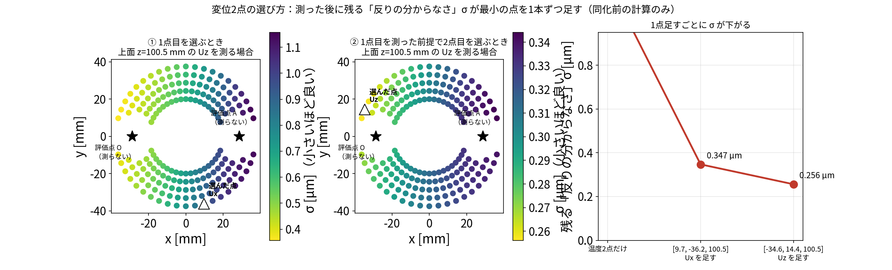

*左＝1点目を選ぶときの採点（色が薄いほど良い）、中＝1点目を測った前提で採点し直したとき、右＝ $\sigma$ が下がる様子。*

左と中を見比べてください。**良い場所（薄い色）が移動しています。**

| | 良い場所 | なぜ |
|---|---|---|
| 1点目のとき | 上面の ±y 側 | ヒータ側と反対側の両方の影響を受ける |
| 2点目のとき | **ヒータの反対側（−x 側）** | 1点目で分からなかった「反対側の情報」が欲しくなる |

#### 選んだ2点で、観測していない温度・変位はどう合ったか

選んだ S1・S2 を実際にデータ同化に入れて、**観測していない場所**を見ます。
反り A−O だけでなく、**A・O それぞれの $U_z$**、**ほかの未観測点の $U_z$**（D・E・F）、**観測していない温度**（代表点 P1・P3・P4 と、代表点以外のセル4点）、**温度場全体**も比べます。

**条件**：真値＝OpenFOAM（温度場）＋FrontISTR（全節点の変位）、15 W。ROM＋EnKF（60メンバー、30 秒ごと、5 seed）。観測は温度計 P2・P0 ＋ 変位計2点だけで、グラフの点はすべて観測に使っていません（ `run/selected_pair_unobserved_check.py` ）。

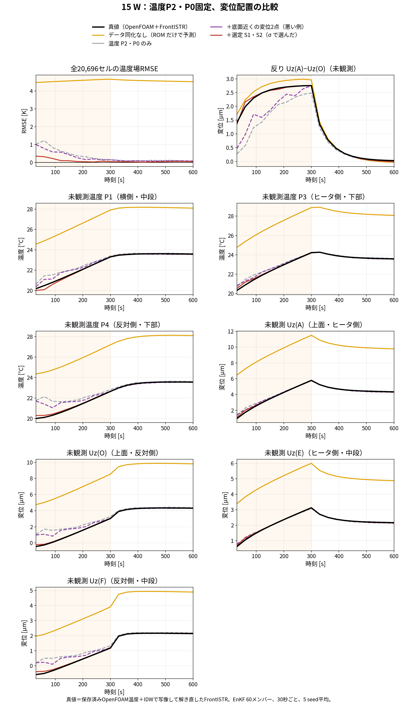

*上段＝センサと評価点の位置（●温度計、■変位計、▲温度の評価点、★変位の評価点）。黄＝データ同化なし（ROM だけで予測）。2〜3段目＝観測していない温度、4〜5段目＝観測していない変位。太い灰色＝真値。各グラフ右上の数字＝30〜300 秒の平均誤差（線の色と対応）。*

| 観測していない量（30〜300 秒の平均誤差） | データ同化なし | 温度 P2・P0 のみ | ＋底面近く（悪い例） | ＋中段 B・C | **＋選定 S1・S2** |
|---|---:|---:|---:|---:|---:|
| 温度場全体（20,696 セルの RMSE） | 4.58 K | 0.54 K | 0.43 K | 0.18 K | **0.13 K** |
| 未観測の温度7点のうち最大 | 4.61 K | 0.90 K | 0.70 K | 0.22 K | **0.19 K** |
| 反り A−O | 0.24 µm ※ | 0.77 µm | 0.58 µm | 0.19 µm | **0.075 µm** |
| $U_z(A)$ | 5.60 µm | 0.24 µm | 0.20 µm | 0.15 µm | **0.10 µm** |
| $U_z(O)$ | 5.37 µm | 0.94 µm | 0.74 µm | 0.16 µm | **0.09 µm** |
| D（上面・+y 側）の $U_z$ | 5.50 µm | 0.64 µm | 0.49 µm | 0.16 µm | **0.12 µm** |
| E（ヒータ側・中段）の $U_z$ | 2.82 µm | 0.10 µm | 0.08 µm | 0.08 µm | **0.05 µm** |
| F（反対側・中段）の $U_z$ | 2.64 µm | 0.52 µm | 0.41 µm | 0.09 µm | **0.06 µm** |

- **データ同化なし（ROM だけで予測）では、温度が約 4.6 K、変位が 2.6〜5.6 µm ずれます。** 選定 S1・S2 でデータ同化すると、温度は 0.2 K 以下、変位は 0.1 µm 前後まで直ります。
- ※ 反り A−O だけは、データ同化なしでも 0.24 µm と小さく見えます。A と O が同じ向きに約 5.5 µm ずれ、差を取ると打ち消し合うためです（§6-2 と同じ注意）。
- **σ で選んだ S1・S2 は、反りだけでなく、観測していない温度・個別の変位のすべてで一番良い結果**でした。
- 温度 P2・P0 だけだと、**反対側（O 側）の温度と変位が外れます**（P4 0.90 K、 $U_z(O)$ 0.94 µm）。ヒータ側の $U_z(A)$ や E は、もともとそこそこ合っています。
- 底面近くの変位計は、ほとんど効きません。


#### まとめ

> **やったこと**：候補 14,754 通りを全部採点して1位を選ぶ。選んだら採点をやり直して、また1位を選ぶ。
>
> **考え方**：いま分かっていないことを、いちばん多く教えてくれる点を選ぶ。選んだら「何が分かっていないか」を更新して、また選ぶ。

**ここまで測定値は一切使っていません。** FrontISTR の計算と ROM の計算だけで、机上で場所が決まります。
本当に当たるかは、このあとデータ同化を回して確かめます。

### 5-3. 結果

まず、**どこを測って、温度と変位がどう合ったか**を見ます。

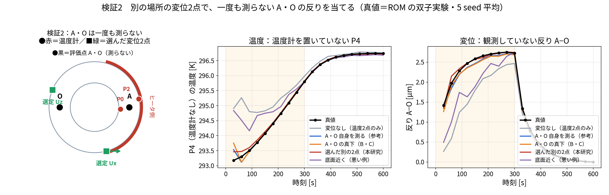

*左＝観測点と評価点／中＝**温度**：温度計を置いていない P4／右＝**変位**：一度も観測していない反り A−O。
黒が真値、色が変位2点の置き場所。*

- **中**：変位なし（灰）は 300 秒まで真値より高めに外れ続けますが、**変位2点を足すとどの置き場所でも真値に近づきます**。
  底面近く（紫）だけは外れたままです。
- **右**：反りは置き場所で大きく変わります。選んだ2点（赤）は**黒い真値にほぼ重なり**、
  変位なし（灰）は加熱中ずっと下に外れています。

誤差を加熱期で平均すると次のようになります。

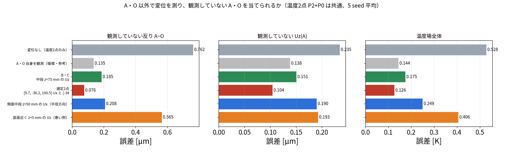

| 変位2点をどこに置くか | **観測していない反り A−O** | **観測していない Uz(A)** | 温度場全体 |
|---|---:|---:|---:|
| 変位なし（温度2点のみ） | 0.756 µm | 0.234 µm | 0.528 K |
| A・O 自身を観測（**観測点での適合評価**・参考） | 0.135 µm | 0.138 µm | 0.145 K |
| B・C（中段 z=75 mm の $U_z$ ） | 0.185 µm | 0.151 µm | 0.175 K |
| **選定2点**（(9.7, −36.2, 100.5) の $U_x$ と (−34.6, 14.4, 100.5) の $U_z$ ） | **0.076 µm** | **0.103 µm** | **0.126 K** |
| 側面中段 z=50 mm の $U_x$ | 0.207 µm | 0.189 µm | 0.248 K |
| 底面近く z=5 mm の $U_z$ （悪い例） | 0.559 µm | 0.196 µm | 0.408 K |

### 5-4. 分かったこと

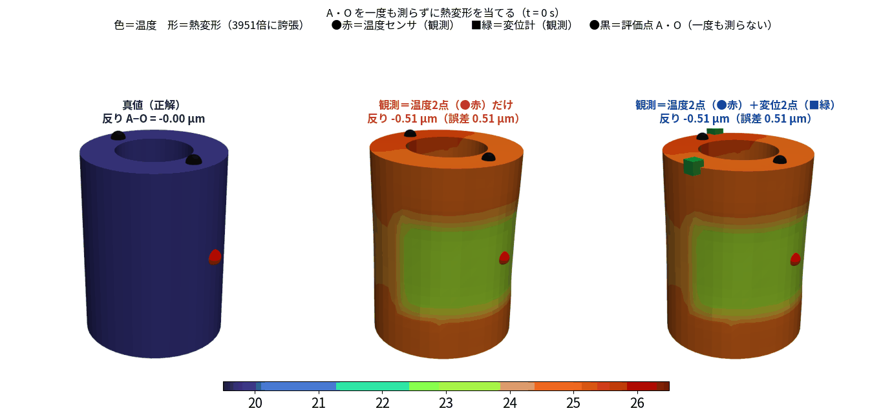

*左＝真値、中＝温度2点だけ、右＝温度2点＋変位2点（A・O は一度も測らない）。
**色＝温度、形＝熱変形**（約4,000倍に誇張）。*

| 印 | 意味 |
|---|---|
| **●赤い球** | 温度センサ（P2・P0。3枚とも共通） |
| **■緑の立方体** | 変位計（右のパネルにだけ現れる。選定した2点） |
| **●黒い球** | 評価点 A・O（**一度も測らない**。3枚とも共通） |

（seed 20260913）

形と色で、何が起きているか一目で分かります。例えば $t=150$ 秒では

| | 反り A−O | 誤差 |
|---|---:|---:|
| 真値 | 2.57 µm | ― |
| 温度2点のみ（中） | 1.38 µm | 1.19 µm |
| **温度2点＋別の場所の変位2点（右）** | **2.56 µm** | **0.01 µm** |

- **中（温度2点のみ）**：全体が緑がかっていて、真値（左）より温度が高めに出ています。形も反りが足りません。
- **右（変位2点を足す）**：色も形も左の真値とほとんど同じです。**A・O（黒球）は一度も測っていません。**

1. **A・O を一度も測らずに、反りを 0.076 µm で当てられました。** 真値の振幅 2.74 µm に対して 2.8 % です。
2. **A・O を直接測った場合（0.135 µm）より正確です。** 測る場所を選べば、知りたい場所を測らないほうが良い結果になりました。
   - 理由は信号対雑音比と考えています。A・O の反りは最大 2.7 µm ですが、変位計のノイズは 0.3 µm あります。
     選定した点は変位がもっと大きく動くので、同じノイズでも情報が多く取れます。**この解釈は確かめていません。**
3. **置き場所で大きく変わります。** 底面近く（0.559 µm）は、変位なし（0.756 µm）から少ししか改善しません。底面は支持点（3節点）の近くで、ほとんど動かないためです。
4. 選定は**データ同化を回す前**に、FrontISTR の熱感度と ROM で作った温度のばらつきだけで計算しています（[blog_005 §4-6](blog_005_optimal_sensor_placement.md) と同じ方法）。

> **これが本研究のいちばん強い結果だと考えています。**
> 工作機械で本当に知りたいのは工具先端の変位ですが、加工中にそこは測れません。
> **測れる場所で変位を測り、測れない場所の変形を当てる**ことを、計算で示せました。

### 5-5. 注意（未確認）

- 上の表（0.076 µm など）は ROM の双子実験です。実ソルバ真値での結果は §6 のとおりで、同じ結論でした。
- 「直接測るより正確」の理由（信号対雑音比）は解釈で、別の計算では確かめていません。
- 選定した2点は上面にあります。この形状では上面がよく動くためで、他の形状では変わります。

> **この節で分かったこと**
> - **A・O を一度も測らずに、反りを 0.076 µm で当てられた**（振幅 2.74 µm の 2.8 %）。
> - **A・O を直接測った場合（0.135 µm）より正確**。測る場所を選べば、知りたい場所を測らないほうが良い結果になった。
> - 置き場所で大きく変わる。底面近く（0.559 µm）は、変位なし（0.756 µm）から少ししか改善しない。
> - 置き場所は**データ同化を回す前**に、FrontISTR の熱感度と ROM の温度のばらつきだけで決められる。


---

## 6. 【検証3】真値を OpenFOAM＋FrontISTR にしても同じか
> **この節で知りたいこと**：§5 は真値も ROM の双子実験だった。**モデル誤差がある条件**でも同じ結論になるか
>
> **条件**：温度の真値＝OpenFOAM の固体温度場、変位の真値＝その温度を各時刻 FrontISTR に入れて計算した全節点の変位。
> データ同化モデルは ROM のまま。A・O は一度も観測しない。15 W・25 W・間欠加熱の3条件 × 5 seed


### 6-1. やったこと

[§5](#5-検証2別の場所の変位で測っていない-ao-を当てられるか) の結果は真値も ROM の双子実験でした。
データ同化に使うのと同じモデルで正解を作っているので、**都合が良すぎます**。
そこで**真値を OpenFOAM＋FrontISTR にして**、同じ試験をやり直しました（`run/holdout_AO_realsolver.py`）。

- 温度の真値＝OpenFOAM の固体温度場
- **変位の真値＝その温度場を各時刻 FrontISTR に入れて計算した全節点の変位**（21 時刻 × 3 条件）
- データ同化モデルは ROM のまま。A・O は一度も観測しない

### 6-2. 結果

3条件それぞれで、**温度と変位がどう合ったか**を見ます。

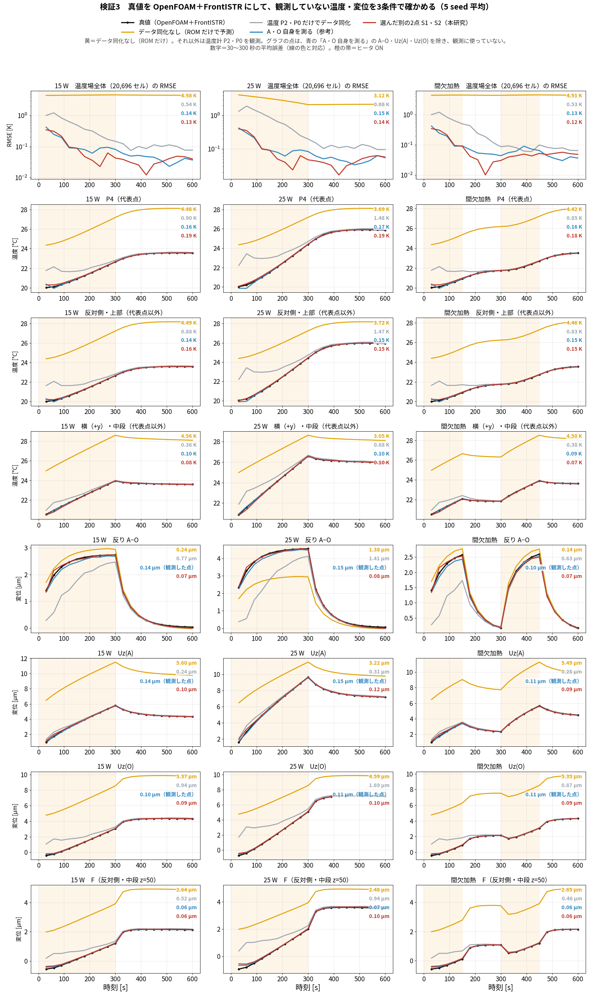

*左から 15 W・25 W・間欠加熱。行は上から、温度場全体の RMSE、観測していない温度3点（代表点 P4、代表点以外のセル2点）、変位（反り A−O、 $U_z(A)$ 、 $U_z(O)$ 、反対側・中段 F の $U_z$ ）。黒が真値（OpenFOAM＋FrontISTR）。各グラフ右上の数字＝30〜300 秒の平均誤差。**黄＝データ同化なし**（60メンバーの ROM を、補正せずにそのまま進めた平均）。青の「A・O 自身を測る」だけは、A−O・ $U_z(A)$ ・ $U_z(O)$ を観測しているので参考値です（ `run/make_ver3_full_fig.py` ）。*

**まず、データ同化しないとどれだけずれるか（黄）。** 発熱量・放熱・初期温度が分からないまま ROM で予測すると、次のようにずれます。

| 観測していない量（30〜300 秒の平均誤差） | **データ同化なし**（15 W／25 W／間欠） | 温度 P2・P0 だけでデータ同化 | **＋選んだ別の2点 S1・S2** |
|---|---|---|---|
| 温度場全体（RMSE） | **4.58／3.12／4.51 K** | 0.54／0.88／0.53 K | **0.13／0.14／0.12 K** |
| P4 の温度 | 4.46／3.69／4.42 K | 0.90／1.48／0.85 K | **0.19／0.19／0.18 K** |
| $U_z(A)$ | **5.60／3.22／5.49 µm** | 0.24／0.31／0.28 µm | **0.10／0.12／0.09 µm** |
| $U_z(O)$ | **5.37／4.59／5.35 µm** | 0.94／1.69／0.87 µm | **0.09／0.10／0.09 µm** |
| F の $U_z$ | 2.64／2.48／2.65 µm | 0.52／0.94／0.46 µm | **0.06／0.10／0.06 µm** |
| 反り A−O | 0.24／1.38／0.14 µm ※ | 0.77／1.41／0.63 µm | **0.075／0.083／0.071 µm** |

- **データ同化なしでは、温度が 3〜4.6 K、変位が 2.5〜5.6 µm ずれます。** $U_z(A)$ の真値は最大 6 µm（25 W では 10 µm）程度なので、変位そのものと同じくらいの大きさでずれています。
- **温度計 P2・P0 と、選んだ変位計2点でデータ同化すると、温度は 0.2 K 以下、変位は 0.1 µm 前後まで直ります。** ずれが **1/20〜1/60** になりました。A・O や F、P4 は一度も観測していません。
- ※ **反り A−O だけは、データ同化なしでも小さく見えます**（15 W で 0.24 µm）。A も O も同じ向きに約 5.5 µm ずれているので、差を取ると打ち消し合うためです。個別の $U_z(A)$ ・ $U_z(O)$ を見れば、大きくずれていることが分かります。**差だけで評価してはいけない**例です（[blog_004 §7-4b](blog_004_pod_selected_rom.md) と同じ注意）。
- 温度計 P2・P0 だけでデータ同化しても、温度場はかなり直ります（0.54 K）。しかしヒータの反対側（P4、 $U_z(O)$ 、F）は外れたままで、反りは 0.77 µm ずれます。変位計2点を足すと、反対側まで直ります。
- 選んだ2点（赤）は、A・O を一度も測らずに、 $U_z(A)$ ・ $U_z(O)$ も **A・O 自身を測った場合（青）と同じか、それ以上に**合いました（15 W で $U_z(A)$ 0.10 対 0.14 µm）。
- 25 W（中央）は ROM の係数を決めていない条件ですが、同じ傾向です。間欠加熱（右）では、2回目の加熱の山まで追えています（ヒータの ON/OFF をモデルに与えているため）。

誤差を加熱期で平均すると次のようになります。

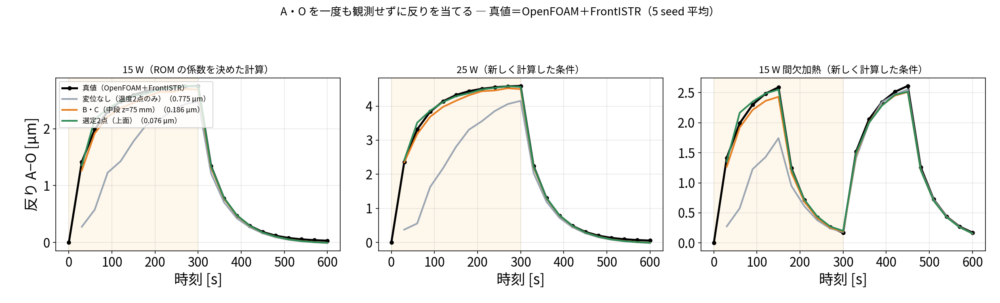

*黒＝真値（OpenFOAM＋FrontISTR）、灰＝変位なし、橙＝B・C、緑＝選定2点。5 seed 平均。*

**反り A−O の誤差 [µm]**（加熱期 30〜300 秒の平均）

| 変位2点をどこに置くか | 15 W | 25 W | 間欠加熱 |
|---|---:|---:|---:|
| 変位なし（温度2点のみ） | 0.769 | 1.408 | 0.630 |
| A・O 自身を観測（**観測点での適合評価**・参考） | 0.137 | 0.153 | 0.100 |
| B・C（中段 z=75 mm） | 0.187 | 0.193 | 0.143 |
| **選定2点（上面）** | **0.075** | **0.083** | **0.071** |
| 底面近く z=5 mm（悪い例） | 0.581 | 1.096 | 0.480 |

**反り以外の、観測していない量も3条件で見る**（ `run/selected_pair_unobserved_check.py` 、同じ真値・同じ設定）

| 観測していない量 | データ同化なし（15 W／25 W／間欠） | 温度2点のみ（15 W／25 W／間欠） | **＋選定2点（15 W／25 W／間欠）** |
|---|---|---|---|
| 温度場全体（RMSE） | 4.58／3.12／4.51 K | 0.54／0.88／0.53 K | **0.13／0.14／0.12 K** |
| 未観測の温度7点のうち最大 | 4.61／3.72／4.54 K | 0.90／1.48／0.85 K | **0.19／0.19／0.18 K** |
| $U_z(A)$ | 5.60／3.22／5.49 µm | 0.24／0.31／0.28 µm | **0.10／0.12／0.09 µm** |
| $U_z(O)$ | 5.37／4.59／5.35 µm | 0.94／1.69／0.87 µm | **0.09／0.10／0.09 µm** |
| 未観測の $U_z$ （D・E・F）のうち最大 | 5.50／3.84／5.42 µm | 0.64／1.06／0.64 µm | **0.12／0.12／0.12 µm** |

15 W の図は §5-2 にあります。25 W と間欠加熱の図は次のとおりです。

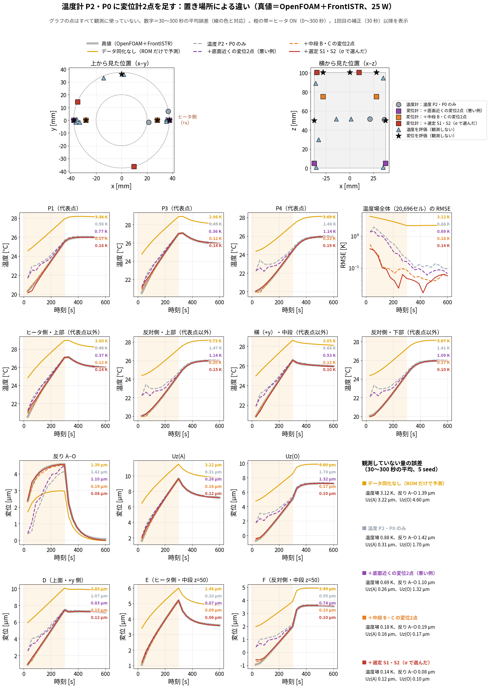

*25 W（ROM の係数を決めていない条件）。見方は §5-2 の図と同じ。*

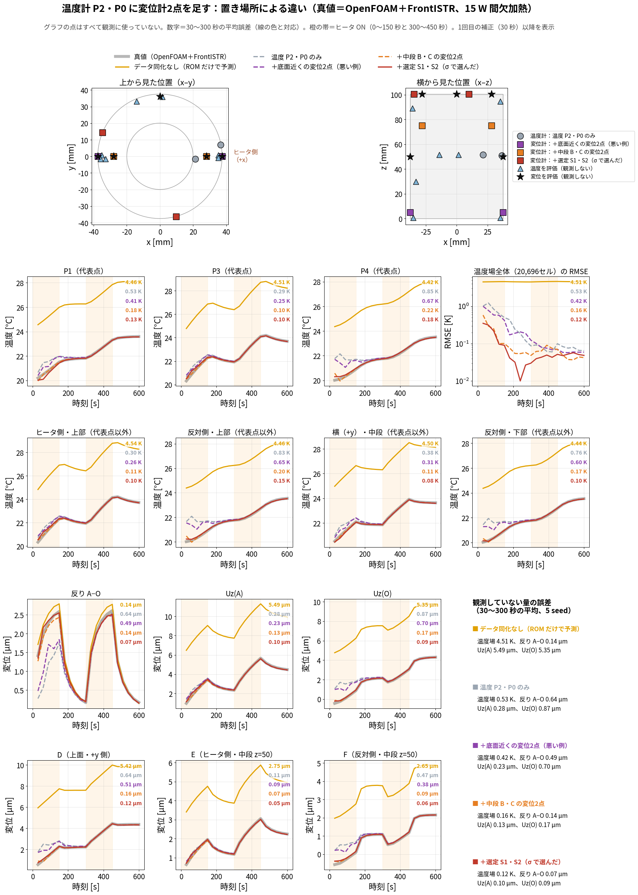

*15 W 間欠加熱（ヒータ ON は 0〜150 秒と 300〜450 秒）。見方は §5-2 の図と同じ。*

### 6-3. 分かったこと

**ROM 真値のときと同じ結論が、実ソルバ真値でも得られました。**

1. **A・O を一度も測らずに、3条件すべてで 0.07〜0.08 µm** で当てられました。
2. **3条件すべてで、A・O を直接測る（0.10〜0.15 µm）より正確**です。
3. 係数を決めていない条件（25 W・間欠加熱）でも成立します。25 W では変位なしの 1.408 µm から **17 倍**改善しました。
4. 置き場所で大きく変わります。底面近くは 25 W で 1.096 µm と、ほとんど改善しません。

> **これで切り口B（測れない場所を、測れる場所から当てる）が、実ソルバ真値でも裏づけられました。**

> **この節で分かったこと**
> - 真値を実ソルバ（OpenFOAM＋FrontISTR）にしても、**3条件すべてで 0.07〜0.08 µm** で当てられた。
> - **3条件すべてで、A・O を直接測る（0.10〜0.15 µm）より正確**。§5 と同じ結論。
> - 係数を決めていない 25 W でも成立し、変位なし（1.408 µm）から **17 倍**改善した。
> - 置き場所が悪いと 25 W で 1.096 µm ＝ ほとんど改善しない。**置き場所の設計に意味がある。**

### 6-4. 温度計も代表点以外から選ぶと、どうなるか

> **この節で知りたいこと**：ここまでの温度計 P2・P0 は ROM の代表点で、しかも2本ともヒータ側にある。温度計も**代表点以外の全セル**から σ で選び、変位計2点と一緒に決めたら、もっと良くなるか
>
> **条件**：選び方は §5-2 と同じ（4000 本の事前分布、反り A−O の σ を 30〜300 秒で平均）。真値は OpenFOAM＋FrontISTR（15 W・25 W・間欠加熱）、EnKF・5 seed

#### やったこと

1. **候補を広げる。** 温度計の候補＝代表5点を除く全セル（20,691 個）。変位計の候補＝§5-2 と同じ 14,754 個。
2. **温度計の観測行列の行を作る。** 代表点以外のセル $j$ の温度は、gappy-POD で代表5点の温度の一次式になるので、行は $\mathbf g_j=\boldsymbol\psi_jU_{rP}^{-1}$ です（代表点なら $(0,0,1,0,0)$ のような行になる）。
3. **何も測らない状態から、σ が一番小さくなる候補を1本ずつ足す。** 温度計・変位計がそれぞれ2本になったら、その種類は候補から外す（ `run/select_nonrep_temp_disp.py` ）。
4. **選んだ4本でデータ同化し、観測していない量を比べる**（ `run/selected_pair_unobserved_check.py` ）。

#### 選ばれた場所

| 順番 | 種類 | 座標 [mm] | 位置 | 足した後の σ （予測） |
|---:|---|---|---|---:|
| ― | 何も測らない | | | 1.451 µm |
| 1 | 変位 $U_x$ | (18.8, 32.5, 100.5) | 上面・+y 側 | 0.368 µm |
| 2 | 変位 $U_x$ | (18.8, −32.5, 100.5) | 上面・−y 側（1本目と鏡写し） | 0.296 µm |
| 3 | 温度 | (−30.1, −20.6, 51.6) | **反対側**・中段 | 0.280 µm |
| 4 | 温度 | (36.7, 0.8, 72.7) | **ヒータ側**・やや上 | **0.220 µm** |

- **温度計は、ヒータ側と反対側に1本ずつ**選ばれました（§0-11 の「両側に分ける」と同じ）。
- **変位計2本は、y=0 の面について鏡写しの位置**で、5点の温度への重みもほぼ同じでした。同じ量を2回測ってノイズを平均する形です。

測る前の予測 σ では、今の配置（温度 P2・P0 ＋ 変位 S1・S2）の 0.256 µm より小さくなりました。

| 配置 | 予測 σ （測る前） |
|---|---:|
| 温度 P2・P0 のみ | 1.186 µm |
| 温度 P2・P4 のみ（代表点・両側） | 0.590 µm |
| 代表点以外の温度2点のみ（σ で選んだ） | 0.499 µm |
| 温度 P2・P0 ＋ 変位 S1・S2（今の配置） | 0.256 µm |
| **代表点以外の温度2点＋変位2点（σ で選んだ）** | **0.220 µm** |

#### データ同化した結果

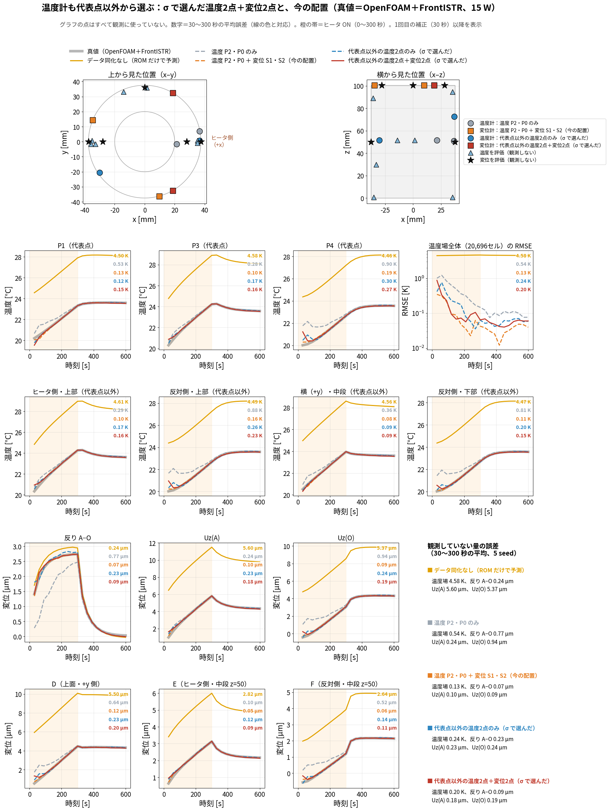

*15 W。見方は §5-2 の図と同じ。黄＝データ同化なし、青＝代表点以外の温度2点のみ、赤＝代表点以外の温度2点＋変位2点、橙＝今の配置（温度 P2・P0 ＋ 変位 S1・S2）。*

| 観測していない量（15 W／25 W／間欠） | データ同化なし | 温度 P2・P0 のみ | 代表点以外の温度2点のみ | 今の配置（P2・P0 ＋ S1・S2） | 代表点以外の温度2点＋変位2点 |
|---|---|---|---|---|---|
| 温度場全体（RMSE） | 4.58／3.12／4.51 K | 0.54／0.88／0.53 K | 0.24／0.27／0.24 K | **0.13／0.14／0.12 K** | 0.20／0.18／0.20 K |
| 反り A−O | 0.24／1.38／0.14 µm ※ | 0.77／1.41／0.63 µm | 0.23／0.26／0.19 µm | **0.075／0.083／0.071 µm** | 0.089／0.094／0.073 µm |
| $U_z(A)$ | 5.60／3.22／5.49 µm | 0.24／0.31／0.28 µm | 0.23／0.25／0.22 µm | **0.10／0.12／0.09 µm** | 0.18／0.17／0.18 µm |
| $U_z(O)$ | 5.37／4.59／5.35 µm | 0.94／1.69／0.87 µm | 0.24／0.28／0.24 µm | **0.09／0.10／0.09 µm** | 0.19／0.17／0.19 µm |

※ データ同化なしの反りが小さく見えるのは、A と O が同じ向きにずれて打ち消し合うためです（§6-2）。

25 W と間欠加熱の図：[unobserved_n_q25.png](img/unobserved_n_q25.png)、[unobserved_n_intermittent.png](img/unobserved_n_intermittent.png)

#### 分かったこと

1. **温度計は代表点以外から選んでも、データ同化できる。** 両側に分けた代表点以外の温度2点だけで、温度場 0.24 K・反り 0.23 µm。代表点 P2・P0（片側）の 0.54 K・0.77 µm より、ずっと良い結果でした。
2. **ただし、予測 σ が一番小さかった「代表点以外の温度2点＋変位2点」は、実際には今の配置より良くなりませんでした。**
   - 反り A−O は今の配置とほぼ同じか、わずかに悪い（0.089 対 0.075 µm など）。
   - 温度場、 $U_z(A)$ ・ $U_z(O)$ は、はっきり悪い（温度場 0.20 対 0.13 K、 $U_z(A)$ 0.18 対 0.10 µm）。
   - **予測 σ の順位（0.220 ＜ 0.256）が、実際の順位と逆になりました。** σ で順位が当たらない例です。
3. **考えられる理由**（どれも確かめていません）
   - **σ は反り A−O だけを見て選んでいる。** 鏡写しの変位計2本は、反り（A と O の差）にはよく効きますが、A・O それぞれの値や温度場の情報は少ない。目的を反りだけにすると、反り以外の量が犠牲になり得ます。
   - **鏡写しの2本は、ほぼ同じことを測っている。** σ の計算では「ノイズが独立なら2回測ると平均で減る」と扱いますが、実際には ROM と真値のずれ（モデル誤差）が2本に共通に乗るので、平均しても減りません。
   - **代表点以外の温度計には、復元の誤差が乗る。** 代表点以外のセルの温度は POD の5つの型で表した近似です。真値（OpenFOAM）とのずれは σ の計算のノイズ $R$ に入れていません。

> **この節で分かったこと**
> - 温度計も**代表点以外から選べる**。σ で選ぶと、ヒータ側と反対側に1本ずつ選ばれた。
> - 代表点以外の温度2点＋変位2点は、**予測 σ では今の配置より良かったが、実際のデータ同化では反りがほぼ同じ、温度場と個別の変位は悪かった**。
> - σ で選ぶときは、**目的（反りだけか、温度場や個別の変位も含むか）**と、**同じ量を測るセンサの重複・モデル誤差**を考える必要がある。今回の σ はどちらも入れていない。

---

## 7. 【検証4】配置の決め方は、既存の方法より良いか
> **この節で知りたいこと**：§5・§6 で「選定2点が良かった」のは、**決め方が良かったから**なのか。既存の配置法と比べてどうか
>
> **条件**：同じ候補集合（14,754 通り）に6つの決め方を適用し、**同じ holdout 試験**（A・O は一度も観測しない）にかける。
> 真値＝OpenFOAM＋FrontISTR、3条件 × 5 seed（`run/placement_method_comparison.py`）


### 7-1. この節は何をしたか

変位計を**どこに置くか決める方法**を6通り用意し、**決め方だけを変えて、ほかの条件は全部そろえて**比べました。

| | |
|---|---|
| **なぜやったか** | 前の節は「選定2点」と「底面近く（悪い例）」を比べただけで、**選び方そのものが良い**という証拠になっていなかった |
| **何をしたか** | 同じ候補 14,754 通りに6つの決め方を適用し、**同じ holdout 試験**（A・O を一度も観測しない）にかけた |
| **比べた相手** | 無作為配置／「よく動く点に置く」／Q-DEIM／A最適／D最適（後ろ3つは教科書的な方法） |
| **真値** | OpenFOAM＋FrontISTR。15 W・25 W・間欠加熱の3条件 × 5 seed |
| **何が得られたか** | 本研究の決め方が**3条件とも最小**（0.075／0.083／0.071 µm）。ただし2位の A最適（0.090 µm）との差は **15〜20 %** |
| **いちばんの収穫** | 「温度場全体を良く知る配置」と「反りを良く知る配置」は**別物**だと示せたこと。そして「よく動く点に置く」は**無作為より悪い**こと |

### 7-2. なぜやるか ― ここまでの比較の弱点

[§5](#5-検証2別の場所の変位で測っていない-ao-を当てられるか) で比べたのは、この4つでした。

| 比べた相手 | 反り A−O の誤差（15 W） |
|---|---:|
| 変位なし | 0.769 µm |
| A・O 自身を測る | 0.137 µm |
| B・C（A・O の真下） | 0.187 µm |
| **選定2点** | **0.075 µm** |
| 底面近く（悪い例） | 0.581 µm |

これで言えるのは「**選んだ点は、適当に決めた点より良かった**」だけです。
底面近くは支持点の近くでほとんど動かないので、負けて当たり前です。

> **本当に知りたいのは「σ を最小化するという選び方そのものが良いのか」です。**
> センサ配置の決め方には教科書的な方法がいくつもあります。それらと比べて初めて、
> 「この選び方が効いている」と言えます。

そこで、**選び方だけを変えて、ほかは全部同じにした比較**を行いました。

### 7-3. 土俵をそろえる

比べるときに変えてよいのは「選び方」だけです。それ以外は全部そろえます。

| そろえるもの | 中身 |
|---|---|
| 候補集合 | 全 5,040 節点 × 3 方向のうち、A・O から 12 mm 以上離れた **14,754 通り**（全手法で共通） |
| 使う情報 | FrontISTR の熱感度 $W$ と、ROM を 4,000 通り回して作った温度のばらつき $B$ だけ。**測定値は使わない** |
| センサの本数 | 温度2点（P2・P0）＋ **変位2点**（全手法で共通） |
| 試験 | A・O を**一度も観測しない** holdout。データ同化は EnKF・60 メンバー・30 秒ごと |
| 真値 | OpenFOAM の温度場 ＋ それを FrontISTR に入れた全節点変位。15 W／25 W／間欠加熱の3条件 |
| 乱数 | 同じ 5 seed |

### 7-4. 比べる6つの決め方

**「何を小さくしようとしているか」で分類**すると、次の6つになります。

| 選び方 | 何を小さくするか | 狙っている対象 |
|---|---|---|
| **ランダム** | ― （20 通りの無作為な2点） | ― （下限の目安） |
| **よく動く点に置く** | ― 温度が変わったとき**変位がいちばん大きく動く**点 | ― |
| **Q-DEIM（QR 列ピボット）** | モード応答の独立性を確保する（条件数の全球最小を保証する方法ではない） | モード係数の復元 |
| **A最適** | 温度5点の事後共分散の **trace** | **代表5点温度の分散の和** |
| **D最適** | 温度5点の事後共分散の **det** | **代表5点温度の不確かさの体積** |
| **目的指向（本研究）** | $\sigma_S^2=w^{\mathsf T}(\cdots)w$ | **反り A−O** |

A最適・D最適は実験計画法の教科書に出てくる基準です。Q-DEIM は ROM の分野で標準的な点の選び方で、
[blog_004 §4](blog_004_pod_selected_rom.md) で ROM の代表5点を選んだのと同じ方法です。

> **比較の軸はここです。**
> 今回のA最適・D最適は**代表5点の温度共分散**、Q-DEIMは**モード応答の独立性**を基準にします。全20,696セルの温度RMSEを直接最小化する方法ではありません。
> 今回の比較法のうち、目的指向は**反り A−O の予測事後分散**を基準にします（ $w$ で目的を指定）。仮定した共分散・ノイズの下での予測値であり、EnKFの実際の誤差の最小を保証するものではありません。
>
> **温度場を良く知れば、反りも良く分かるはずだ** ― これが正しいなら、A最適と本研究は同じ答えになるはずです。
> 違う答えになるなら、「目的を指定すること」に意味があることになります。

### 7-5. どこが選ばれたか ― データ同化を回す前に、場所を見る

データ同化を回す前に、**選ばれた場所そのもの**を見ます。選定はすべて机上の計算だけで終わっています。


*上面（z=100.5 mm）を真上から見た図。□＝選ばれた変位計、矢印＝測る方向（ $U_z$ は紙面に垂直なので矢印なし）、
●＝評価点 A・O（測らない）、赤い弧＝ヒータ側。*

| 選び方 | 1点目 | 2点目 | **2点の間隔** | 測る前の予測 $\sigma$ |
|---|---|---|---:|---:|
| よく動く点に置く | (26.5, 26.5) $U_y$ | (22.8, 29.8) $U_y$ | **5.0 mm** | 1.007 µm |
| Q-DEIM | (26.5, 26.5) $U_y$ | (4.9, −37.2) $U_x$ | 67.3 mm | 0.324 µm |
| A最適 | (−29.8, 22.8) $U_z$ | (−29.8, −22.8) $U_x$ | 45.6 mm | 0.277 µm |
| D最適 | (−36.2, 9.7) $U_z$ | (−18.8, −32.5) $U_y$ | 45.6 mm | 0.353 µm |
| A・O 自身（循環・参考） | (28.7, 0) $U_z$ | (−28.7, 0) $U_z$ | 57.4 mm | 0.319 µm |
| **目的指向（本研究）** | (9.7, −36.2) $U_x$ | (−34.6, 14.4) $U_z$ | 67.3 mm | **0.256 µm** |

座標は mm、上面なので z は省略しています。

**この時点で2つ分かります。**

**(1) 「よく動く点に置く」は、2点が 5 mm しか離れていません。**
左上のパネルで、2つの□がほとんど重なっているのが見えます。
「よく動く点」は上面の特定の向きに**固まって存在する**ので、単純に上位2つを採ると
**ほとんど同じ場所を2回測る**ことになります。 [§5-2 のステップ4](#ステップ4採点をやり直して2点目を選ぶ) で
「2位をそのまま選んではいけない」と書いたのは、まさにこれです。

**(2) 式は「A・O を直接測るのは最善ではない」と、データ同化を回す前に言っています。**
A・O 自身を測る構成の予測は 0.319 µm で、目的指向の 0.256 µm より大きい。
[§5](#5-検証2別の場所の変位で測っていない-ao-を当てられるか) の「直接測るより正確」という結果は、
**測定の前に式が予言していた**ことになります。

### 7-6. 同じ試験にかけた結果

選ばれた2点それぞれで、A・O を一度も観測しない holdout を回します。
まず、**温度と変位がどう合ったか**を見ます。

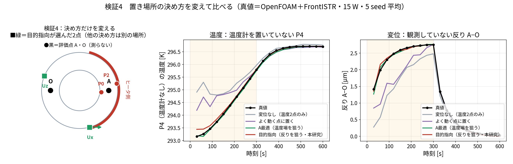

*左＝観測点（緑は目的指向が選んだ2点。他の決め方は別の場所）／中＝**温度**（P4）／右＝**変位**（反り A−O）。
真値＝OpenFOAM＋FrontISTR、15 W。*

- **中**：「よく動く点に置く」（紫）は、温度でも真値から離れたままです。2点が 5 mm しか離れておらず、
  同じ情報しか入らないためです。
- **右**：反りでは差がはっきり出ます。目的指向（赤）が真値にいちばん近く、A最適（緑）がそれに続きます。

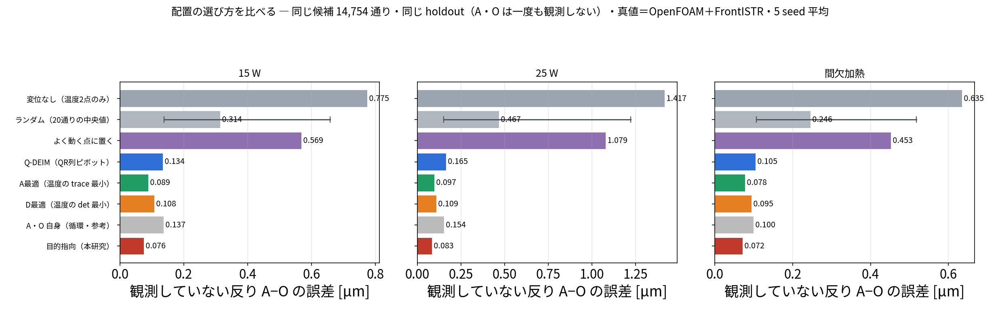

**観測していない反り A−O の誤差 [µm]**（加熱期 30〜300 秒の平均、5 seed）

| 選び方 | 15 W | 25 W | 間欠加熱 |
|---|---:|---:|---:|
| 変位なし（温度2点のみ） | 0.769 | 1.408 | 0.630 |
| ランダム（20 通りの中央値） | 0.315 | 0.471 | 0.246 |
| よく動く点に置く | 0.564 | 1.075 | 0.448 |
| Q-DEIM（QR 列ピボット） | 0.137 | 0.170 | 0.107 |
| D最適（det 最小） | 0.108 | 0.109 | 0.094 |
| A最適（trace 最小） | 0.090 | 0.098 | 0.080 |
| A・O 自身を観測（循環・参考） | 0.137 | 0.153 | 0.100 |
| **目的指向（本研究）** | **0.075** | **0.083** | **0.071** |

ランダムの散らばり（20 通り）：15 W で最良 0.140 / 最悪 0.655、25 W で最良 0.153 / 最悪 1.213 µm。

### 7-7. 分かったこと

**① 「温度場を良く知れば反りも分かる」は、だいたい正しいが、最善ではありません。**
A最適（温度場を狙う）は 0.090 µm、目的指向（反りを狙う）は 0.075 µm。
**目的を指定したほうが良かった**ものの、差は 15〜20 % で、劇的ではありません。
ステップ2で立てた問いへの答えは「**目的の指定には意味があるが、効き目は限定的**」です。

**② はっきり差がつくのは「よく動く点に置く」に対してです。**
「よく動く点に置く」は 0.448〜1.075 µm で、**ランダム（0.246〜0.471 µm）より悪い**。
理由はステップ3で見たとおり、2点が 5 mm しか離れていないからです。
**よく動く点を2つ選ぶのではなく、違うことを教えてくれる2点を選ぶ**必要があります。

**③ 「何を最小化するか」が結果を決めます。**
D最適は自分の指標（logdet −25.284）では6つの中で最良です。**自分の土俵では勝っています。**
それでも反りの誤差では A最適にも目的指向にも負けました。
**温度場全体を良く知ることと、反りを良く知ることは別**だということです。

**④ 良い配置はすべて「ヒータの反対側（−x 側）」を含みます。**
図を見ると、上位4つ（Q-DEIM・A最適・D最適・目的指向）はどれも −x 側に点を持っています。
「よく動く点に置く」だけが両方とも +x 側（ヒータ側）を選び、失敗しました。
反りは「ヒータ側と反対側の温度差」で決まるので、**片側だけ見ていては差が分からない**、ということです。

**⑤ 測る前の予測 $\sigma$ の順位は、実際の順位をほぼ当てました。**

| | 1位 | 2位 | 3位 | 4位 | 5位 |
|---|---|---|---|---|---|
| 予測 $\sigma$ | 目的指向 0.256 | A最適 0.277 | Q-DEIM 0.324 | D最適 0.353 | よく動く点 1.007 |
| 実際（15 W） | 目的指向 0.075 | A最適 0.090 | **D最適 0.108** | **Q-DEIM 0.137** | よく動く点 0.564 |

**D最適と Q-DEIM だけが入れ替わりました**（順位相関 0.9）。完全ではありませんが、
**買う前・取り付ける前に、おおよその優劣は分かる**ということです。

**⑥ どの「まともな」選び方でも、A・O を直接測るより良い結果でした。**
Q-DEIM 0.137、D最適 0.108、A最適 0.090、目的指向 0.075 に対し、A・O 自身は 0.137 µm。
「**知りたい場所を測らないほうが良い**」のは、特定の選び方に固有の話ではなく、
**この問題の性質**だと考えられます（A・O の反りは 2.7 µm しかないのに、ノイズは 0.3 µm あるため）。

### 7-8. 言えること・言えないこと

| 言える | 言えない |
|---|---|
| この形状・この目的（反り A−O）・変位2点の場合、目的指向が3条件とも最小だった | 目的指向が一般に最適だということ（**2点・1形状・1目的量しか試していない**） |
| 「よく動く点に置く」は危険（ランダムより悪いことがある） | A最適が常に2位だということ |
| 目的を指定すると、温度場だけを狙う配置より良くなる（15〜20 %） | その差が実用上の意味を持つかどうか |
| 測る前の予測で順位をほぼ当てられる（順位相関 0.9） | 順位が完全に当たること（D最適と Q-DEIM は入れ替わった） |

---

## 8. 工作機械の研究全体の中での位置づけ

ここまでの検証をふまえ、**工作機械の熱変形研究のどこに本研究が入るか**を整理します。

### 8-1. 既存の4つの流派

| 流派 | やり方 | 弱点 |
|---|---|---|
| **① 回帰・機械学習** | 温度センサ多点 → 変位を回帰／CNN で予測 | 学習した運転条件の外で外れる。物理が入っていない |
| **② FEM ベースの補償** | 詳細 FEM をオフラインで解き、温度から変位を計算 | 境界条件（熱伝達率・発熱量）が合わないと外れる |
| **③ 低次元化＋状態推定** | ROM＋カルマンフィルタで温度場を推定（[ETH 2024](https://www.research-collection.ethz.ch/entities/publication/a1ddda1a-3cd6-41ad-8590-be31b19896fb) など） | **観測は温度のみ。変位は出力** |
| **④ 直接測定による補償** | 変位計で TCP を測って直接補正（[NIST の整理](https://tsapps.nist.gov/publication/get_pdf.cfm?pub_id=957076) の「直接法」） | 加工中は測れない。状態推定には戻さない |

> **③と④の間が空いています。**
> ③は変位を「出力」、④は変位を「補正対象」として扱っていて、
> **変位を「観測」として状態推定に戻す流派がありません。**

### 8-2. 切り口A：変位は「結果」ではなく「情報源」である

> **熱変形は補正すべき誤差であると同時に、温度場を知るための情報源でもある。**

**根拠は §2 の一覧表にまとめてあります。**
要点は、変位計1本が5点すべての温度に触れるので、**温度計のない点の温度まで直る**ことです。

**なぜ新しいか**：④では変位は補正量として消費され、③では観測に入っていません。
**「変位を測ると温度が分かる」という逆方向の情報の流れ**は、調べた範囲（§3）で報告が見当たりません。

> **発表での言い方**
> 従来、熱変形は補正すべき対象であった。本研究は、**熱変形を温度場推定の観測情報として用いる**ことで、
> 温度センサのない位置の温度・発熱量まで同時に推定できることを示す。

### 8-3. 切り口B：測れない場所を、測れる場所から当てる設計論（目玉）

> **工具先端は測れない。測れる場所をどこにすれば、測れない場所が当たるかを設計できる。**

| 構成 | 測っていない A−O の反りの誤差 |
|---|---:|
| 温度2点のみ | 0.756 µm |
| A・O 自身を測る（循環・参考） | 0.135 µm |
| **選定した別の2点を測る** | **0.076 µm** |

**知りたい場所を直接測るより正確**という結果です（§5）。
しかも置き場所は、**データ同化を回す前に机上計算だけで決められます**（全 15,120 候補から選定）。

**なぜ新しいか**：④は「測れる場所を測って、そこを補正する」。
本研究は「**測れる場所を測って、測れない場所を当てる**」。さらに**その場所を設計できる**。

> **発表での言い方**
> 加工中の工具先端に変位計は置けない。本研究は、置ける位置での変位観測から、
> **一度も測らない位置の熱変形を振幅の 2.8 % の誤差で推定**し、
> さらに**その観測位置を事前計算で設計できる**ことを示す。

### 8-4. 切り口C：運転条件が変わっても使える（①への差別化）

> **回帰モデルは学習した条件を外れると外れる。物理モデル＋データ同化は外挿できる。**

真値は OpenFOAM＋FrontISTR（[blog_007](blog_007_rom_applicability.md)、[21_advantage_verification.md](21_advantage_verification.md)）。

| 条件 | 回帰式 | データ同化（温度2点＋変位2点） |
|---|---:|---:|
| 15 W（回帰式の係数を決めた条件） | 0.30 µm | **0.09 µm** |
| **25 W（決めていない条件）** | 0.29 µm | **0.10 µm** |
| 間欠加熱（ON/OFF を与える） | 0.30 µm | **0.08 µm** |

**約3分の1の誤差**です。さらに**発熱量そのものを 25.07 W と推定**できています（真値 25 W）。
これは回帰モデルには原理的にできません。

**なぜ新しいか**：①の弱点（外挿できない）を、実ソルバを真値にした試験で定量的に示しています。

### 8-5. 組み立て方の提案

**A を主、B を目玉、C を裏づけ**にするのが強いと考えます。

| 役割 | 内容 |
|---|---|
| **主張（A）** | 熱変形を「補正対象」から「**観測情報**」に位置づけ直す |
| **目玉（B）** | 測れない場所の変形を、測れる場所から**直接測定より正確に**推定（0.076 対 0.135 µm）。しかも置き場所を事前設計できる |
| **裏づけ（C）** | 係数を決めていない運転条件でも、従来の回帰補正の **1/3** の誤差。発熱量も同定できる |

### 8-6. 今の弱点と、埋める手段

| 弱点 | 埋める手段 | 状況 |
|---|---|---|
| 真値がすべて計算（実機なし） | `IoT/thermal_expansion_experiment/` の実験 | **未実施**（設計・試作案のみ） |
| 文献調査が英語5回・日本語1回 | 精密工学会・日本機械学会の論文を追加調査 | **未実施** |
| 切り口Bの holdout が ROM 真値のみ | §5 を OpenFOAM 真値でやり直す | **実施済み（§6）** |

目玉である切り口Bは、ROM の双子実験（§5）だけでなく実ソルバ真値（§6）でも確かめ、
配置の決め方も既存法と比べました（§7）。
**実ソルバを真値にした holdout 試験は実施済み**で（§6）、3条件とも同じ結論でした。残るのは実機検証と文献調査です。

---

## 9. 主張の書き方

### 9-1. 言ってよいこと

> 工作機械の熱変形補正では、温度を観測して変位を推定する形か、変位を直接測って補正する形が一般的である。
> 本研究は**温度と変位を同時に観測としてデータ同化に入れ**、温度センサのない点の温度・測っていない点の熱変形・発熱量を同時に推定した。
> とくに、**A・O を一度も観測せずに、別の場所の変位2点から反りを 0.076 µm（振幅の2.8 %）で推定**できた。これは A・O を直接測った場合（0.135 µm）より正確である。
> **調べた範囲では、この形の報告は見当たらない。**

「調べた範囲では」を必ず付けます。英語5回・日本語1回の検索だけが根拠だからです。

### 9-2. 言ってはいけないこと

| 言わない | 理由 |
|---|---|
| 「初めて提案した」 | 網羅的な文献調査をしていない |
| 「EnKF／POD／変位のデータ同化が新しい」 | いずれも既知の手法 |
| 「変位計は常に温度計より情報量が多い」 | 今回の温度場RMSEは近いが、反りの誤差には差がある。情報は推定対象・ノイズ・配置に依存（§4） |
| 「実機で有効」 | 真値はすべて計算で作ったもの |
| 「どんな機械でも有効」 | 熱源の位置が変わると配置も変わる（[blog_007](blog_007_rom_applicability.md)） |

### 9-3. 主張を強くするには（未実施）

1. **文献調査を広げる**：精密工学会・日本機械学会の論文、構造ヘルスモニタリング分野。
2. **センサ数をそろえた比較**：「温度計3本」対「温度計2本＋変位計1本」。変位計が温度計の代わりになるかを示す。
3. ~~実ソルバを真値にした holdout 試験~~ → **実施済み**（§6）。
4. **実機での検証**：`IoT/thermal_expansion_experiment/` に計画があるが、未実施。

---

## 10. 発表での位置づけ（案）

| 章 | 言うこと |
|---|---|
| 背景 | 熱変形補正では温度を測って変位を推定するのが一般的 |
| 課題 | 温度計は1本で1点しか見られない。置けない場所もある |
| **本研究の主張** | **変位も観測としてデータ同化に入れる**。変位計は5点すべての温度に触れるので、温度計のない点の温度まで直る。しかも**知りたい場所に置く必要がない** |
| 結果 | 温度場 0.503 → 0.160 K、発熱量 14.05 → 14.89 W。**A・O を測らずに反り 0.076 µm**（直接測るより正確） |
| 限界 | 計算で作った真値のみ。実機は未実施。文献調査も網羅的ではない |
