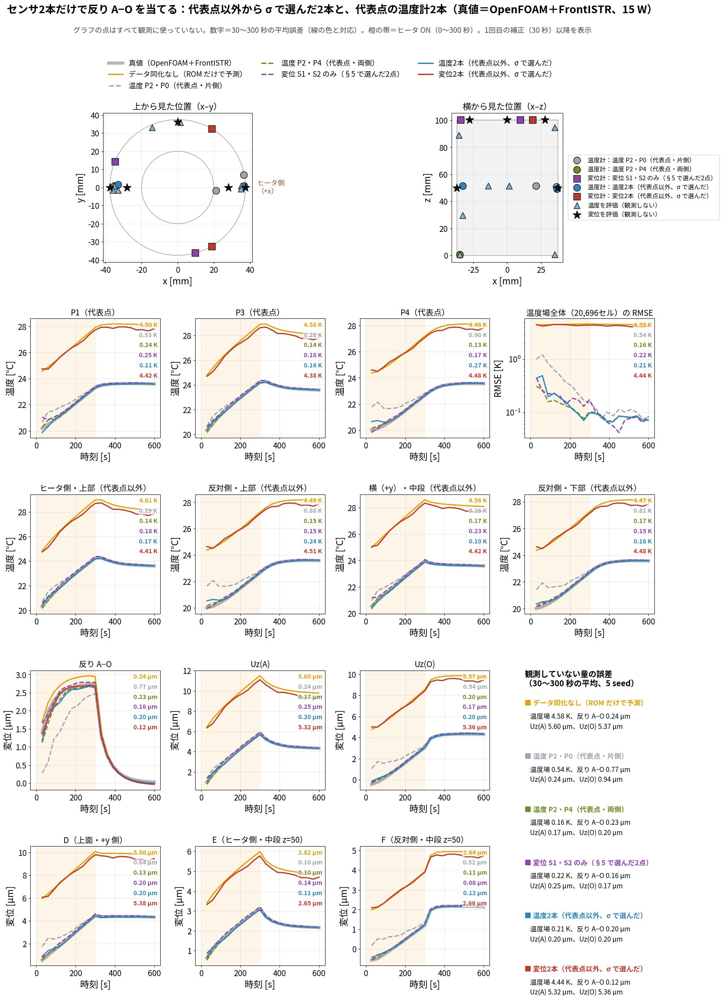

# blog_009：センサ2本だけで反りを当てる ― 代表点以外から σ で選ぶ

更新日：2026-10-12

[blog_008](blog_008_novelty_displacement_assimilation.md) では、温度計 P2・P0 を固定して、変位計2本の場所を σ で選びました。
この記事では、**センサを全部で2本だけ**にして、**代表点（P0〜P4）以外の場所**から、反り A−O を一番よく当てられる2本を σ で選びます。
温度計2本・変位計2本・種類を問わず2本の3通りを選び、OpenFOAM＋FrontISTR を真値にしたデータ同化で確かめます。

## この記事で確かめること

| | 内容 |
|---|---|
| **確かめたいこと** | 代表点以外の場所から2本だけ選んで、反り A−O を当てられるか。どの種類・どの場所が良いか |
| **選び方** | σ （センサを付けた後でも残る、反りの分からなさ）が一番小さくなる候補を1本ずつ足す（blog_008 §5-2 と同じ考え方） |
| **候補** | 温度計：代表5点を除く全セル 20,691 個。変位計：A・O から 12 mm 以内を除く全節点 × 3方向 14,754 個 |
| **比べる配置** | データ同化なし／代表点の温度計 P2・P0（片側）／P2・P4（両側）／変位計 S1・S2 だけ（blog_008 §5 で選んだ2点）／σ で選んだ温度計2本／σ で選んだ変位計2本 |
| **真値** | OpenFOAM（温度場）＋FrontISTR（全節点の変位）。15 W・25 W・15 W 間欠加熱 |
| **データ同化** | ROM＋EnKF、60メンバー、30 秒ごと、5 seed 平均。ノイズは温度 0.3 K、変位 0.3 µm |
| **評価** | 30〜300 秒の平均誤差。観測に使っていない温度（7点）・温度場全体・反り A−O・ $U_z(A)$ ・ $U_z(O)$ ・ほかの変位 |
| **実機** | 実機の測定はしていない |

> **この記事の結論**
> 1. **温度計2本**を σ で選ぶと、**ヒータ側の中段と、反対側の中段**に1本ずつ選ばれた。反りの誤差は 0.20 µm（15 W）で、代表点の P2・P4（0.23 µm）より少し良かった。
> 2. **変位計2本**（種類を問わず選んでも同じ）を σ で選ぶと、**上面の鏡写しの2点**（同じ向き $U_x$ ）が選ばれた。**反りは一番よく当たった**（0.12 µm）が、**温度場は 4.4 K、 $U_z(A)$ ・ $U_z(O)$ は 5.3 µm ずれたまま**で、データ同化なしと同じだった。
> 3. 理由は、この2本が「**全体が一様に温まる**」ことに反応しないから。反りも一様な温まりには反応しないので、反りだけを目的に σ で選ぶと、こういう2本が選ばれる。
> 4. 同じ σ の式で「 $U_z(A)$ の分からなさ」を計算すると、この2本ではほとんど縮まない（3.0 → 2.6 µm）ことが**測る前に分かる**。σ で選ぶときは、**知りたい量を反りだけにしない**ほうがよい。

---

## 1. 選び方の理論

### 1-1. 何を小さくするか ― σ

**σ ＝ センサを付けたとしたら、それでもまだ残る、反りの分からなさ**です。
ROM を条件を変えて 4,000 本回した「ありえる世界」で、横軸にセンサの値、縦軸に反りをとった散布図を描くと、σ は「センサの値が分かったときに残る、反りの縦の幅」になります（blog_008 §5-2 ステップ3の図）。
**センサの値が反りと一緒に動く場所ほど σ が小さく、良い場所**です。

### 1-2. センサ1本の σ の式（導き方）

記号はすべて 4,000 本の平均からのずれで、 $\langle\ \rangle$ は 4,000 本の平均です。

- 反り： $d=\mathbf w^{\mathsf T}\mathbf T$ （ $\mathbf w$ ＝反りの重み、 $\mathbf T$ ＝代表5点の温度）
- センサの値： $y=\mathbf h^{\mathsf T}\mathbf T+\varepsilon$ （ $\mathbf h$ ＝そのセンサの重み、 $\varepsilon$ ＝ノイズ、分散 $r$ ）

重み $\mathbf w$ と $\mathbf h$ は、FrontISTR を6回解いて作った「温度が 1 K 上がると何 µm 動くか」の表です（温度計なら gappy-POD の重み。blog_008 §5-2 ステップ1）。

**① センサの値から反りを直線で予想し、外れを二乗して平均する。**

$$
\langle(d-a\,y)^2\rangle=\langle d^2\rangle-2a\,\langle d\,y\rangle+a^2\,\langle y^2\rangle
$$

**② 3つの平均を、温度の分からなさの表 $B=\langle\mathbf T\mathbf T^{\mathsf T}\rangle$ で書く。** ノイズは温度と無関係（ $\langle\mathbf T\varepsilon\rangle=0$ ）なので、

$$
\langle d^2\rangle=\mathbf w^{\mathsf T}B\,\mathbf w,\qquad
\langle d\,y\rangle=\mathbf w^{\mathsf T}B\,\mathbf h,\qquad
\langle y^2\rangle=\mathbf h^{\mathsf T}B\,\mathbf h+r
$$

**③ 傾き $a$ について平方完成する。** $V_d=\mathbf w^{\mathsf T}B\mathbf w$ 、 $C=\mathbf w^{\mathsf T}B\mathbf h$ 、 $V_y=\mathbf h^{\mathsf T}B\mathbf h+r$ と書くと、

$$
V_d-2aC+a^2V_y=V_y\Big(a-\frac{C}{V_y}\Big)^2+V_d-\frac{C^2}{V_y}
$$

**④ 第1項が 0 になる $a=C/V_y$ のとき、外れが一番小さい。そのとき残る外れが σ²。**

$$
\sigma^2=V_d-\frac{C^2}{V_y}=\mathbf w^{\mathsf T}B\,\mathbf w-\frac{(\mathbf w^{\mathsf T}B\,\mathbf h)^2}{\mathbf h^{\mathsf T}B\,\mathbf h+r}
$$

測定値はどこにも出てきません。重み（FrontISTR）、 $B$ （ROM 4,000 本）、 $r$ （センサの仕様）だけで、**センサを付ける前に**計算できます。

### 1-3. 2本目を足すときの式（導き方）

2本目は、「1本目を付けた後でも残る分からなさ」について、同じことをします。
1本目を付けた後の温度の分からなさの表を $P$ とします（付ける前は $P=B$ ）。

**① 知りたい量が何であっても同じ式になることを確かめる。** 知りたい量を $z=\mathbf v^{\mathsf T}\mathbf T$ （ $\mathbf v$ は任意の重み）とすると、1-2 と同じ計算で

$$
\sigma_z^2{}'=\mathbf v^{\mathsf T}P\,\mathbf v-\frac{(\mathbf v^{\mathsf T}P\,\mathbf h)^2}{\mathbf h^{\mathsf T}P\,\mathbf h+r}
$$

**② $(\mathbf v^{\mathsf T}P\mathbf h)^2=\mathbf v^{\mathsf T}(P\mathbf h)(P\mathbf h)^{\mathsf T}\mathbf v$ と書き直す。** $P$ が対称なので $\mathbf h^{\mathsf T}P\mathbf v=(P\mathbf h)^{\mathsf T}\mathbf v$ です。

$$
\sigma_z^2{}'=\mathbf v^{\mathsf T}\Big(P-\frac{(P\mathbf h)(P\mathbf h)^{\mathsf T}}{\mathbf h^{\mathsf T}P\,\mathbf h+r}\Big)\mathbf v
$$

**③ どんな $\mathbf v$ でも括弧の中が共通なので、センサを1本足した後の分からなさの表は**

$$
P'=P-\frac{(P\mathbf h)(P\mathbf h)^{\mathsf T}}{\mathbf h^{\mathsf T}P\,\mathbf h+r}
$$

これを1本ごとに繰り返せば、何本付けた後の分からなさも計算できます（センサのノイズが互いに無関係なら、blog_008 §5-2 (c′) の行列の式で一度に計算した結果と同じ）。反りの σ は $\sigma^2=\mathbf w^{\mathsf T}P'\mathbf w$ です。

### 1-4. 選ぶ手順

1. 30, 60, …, 300 秒の10時刻それぞれで、ROM 4,000 本から $B(t_k)$ を作る。
2. すべての候補について、1-2 の σ を10時刻で計算して平均する（点数 $J$ ）。
3. 点数が一番小さい候補を1本目にする。
4. 1-3 の式で各時刻の $P$ を更新し、残りの候補を採点し直して、2本目を選ぶ。

温度計2本（T2）、変位計2本（U2）、種類を問わず2本（ANY2）の3通りで行いました（ `run/select_two_nonrep.py` ）。

---

## 2. 選ばれた場所

| 選び方 | 1本目 | 2本目 | 予測 σ （反り A−O） |
|---|---|---|---:|
| 温度計2本（T2） | 温度：ヒータ側・中段 $(36.7,0.8,49.2)$ mm | 温度：**反対側**・中段 $(-32.9,1.6,51.6)$ mm | 0.365 µm |
| 変位計2本（U2） | 変位 $U_x$ ：上面 $(18.8,32.5,100.5)$ mm | 変位 $U_x$ ：上面 $(18.8,-32.5,100.5)$ mm（1本目の鏡写し） | **0.296 µm** |
| 種類を問わず2本（ANY2） | U2 と同じ | U2 と同じ | 0.296 µm |

比較用の配置の予測 σ ：何も測らない 1.451 µm、温度 P2・P0 1.186 µm、温度 P2・P4 0.590 µm、変位 S1・S2 のみ 0.318 µm（いずれも 30〜300 秒の平均）。

- **温度計2本は、ヒータ側と反対側に1本ずつ**選ばれました。反りの重み $\mathbf w$ はヒータ側の P0・P2 が＋、反対側の P1・P4 が−なので、両側の温度を知ると反りが分かるためです。
- **変位計2本は、上面の、y=0 の面について鏡写しの2点**が選ばれました。向きも同じ $U_x$ です。

---

## 3. 結果 ― データ同化で確かめる

*15 W。上段＝センサと評価点の位置（●温度計、■変位計、▲温度の評価点、★変位の評価点）。2〜3段目＝観測していない温度、4〜5段目＝観測していない変位。太い灰色＝真値。各グラフ右上の数字＝30〜300 秒の平均誤差（線の色と対応）。黄＝データ同化なし、赤＝σ で選んだ変位計2本、青＝σ で選んだ温度計2本（ `run/selected_pair_unobserved_check.py t2` ）。*

25 W と間欠加熱の図：[unobserved_t2_q25.png](img/unobserved_t2_q25.png)、[unobserved_t2_intermittent.png](img/unobserved_t2_intermittent.png)

**観測していない量の誤差（30〜300 秒の平均、5 seed。15 W／25 W／間欠）**

| 配置（センサ2本） | 予測 σ | 反り A−O | 温度場全体 | $U_z(A)$ | $U_z(O)$ |
|---|---:|---|---|---|---|
| データ同化なし | 1.451 | 0.24／1.38／0.14 µm ※ | 4.58／3.12／4.51 K | 5.60／3.22／5.49 µm | 5.37／4.59／5.35 µm |
| 温度 P2・P0（代表点・片側） | 1.186 | 0.77／1.41／0.63 µm | 0.54／0.88／0.53 K | 0.24／0.31／0.28 µm | 0.94／1.69／0.87 µm |
| 温度 P2・P4（代表点・両側） | 0.590 | 0.23／0.28／0.20 µm | **0.16／0.18／0.15 K** | **0.17／0.17／0.15 µm** | **0.20／0.28／0.20 µm** |
| 変位 S1・S2 のみ | 0.318 | 0.16／0.17／0.11 µm | 0.22／0.22／0.18 K | 0.25／0.29／0.21 µm | 0.17／0.18／0.16 µm |
| **温度2本（代表点以外、σ で選んだ）** | 0.365 | 0.20／0.24／0.16 µm | 0.21／0.25／0.20 K | 0.20／0.23／0.17 µm | 0.20／0.30／0.21 µm |
| **変位2本（代表点以外、σ で選んだ）** | **0.296** | **0.12／0.13／0.09 µm** | **4.44／4.58／4.42 K** | **5.32／5.54／5.29 µm** | **5.36／5.55／5.33 µm** |

※ データ同化なしの反りが小さく見えるのは、A も O も同じ向きに約 5.5 µm ずれて、差を取ると打ち消し合うためです（blog_008 §6-2）。

### 3-1. 温度計2本（代表点以外）

- 反りは 0.20／0.24／0.16 µm で、**代表点の P2・P4（0.23／0.28／0.20 µm）より少し良い**結果でした。予測 σ の順（0.365 ＜ 0.590）と同じです。
- 温度場全体は 0.21 K で、P2・P4 の 0.16 K よりやや悪い結果でした。σ は反りを目的に選んでいるので、温度場が一番良くなるとは限りません。
- 片側の P2・P0（反り 0.77 µm）より、ずっと良くなりました。**両側に1本ずつ**が効いています。

### 3-2. 変位計2本（代表点以外）

- **反り A−O は 6 つの配置の中で一番よく当たりました**（0.12／0.13／0.09 µm）。予測 σ も一番小さく（0.296）、ここは予測どおりです。
- **ところが、温度場全体（4.4 K）、 $U_z(A)$ ・ $U_z(O)$ （5.3 µm）は、データ同化なしとほとんど同じ**でした。図でも、赤い線は観測していない温度と個別の変位で、黄の線（データ同化なし）とほぼ重なっています。
- つまり、この2本は**反りだけを当て、ほかは何も直していません**。

---

## 4. なぜ変位計2本は、反りしか当てられなかったのか ― 理論

### 4-1. 温度を「全体の温まり」と「温度差」に分ける

代表5点の温度を、5点の平均 $m$ と、平均からの差 $\boldsymbol\delta$ に分けます。

$$
\mathbf T=m\,\mathbf 1+\boldsymbol\delta,\qquad \mathbf 1=(1,1,1,1,1),\qquad \sum_i\delta_i=0
$$

$m$ は「全体がどれだけ温まったか」、 $\boldsymbol\delta$ は「どこが他より熱いか（温度差）」です。

### 4-2. 分からなさの大部分は「全体の温まり」

$t=150$ 秒の $B$ を固有値分解すると、一番大きい固有値が 27.2 K²（全体の約 96 %）で、その方向はほぼ $(1,1,1,1,1)$ （5点がそろって上下する）でした。
発熱量や初期温度が分からないと、**まず「全体がどれだけ温まったか」が分からない**、ということです。

### 4-3. 反りは「全体の温まり」に反応しない

反りの重みの合計は 0 です（ $0.470-0.654+0.604+0.038-0.458=0$ ）。そのため、

$$
d=\mathbf w^{\mathsf T}\mathbf T=m\,(\mathbf w^{\mathsf T}\mathbf 1)+\mathbf w^{\mathsf T}\boldsymbol\delta=m\cdot 0+\mathbf w^{\mathsf T}\boldsymbol\delta=\mathbf w^{\mathsf T}\boldsymbol\delta
$$

**反りは温度差 $\boldsymbol\delta$ だけで決まり、全体の温まり $m$ には反応しません。** 全体が一様に温まると円筒は伸びるだけで、傾かないからです。

### 4-4. 選ばれた変位計2本も「全体の温まり」に反応しない

選ばれた変位計の重みは2本とも $\mathbf h=(-0.521,\,0.564,\,-0.773,\,0.405,\,0.313)$ で、合計は $-0.013$ とほぼ 0 です。

$$
y=\mathbf h^{\mathsf T}\mathbf T+\varepsilon\approx\mathbf h^{\mathsf T}\boldsymbol\delta+\varepsilon
$$

この2本は**温度差だけを見ていて、全体の温まり $m$ は見ていません**。
上面の横方向（ $U_x$ ）の変位は、円筒が傾くと動き、一様に温まって伸びても（この位置では）ほとんど動かないためと考えられます。

| センサ・量 | 重みの合計（全体が 1 K 温まったときの反応） |
|---|---:|
| 反り A−O | 0.00 µm |
| 選ばれた変位計2本（ $U_x$ ） | −0.01 µm |
| 変位計 S1（ $U_x$ 、blog_008 §5） | −0.12 µm |
| 変位計 S2（ $U_z$ 、blog_008 §5） | **1.21 µm** |
| $U_z(A)$ 、 $U_z(O)$ | 1.21 µm |
| 温度計（どこでも） | 1.00 K |

### 4-5. だから、反りは当たり、ほかは当たらない

- 反りは温度差だけで決まり、2本の変位計も温度差だけを見ている → **反りは当たる**。
- 温度場、 $U_z(A)$ 、 $U_z(O)$ は全体の温まり $m$ で大きく動く（ $U_z$ の重みの合計は 1.21 µm/K）。しかし $m$ を見ているセンサがない → **当たらない**。
- σ は反りだけを目的にして選んだので、 $m$ を見ないセンサでも「反りには十分」と判断して選びました。

**blog_008 §5 の S1・S2 では、S2 が上下方向 $U_z$ で、全体の温まりに反応します（1.21）。** だから S1・S2 だけでも、温度場（0.22 K）や $U_z(A)$ （0.25 µm）がそこそこ当たりました。

### 4-6. このことは、測る前に σ の式で分かる

1-3 の式は、知りたい量の重み $\mathbf v$ を何にしても使えます。反りの代わりに $U_z(A)$ や「5点の平均温度」を知りたい量にして、同じ配置の σ を計算すると：

| 配置 | 反り A−O の σ | $U_z(A)$ の σ | 5点の平均温度の σ |
|---|---:|---:|---:|
| 何も測らない | 1.45 µm | 3.01 µm | 2.38 K |
| 温度 P2・P4 | 0.59 µm | 0.43 µm | 0.27 K |
| 変位 S1・S2 のみ | 0.32 µm | 0.47 µm | 0.32 K |
| 温度2本（σ で選んだ） | 0.37 µm | 0.46 µm | 0.26 K |
| **変位2本（σ で選んだ）** | **0.30 µm** | **2.55 µm** | **2.12 K** |

（30〜300 秒の平均。データ同化はしていない。）

**変位2本は、反りの σ は一番小さいのに、 $U_z(A)$ と平均温度の σ はほとんど縮みません。** データ同化を回す前に、この表を見れば「反り以外は当たらない」と分かります。

### 4-7. なぜ同じ場所を2回測るような2本が選ばれたのか

2本の重みはまったく同じなので、2本の値の平均をとると

$$
\frac{y_1+y_2}{2}=\mathbf h^{\mathsf T}\mathbf T+\frac{\varepsilon_1+\varepsilon_2}{2}
$$

になり、ノイズの分散が $r$ から $r/2$ に半分になります（ノイズが互いに無関係なら）。σ の式では「同じ量を2回測ってノイズを減らす」ことが、別の場所を測ることより得だと判断されました（σ が 0.368 → 0.296 µm）。
ただし実際には、ROM と真値のずれ（モデル誤差）は2本に共通に乗るので、平均しても減りません。blog_008 §6-4 でも同じ鏡写しの2本が選ばれ、予測ほど良くなりませんでした。

---

## 5. 分かったこと

1. **代表点以外から選んでも、2本で反りを当てられる。** 温度計2本なら、ヒータ側と反対側の中段に1本ずつ。反りの誤差は 0.20 µm（15 W）で、代表点 P2・P4 より少し良い。
2. **変位計2本は、反りは一番よく当たる（0.12 µm）が、反りしか当たらない。** 温度場と個別の変位は、データ同化なしと同じだけずれたまま。
3. **原因は「全体の温まり」を見るセンサがないこと。** 反りも、選ばれた変位計（上面の横方向）も、全体が一様に温まることに反応しない。
4. **σ で選ぶときは、知りたい量を反りだけにしない。** 例えば $U_z(A)$ や平均温度の σ も同時に小さくする、あるいは全体の温まりに反応するセンサ（温度計1本、または上下方向の変位計）を必ず1本入れる。どちらも、データ同化を回す前に σ の表で確かめられる。

## 6. 言えないこと・やっていないこと

- 実機では確かめていません。真値はすべて数値計算（OpenFOAM＋FrontISTR）です。
- 選び方は1本ずつ足す方法（貪欲法）で、2本の組み合わせ全部を調べた最良ではありません。
- 「反りと $U_z(A)$ を両方小さくする」ように目的を変えて選び直す計算は、まだしていません。
- 4-4 の「上面の $U_x$ は一様な温まりで動かない」理由は解釈で、変位の分布を描いて確かめてはいません。
- 熱源の位置が変わると、ROM も選ぶ場所も作り直しが必要です。

### 使ったスクリプト

| スクリプト | 内容 |
|---|---|
| `run/select_two_nonrep.py` | σ で2本を選ぶ（T2・U2・ANY2）。結果 `results/two_nonrep_selection.json` |
| `run/selected_pair_unobserved_check.py t2` | 選んだ配置でデータ同化し、観測していない量を評価。図 `docs/img/unobserved_t2_*.png` |
| `run/select_nonrep_temp_disp.py` | σ の計算の共通部分（4000 本の事前分布、1本足す更新） |
