# blog_009：温度2点を選び、次に変位2点を追加する

**知りたいことは、測る位置を選ぶことで、観測していない温度と変位がどこまで正解に近づくか、です。** まず温度センサ2点を選び、人が決めた2点と比較します。次に、その温度配置を固定して変位センサ2点を追加します。

更新日：2026-10-12。本文の数値と図は、セル→FEM節点の温度写像を近傍8セルのIDWに統一した結果です。

## 1. 何を推定し、何で良し悪しを決めるか

対象は、片側から加熱する中空円筒です。OpenFOAMで温度、FrontISTRで熱変位を計算した結果を正解とします。実機計測ではありません。

今回、配置を選ぶ目的は**未観測の反り**です。

$$
d(t)=U_z(A,t)-U_z(O,t)
$$

A・Oは上面のヒータ側・反対側の評価点です。A・O自身と、その12 mm以内の変位は観測候補から除外します。


ROMは、Q-DEIMで選んだOpenFOAMセル5点P0〜P4の温度を進めます。**この代表5点を変更するのではなく、観測センサを置く場所を選びます。** 温度候補は代表5点を除く20,691セル、変位候補は除外領域を除くFEM節点のUx・Uy・Uz、計14,754成分です。

配置の採点は「反りの不確かさ」を使います。その後にEnKFを実行し、反りだけでなく全温度場、各点の温度、A・Oそれぞれの変位も評価します。

## 2. 4,000ケースで何を変えたか

代表5点の温度がまだ分からない状態を、4,000本のROM計算で表します。**4,000はセンサ配置数ではありません。** 各ケースで、次の初期温度・発熱・放熱を選びます。

| 条件 | 各ケースに与える値 |
|---|---|
| 代表5点の初期温度 | 各点独立に17〜32 ℃の一様分布 |
| 加熱中の発熱量 $Q$ | 4.5〜27 Wの一様分布。実装は $Q=15q_{\mathrm{scale}}$ |
| 放熱 $h_{\mathrm{ROM}}$ | 平均0.02、標準偏差0.01 W/Kの正規分布を0.001〜0.1 W/Kへ制限 |
| 共通条件 | 外気温20 ℃、0〜300秒加熱、校正済みROM係数、RK4刻み2秒 |
| 採点時刻 | 30、60、…、300秒の10時刻。乱数seed＝20260930 |

$h_{\mathrm{ROM}}$ は集中定数の放熱コンダクタンス [W/K] で、表面熱伝達率 [W/m²K] とは異なります。上の分布は今回の設計上の仮定です。

同じ時刻の4,000本から、5点温度の共分散を求めます。

$$
\mathbf T_P^{(m)}=
\begin{bmatrix}T^{(m)}[P0]\\T^{(m)}[P1]\\T^{(m)}[P2]\\T^{(m)}[P3]\\T^{(m)}[P4]\end{bmatrix},
\qquad
\langle\mathbf T_P\rangle=\frac{1}{4000}\sum_{m=1}^{4000}\mathbf T_P^{(m)}
$$

$$
B(t)=\frac{1}{3999}\sum_{m=1}^{4000}
\big(\mathbf T_P^{(m)}-\langle\mathbf T_P\rangle\big)
\big(\mathbf T_P^{(m)}-\langle\mathbf T_P\rangle\big)^{\mathsf T}
$$

$B$ は5×5行列です。対角は各代表点温度の分散、非対角は2点の温度が一緒に変わる関係です。この平均は**同時刻のケース方向平均**で、POD作成時の時間平均温度場とは別です。

### 2-1. 4,000ケースは、EnKFを4,000メンバーで行うことと何が違うのか

**どちらも異なる温度・パラメータを持つROMを多数進めますが、観測による補正を繰り返すかどうかが違います。** 今回は、4,000ケースを配置設計に、60メンバーを実際のEnKFに使っています。

| 項目 | 配置設計の4,000ケース | データ同化の60メンバー |
|---|---|---|
| 目的 | どのセンサを置けば反りの不確かさを減らせるか予測する | 観測値を使って温度・Q・hを推定する |
| 実際の観測値 | 入れない | 正解＋観測ノイズの模擬観測を入れる |
| ROMを進めた後 | 温度の共分散Bを記録する | 観測予報を作り、EnKFで7変数を補正する |
| 次の時刻へ渡す値 | 観測で補正していない温度と、各ケースで固定したQ・h | 前回観測で補正した温度・Q・h |
| 主に計算する共分散 | 同時刻の5点温度のB（5×5） | 状態と観測予報のCzy（7×観測数）、Cyy（観測数×観測数） |

4,000ケースの時間発展は、各ケースについて

$$
\underbrace{\mathbf T_{P,k}^{(m)}}_{5\times1} =\mathcal M\left(\underbrace{\mathbf T_{P,k-1}^{(m)}}_{5\times1},\underbrace{q^{(m)}}_{1\times1},\underbrace{h^{(m)}}_{1\times1}\right),
\quad m=1,\ldots,4000
$$

です。観測補正の項はなく、q・hも観測で変更しません。この温度からBを作り、候補を測った場合の残存共分散を式で予測します。候補を変えるたびに4,000ケースを同化し直しているわけでもありません。

一方、60メンバーのEnKFは、

$$
\underbrace{\mathbf z_k^{f,(m)}}_{7\times1}
\ \longrightarrow\ 
\underbrace{\mathbf z_k^{a,(m)}}_{7\times1} =\underbrace{\widetilde{\mathbf z}_k^{f,(m)}}_{7\times1} +\underbrace{K_k}_{7\times n_y}
\underbrace{\left(\mathbf y_k^{\mathrm{obs}}+\boldsymbol\varepsilon_k^{(m)}-\widetilde{\mathbf y}_k^{f,(m)}\right)}_{n_y\times1}
$$

と補正してから次へ進みます。 $\mathbf z$ は5点温度・発熱倍率q・放熱h、 $n_y$ は観測成分数です。温度2点＋変位2点なら $n_y=4$ です。 $f$ は予報、 $a$ は補正後、チルダはインフレーション後です。詳しい全成分の展開は§6-0に示します。

**EnKFそのものを4,000メンバーに増やすことはできますが、その場合は4,000メンバー全てを観測で毎回補正するので、今回の配置設計とは別の計算です。** また、4,000ケースの方が多いから、60メンバーのEnKFより推定が正確という比較にもなりません。今回の4,000は設計上の設定値で、必要最小ケース数を確認した結果ではありません。


### 2-2. 代表5点はどう選び、その温度から全温度場をどう復元するのか

**ROMの代表5点P0〜P4は、センサ配置の採点より前にPOD/Q-DEIMで決めておきます。** 4,000ケースから選ぶ温度センサT1・T2とは役割が違います。blog009とblog010では代表点と復元行列を固定し、観測点だけを選び直します。

**① OpenFOAMの温度場を列に並べ、セルごとの時間平均を引く。** セル数N=20,696、時刻数Nt=121（0〜600秒、5秒ごと）です。

$$
\underbrace{X}_{N\times N_t} =\begin{bmatrix}
T_1(0)&T_1(5)&\cdots&T_1(600)\\
T_2(0)&T_2(5)&\cdots&T_2(600)\\
\vdots&\vdots&\ddots&\vdots\\
T_N(0)&T_N(5)&\cdots&T_N(600)
\end{bmatrix},
\qquad \bar T_i=\frac1{121}\sum_{k=0}^{120}T_i(5k)
$$

$$
\underbrace{X_c}_{N\times N_t} =X-\underbrace{\bar{\mathbf T}}_{N\times1}\underbrace{\mathbf1^{\mathsf T}}_{1\times N_t}
$$

**② SVDで上位5本の空間モードを取り出す。**

$$
\underbrace{X_c}_{20696\times121} =\underbrace{U}_{20696\times121}
\underbrace{\Sigma}_{121\times121}
\underbrace{V^{\mathsf T}}_{121\times121},
\qquad
\underbrace{\Phi}_{20696\times5}=U_{:,1:5}
$$

ここでは上位5列という意味で $U_{:,1:5}$ と書いています。Pythonでは `U[:, :5]` です。各モードの強さを5成分の係数 $\mathbf a_{\mathrm{POD}}$ とすると、

$$
\underbrace{\mathbf T_{\mathrm{cell}}}_{20696\times1}
\approx\underbrace{\bar{\mathbf T}}_{20696\times1} +\underbrace{\Phi}_{20696\times5}\underbrace{\mathbf a_{\mathrm{POD}}}_{5\times1}
$$

と温度分布を表します。これは温度分布の表現であり、5点熱ROMの時間積分式そのものではありません。

**③ Q-DEIMで、5モードを区別しやすいセルを5つ選ぶ。** コードは $\Phi^{\mathsf T}$ （5×20,696）に列枢軸付きQR分解を行い、先頭5個の枢軸セルをP0〜P4にします。元の基底の行を選ぶことは、転置した基底の列を選ぶことです。モードの情報が重複しにくい行を選ぶための手順で、反りへのJを最小化する選び方とは異なります。

**④ 選んだ代表5点の温度から、5モードの係数を逆算する。** $\Phi$ のP0〜P4の行を抜き出すと、

$$
\underbrace{\Phi_P}_{5\times5} =\begin{bmatrix}
\phi_1[P0]&\phi_2[P0]&\phi_3[P0]&\phi_4[P0]&\phi_5[P0]\\
\phi_1[P1]&\phi_2[P1]&\phi_3[P1]&\phi_4[P1]&\phi_5[P1]\\
\phi_1[P2]&\phi_2[P2]&\phi_3[P2]&\phi_4[P2]&\phi_5[P2]\\
\phi_1[P3]&\phi_2[P3]&\phi_3[P3]&\phi_4[P3]&\phi_5[P3]\\
\phi_1[P4]&\phi_2[P4]&\phi_3[P4]&\phi_4[P4]&\phi_5[P4]
\end{bmatrix}
$$

です。 $\phi_\ell[Pj]$ は第ℓモードの代表点Pjでの値です。代表点の温度を式へ代入すれば、

$$
\underbrace{\begin{bmatrix}
T[P0]-\bar T[P0]\\T[P1]-\bar T[P1]\\T[P2]-\bar T[P2]\\T[P3]-\bar T[P3]\\T[P4]-\bar T[P4]
\end{bmatrix}}_{5\times1}
\approx\underbrace{\Phi_P}_{5\times5}\underbrace{\mathbf a_{\mathrm{POD}}}_{5\times1}
$$

となります。この5本の方程式を解くため、コードは擬似逆行列を使います。

$$
\underbrace{\mathbf a_{\mathrm{POD}}}_{5\times1} =\underbrace{\Phi_P^+}_{5\times5}
\underbrace{(\mathbf T_P-\bar{\mathbf T}_P)}_{5\times1}
$$

ΦPが正則なら擬似逆は通常の逆行列と一致します。ここでのモード係数は、後で観測のずれに掛ける補正係数 $a_j$ とは別物です。

**⑤ 求めた5モードの係数を、全セルの式に戻す。**

$$
\underbrace{\mathbf T_{\mathrm{cell}}}_{20696\times1}
\approx\underbrace{\bar{\mathbf T}}_{20696\times1} +\underbrace{\Phi}_{20696\times5}
\underbrace{\Phi_P^+}_{5\times5}
\underbrace{(\mathbf T_P-\bar{\mathbf T}_P)}_{5\times1}
$$

固定した積 $G=\Phi\Phi_P^+$ を事前計算すれば、各時刻では5点温度にGを掛けるだけで全場を復元できます。任意のセルcの温度を1成分で展開すると、

$$
\begin{aligned}
T[c]\approx\bar T[c]
&+G_{c,0}\big(T[P0]-\bar T[P0]\big) +G_{c,1}\big(T[P1]-\bar T[P1]\big)\\
&+G_{c,2}\big(T[P2]-\bar T[P2]\big) +G_{c,3}\big(T[P3]-\bar T[P3]\big)\\
&+G_{c,4}\big(T[P4]-\bar T[P4]\big).
\end{aligned}
$$

各係数も、

$$
G_{c,j}=\sum_{\ell=1}^{5}\phi_\ell[c]{}(\Phi_P^+)_{\ell,j}
$$

と計算した値です。これが、代表点以外に置く温度計の重みの出所です。**5点温度から全場を完全に決められるという一般的な性質ではなく、温度場をこの5モードで近似するという仮定の下での復元**です。

実装は `run/select_points_qdeim.py` の `np.linalg.svd(Xc, full_matrices=False)` と `qr(U[:, :5].T, pivoting=True)`、同化時の復元は `run/selected_pair_unobserved_check.py` の `UPp = np.linalg.pinv(U[pod, :])` と `G = U @ UPp` に対応します。図を含むPOD/Q-DEIMの詳細は [blog004](blog_004_pod_selected_rom.md) を参照してください。


## 3. 候補を測ると、不確かさはどう減るか

### 3-1. センサの値を、代表5点の温度から計算する

代表点温度のずれを $\delta T[Pj]$ と書きます。ここでは4,000ケースの同時刻平均からのずれです。候補センサ $c$ の値のずれは、

$$
\delta y_c=
\begin{bmatrix}h_{c,0}&h_{c,1}&h_{c,2}&h_{c,3}&h_{c,4}\end{bmatrix}
\begin{bmatrix}\delta T[P0]\\\delta T[P1]\\\delta T[P2]\\\delta T[P3]\\\delta T[P4]\end{bmatrix} =\mathbf h_c^{\mathsf T}\delta\mathbf T_P
$$

です。 $h_{c,j}$ は「代表点Pjの温度が1 K変わると、そのセンサ値がいくら変わるか」です。温度計ならgappy-PODの復元重み、変位計ならgappy-POD→IDW→FrontISTRの熱弾性応答を合わせた重みです。放熱パラメータ $h_{\mathrm{ROM}}$ とは別の記号です。

反りも同様に、

$$
\delta d=\mathbf w^{\mathsf T}\delta\mathbf T_P,
\qquad \mathbf w=\mathbf h_{A,z}-\mathbf h_{O,z}
$$

と表せます。したがって、温度の共分散から「反りとセンサ値が一緒に変わる関係」を計算できます。


**この重みを、実際のコードでどう作るか。** POD基底を $\Phi$ 、代表5点の行だけを取り出した行列を $\Phi_P$ とします。PODの時間平均温度場を $\bar{\mathbf T}$ とすると、全セルの温度は

$$
\mathbf T_{\mathrm{cell}}=\bar{\mathbf T} +\underbrace{\Phi\Phi_P^{+}}_{G}
(\mathbf T_P-\bar{\mathbf T}_P)
$$

で復元します。上付き $+$ は擬似逆行列です。コードの `G = U @ UPp` に対応します。セルcに置く温度計の重みは、**Gのc行**です。

$$
\mathbf h_c^{\mathsf T}=G_{c,:} =\begin{bmatrix}G_{c,0}&G_{c,1}&G_{c,2}&G_{c,3}&G_{c,4}\end{bmatrix}
$$

変位計の場合は、IDWの温度写像行列 $M$ と、FrontISTRの温度→変位応答 $W$ を使うと、PODモードに対する変位応答は $D=WM\Phi$ です。プログラムではW全体を組み立てず、**平均温度場と5モードをFrontISTRに与えた6回の計算**から、平均変位とDを作っています。

$$
\mathbf u=\bar{\mathbf u}+D\Phi_P^+(\mathbf T_P-\bar{\mathbf T}_P)
$$

節点Sのx方向を測る場合の重みは、

$$
\boxed{\mathbf h_{S,x}^{\mathsf T}=D_{S,x,:}\Phi_P^+}
$$

です。成分ごとには、

$$
h_{S,x,j}=\sum_{\ell=1}^{5}D_{S,x,\ell}(\Phi_P^+)_{\ell,j}
$$

となります。`Wall = np.einsum("nck,kj->ncj", D, UPp)` は、全節点・全方向についてこの積を計算しています。

**PODの時間平均と、4,000ケースの平均は別です。** 上の復元式から4,000ケースの平均を引くと、固定した平均場の項が消え、 $\delta y_c=\mathbf h_c^{\mathsf T}\delta\mathbf T_P$ になります。このため、共分散の計算には重みだけを使えます。


### 3-2. センサで温度を直した後、誤差はどれだけ残るか

ここでは、**温度の補正式を先に作り、その補正後の誤差を計算して、共分散の更新式を導きます。** 最初から共分散の式を仮定するわけではありません。

**① 測る前の温度誤差を書く。** 推定温度を $\hat T_P$ 、未知の正しい温度を $\mathbf T_P$ とし、誤差を

$$
\mathbf e=\mathbf T_P-\widehat{\mathbf T}_P =\begin{bmatrix}e_0\\e_1\\e_2\\e_3\\e_4\end{bmatrix},
\qquad P_{ij}=\mathbb E[e_i e_j]
$$

とします。 $\mathbb E$ は仮定した不確かさに対する平均です。平均誤差をゼロとして扱う線形推定です。最初の $P$ は、4,000ケースの温度のばらつきから計算した $B$ を使います。

**② センサの観測値から予報値を引く。** ここで求めるのは、候補センサcについての **「観測値 − 予報値」** です。これを $\Delta y_c$ と書きます。温度計なら単位はK、変位計ならµmです。

$$
\underbrace{\Delta y_c}_{1\times1} =\underbrace{y_c^{\mathrm{obs}}}_{1\times1} -\underbrace{\widehat y_c}_{1\times1}
$$

**なぜこの差を5点温度の誤差で書けるのか、順に代入します。** §3-1で使った「代表5点の温度に重みを掛けてセンサ値を計算する式」は、次の形です。

$$
\underbrace{y_c(\mathbf T_P)}_{1\times1} =\underbrace{\bar y_c}_{1\times1} +\underbrace{\begin{bmatrix}h_{c,0}&h_{c,1}&h_{c,2}&h_{c,3}&h_{c,4}\end{bmatrix}}_{\mathbf h_c^{\mathsf T}:\ 1\times5}
\underbrace{\begin{bmatrix}
T[P0]-\bar T[P0]\\T[P1]-\bar T[P1]\\T[P2]-\bar T[P2]\\T[P3]-\bar T[P3]\\T[P4]-\bar T[P4]
\end{bmatrix}}_{5\times1}
$$

$\bar y_c$ はPODの平均温度場に対応するセンサ値、 $\bar T[Pj]$ はその平均場の代表点温度です。 $h_{c,j}$ は、代表点Pjの温度が1 K変わったときのセンサ値の変化です。温度計なら温度復元の重み、変位計なら温度復元とFrontISTR応答を組み合わせた重みです。放熱パラメータ $h_{\mathrm{ROM}}$ とは別です。

**この同じ式へ、正しい温度と推定温度をそれぞれ入れます。** この導出では、正しいセンサ値も同じ復元式で表せると仮定し、観測にだけノイズ $\varepsilon_c$ が加わるとします。

$$
y_c^{\mathrm{obs}} =\bar y_c+\mathbf h_c^{\mathsf T}(\mathbf T_P-\bar{\mathbf T}_P)+\varepsilon_c
$$

$$
\widehat y_c =\bar y_c+\mathbf h_c^{\mathsf T}(\widehat{\mathbf T}_P-\bar{\mathbf T}_P)
$$

両式とも、重みは1×5、括弧内は5×1、結果は1×1です。上の式から下の式を引くと、共通の平均場の項が消えます。

$$
\begin{aligned}
\Delta y_c
&=y_c^{\mathrm{obs}}-\widehat y_c\\
&=\bar y_c+\mathbf h_c^{\mathsf T}(\mathbf T_P-\bar{\mathbf T}_P)+\varepsilon_c -\left\{\bar y_c+\mathbf h_c^{\mathsf T}(\widehat{\mathbf T}_P-\bar{\mathbf T}_P)\right\}\\
&=\mathbf h_c^{\mathsf T}(\mathbf T_P-\widehat{\mathbf T}_P)+\varepsilon_c.
\end{aligned}
$$

①で定義した温度誤差 $e_j=T[Pj]-\widehat T[Pj]$ を使うと、**求めたかった行列表記**は次のとおりです。

$$
\boxed{
\underbrace{\Delta y_c}_{1\times1} =\underbrace{\begin{bmatrix}h_{c,0}&h_{c,1}&h_{c,2}&h_{c,3}&h_{c,4}\end{bmatrix}}_{1\times5}
\underbrace{\begin{bmatrix}
T[P0]-\widehat T[P0]\\T[P1]-\widehat T[P1]\\T[P2]-\widehat T[P2]\\T[P3]-\widehat T[P3]\\T[P4]-\widehat T[P4]
\end{bmatrix}}_{\mathbf e:\ 5\times1} +\underbrace{\varepsilon_c}_{1\times1}
}
$$

掛け算を展開すると、

$$
\Delta y_c=h_{c,0}e_0+h_{c,1}e_1+h_{c,2}e_2+h_{c,3}e_3+h_{c,4}e_4+\varepsilon_c
$$

です。つまり、**センサの「観測値−予報値」には、5点温度の誤差がセンサに現れた分と、観測ノイズが含まれます。** 次の③では、この差に補正係数を掛けて代表点の温度を直します。

$\varepsilon_c$ は温度誤差とは独立な平均ゼロの観測ノイズで、 $\mathbb E[\varepsilon_c^2]=r_c$ です。 $\Delta y_c$ は観測との差であり、§3-1のケース平均からのずれ $\delta y_c$ とは区別します。ここでは小文字の $h_{c,j}$ はセンサへの復元係数です。

この関係は配置の採点に使う線形モデル内での関係です。実際のOpenFOAM・FrontISTRの正解とROMの復元にはモデル誤差があるため、その場合の観測差には復元誤差も含まれます。実際の有効性は§6のEnKF比較で確認します。

**③ センサのずれを使って、温度を直す。** 代表点Pjの補正係数を $a_j$ として、

$$
\widehat T_{+c}[Pj]=\widehat T[Pj]+a_j\Delta y_c
$$

と置きます。 $a_j$ は「センサが1単位ずれていたら、Pjの推定温度を何K直すか」です。補正後に残る誤差は、

$$
e_{j,+c}=T[Pj]-\widehat T_{+c}[Pj] =e_j-a_j\Delta y_c
$$

となります。**これをできるだけ小さくする $a_j$ を求めます。**

**④ 補正した後、温度の誤差がどれだけ残るかを計算する。**

ここでの目的は、**センサのずれ $\Delta y_c$ を何倍して温度を直すとよいか、つまり補正係数 $a_j$ を決めること**です。その準備として、補正後の温度誤差を二乗して平均します。

記号を確認します。

| 記号 | 意味 |
|---|---|
| $e_j$ | 補正前のPjの温度誤差＝正しい温度−推定温度 [K] |
| $\Delta y_c$ | 候補センサcの観測値−予報値（温度計はK、変位計はµm） |
| $a_j\Delta y_c$ | Pjの推定温度に足す補正量 [K] |
| $e_{j,+c}=e_j-a_j\Delta y_c$ | 補正した後に残るPjの温度誤差 [K] |
| $\mathbb E[\cdot]$ | 想定した温度の不確かさと観測ノイズについて平均する操作 |

以下の $\mathbb E$ は時間平均ではありません。配置設計では、温度の不確かさを4,000ケースの標本共分散で見積もり、ノイズの分散は $r_c$ として別に加えます。候補ごとに実測値を用意する計算ではありません。

#### (a) まず、補正後の誤差を二乗する

$$
e_{j,+c}=e_j-a_j\Delta y_c
$$

なので、 $(A-B)^2=A^2-2AB+B^2$ を使うだけです。

$$
e_{j,+c}^2=e_j^2-2a_j e_j\Delta y_c+a_j^2(\Delta y_c)^2
$$

$a_j$ は、平均を取る間は固定した係数です。したがって、

$$
\mathbb E[e_{j,+c}^2] =\underbrace{\mathbb E[e_j^2]}_{(1)} -2a_j\underbrace{\mathbb E[e_j\Delta y_c]}_{(2)} +a_j^2\underbrace{\mathbb E[(\Delta y_c)^2]}_{(3)}
$$

（(1) 補正前の誤差の二乗平均、(2) 温度誤差とセンサのずれの積の平均、(3) センサのずれの二乗平均。）

となります。最初の項は、共分散の定義から $\mathbb E[e_j^2]=P_{jj}$ です。残りの2つを順に求めます。

#### (b) 温度誤差とセンサのずれの「積の平均」を求める

②で求めた式を、そのまま代入します。

$$
\Delta y_c=h_{c,0}e_0+h_{c,1}e_1+h_{c,2}e_2+h_{c,3}e_3+h_{c,4}e_4+\varepsilon_c
$$

まず $e_j$ を掛けます。

$$
\begin{aligned}
e_j\Delta y_c ={}&h_{c,0}e_je_0+h_{c,1}e_je_1+h_{c,2}e_je_2\\
&+h_{c,3}e_je_3+h_{c,4}e_je_4+e_j\varepsilon_c.
\end{aligned}
$$

次に平均します。各重み $h_{c,i}$ は固定値なので平均の外に出せます。 $\mathbb E[e_je_i]=P_{ji}$ であり、ノイズは温度誤差と独立・平均ゼロなので、

$$
\mathbb E[e_j\varepsilon_c] =\mathbb E[e_j]\mathbb E[\varepsilon_c]=0
$$

です。よって、

$$
\mathbb E[e_j\Delta y_c] =P_{j0}h_{c,0}+P_{j1}h_{c,1}+P_{j2}h_{c,2}+P_{j3}h_{c,3}+P_{j4}h_{c,4}
$$

となります。**この長い計算結果を、以降は $v_j$ と短く書きます。** 行列では、

$$
\underbrace{v_j}_{1\times1} =\underbrace{\begin{bmatrix}P_{j0}&P_{j1}&P_{j2}&P_{j3}&P_{j4}\end{bmatrix}}_{1\times5}
\underbrace{\begin{bmatrix}h_{c,0}\\h_{c,1}\\h_{c,2}\\h_{c,3}\\h_{c,4}\end{bmatrix}}_{5\times1}
$$

です。 $v_j$ は、**センサが予報より高く出るとき、Pjの温度も推定より高い傾向にあるか**を表す共分散です。正なら同じ向き、負なら逆向きの関係です。ゼロなら、この線形補正ではそのセンサのずれからPjの誤差を推測できません。

#### (c) センサのずれの「二乗平均」を求める

同じ $\Delta y_c$ の式を二乗します。 $\sum_i h_{c,i}e_i$ は上の5項を足したものです。

$$
(\Delta y_c)^2 =\left(\sum_{i=0}^{4}h_{c,i}e_i\right)^2 +2\left(\sum_{i=0}^{4}h_{c,i}e_i\right)\varepsilon_c +\varepsilon_c^2
$$

平均すると、中央の項は独立性とノイズの平均ゼロから消え、最後の項は観測ノイズの分散 $r_c$ になります。

$$
\mathbb E[(\Delta y_c)^2] =\sum_{i=0}^{4}\sum_{\ell=0}^{4}h_{c,i}\underbrace{\mathbb E[e_i e_\ell]}_{P_{i\ell}}h_{c,\ell}+r_c
$$

**この計算結果を $s_c$ と短く書きます。** 行列では、

$$
\underbrace{s_c}_{1\times1} =\underbrace{\begin{bmatrix}h_{c,0}&h_{c,1}&h_{c,2}&h_{c,3}&h_{c,4}\end{bmatrix}}_{1\times5}
\underbrace{\begin{bmatrix}
P_{00}&P_{01}&P_{02}&P_{03}&P_{04}\\
P_{10}&P_{11}&P_{12}&P_{13}&P_{14}\\
P_{20}&P_{21}&P_{22}&P_{23}&P_{24}\\
P_{30}&P_{31}&P_{32}&P_{33}&P_{34}\\
P_{40}&P_{41}&P_{42}&P_{43}&P_{44}
\end{bmatrix}}_{5\times5}
\underbrace{\begin{bmatrix}h_{c,0}\\h_{c,1}\\h_{c,2}\\h_{c,3}\\h_{c,4}\end{bmatrix}}_{5\times1} +\underbrace{r_c}_{1\times1}
$$

です。 $s_c$ は、**温度の不確かさによるセンサ予報のばらつきに、観測ノイズの分散を加えたもの**です。温度計ならK²、変位計ならµm²です。

#### (d) 求めた2つを、補正後の誤差の式に戻す

(a)の2つの平均を、それぞれ $v_j$ と $s_c$ に置き換えると、

$$
\boxed{\mathbb E[e_{j,+c}^2]=P_{jj}-2a_jv_j+a_j^2s_c}
$$

となります。 $P_{jj},v_j,s_c$ は共分散・復元重み・ノイズ分散から計算できる値です。**残る選択は $a_j$ だけなので、次の⑤でこの式が最小になる $a_j$ を求めます。**

**⑤ 誤差が最小になる補正係数を求める。** $a_j$ で微分してゼロと置きます。

$$
\frac{\partial}{\partial a_j}
\big(P_{jj}-2a_jv_j+a_j^2s_c\big) =-2v_j+2a_js_c=0
$$

$$
\boxed{a_j=\frac{v_j}{s_c}}
$$

これを温度の補正式へ戻すと、

$$
\boxed{\widehat T_{+c}[Pj] =\widehat T[Pj]+\frac{v_j}{s_c}\big(y_c^{\mathrm{obs}}-\widehat y_c\big)}
$$

です。**センサと強く一緒に変わる温度には大きく補正を掛け、関係が弱い温度には小さく掛けます。** ノイズが大きいと $s_c$ が大きくなり、補正を控えます。

**⑥ この補正をした後の共分散を計算する。** Pjだけでなく、PiとPjの誤差の積を平均します。

$$
\begin{aligned}
P_{+c,ij}
&=\mathbb E[e_{i,+c}e_{j,+c}]\\
&=\mathbb E[(e_i-a_i\Delta y_c)(e_j-a_j\Delta y_c)]\\
&=P_{ij}-a_jv_i-a_iv_j+a_ia_js_c\\
&=P_{ij}-\frac{v_iv_j}{s_c}-\frac{v_iv_j}{s_c} +\frac{v_iv_j}{s_c}\\
&=\boxed{P_{ij}-\frac{v_iv_j}{s_c}}.
\end{aligned}
$$

**これを5点すべてについて並べたものが、共分散の更新式です。**

$$
\mathbf v=P\mathbf h_c,
\qquad s_c=\mathbf h_c^{\mathsf T}P\mathbf h_c+r_c
$$

$$
\boxed{P_{+c}=P-\frac{\mathbf v\mathbf v^{\mathsf T}}{s_c}}
$$

例えば対角成分は $P_{+c,jj}=P_{jj}-v_j^2/s_c$ です。測ったことで、Pjの温度の分散が $v_j^2/s_c$ だけ減ると予測します。ここまでの導出には、実際の測定値は残っていません。**だから、測定前に候補を採点できます。** ガウス分布なら条件付き共分散と一致し、一般の分布では最適な線形補正で残る誤差の共分散を表します。

**⑦ 残る温度誤差を反りに換算する。** $\delta d=\mathbf w^{\mathsf T}\mathbf e_{+c}$ なので、

$$
\sigma_{+c}^2 =\sum_{i=0}^{4}\sum_{j=0}^{4}w_iP_{+c,ij}w_j =\mathbf w^{\mathsf T}P_{+c}\mathbf w
$$

$$
\boxed{\sigma_{+c}^2 =\mathbf w^{\mathsf T}P\mathbf w -\frac{(\mathbf w^{\mathsf T}P\mathbf h_c)^2}
{\mathbf h_c^{\mathsf T}P\mathbf h_c+r_c}}
$$

右辺の第1項は測る前の反りの分散、第2項は候補cを測ることで減る分散です。平方根を取った $\sigma_{+c}$ を30〜300秒の10時刻で平均し、採点値にします。

$$
\boxed{J_c=\frac{1}{10}\sum_{k=1}^{10}\sigma_{+c}(30k)}
$$

$J_c$ が小さい候補を1本選び、各時刻の共分散を $P\leftarrow P_{+c}$ に更新して、次の候補を採点し直します。この $P$ の更新は**同じ時刻で観測センサを増やす計算**で、30秒先へ進めるROM時間積分とは別です。全ペアの大域最適解を求める総当たりではありません。


### 3-3. なぜ熱感度Wや温度分布だけでは観測位置を決められないのか

**熱感度Wや温度分布は配置を考える根拠になります。しかし、それだけでは「そこを測ると、未観測の反りの推定誤差が最も減る」とは言えません。** データ同化では、対象に影響する温度のうち、まだ分かっていない違いを捉える観測が有効だからです。

例えば、ヒータ側を既に1本測っているとします。その近くに2本目を置けば、温度は大きく変化していても、1本目と似た情報しか得られない場合があります。反対側を測る方が、左右の温度差を把握でき、反りの推定に役立つ可能性があります。これは温度の高さや熱感度の大きさだけでは判断できません。

#### 熱感度Wは「温める場所」と「対象の変位」の関係を示す

FrontISTRの熱感度の成分は、

$$
W_{A,z,n}=\frac{\partial U_z(A)}{\partial T_F[n]}
$$

です。 $T_F[n]$ はFEM節点nの温度、 $U_z(A)$ はAの上下変位です。「節点nの温度を1 K変えると、Aの上下変位がどれだけ変わるか」を表します。反り $d=U_z(A)-U_z(O)$ については、

$$
\underbrace{\delta d}_{1\times1} =\underbrace{\left(W_{A,z,:}-W_{O,z,:}\right)}_{1\times N_F}
\underbrace{\delta\mathbf T_F}_{N_F\times1},
\qquad N_F=5040
$$

となります。コロンは全節点に対応する列を取り出す記号です。この温度変化は線形化の基準からの変化で、§3-1のケース平均からのずれとは基準が異なりますが、線形写像の重みは同じです。

**Wが大きい場所でも、その温度が既に他の観測から十分分かっていれば、追加して測る効果は小さくなります。** また、正解の温度分布が1枚あるだけでは、どこが不確かか、別のセンサと情報が重複するかは分かりません。

#### 今回は「測った後に残る反りの不確かさ」で選ぶ

§3-2の式を、配置を選ぶ理由として読み直します。 $P$ は現在残っている代表5点温度の誤差共分散（5×5）、 $\mathbf w$ は代表5点温度から反りへの重み（5×1）、 $\mathbf h_c$ は候補センサへの重み（5×1）、 $r_c$ はその観測ノイズの分散（1×1）です。

候補cを測る前と後の反りの分散は、

$$
\underbrace{V_{\mathrm{before}}}_{1\times1} =\underbrace{\mathbf w^{\mathsf T}}_{1\times5}
\underbrace{P}_{5\times5}
\underbrace{\mathbf w}_{5\times1}
$$

$$
\boxed{
\underbrace{V_{\mathrm{after},c}}_{1\times1} =V_{\mathrm{before}} -\frac{\left(\mathbf w^{\mathsf T}P\mathbf h_c\right)^2}
{\mathbf h_c^{\mathsf T}P\mathbf h_c+r_c}
}
$$

です。 $V_{\mathrm{after},c}$ は§3-2の $\sigma_{+c}^2$ と同じ量です。単位はµm²です。

分子にある $\mathbf w^{\mathsf T}P\mathbf h_c$ は、**反りの推定誤差と、候補センサの予報誤差が、どれだけ一緒に変わるか**を表します。この関係が強ければ、センサの予報と観測のずれから反りのずれも推測できます。分母には観測ノイズが入るため、信号がノイズに埋もれる候補は効果が小さくなります。

| 判断材料 | 配置を選ぶときの問い |
|---|---|
| FrontISTRの熱感度Wと温度復元 | その温度の違いは、反りに影響するか |
| 共分散P（最初は4,000ケースから求めたB） | その違いは、まだ分かっていないか。他の観測と情報が重複しないか |
| 候補の観測感度とノイズ | その違いを、このセンサの位置・方向で捉えられるか |

**4,000ケースは「適当な点では同化できない」ことを示すためではありません。** 想定する初期温度・発熱量・放熱条件の違いから温度の不確かさを作り、同じ本数ならどの配置が反りの推定に役立つかを、測定前に予測するために使っています。実際のEnKFは別の60メンバーで行います。

#### 今回、どこまで「最適」と言えるのか

今回のコードは、測定後に残る反りの標準偏差を30〜300秒で平均した $J_c$ が最小となる候補を、1本ずつ選びます。2本目は、1本目を測った後に残る共分散で再採点します。

したがって、本研究での表現は、**「設定した不確かさ・観測ノイズ・候補位置の下で、反りA−Oの予測不確かさを最も減らす候補を逐次選定した」**です。全センサ組合せの大域的最適性や、任意の運転条件での最適性を証明したわけではありません。

さらに実際のEnKFで、手動温度2点の反り誤差0.775 µmが、選定温度2点で0.198 µm、選定変位2点も追加すると0.103 µmになったことを確認しました（条件と指標は§6-2）。これは比較した配置での有効性を示します。**Wは物理的な関係を説明し、共分散による採点は配置の選定根拠を与え、EnKFの比較試験で実際の効果を確認する**、という順序です。

なお、**Wの大きさだけで選んだ配置との直接比較は、この試験ではまだ行っていません。** その比較を追加すれば、温度の不確かさや情報の重複まで考慮することの効果を、さらに明確に検証できます。


### 3-4. 150秒で再計算すると、観測の追加で分散はどう減るか

4,000ケースを同じ事前分布から0〜150秒まで再計算し、150秒のBから各段階の残存共分散Pcを求めました。**位置は既存の30〜300秒平均による選定結果を使い、150秒だけで選び直してはいません。**

| 観測の追加 | 反りの分散σ² [µm²] | 標準偏差σ [µm] |
|---|---:|---:|
| 測る前 | 1.4489 | 1.2037 |
| 選定温度T1 | 1.0506 | 1.0250 |
| 選定温度T1・T2 | 0.1307 | 0.3615 |
| ＋選定変位S1（Ux） | 0.0566 | 0.2379 |
| ＋選定変位S2（Ux） | 0.0373 | 0.1930 |

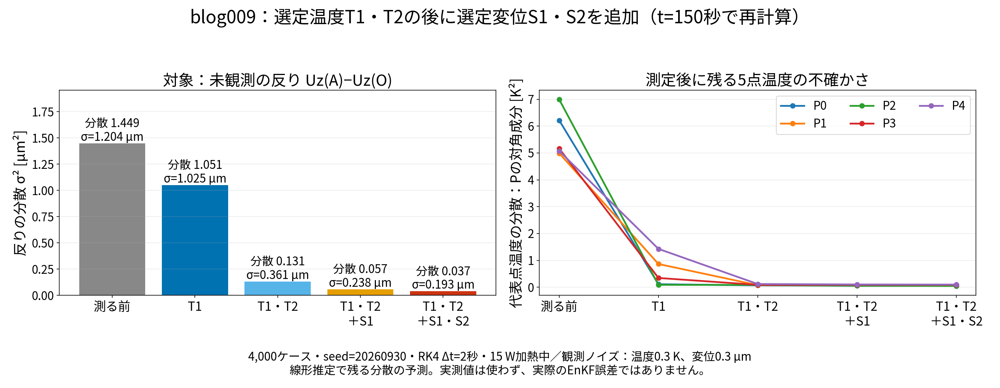

*左：未観測の反りA−Oの残存分散σ²と標準偏差σ。右：Pcの対角成分（P0〜P4の温度に残る分散）。4,000ケース、seed=20260930、15 W加熱中、RK4刻み2秒、観測ノイズは温度0.3 K・変位0.3 µm。実際の同化誤差ではなく、線形推定による不確かさの予測です。*

候補の位置・方向から重みの行を取り出し、それを並べたHとB・RからPcを計算します。次に、対象の反りへの重みwを掛けた `w @ Pc @ w` が反りの分散σ²、その平方根がσです。行列を一括で更新する方法と、§3-2の1本ずつの更新が一致することを確認しました。

この再計算では温度T1・T2の追加でσは1.204→0.361 µm、変位S1・S2も加えると0.193 µmへ減りました。図の温度の分散にも、センサを置かない代表点まで不確かさが減る様子が現れます。

再現：`run/recalculate_posterior_t150.py`。計算フォルダは `sample/106_0_pod_selected_rom/`、出力は `results/posterior_t150.json` と `results/posterior_t150.npz` です。前者には各段階のB・H・R・Pc・σを、後者には150秒の4,000ケース温度と共分散を保存しています。計算時間は結果JSONに記録しています。

## 4. まず温度センサ2点を選ぶ

温度計だけを候補にして、1本目、2本目を選びます。最初からP2・P0を観測する前提は置きません。

### 4-1. 温度センサの候補位置から、観測の重みを取り出す

ここで決めるのは、**温度を測るセルの位置を2か所**です。温度の値そのものを決める処理ではありません。また、目的は本記事の評価対象である反りA−Oの推定です。温度場RMSEだけを最小にする配置を探しているわけではありません。

候補は、ROMの代表5点を除くOpenFOAMの20,691セルです。候補セルの番号をcとします。既に作った温度復元行列は、

$$
\underbrace{G}_{20696\times5} =\underbrace{\Phi}_{20696\times5}
\underbrace{\Phi_P^+}_{5\times5}
$$

です。 $\Phi$ は全セルのPOD基底、 $\Phi_P$ は代表5点の行を抜き出した行列です。**候補セルcを指定したら、Gのc行を取り出します。**

$$
\underbrace{\mathbf g_c^{\mathsf T}}_{1\times5} =\begin{bmatrix}G_{c,0}&G_{c,1}&G_{c,2}&G_{c,3}&G_{c,4}\end{bmatrix}
$$

本章では温度センサと分かるようにgと書きます。§3で一般のセンサに使った $\mathbf h_c$ は、温度センサの場合この $\mathbf g_c$ です。 $G_{c,j}$ は「代表点Pjの温度が1 K変わると、復元した候補セルcの温度が何K変わるか」です。

候補セルの温度予報は、

$$
\underbrace{\widehat T[c]}_{1\times1} =\bar T[c] +\underbrace{\begin{bmatrix}G_{c,0}&G_{c,1}&G_{c,2}&G_{c,3}&G_{c,4}\end{bmatrix}}_{1\times5}
\underbrace{\begin{bmatrix}
\widehat T[P0]-\bar T[P0]\\
\widehat T[P1]-\bar T[P1]\\
\widehat T[P2]-\bar T[P2]\\
\widehat T[P3]-\bar T[P3]\\
\widehat T[P4]-\bar T[P4]
\end{bmatrix}}_{5\times1}
$$

です。バーはPODの時間平均温度場、ハットは補正前の推定温度です。候補は代表点以外なので、**この1行は「1か所だけ1」の行ではなく、5点温度を組み合わせる重み**になります。

### 4-2. その温度を測ったら、代表5点をどう補正できるか

§3-2と同じく、 $e_j=T[Pj]-\widehat T[Pj]$ は、正しい温度と補正前の推定温度との差です。正しい温度を上の復元式で表せる線形モデル内では、観測値と予報値の差は、

$$
\underbrace{T^{\mathrm{obs}}[c]-\widehat T[c]}_{\Delta y_c:\ 1\times1} =
\underbrace{\begin{bmatrix}G_{c,0}&G_{c,1}&G_{c,2}&G_{c,3}&G_{c,4}\end{bmatrix}}_{1\times5}
\underbrace{\begin{bmatrix}
T[P0]-\widehat T[P0]\\
T[P1]-\widehat T[P1]\\
T[P2]-\widehat T[P2]\\
T[P3]-\widehat T[P3]\\
T[P4]-\widehat T[P4]
\end{bmatrix}}_{\mathbf e:\ 5\times1} +\underbrace{\varepsilon_{T,c}}_{1\times1}
$$

です。ノイズ $\varepsilon_{T,c}$ の平均はゼロ、分散は $\sigma_T^2$ 、今回は $\sigma_T=0.3$ Kです。

**1本目の選定前にはまだ観測を使っていないので、温度誤差の共分散をBと置きます。** Bは§2で4,000ケースから計算した5×5行列です。§3-2で導いた補正係数をこの候補に使うと、代表5点の補正は、

$$
\underbrace{\widehat{\mathbf T}_{P,+c}}_{5\times1} =\underbrace{\widehat{\mathbf T}_P}_{5\times1} +\underbrace{\frac{B\mathbf g_c}{\mathbf g_c^{\mathsf T}B\mathbf g_c+\sigma_T^2}}_{5\times1}
\underbrace{\big(T^{\mathrm{obs}}[c]-\widehat T[c]\big)}_{1\times1}
$$

となります。**代表点以外の温度計1本のずれが、5点それぞれへの補正量に変換される**ことが、この5×1の係数に表れています。

配置選定中は、この式に実測値を入れて温度を補正しません。次に示す「もしこの補正をしたら、どれだけ温度誤差が残るか」を計算します。

### 4-3. 1本目は、反りに残る不確かさが最小になるセルを選ぶ

候補cを使って補正した後に残る温度誤差の共分散は、

$$
\underbrace{P_{+c}}_{5\times5} =\underbrace{B}_{5\times5} -\frac{
\underbrace{(B\mathbf g_c)}_{5\times1}
\underbrace{(B\mathbf g_c)^{\mathsf T}}_{1\times5}
}{\underbrace{\mathbf g_c^{\mathsf T}B\mathbf g_c+\sigma_T^2}_{1\times1}}
$$

です。これは§3-2の共分散更新式で、PをB、センサの重みhを温度復元の重みgに置き換えたものです。候補を変えるとgが変わり、残る共分散も変わります。

次に、温度誤差を対象の反りの誤差へ換算します。代表5点から反りへの固定した重みを、

$$
\underbrace{\mathbf w^{\mathsf T}}_{1\times5} =\begin{bmatrix}w_0&w_1&w_2&w_3&w_4\end{bmatrix},
\qquad w_j=h_{A,z,j}-h_{O,z,j}
$$

とします。 $h_{A,z,j},h_{O,z,j}$ は、温度復元・IDW・FrontISTR応答を通じて求めた、代表点Pjの温度からUz(A)・Uz(O)への係数です。反り誤差は $e_d=w_0e_0+\cdots+w_4e_4$ なので、候補cを使った補正後に残る反りの分散は、

$$
\underbrace{\sigma_{+c}^2(t)}_{1\times1} =\underbrace{\mathbf w^{\mathsf T}}_{1\times5}
\underbrace{P_{+c}(t)}_{5\times5}
\underbrace{\mathbf w}_{5\times1}
$$

です。**候補の温度位置c → 復元重みg → 残る温度共分散Pc → 残る反りの標準偏差σ**、という順に計算しています。

この計算を、同じ候補cについて30、60、…、300秒の10個のBで繰り返します。平方根を取った標準偏差を平均した採点値は、

$$
J_c=\frac1{10}\sum_{k=1}^{10}\sqrt{\mathbf w^{\mathsf T}P_{+c}(30k)\mathbf w}
$$

です。**全20,691候補のJを比較して、一番小さい候補を温度センサT1にします。** カラーマップの色はこのJであり、候補の温度そのものやWそのものではありません。

### 4-4. 2本目は、T1で分かる情報を除いてから選ぶ

T1が決まったら、その重み $\mathbf g_{T1}$ を使い、10時刻それぞれで次の共分散を計算します。

$$
\underbrace{P^{(T1)}}_{5\times5} =\underbrace{B}_{5\times5} -\frac{\underbrace{(B\mathbf g_{T1})(B\mathbf g_{T1})^{\mathsf T}}_{5\times5}}
{\underbrace{\mathbf g_{T1}^{\mathsf T}B\mathbf g_{T1}+\sigma_T^2}_{1\times1}}
$$

上付き(T1)は「温度計T1を使って補正したと仮定した場合」の名前です。このPは、**T1を使った後にも残る温度の不確かさ**を表します。時間を先に進めた結果ではありません。

次の候補cを追加した場合は、BではなくこのPから始めます。

$$
\underbrace{P^{(T1,+c)}}_{5\times5} =\underbrace{P^{(T1)}}_{5\times5} -\frac{
\underbrace{(P^{(T1)}\mathbf g_c)(P^{(T1)}\mathbf g_c)^{\mathsf T}}_{5\times5}
}{\underbrace{\mathbf g_c^{\mathsf T}P^{(T1)}\mathbf g_c+\sigma_T^2}_{1\times1}}
$$

この共分散を使って再び反りの標準偏差を10時刻で平均し、T1以外の候補で最小となるセルをT2にします。**1本目と2本目を、最初のJの上位2セルから選ぶ方法ではありません。** T1と同じ情報しか持たない候補では、追加して減らせる不確かさが小さくなるためです。

2本とも決まったときの温度観測行列は、

$$
\underbrace{H_T}_{2\times5} =\begin{bmatrix}
G_{T1,0}&G_{T1,1}&G_{T1,2}&G_{T1,3}&G_{T1,4}\\
G_{T2,0}&G_{T2,1}&G_{T2,2}&G_{T2,3}&G_{T2,4}
\end{bmatrix},
\qquad
\underbrace{R_T}_{2\times2} =\begin{bmatrix}\sigma_T^2&0\\0&\sigma_T^2\end{bmatrix}
$$

です。 $G_{T1,j}$ は選定セルT1のGの行の成分です。このHは、代表点以外の2点を観測する際に、代表5点温度から温度センサ2本の予報を計算するために使います。

### 4-5. 実際のコードと、今回選ばれた温度位置

`run/sequential_sensor_study.py` が候補全セルを採点し、`run/select_nonrep_temp_disp.py` の `score()` と `add_row()` が上の計算を行います。温度2点を選ぶ部分を、処理が分かる形に書き直すと、

```python
# G: (20696, 5)、w: (5,)、Ps: 各時刻の共分散10個、各(5, 5)
# 最初のPsは、4,000ケースから作ったB(t)を並べたもの
for sensor_number in range(2):
    J = score(Ps, w, G, 0.3**2)  # 全候補の平均標準偏差
    c = int(np.where(validT, J, np.inf).argmin())
    g = G[c]                    # 選定セルの復元重み (5,)
    Ps = [add_row(P, g, 0.3**2) for P in Ps]  # 残存共分散に更新
    validT[c] = False            # 同じセルは再選択しない
```

となります。`validT` は代表5点と選定済みセルを候補から除くマスクです。結果は `results/sequential_selection.json`、全候補の採点値は `results/sequential_scores.npz` に保存しています。ここでは実測値を使っておらず、配置設計の計算です。


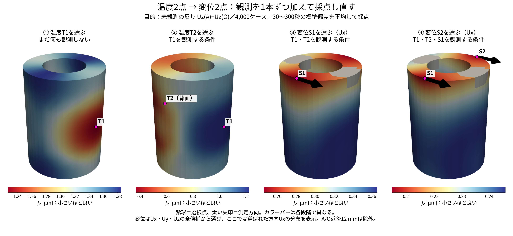

*左からT1 → T2 → S1 → S2の選択。各段階の前提条件とカラーバーを図中に表示。変位候補は3方向すべてを採点し、ここでは選ばれたUxの分布を表示します。紫球が選択点、太い矢印が測定方向です。温度の採点はセルで行い、表示時だけIDWでメッシュに写しています。*

選ばれたのは、**ヒータ側の中段T1と、反対側の中段T2**でした。概略座標はT1＝(36.7, 0.8, 49.2) mm、T2＝(−35.9, −1.5, 51.6) mmです。片側を測った後、反対側にも残る温度差の不確かさを減らす配置です。

比較対象は、人が決めた代表点P2・P0の温度2本です。これは一組の手動配置との比較で、あらゆるランダム配置を代表するものではありません。

## 5. その温度2点を固定し、変位2点を選ぶ

T1・T2を観測する条件で残る共分散から、変位候補のUx・Uy・Uzを採点します。変位2本目も、1本目を追加した後に再採点します。

上の1枚の図の③・④が、この手順です。各段階の全方向の比較は、[変位1本目のUx・Uy・Uz分布](img/sequential_displacement_1.png)、[変位2本目のUx・Uy・Uz分布](img/sequential_displacement_2.png)で確認できます。

選ばれたのは、**上面の離れた2点での横方向変位Ux**でした。S1＝(4.9, −37.2, 100.5) mm、S2＝(4.9, 37.2, 100.5) mmです。旧試験の「P2・P0固定時のS1(Ux)・S2(Uz)」とは、温度の前提が異なるため別の配置になります。

### FrontISTRの熱感度Wと選択点を重ねて比較する

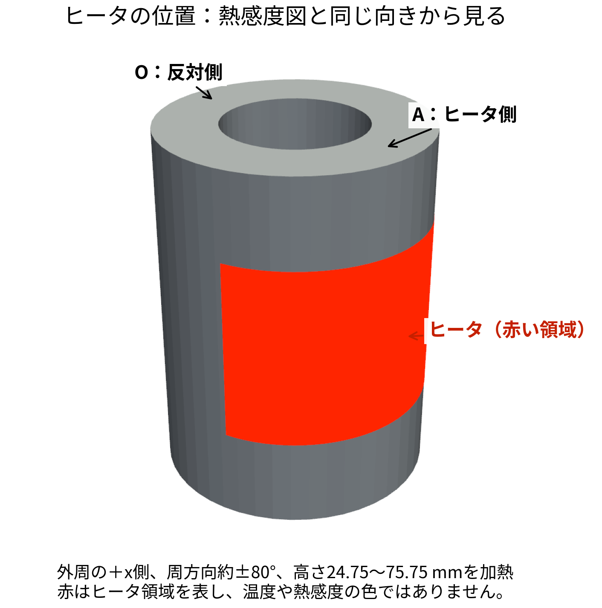

*赤い領域がヒータです。外周の＋x側、周方向約±80°、高さ24.75〜75.75 mmを加熱します。この赤は温度や熱感度の値ではありません。下の熱感度図も同じ向きから見ています。*

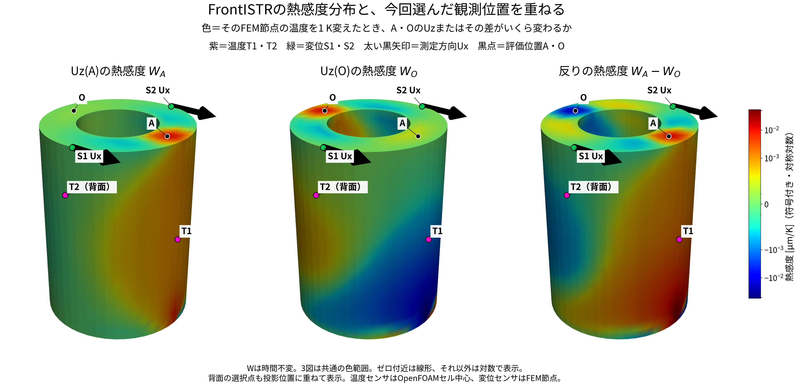

*色はFEM節点温度を1 K変えたときのUz(A)、Uz(O)、その差への感度 [µm/K]。紫は温度T1・T2、緑は変位S1・S2、矢印は測定方向Uxです。Wは時間不変です。レインボー配色で、青は負、緑付近はゼロ、赤は正の感度を表します。小さい値も見えるよう、3図共通の対称対数スケールを使い、ゼロ近傍だけ線形表示しています。*

ここでA・OのW行は、105のFrontISTRが出力した剛性行列・熱荷重行列から求めたものです。差の行はFrontISTRの直接出力を使用し、行列から求めた値とも相対差約 $1.8\times10^{-7}$ で照合済みです。105の四面体分割と、106の変位応答を計算した六面体では離散化が異なります。

T1の近くは、温度上昇がAを上げ、Oを下げる側に働きます。反対側T2はOの上下変位にも関係します。両側の温度を測ることは、この異なる伸び方を区別する情報になります。ただし、**今回選んだT1・T2はWの絶対値最大点を選んだものではありません。** 温度の共分散と観測ノイズを含め、反りの不確かさが小さくなる場所を選びました。

**S1・S2も、この図のWが最大の場所ではありません。** この図のWは「その場所を温めた場合、A・OのUzがどう変わるか」です。一方、変位計の採点に使うのは「全温度場の変化がS1・S2のUxにどう現れ、その情報が反りの推定に役立つか」です。Wの列に対応する温度の位置と、Wの行に対応する変位の測定位置を区別する必要があります。UxからUzへ情報が伝わる式は、この後の§6-0に展開しています。

ParaViewで重ねる場合は `results/vtk/W_AO_selected_sensors.vtu` と `results/vtk/W_AO_selected_sensor_points.vtp` を同時に開けます。座標は両方mmです。VTPの `sensor_code` の対応は `results/W_AO_selected_overlay.json` に、変位の方向は `direction` に保存しています。


| 配置設計の段階 | 予測した反りの標準偏差の時間平均 |
|---|---:|
| 温度T1・T2を選んだ後 | 0.366 µm |
| さらに変位S1を追加 | 0.246 µm |
| さらに変位S2を追加 | 0.204 µm |

この表は**採点による予測**です。次に実際のEnKFで確かめます。

## 6. 選んだ位置でEnKFを実行する

60メンバー、30秒ごと20回更新、0〜600秒を計算します。乱数seedは20260913〜20260917の5個、線は5試行それぞれのアンサンブル平均をさらに平均したものです。観測ノイズの標準偏差は温度0.3 K・変位0.3 µmです。

EnKFが補正する状態は、代表5点温度と発熱倍率・放熱の7変数です。

$$
\mathbf z=[T[P0],T[P1],T[P2],T[P3],T[P4],q_{\mathrm{scale}},h_{\mathrm{ROM}}]^{\mathsf T}
$$

ROMで次の観測時刻へ進め、各メンバーの温度からセンサ値を予報します。観測値との差を、状態とセンサ予報の標本共分散から求めたカルマンゲインで7変数の補正に変換します。補正した5点温度を次のROM初期値に使います。**変位は観測に使いますが、独立した状態として積分しません。** 数式とコードの詳しい対応は [blog_006](blog_006_temp2_disp2_step_by_step.md) を参照してください。

温度場は補正後の5点温度からgappy-PODで復元し、変位はIDW＋FrontISTRの事前計算した応答から復元します。

### 6-0. 今回のプログラムが7変数を補正する式

以下は `run/selected_pair_unobserved_check.py` の `seq` 配置と、`dacore/enkf.py` の `enkf_update` に対応します。配置選定用の4,000ケースとは別に、**実際の同化では60メンバー**を使います。温度T1・T2と変位S1・S2の4観測を使う場合を展開します。

**① 各メンバーをROMで30秒進める。** メンバー番号を $m=1,\ldots,60$ 、観測時刻を $t_k=30k$ 秒とします。前回の補正後を上付き $a$ 、今回の予報を $f$ と書きます。

$$
\mathbf T_{P,k}^{f,(m)}=
\mathcal M_{t_{k-1}\to t_k}
\big(\mathbf T_{P,k-1}^{a,(m)},q_{k-1}^{a,(m)},h_{k-1}^{a,(m)}\big)
$$

この式の入力と出力を、列ベクトルで省略せずに書くと次の形です。

$$
\underbrace{\begin{bmatrix}
T_k^{f,(m)}[P0]\\T_k^{f,(m)}[P1]\\T_k^{f,(m)}[P2]\\T_k^{f,(m)}[P3]\\T_k^{f,(m)}[P4]
\end{bmatrix}}_{5\times1} =\mathcal M_{t_{k-1}\to t_k}\left(
\underbrace{\begin{bmatrix}
T_{k-1}^{a,(m)}[P0]\\T_{k-1}^{a,(m)}[P1]\\T_{k-1}^{a,(m)}[P2]\\T_{k-1}^{a,(m)}[P3]\\T_{k-1}^{a,(m)}[P4]
\end{bmatrix}}_{5\times1},
\underbrace{q_{k-1}^{a,(m)}}_{1\times1},
\underbrace{h_{k-1}^{a,(m)}}_{1\times1}\right)
$$

左辺は「今回の観測時刻まで進めた代表5点の予報温度」、右辺の列ベクトルは「前回の観測で補正した代表5点の温度」です。 $\mathcal M$ は行列の名前ではなく、熱方程式を時間積分する処理の名前です。5点温度と2パラメータを受け取り、次時刻の5点温度を返します。

$\mathcal M$ はRK4で熱ROMを積分する処理です。この30秒の予報中、 $q=q_{\mathrm{scale}}$ と $h=h_{\mathrm{ROM}}$ は各メンバー内で固定します。

$$
\mathbf z_k^{f,(m)}=
\begin{bmatrix}
T_k^{f,(m)}[P0]\\T_k^{f,(m)}[P1]\\T_k^{f,(m)}[P2]\\T_k^{f,(m)}[P3]\\T_k^{f,(m)}[P4]\\
q_{k-1}^{a,(m)}\\h_{k-1}^{a,(m)}
\end{bmatrix}
$$

この状態ベクトル $\mathbf z_k^{f,(m)}$ の大きさは **7×1** です。最後の2成分は次の意味です。

- $q=q_{\mathrm{scale}}$ ：発熱倍率（無次元）。ON時の発熱量は $Q=15q$ Wです。予報中は前回補正した $q_{k-1}^{a,(m)}$ をそのまま使います。
- $h=h_{\mathrm{ROM}}$ ：ROMの放熱コンダクタンス [W/K]。外気への放熱項 $-h(T_i-T_{\mathrm{air}})$ の係数です。表面熱伝達率 [W/(m² K)] とは区別します。これも予報中は前回補正値を使います。

**② そのメンバーならセンサが何を示すかを計算する。** 温度観測値は $\theta_1,\theta_2$ と書き、ROMの代表点温度と区別します。

$$
\mathbf y_k^{f,(m)}=
\begin{bmatrix}
\bar T[T1]+\mathbf g_{T1}^{\mathsf T}(\mathbf T_{P,k}^{f,(m)}-\bar{\mathbf T}_P)\\
\bar T[T2]+\mathbf g_{T2}^{\mathsf T}(\mathbf T_{P,k}^{f,(m)}-\bar{\mathbf T}_P)\\
\bar u_x[S1]+\mathbf h_{S1,x}^{\mathsf T}(\mathbf T_{P,k}^{f,(m)}-\bar{\mathbf T}_P)\\
\bar u_x[S2]+\mathbf h_{S2,x}^{\mathsf T}(\mathbf T_{P,k}^{f,(m)}-\bar{\mathbf T}_P)
\end{bmatrix}
$$

** $\mathbf y_k^{f,(m)}$ は、実測値ではありません。** 「メンバー $m$ の予報温度が正しいなら、今回の時刻 $t_k$ に4本のセンサが示すはずの値」を並べた **4×1の列ベクトル**です。

$$
\underbrace{\mathbf y_k^{f,(m)}}_{4\times1} =\underbrace{\begin{bmatrix}
\theta_{1,k}^{f,(m)}\\\theta_{2,k}^{f,(m)}\\U_{x,k}^{f,(m)}(S1)\\U_{x,k}^{f,(m)}(S2)
\end{bmatrix}}_{4\times1}
$$

1・2行目は代表点以外のT1・T2の温度 [K]、3・4行目はS1・S2の横方向変位 [µm] です。実際には、次の行列積で計算しています。

$$
\underbrace{\mathbf y_k^{f,(m)}}_{4\times1} =\underbrace{\begin{bmatrix}
\bar T[T1]\\\bar T[T2]\\\bar u_x[S1]\\\bar u_x[S2]
\end{bmatrix}}_{4\times1} +\underbrace{\begin{bmatrix}
g_{T1,0}&g_{T1,1}&g_{T1,2}&g_{T1,3}&g_{T1,4}\\
g_{T2,0}&g_{T2,1}&g_{T2,2}&g_{T2,3}&g_{T2,4}\\
h_{S1x,0}&h_{S1x,1}&h_{S1x,2}&h_{S1x,3}&h_{S1x,4}\\
h_{S2x,0}&h_{S2x,1}&h_{S2x,2}&h_{S2x,3}&h_{S2x,4}
\end{bmatrix}}_{4\times5}
\underbrace{\begin{bmatrix}
T_k^{f,(m)}[P0]-\bar T[P0]\\T_k^{f,(m)}[P1]-\bar T[P1]\\T_k^{f,(m)}[P2]-\bar T[P2]\\T_k^{f,(m)}[P3]-\bar T[P3]\\T_k^{f,(m)}[P4]-\bar T[P4]
\end{bmatrix}}_{5\times1}
$$

$g_{T1,j}$ は「代表点Pjの温度が1 K変わると、復元したT1の温度が何 K変わるか」という温度復元の係数（無次元）です。 $h_{S1x,j}$ は「同じ1 Kの変化で、S1のUxが何 µm変わるか」という変位復元の係数 [µm/K] です。T2・S2も同様です。**ここでの $g,h_{S1x,j}$ は固定した復元係数であり、状態として推定する $q,h_{\mathrm{ROM}}$ とは別物です。**

ここでバーはPODの時間平均場とその変位応答です。 $\mathbf g$ は温度復元の重み、 $\mathbf h$ は変位の重みです。S1・S2は今回いずれもUxを測ります。A・OのUzは観測ベクトルに入りません。

比較する観測ベクトルは、保存済みOpenFOAM・FrontISTRの正解に観測ノイズ $\boldsymbol\eta_k$ を加えたものです。

$$
\mathbf y_k^{\mathrm{obs}}=
\begin{bmatrix}\theta_1^*(t_k)\\\theta_2^*(t_k)\\U_x^*(S1,t_k)\\U_x^*(S2,t_k)\end{bmatrix} +\boldsymbol\eta_k,
\qquad \boldsymbol\eta_k\sim\mathcal N(\mathbf0,R)
$$

**この観測値を使う場所は、⑥の「観測と予報の差」です。** 上の4成分を省略せずに更新式へ代入すると、

$$
\underbrace{\mathbf z_k^{a,(m)}}_{7\times1} =\underbrace{\widetilde{\mathbf z}_k^{f,(m)}}_{7\times1} +\underbrace{K}_{7\times4}
\underbrace{\begin{bmatrix}
\theta_1^*(t_k)+\eta_{1,k}+\varepsilon_{1,k}^{(m)}-\widetilde\theta_{1,k}^{f,(m)}\\
\theta_2^*(t_k)+\eta_{2,k}+\varepsilon_{2,k}^{(m)}-\widetilde\theta_{2,k}^{f,(m)}\\
U_x^*(S1,t_k)+\eta_{3,k}+\varepsilon_{3,k}^{(m)}-\widetilde U_{x,k}^{f,(m)}(S1)\\
U_x^*(S2,t_k)+\eta_{4,k}+\varepsilon_{4,k}^{(m)}-\widetilde U_{x,k}^{f,(m)}(S2)
\end{bmatrix}}_{\mathbf r_k^{(m)}:\ 4\times1}
$$

となります。**各行の「正解値＋η」が、上で作った観測値そのものです。** そこへメンバー別の観測摂動εを加え、そのメンバーのセンサ予報を引きます。この4つの差にKを掛けると、7変数の補正量（7×1）になります。チルダは③のインフレーション後を示します。

$\boldsymbol\eta_k$ は模擬観測を作るノイズ（4×1）で、同時刻の60メンバーは同じ観測値を使います。 $\boldsymbol\varepsilon_k^{(m)}$ は更新の際に各メンバーへ独立に加える摂動（4×1）です。実測では「正解値＋η」の4成分を、実際の4センサの測定値に置き換えます。

実際のコードでは、ηを加えた値を変数 `y` に保存しているので、更新関数でηという名前は再登場しません。**ηは既に `y` に含まれており、消えたわけではありません。**

```python
# run/selected_pair_unobserved_check.py
# yv: 正解の温度2成分と変位2成分 (4,)
y = np.array(yv) + ro.normal(0, np.sqrt(np.diag(Rd)))  # 正解＋η
Z = enkf_update(Z, y, None, Rd, rng, inflation=INFL, Yf=Yf)

# dacore/enkf.py 内（Zf, Yf はインフレーション後）
eps = rng.multivariate_normal(np.zeros(len(y)), R, size=n_ens)  # (60, 4)
innov = (y[None, :] + eps) - Yf  # (60, 4)：上の差を60行並べる
gain_T = np.linalg.solve(S, C_zy.T)  # (4, 7)：Kの転置
Za = Zf + innov @ gain_T  # (60, 7)：全メンバーの7変数を補正
```

Kを求める④・⑤では60メンバーの予報とRを使い、**実際の観測値は⑥で補正量を求めるときに使います。**

$R$ は温度2成分の分散 $(0.3\ \mathrm K)^2$ と変位2成分の分散 $(0.3\ \mathrm{µm})^2$ を対角に並べた4×4行列です。

**ここからの行列の大きさ**：数式ではメンバー1個を列ベクトルで書き、コードではメンバーを行に並べます。

| 量 | 数式の大きさ | コードの配列 |
|---|---|---|
| 状態・状態平均・状態偏差 | 7×1 | `Zf`, `dZ`: 60×7、`zbar`: (7,) |
| センサ予報・その平均・偏差 | 4×1 | `Yf`, `dY`: 60×4、`ybar`: (4,) |
| 観測値・メンバー1個の観測摂動・観測差 | 4×1 | `y`: (4,)、`eps`, `innov`: 60×4 |
| 状態とセンサ予報の共分散 $C_{zy}$ | 7×4 | `C_zy`: 7×4 |
| センサ予報の共分散 $C_{yy}$ ・観測ノイズ共分散 $R$ | 4×4 | `C_yy`, `R`, `S`: 4×4 |
| カルマンゲイン $K$ | 7×4 | `gain_T`: 4×7（Kの転置） |
| 補正量 $K\mathbf r_k^{(m)}$ | (7×4)(4×1)＝7×1 | `innov @ gain_T`: (60×4)(4×7)＝60×7 |

**③ 60メンバーのばらつきを1.02倍にする。** 実装のインフレーション係数は $\rho=1.02$ です。状態とセンサ予報の両方を、それぞれの60メンバー平均の周りで広げます。

$$
\bar{\mathbf z}_k^f=\frac1{60}\sum_m\mathbf z_k^{f,(m)},
\qquad \bar{\mathbf y}_k^f=\frac1{60}\sum_m\mathbf y_k^{f,(m)}
$$

$$
\widetilde{\mathbf z}_k^{f,(m)}=\bar{\mathbf z}_k^f+\rho(\mathbf z_k^{f,(m)}-\bar{\mathbf z}_k^f),
\qquad
\widetilde{\mathbf y}_k^{f,(m)}=\bar{\mathbf y}_k^f+\rho(\mathbf y_k^{f,(m)}-\bar{\mathbf y}_k^f)
$$

**インフレーションとは、平均からのずれを少し広げる操作です。** 今回1.02倍にするものは、各メンバーの値そのものではなく、平均からの偏差です。温度・q・hの7状態と、4成分のセンサ予報に同じ係数を使います。

例えば平均20 ℃でメンバーが21 ℃なら、 $20+1.02(21-20)=21.02$ ℃になります。19 ℃のメンバーなら $20+1.02(19-20)=18.98$ ℃です。平均は変わらず、標準偏差は1.02倍、分散・共分散は $1.02^2=1.0404$ 倍になります。

$$
\mathrm{Cov}(\widetilde{\mathbf z}^f)=\rho^2\mathrm{Cov}(\mathbf z^f),
\qquad \rho=1.02
$$

同化を繰り返すとメンバーのばらつきが過度に小さくなり、モデルと観測の差を補正しにくくなることがあります。その対策としてコードの `INFL=1.02` が設定されています。**1.02は実装上の調整値で、熱方程式から導いた値ではなく、この研究で最適性を確認した値でもありません。** この操作は、モデル誤差を別途同定したことを意味しません。


**④ 状態とセンサ予報の標本共分散を求める。**

$$
\Delta\mathbf z_k^{(m)}=\widetilde{\mathbf z}_k^{f,(m)}-\bar{\mathbf z}_k^f,
\qquad
\Delta\mathbf y_k^{(m)}=\widetilde{\mathbf y}_k^{f,(m)}-\bar{\mathbf y}_k^f
$$

上の偏差も、成分を省略しない列ベクトルで書くと次のとおりです。ここで引く平均は、**同じ時刻の60メンバー平均**であり、②のPODの時間平均（ $\bar T[Pj]$ ）とは異なります。

$$
\underbrace{\Delta\mathbf z_k^{(m)}}_{7\times1} =\underbrace{\begin{bmatrix}
\widetilde T_k^{f,(m)}[P0]-\overline{T_k^f[P0]}\\
\widetilde T_k^{f,(m)}[P1]-\overline{T_k^f[P1]}\\
\widetilde T_k^{f,(m)}[P2]-\overline{T_k^f[P2]}\\
\widetilde T_k^{f,(m)}[P3]-\overline{T_k^f[P3]}\\
\widetilde T_k^{f,(m)}[P4]-\overline{T_k^f[P4]}\\
\widetilde q_k^{f,(m)}-\overline{q_k^f}\\
\widetilde h_k^{f,(m)}-\overline{h_k^f}
\end{bmatrix}}_{7\times1}
$$

$$
\underbrace{\Delta\mathbf y_k^{(m)}}_{4\times1} =\underbrace{\begin{bmatrix}
\widetilde\theta_{1,k}^{f,(m)}-\overline{\theta_{1,k}^f}\\
\widetilde\theta_{2,k}^{f,(m)}-\overline{\theta_{2,k}^f}\\
\widetilde U_{x,k}^{f,(m)}(S1)-\overline{U_{x,k}^f(S1)}\\
\widetilde U_{x,k}^{f,(m)}(S2)-\overline{U_{x,k}^f(S2)}
\end{bmatrix}}_{4\times1}
$$

例えば $\overline{T_k^f[P0]}=\frac1{60}\sum_{m=1}^{60}T_k^{f,(m)}[P0]$ です。他の成分もそれぞれ60個から平均します。偏差は観測との差ではなく、**各メンバーとメンバー平均との差**です。

$$
\underbrace{C_{zy}}_{7\times4}=\frac1{59}\sum_{m=1}^{60}\underbrace{\Delta\mathbf z_k^{(m)}}_{7\times1}\underbrace{\Delta\mathbf y_k^{(m)\mathsf T}}_{1\times4},
\qquad
\underbrace{C_{yy}}_{4\times4}=\frac1{59}\sum_{m=1}^{60}\underbrace{\Delta\mathbf y_k^{(m)}}_{4\times1}\underbrace{\Delta\mathbf y_k^{(m)\mathsf T}}_{1\times4}
$$

$C_{zy}$ は7×4、 $C_{yy}$ は4×4です。たとえば $C_{zy}$ の発熱倍率の行は、

$$
[C_{zy}]_{q,:}=\frac1{59}\sum_m
\Delta q_k^{(m)}
\begin{bmatrix}\Delta\theta_1^{(m)}&\Delta\theta_2^{(m)}&\Delta U_x^{(m)}(S1)&\Delta U_x^{(m)}(S2)\end{bmatrix}
$$

です。**発熱倍率が違うメンバーでセンサ値がどう変わったか**を使います。放熱の行も $\Delta q$ を $\Delta h$ に置き換えて計算します。センサの式にQ・hが直接現れなくても、ROMの時間発展を通じて共分散が生まれます。

**⑤ カルマンゲインを求める。**

$$
\underbrace{K}_{7\times4}=\underbrace{C_{zy}}_{7\times4}\underbrace{(C_{yy}+R)^{-1}}_{4\times4}
$$

これは7×4行列です。コードは逆行列を作らず、 $(C_{yy}+R)K^{\mathsf T}=C_{zy}^{\mathsf T}$ を `np.linalg.solve` で解きます。

**⑥ 観測との差を7変数の補正量に変換する。** 各メンバーに独立な観測摂動 $\boldsymbol\varepsilon_k^{(m)}\sim\mathcal N(\mathbf0,R)$ を与えます。これは②で作った観測ノイズ $\boldsymbol\eta_k$ とは別です。

$$
\mathbf r_k^{(m)}=\mathbf y_k^{\mathrm{obs}}+\boldsymbol\varepsilon_k^{(m)}-
\widetilde{\mathbf y}_k^{f,(m)} =\begin{bmatrix}r_1^{(m)}\\r_2^{(m)}\\r_3^{(m)}\\r_4^{(m)}\end{bmatrix}
$$

$$
\boxed{\mathbf z_k^{a,(m)}=\widetilde{\mathbf z}_k^{f,(m)}+K\mathbf r_k^{(m)}}
$$

**この積を、7変数×4観測の行列として書く。** 補正量は「補正後 − 拡張後の予報」です。④の平均からの偏差と区別して、 $\Delta_{\mathrm{corr}}$ と書きます。

$$
\begin{bmatrix}
\Delta_{\mathrm{corr}}T[P0]\\
\Delta_{\mathrm{corr}}T[P1]\\
\Delta_{\mathrm{corr}}T[P2]\\
\Delta_{\mathrm{corr}}T[P3]\\
\Delta_{\mathrm{corr}}T[P4]\\
\Delta_{\mathrm{corr}}q\\
\Delta_{\mathrm{corr}}h
\end{bmatrix} =
\begin{bmatrix}
K_{0,1}&K_{0,2}&K_{0,3}&K_{0,4}\\
K_{1,1}&K_{1,2}&K_{1,3}&K_{1,4}\\
K_{2,1}&K_{2,2}&K_{2,3}&K_{2,4}\\
K_{3,1}&K_{3,2}&K_{3,3}&K_{3,4}\\
K_{4,1}&K_{4,2}&K_{4,3}&K_{4,4}\\
K_{q,1}&K_{q,2}&K_{q,3}&K_{q,4}\\
K_{h,1}&K_{h,2}&K_{h,3}&K_{h,4}
\end{bmatrix}
\begin{bmatrix}
r_1^{(m)}\\r_2^{(m)}\\r_3^{(m)}\\r_4^{(m)}
\end{bmatrix}
$$

左辺は同じ時刻k・メンバーmでの補正量です。上5行の $K_{j,\ell}$ は、下の成分式の $K_{T[Pj],\ell}$ と同じ係数です。

| 行・列 | 何を意味するか |
|---|---|
| 行P0〜P4 | その代表点温度を何K直すか |
| 行q | 発熱倍率をいくら直すか |
| 行h | 放熱コンダクタンスを何W/K直すか |
| 列1 | 温度センサT1のずれ $r_1$ の影響 |
| 列2 | 温度センサT2のずれ $r_2$ の影響 |
| 列3 | S1のUxのずれ $r_3$ の影響 |
| 列4 | S2のUxのずれ $r_4$ の影響 |

例えば $K_{q,3}$ は、**S1のUxが予報から1 µmずれたとき、発熱倍率qをどれだけ直すか**を表します。 $K_{h,3}$ は同じずれをhの補正へ換算します。温度観測の列と変位観測の列では単位が異なりますが、ゲインがそれぞれの状態の単位へ換算します。


行ごとに書けば、代表5点温度については、各 $j=0,\ldots,4$ に対して

$$
T_k^{a,(m)}[Pj]=\widetilde T_k^{f,(m)}[Pj] +K_{T[Pj],1}r_1^{(m)}+K_{T[Pj],2}r_2^{(m)} +K_{T[Pj],3}r_3^{(m)}+K_{T[Pj],4}r_4^{(m)}
$$

発熱倍率・放熱についても同じ4成分のずれを使います。

$$
q_k^{a,(m)}=\widetilde q_k^{f,(m)} +K_{q,1}r_1^{(m)}+K_{q,2}r_2^{(m)}+K_{q,3}r_3^{(m)}+K_{q,4}r_4^{(m)}
$$

$$
h_k^{a,(m)}=\widetilde h_k^{f,(m)} +K_{h,1}r_1^{(m)}+K_{h,2}r_2^{(m)}+K_{h,3}r_3^{(m)}+K_{h,4}r_4^{(m)}
$$

**これが、温度・変位観測から、観測点以外の代表5点温度とQ・hを補正する処理です。** ゲインの3・4列が、変位観測のずれを各状態の補正に変換します。


**なぜQ・hも直せるのか。** 60メンバーでは、最初からq・hがそれぞれ異なります。そのq・hでROMを進めると、代表5点温度が異なり、T1・T2の温度とS1・S2のUxの予報も異なります。この対応を $C_{zy}$ のq行・h行に記録しています。

$$
(q^{(m)},h^{(m)})
\ \longrightarrow\ \mathbf T_P^{f,(m)}
\ \longrightarrow\ \mathbf y^{f,(m)}
\ \longrightarrow\ C_{zy}
\ \longrightarrow\ K
$$

実際の観測との差に、このKを掛けることでq・hを変更します。Q・hを測定した値に置き換えたり、観測ごとに別々の逆解析を解いたりする処理ではありません。

発熱量の補正をWで書くと、制限処理の前には

$$
\Delta_{\mathrm{corr}}Q =15\Delta_{\mathrm{corr}}q =15\left(
K_{q,1}r_1^{(m)}+K_{q,2}r_2^{(m)} +K_{q,3}r_3^{(m)}+K_{q,4}r_4^{(m)}
\right)
$$

です。括弧内が正ならQを上げ、負なら下げます。hも同様に、h行と4成分のずれの積の和で上げ下げします。**Uxの符号だけからQ・hの補正方向は決まりません。** 観測予報のずれと、今回求めたゲインの符号・大きさの両方で決まります。また、qとhによるセンサ値の変化が似ていると、状態は合っても両パラメータを正しく区別できない場合があります。

**Kは固定した重みではありません。** 温度・変位の復元重み $\mathbf g,\mathbf h$ は事前計算した固定値ですが、Kは各観測時刻の60メンバーから毎回求め直します。 $C_{yy}+R$ の逆作用で4観測の相互関係も考慮するため、 $K_{q,3}$ を単に $\mathrm{Cov}(q,U_x(S1))$ だけから決めているわけではありません。


実装は補正後の $q$ を0〜3、 $h$ を0.0001〜0.2 W/Kに制限します。発熱量への換算は $Q=15q$ Wです。このQはON時の発熱量で、OFF中の熱入力はゼロです。

**⑦ 補正した各メンバーの7変数を次の30秒の予報に渡す。** 平均値1組だけを次へ渡すのではありません。60組を維持して繰り返し、表示時に平均します。補正後温度からUz(A)・Uz(O)を再計算します。変位の独立状態を保存して次時刻へ積分する処理ではありません。


### 6-1. Ux観測が、未観測Uzを直す数学的な経路

「UxがUzを物理的に押し動かす」という意味ではありません。同じ温度場がUxとUzに現れることを使って、温度の推定を直す処理です。

Kの上5行を $K_T$ とします。これは4成分の観測差から、代表5点の温度補正量を求める5×4行列です。

$$
\Delta_{\mathrm{corr}}\mathbf T_P=K_T\mathbf r^{(m)}
$$

A・Oの上下変位は、固定した復元重みを使って

$$
U_z(A)=\bar u_{A,z}+\mathbf h_{A,z}^{\mathsf T}(\mathbf T_P-\bar{\mathbf T}_P),
\qquad
U_z(O)=\bar u_{O,z}+\mathbf h_{O,z}^{\mathsf T}(\mathbf T_P-\bar{\mathbf T}_P)
$$

と計算します。補正前後の差を取ると、平均場の定数項が消え、

$$
\Delta_{\mathrm{corr}}U_z(A)=\mathbf h_{A,z}^{\mathsf T}K_T\mathbf r^{(m)},
\qquad
\Delta_{\mathrm{corr}}U_z(O)=\mathbf h_{O,z}^{\mathsf T}K_T\mathbf r^{(m)}
$$

となります。反り $d=U_z(A)-U_z(O)$ については、 $\mathbf w=\mathbf h_{A,z}-\mathbf h_{O,z}$ より、

$$
\boxed{\Delta_{\mathrm{corr}}d=\mathbf w^{\mathsf T}K_T\mathbf r^{(m)}}
$$

です。たとえばS1のUx観測差 $r_3^{(m)}$ が反りの補正に寄与する項は、

$$
\underbrace{\left[\sum_{j=0}^{4}
(h_{A,z,j}-h_{O,z,j})K_{T[Pj],3}\right]}_{\beta}
\ r_3^{(m)}
$$

（ $eta$ ：S1 の $U_x$ のずれを、反りの補正へ換算する係数。）

です。**Ux観測のずれ → Kの3列目による5点温度の補正 → 温度からUz(A)・Uz(O)を再計算**という経路が、上の積にそのまま表れています。S2のUxは4列目を通ります。A・OのUzは観測に使わず、補正後温度から出力しています。

配置設計の式でも、この関係を確認できます。既に選んだ温度センサの情報を反映した共分散をP、追加するSのUxの重みを $\mathbf h_{S,x}$ とすると、線形推定でUxを1本追加した場合の反りの補正係数は、

$$
\beta_{d,Sx} =\frac{\mathbf w^{\mathsf T}P\mathbf h_{S,x}}
{\mathbf h_{S,x}^{\mathsf T}P\mathbf h_{S,x}+r_u} =\frac{\mathrm{Cov}(d,U_x(S))}
{\mathrm{Var}(U_x(S))+r_u}
$$

です。反りの分散が減る量は、

$$
\boxed{\Delta\sigma_d^2 =\frac{\mathrm{Cov}(d,U_x(S))^2}
{\mathrm{Var}(U_x(S))+r_u}}
$$

となります。**測定方向が異なっていても、同じ温度の不確かさを通じて共分散があれば、UxはUzの推定情報になります。** 共分散がゼロなら、この線形補正では反りの情報になりません。今回の選定は、この分散減少を含むJを全方向の候補について比較したものです。実際のEnKFは4観測を同時に使い、そのゲインを60メンバーから各時刻で求めています。

今回の計算では、選定温度2点のみから選定Ux2点を追加すると、未観測反りの誤差が15 Wで **0.198→0.103 µm**、25 Wで **0.242→0.107 µm**、間欠加熱で **0.161→0.090 µm** に減りました。したがって、**今回の3条件ではUx観測が未観測反りの推定に有効だった**と言えます。すべてのUz出力で最良になることや、実機での有効性まで示した結果ではありません。


### 6-2. 15 Wの結果：温度配置を選び、変位配置を追加する


**この図で比較する未観測量は8つです。** 温度はP1・P3・P4の3点、変位は反り $U_z(A)-U_z(O)$ 、A単体の $U_z(A)$ 、O単体の $U_z(O)$ 、別の2点E・Fの $U_z$ です。**いずれも図の比較配置では観測に使っていません。** E・Fは上面の選定変位点とは異なる、中段の節点です。

| 評価点 | 場所 | 実際の評価座標 $(x,y,z)$ [mm] |
|---|---|---|
| 温度P1 | 横側・中段のOpenFOAMセル | (−14.12, 33.09, 51.56) |
| 温度P3 | ヒータ側・下部のOpenFOAMセル | (35.13, 0.78, 0.78) |
| 温度P4 | 反対側・下部のOpenFOAMセル | (−35.13, 0.78, 0.78) |
| 変位A | 上面・ヒータ側のFEM節点 | (28.75, 0, 100.50) |
| 変位O | 上面・反対側のFEM節点 | (−28.75, 0, 100.50) |
| 変位E | ヒータ側・中段のFEM節点 | (37.50, 0, 50.25) |
| 変位F | 反対側・中段のFEM節点 | (−37.50, 0, 50.25) |

黒線は正解、色線は同化なし・手動温度2点・選定温度2点・底面変位追加・選定変位追加です。線は各試行の60メンバー平均をさらに5試行で平均しています。表示は最初の更新時刻30秒から600秒までです。

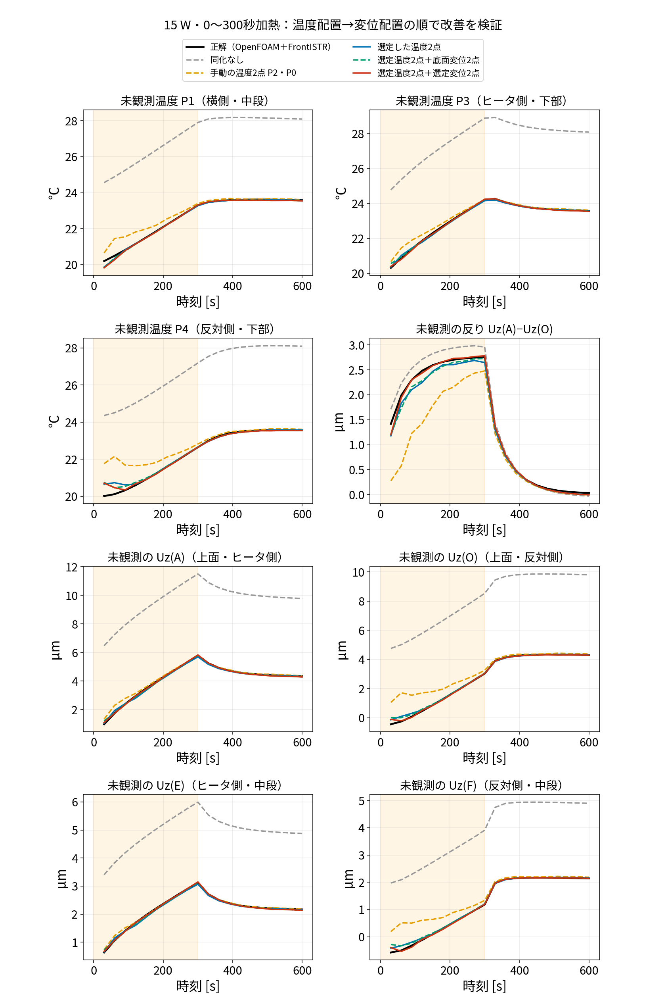

*正解はOpenFOAM温度＋IDWで温度を渡したFrontISTR変位。P1・P3・P4は温度観測に使わない代表点。A・O・E・Fも観測に使いません。橙帯は加熱中。*

以下の誤差は30〜300秒、10時刻、5試行で平均しました。温度場は全セルRMSEの時間平均、変位は平均絶対誤差です。

計算式では、試行数 $S=5$ 、評価時刻数 $K=10$ 、セル数 $N=20696$ として、

$$
E_T=\frac{1}{SK}\sum_{s=1}^{S}\sum_{k=1}^{K}
\sqrt{\frac{1}{N}\sum_{i=1}^{N}(\widehat T_{s,i}(t_k)-T_i^*(t_k))^2},
\qquad
E_d=\frac{1}{SK}\sum_{s=1}^{S}\sum_{k=1}^{K}|\widehat d_s(t_k)-d^*(t_k)|
$$

です。ハットは同化後の60メンバー平均、星は正解です。各点の変位誤差も $d$ をその点の変位に置き換えて計算します。

| 観測配置 | 温度場 [K] | 反りA−O [µm] | Uz(A) [µm] | Uz(O) [µm] |
|---|---:|---:|---:|---:|
| 手動の温度2点P2・P0 | 0.543 | 0.775 | 0.241 | 0.951 |
| 選定した温度2点T1・T2 | 0.208 | 0.198 | 0.200 | 0.204 |
| T1・T2＋底面近くの変位2点 | 0.176 | 0.178 | 0.147 | 0.167 |
| T1・T2＋選定した変位2点S1・S2 | 0.169 | **0.103** | 0.140 | 0.168 |

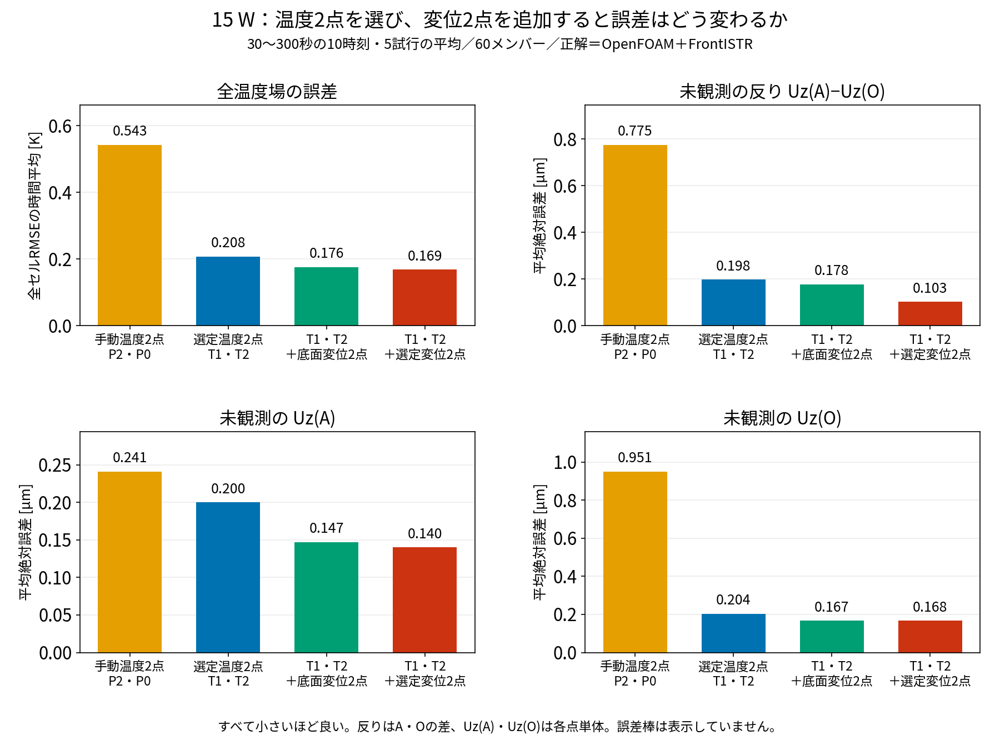

*上の表と同じ数値を棒グラフにしたものです。温度場は全セルRMSEの時間平均、変位は平均絶対誤差で、いずれも小さいほど良い指標です。*

**なぜ手動のP0・P2では誤差が大きかったか。** P0は約(21.3, −1.6, 51.6) mm、P2は約(36.5, 6.9, 50.8) mmで、どちらもヒータ側の中段です。ヒータ側を2点測っても、反対側の温度は共分散による間接的な補正に頼ります。左右の伸びの差で決まる反りを知るには、反対側にも残る温度の不確かさが問題になります。

同じ4,000ケースから、測定後に残る反りの標準偏差を予測すると、P0・P2では **1.192 µm**、ヒータ側T1・反対側T2では **0.366 µm** でした。この採点上の差と、実際のEnKFで反り誤差が **0.775→0.198 µm** に減ったことは整合します。P0・P2はROMの代表点として選ばれた点ですが、代表点としての役割と、温度計2本で反りを推定するための観測配置の良さは別です。

ただし、この比較は観測配置による残存不確かさの説明です。有限アンサンブル、ROM誤差、初期分布などの寄与を個別に切り分けた原因分析ではありません。

**温度位置を選ぶことで温度場と反りが改善し、さらに反りを目的に変位位置・方向を選ぶことで、反りの誤差が小さくなりました。** 一方Uz(O)は底面配置より良くなっていません。反りを狙う配置が、すべての出力で最良になるわけではありません。

同化なしの反り誤差は0.239 µmですが、Uz(A)・Uz(O)はそれぞれ5.604・5.365 µm外れます。同じ向きの誤差が差を取ると打ち消されるため、反りだけで推定全体を評価できません。

### 6-3. 25 W・間欠加熱でも確かめる

センサ位置とROM係数を変えずに、加熱条件を変えます。

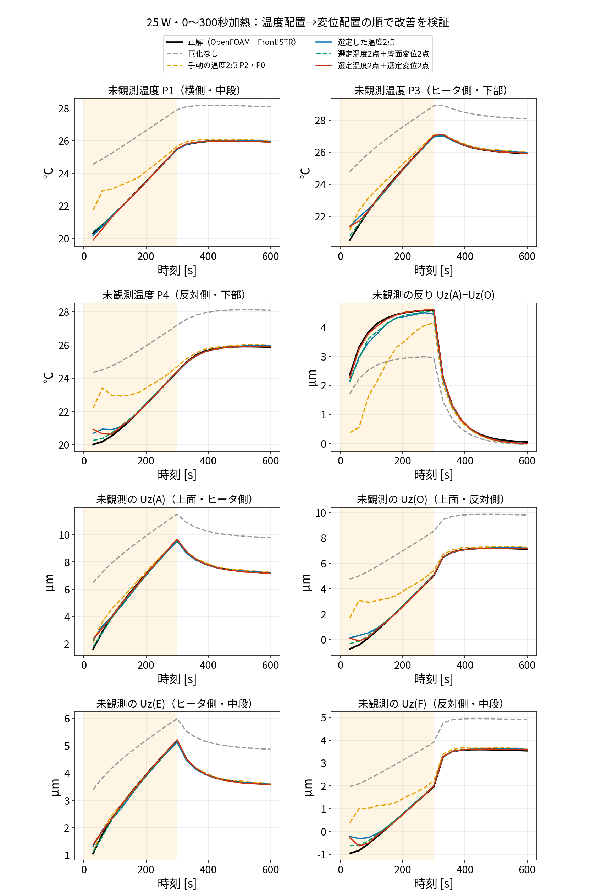

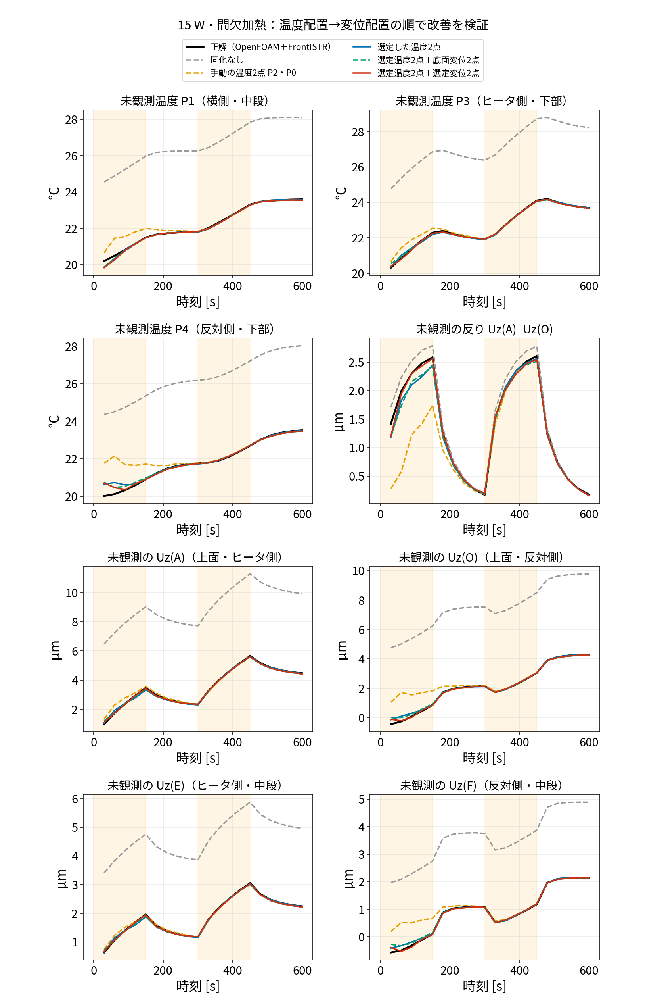

| 加熱条件 | 手動温度2点：反り誤差 | 選定温度2点：反り誤差 | ＋選定変位2点：反り誤差 |
|---|---:|---:|---:|
| 25 W、0〜300秒ON | 1.417 µm | 0.242 µm | 0.107 µm |
| 15 W、0〜150秒と300〜450秒ON | 0.635 µm | 0.161 µm | 0.090 µm |

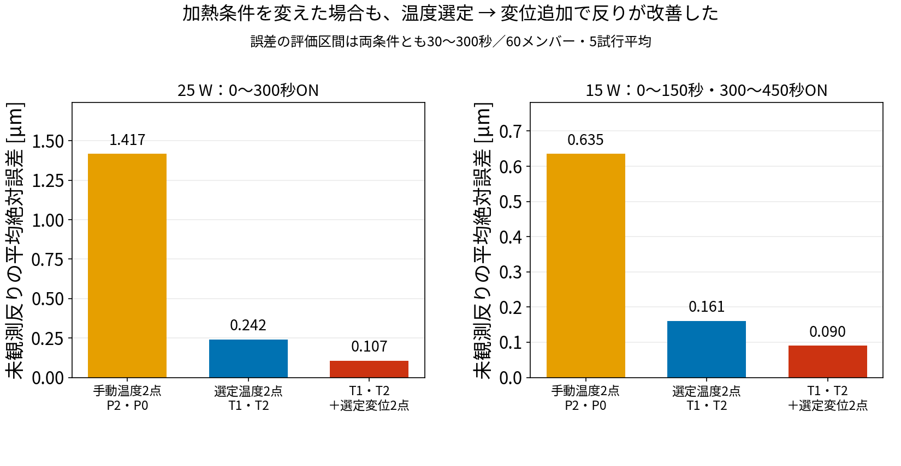

*直前の表と同じ値です。各加熱条件で、手動温度2点、選定温度2点、選定温度＋選定変位の3構成を比較します。*

どちらも評価区間は30〜300秒です。25 Wでは底面変位を追加した方が温度場RMSEは小さく、選定変位を追加した方が反り誤差は小さくなりました。**今回のJは反りを目的にした採点値**であることを、結果でも区別します。

### 6-4. 代表点以外の未観測温度も、同化で正解に近づくか

**P1・P3・P4は未観測でもROMの代表点です。ここではさらに、代表点P0〜P4に含まれず、温度観測にも使っていない別の4セルで確認します。** 既存検証コードで固定している4点を全て掲載し、blog009・010の両方で同じ検証点を使います。観測に使った温度へ合うかだけでなく、復元した別の場所の温度にも合うかを比較します。

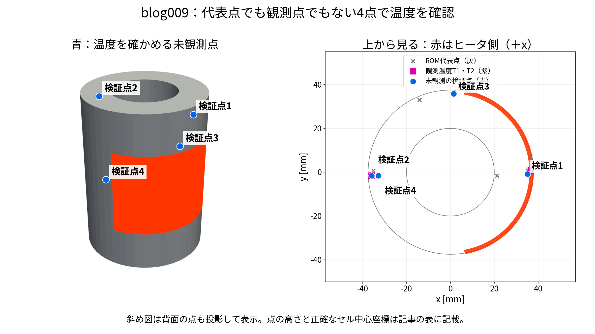

*青は温度を確かめる4つの未観測セル。赤はヒータ、右図の紫は選定温度センサT1・T2、灰はROM代表点です。上から重なって見える点も、高さやセル番号は異なります。検証点は温度センサにもROM代表点にも含まれないことをセル番号で確認しています。*

| 検証点 | 位置 | 実際のOpenFOAMセル中心 [mm] | セル番号（コードの0始まり） |
|---|---|---|---:|
| 検証点1 | ヒータ側・上部 | (35.12, -0.78, 94.58) | 15481 |
| 検証点2 | 反対側・上部 | (-35.89, -1.55, 89.06) | 388 |
| 検証点3 | 横（+y）・中段 | (1.51, 35.86, 51.56) | 2212 |
| 検証点4 | 反対側・下部 | (-32.88, -1.57, 29.69) | 6236 |

この4点の温度はROMで独立に時間積分していません。EnKFで補正した代表5点温度から、gappy-PODの復元行列Gを使って計算しています。検証セルcの温度は、

$$
\widehat T[c]{}(t)=\bar T[c] +\underbrace{\begin{bmatrix}G_{c,0}&G_{c,1}&G_{c,2}&G_{c,3}&G_{c,4}\end{bmatrix}}_{1\times5}
\underbrace{\begin{bmatrix}
\widehat T[P0]{}(t)-\bar T[P0]\\
\widehat T[P1]{}(t)-\bar T[P1]\\
\widehat T[P2]{}(t)-\bar T[P2]\\
\widehat T[P3]{}(t)-\bar T[P3]\\
\widehat T[P4]{}(t)-\bar T[P4]
\end{bmatrix}}_{5\times1}
$$

です。バーはPODの時間平均場、ハットは同化後の推定値です。**観測のずれで代表5点を補正した影響が、この復元式を通して、観測していないセルの温度にも反映されます。** 同化なしでは、観測で補正せずに進めた代表5点から、同じGで復元します。

以下は、既存の同一EnKF比較で保存した全7温度点のうち、代表点以外の4点を抜き出した図です。新しく異なる条件のEnKFを計算した結果ではありません。

#### 15 W：0〜300秒加熱での比較

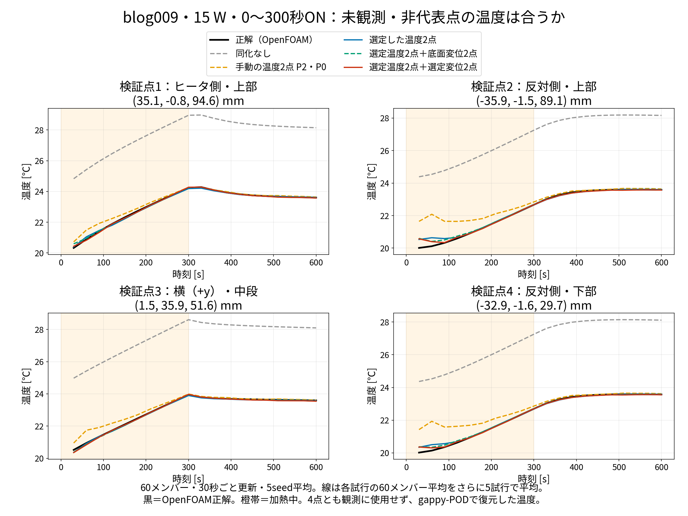

*黒＝OpenFOAMの正解。灰破線＝同化なし、橙破線＝手動温度P2・P0、青＝選定温度T1・T2、緑破線＝選定温度＋底面変位、赤＝選定温度＋選定変位。60メンバー・30秒ごと20更新・5seedで、線は各試行の60メンバー平均をさらに5試行で平均。橙帯は加熱中。更新後30〜600秒を表示しています。*

下表は各検証セルの**平均絶対温度誤差 [K]**です。評価区間は30〜300秒の10時刻、5試行で、全セルRMSEとは異なります。

| 検証点 | 同化なし | 手動温度P2・P0 | 選定温度T1・T2 | ＋底面変位2点 | ＋選定変位2点 |
|---|---:|---:|---:|---:|---:|
| 検証点1 | 4.610 | 0.294 | 0.166 | 0.125 | 0.146 |
| 検証点2 | 4.493 | 0.875 | 0.235 | 0.190 | 0.206 |
| 検証点3 | 4.560 | 0.358 | 0.096 | 0.108 | 0.095 |
| 検証点4 | 4.466 | 0.807 | 0.178 | 0.132 | 0.149 |

#### 25 W：0〜300秒加熱での比較

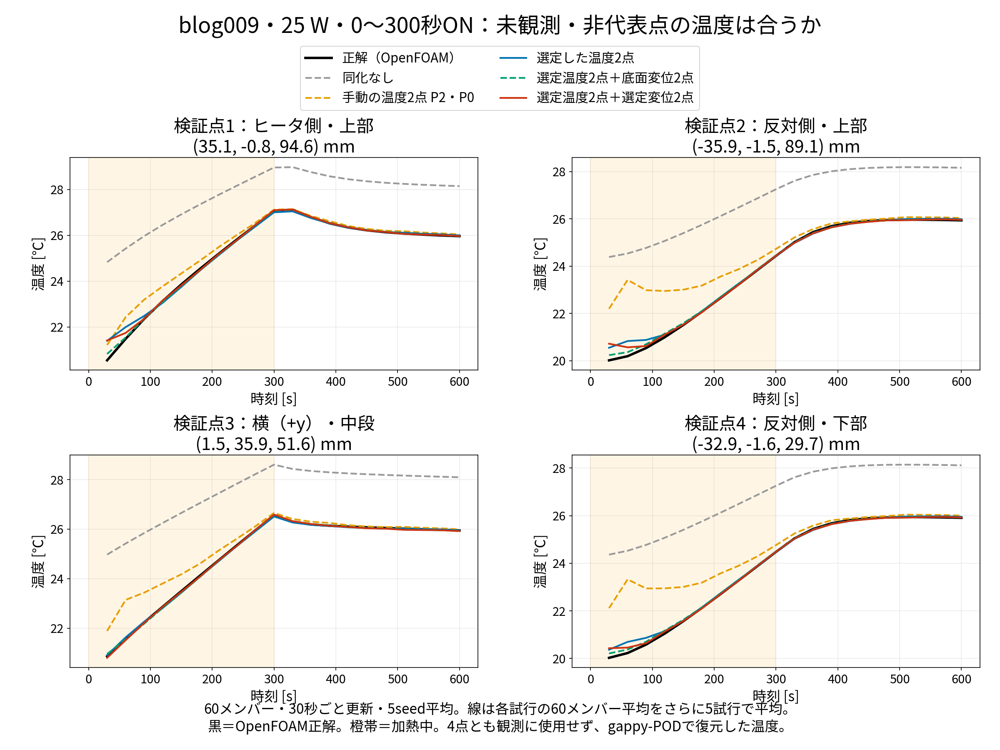

*黒＝OpenFOAMの正解。灰破線＝同化なし、橙破線＝手動温度P2・P0、青＝選定温度T1・T2、緑破線＝選定温度＋底面変位、赤＝選定温度＋選定変位。60メンバー・30秒ごと20更新・5seedで、線は各試行の60メンバー平均をさらに5試行で平均。橙帯は加熱中。更新後30〜600秒を表示しています。*

下表は各検証セルの**平均絶対温度誤差 [K]**です。評価区間は30〜300秒の10時刻、5試行で、全セルRMSEとは異なります。

| 検証点 | 同化なし | 手動温度P2・P0 | 選定温度T1・T2 | ＋底面変位2点 | ＋選定変位2点 |
|---|---:|---:|---:|---:|---:|
| 検証点1 | 2.997 | 0.461 | 0.229 | 0.131 | 0.189 |
| 検証点2 | 3.716 | 1.471 | 0.251 | 0.173 | 0.222 |
| 検証点3 | 3.051 | 0.682 | 0.099 | 0.109 | 0.094 |
| 検証点4 | 3.672 | 1.414 | 0.194 | 0.124 | 0.154 |

#### 15 W：0〜150秒・300〜450秒の間欠加熱での比較

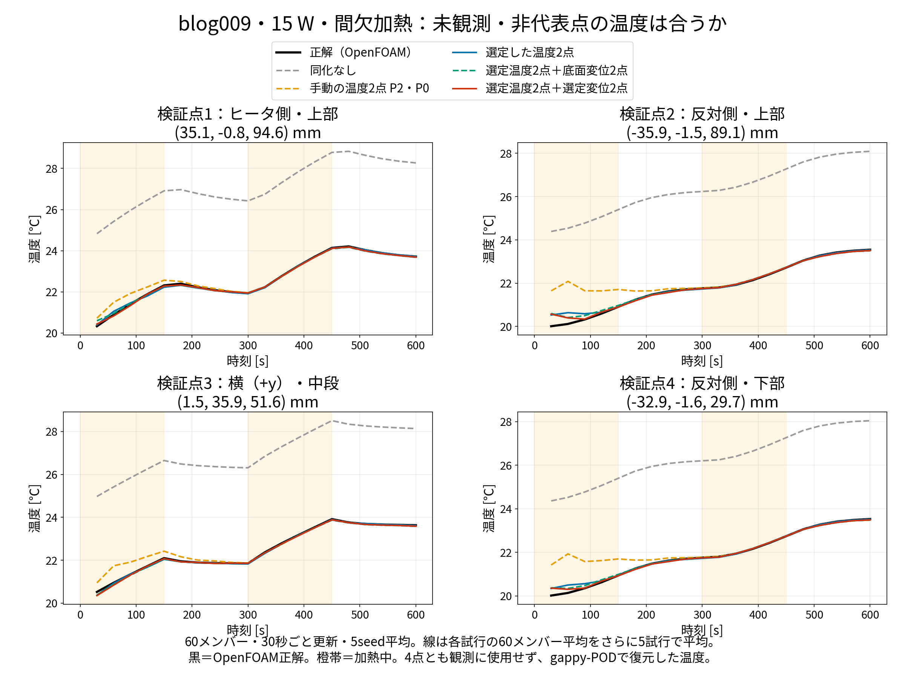

*黒＝OpenFOAMの正解。灰破線＝同化なし、橙破線＝手動温度P2・P0、青＝選定温度T1・T2、緑破線＝選定温度＋底面変位、赤＝選定温度＋選定変位。60メンバー・30秒ごと20更新・5seedで、線は各試行の60メンバー平均をさらに5試行で平均。橙帯は加熱中。更新後30〜600秒を表示しています。*

下表は各検証セルの**平均絶対温度誤差 [K]**です。評価区間は30〜300秒の10時刻、5試行で、全セルRMSEとは異なります。

| 検証点 | 同化なし | 手動温度P2・P0 | 選定温度T1・T2 | ＋底面変位2点 | ＋選定変位2点 |
|---|---:|---:|---:|---:|---:|
| 検証点1 | 4.541 | 0.304 | 0.151 | 0.118 | 0.146 |
| 検証点2 | 4.460 | 0.826 | 0.242 | 0.193 | 0.206 |
| 検証点3 | 4.497 | 0.382 | 0.083 | 0.099 | 0.092 |
| 検証点4 | 4.436 | 0.764 | 0.184 | 0.134 | 0.149 |

各点cの誤差は、試行sの60メンバー平均を使い、次式で計算しています。

$$
E_c=\frac1{5\cdot10}\sum_{s=1}^{5}\sum_{k=1}^{10}
\left|\widehat T_s[c]{}(30k)-T^*[c]{}(30k)\right|.
$$

星は保存済みOpenFOAM正解です。グラフに描いた5試行平均の線から誤差を求めるのではなく、各試行の誤差を計算してから平均しています。

**代表点以外の4点でも、同化なしでは15 Wの平均誤差が約4.5 Kあるのに対し、選定温度＋選定変位の同化では0.095〜0.206 Kになりました。** したがって、今回の固定4点では、観測していない場所の復元温度も正解に近づいたことが確認できます。

ただし、変位を追加すれば全ての温度点で最良になるわけではありません。観測位置は反りA−Oを対象に選んでいるため、温度だけの同化や底面変位を加えた場合の方が温度誤差の小さい点もあります。変位推定の改善と、各点温度の改善は別々に表で確認します。

図の作成：`run/make_nonrep_temperature_validation.py`。点のセル番号・座標・観測との非重複確認・誤差一覧は `results/nonrep_temperature_validation.json` に保存しています。

## 7. 結論と再現場所

温度2点を先に選び、その配置に変位2点を追加すると、今回の3条件では未観測の反りの推定誤差が段階的に改善しました。位置を選ぶ理由は、単なる熱感度の大きさではなく、**既に選んだセンサで残る不確かさを、追加候補がどれだけ減らせるか**です。

代表5点温度が完全に既知なら、固定した復元式の範囲では温度由来の不確かさはゼロです。ただしPODの復元誤差、モデル誤差、未知Q/hによる将来の予測誤差は別に残ります。

| 処理 | ファイル |
|---|---|
| 4,000ケース・共分散・候補採点の共通関数 | `run/select_nonrep_temp_disp.py` の `priors`, `add_row`, `score` |
| 温度2点→変位2点の順の選定・J分布図 | `run/sequential_sensor_study.py` |
| EnKFの3条件・5seed比較 | `run/selected_pair_unobserved_check.py seq` |
| 読みやすい時刻歴図 | `run/make_sequential_figures.py` |
| 選択点・採点値 | `results/sequential_selection.json`, `results/sequential_scores.npz` |
| 評価値・時刻歴 | `results/unobserved_check_seq_*.json`, `results/unobserved_traj_seq_*.npz` |

すべて `sample/106_0_pod_selected_rom/` 内です。正解のOpenFOAM温度場は既存データを利用し、IDWに変更したFrontISTR変位とROMのEnKFを再計算しました。旧試験の「センサ種類を問わず2本だけ選ぶ結果」と、今回の「温度2本を先に選んでから変位2本を足す結果」は混ぜていません。


評価対象A・Oだけをz軸まわりに90°回し、同じ手順・3加熱条件で選び直した比較は [blog010：評価点を変えた観測配置の検証](blog_010_rotated_target_sensor_placement.md) にまとめました。

---

## 8. 4,000 本の総当たりではなく、理論から最適位置を求める

ここまでの選び方は「ROM を 4,000 本回してばらつき $B$ を作り、候補を1本ずつ総当たりで採点する」ものでした。同じ答えを、**もっと理論的に、短い計算で**出せるかを確かめました（ `run/theory_based_selection.py` ）。 $B$ は乱数ではなく式で計算したもの（blog_008 §5-2 の「共分散の伝播」）を使っています。

$B$ を熱方程式から求める部分（固定した放熱条件での線形応答＋放熱条件の数値積分、および接線近似）は、[blog_011](blog_011_equation_based_sensor_placement.md) で別に詳しく扱っています。この節では、 $B$ が手に入った後の「候補の選び方」を理論的にする部分（閉じた式、2軸の見方、全ペアの厳密評価、複数目的、逐次 σ）を扱います。

### 8-1. センサ1本の σ は、閉じた式で書ける

センサ1本（重み $\mathbf h$ ）を付けた後の反りの σ は、付録Aの式をそのまま変形すると、次の2つの掛け算になります。

$$
\sigma^2=\mathbf w^{\mathsf T}B\,\mathbf w\Big(1-\cos^2\theta_B\cdot\frac{\mathrm{SNR}}{1+\mathrm{SNR}}\Big),\qquad
\cos\theta_B=\frac{\mathbf w^{\mathsf T}B\,\mathbf h}{\sqrt{(\mathbf w^{\mathsf T}B\,\mathbf w)(\mathbf h^{\mathsf T}B\,\mathbf h)}},\qquad
\mathrm{SNR}=\frac{\mathbf h^{\mathsf T}B\,\mathbf h}{r}
$$

- $\cos\theta_B$ ：温度のばらつき方で測った、**センサの重みと反りの重みの向きの近さ**。
- $\mathrm{SNR}$ ：センサの値のばらつき ÷ ノイズ。**値がよく動くか**。

**理想のセンサは、重みが反りの重みと同じ向きで（ $\cos\theta_B\to\pm1$ ）、値が大きく動く（ $\mathrm{SNR}\gg1$ ）もの**です。この式で全候補を並べた結果は、総当たりの σ と一致しました（差 $10^{-16}$ µm、計算 0.03 秒）。総当たりが要らないのではなく、「総当たりの採点が、この2つの量に分解できる」ということです。

### 8-2. 候補を「全体の温まり」と「温度差」の2軸で見る

温度のばらつき $B$ を固有値分解すると、**90 % が「5点が一緒に上がる」方向（全体の温まり）、7 % が「ヒータ側⇔反対側」の方向（温度差）**で、残りは 3 % です。各候補の重みをこの2方向に射影し、ノイズで割ると、候補は平面上の点になります。

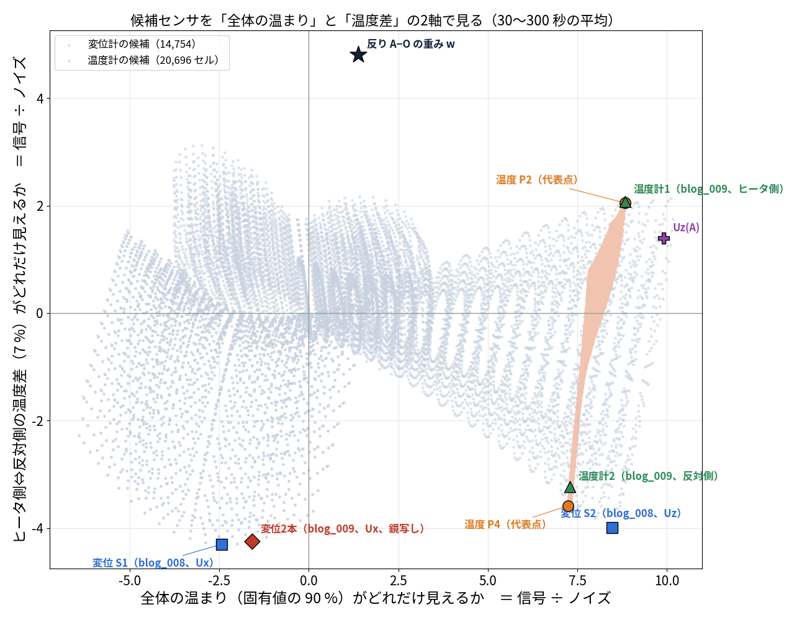

*横軸＝全体の温まりがどれだけ見えるか、縦軸＝温度差がどれだけ見えるか（どちらも信号÷ノイズ、30〜300 秒の平均）。灰色の点＝変位計の候補 14,754、橙の点＝温度計の候補 20,696。★＝反りの重み（ `run/make_two_axis_plane_fig.py` ）。*

- **反り（★）は縦軸の上**にあります。横軸（全体の温まり）には反応しません。
- **温度計は全部、右側（横軸 7〜9）**にあります。温度計はどこに置いても全体の温まりが見えます。縦軸の位置はヒータ側（＋）か反対側（−）かで決まります。
- **変位計は広く散らばります**。上面の横方向（ $U_x$ ）の候補は横軸がほぼ 0 で、温度差だけを見ます。上面の上下方向（ $U_z$ 、S2 など）は右下にあり、全体の温まりも見えます。
- **blog_009 の鏡写しの変位計2本（◆）は、縦軸の近くの同じ場所**にあります。反りと同じ軸しか見ていないので反りは当たり、全体の温まりが見えないので温度は当たらない、ということが一目で分かります。
- 2本で温度場まで直したいなら、**右側（温度計か上下方向の変位計）と、縦軸の近く（横方向の変位計）を1本ずつ**取るのが良い組み合わせです。

この2軸だけに落として σ を計算すると、1本の順位はほぼ合いますが、**2本の組み合わせでは精度が足りませんでした**（2軸で最良のペアを本来の $B$ で評価し直すと、変位2本で 0.32、温度2本で 0.54 µm と、貪欲法より悪い）。残り 3 % の方向も2本目の選定には効きます。図は説明のために使い、選定は5次元のままで行います。

### 8-3. 2本の全組み合わせを、厳密に評価する

2本の σ は、1本足すごとの更新式（付録B）を2回使うと、**2×2 の式で閉じます**。そのため、候補の全組み合わせ（変位2本：約1.1億組、温度2本：約2.1億組）を、近似なしで評価できます（各時刻の $B$ で計算して10時刻平均。1組あたり 2×2 の行列の計算だけ）。

| 選び方（目的＝反り A−O） | 選ばれた2本 | σ（反り） | 計算時間 |
|---|---|---:|---:|
| 変位2本・貪欲法（§2） | 上面 $U_x$ の鏡写し $(18.8,\,\pm32.5)$ | 0.296 µm | 数秒 |
| **変位2本・全ペア厳密** | 上面 $U_x$ $(26.5,\,26.5)$ ＋ $(9.7,\,-36.2)$ | **0.293 µm** | 81 秒 |
| 温度2本・貪欲法（§2） | ヒータ側・中段 ＋ 反対側・中段 | 0.366 µm | 数秒 |
| **温度2本・全ペア厳密** | 同じ（座標が 1 mm ほど違うだけ） | **0.366 µm** | 176 秒 |
| **温度1本＋変位1本・全ペア厳密** | 温度：反対側 $z=80$ mm ＋ 変位 $U_x$ 上面 $(-4.9,\,-37.2)$ | **0.286 µm** | 124 秒 |

- **貪欲法は、厳密な最適解の 1 % 以内でした。** 1本ずつ選ぶ方法で十分だったことが、厳密解で確かめられました。
- 反りだけを目的にすると、種類を問わない最良は「温度1本＋変位1本」（0.286 µm）です。ただし温度計1本では $U_z(A)$ の σ が 0.51 µm（§8-4 の表）で、全体の温まりは半分しか直りません。

### 8-4. 目的を「反り＋ $U_z(A)$ ＋平均温度」にして、2本を厳密に選ぶ

§5 の落とし穴（反りだけを目的にすると全体の温まりが見えない）を避けるため、知りたい量を3つにして、「それぞれの σ が測る前の何割残るか」の二乗の和 $J$ を最小にする2本を、全組み合わせから厳密に選びました。

$$
J=\Big(\frac{\sigma_{A-O}}{\sigma_{A-O,0}}\Big)^2+\Big(\frac{\sigma_{U_z(A)}}{\sigma_{U_z(A),0}}\Big)^2+\Big(\frac{\sigma_{\bar T}}{\sigma_{\bar T,0}}\Big)^2
$$

| 2本の配置 | 反り A−O の σ | $U_z(A)$ の σ | 5点の平均温度の σ |
|---|---:|---:|---:|
| 何も測らない | 1.46 µm | 3.02 µm | 2.39 K |
| 変位2本（反りだけ、§2 の鏡写し $U_x$ ） | **0.30 µm** | 2.58 µm | 2.14 K |
| 温度1本＋変位1本（反りだけ、厳密） | 0.29 µm | 0.51 µm | 0.40 K |
| **変位2本（3つの目的、厳密）**：上面 $U_z$ の鏡写し $(\mp36.2,\,\pm9.7)$ | 0.33 µm | **0.27 µm** | **0.24 K** |
| 温度2本（3つの目的、厳密）：ヒータ側 $z=48$ ＋ 反対側 $z=67$ mm | 0.38 µm | 0.38 µm | 0.24 K |
| 温度1本＋変位1本（3つの目的、厳密）：温度 ヒータ側 $z=36$ ＋ 変位 $U_z$ 上面 $(-36.2,\,9.7)$ | 0.36 µm | 0.35 µm | 0.23 K |

- 目的を3つにすると、**変位2本でも「上面の上下方向 $U_z$ 」が選ばれ**、反り・ $U_z(A)$ ・平均温度のすべてが測る前の 1/4〜1/10 になります。反りは 0.30 → 0.33 µm とわずかに譲るだけです。
- 2軸の図で言うと、上下方向の変位計は右下（全体の温まりも温度差も見える）にあるので、2本で両方の軸を押さえられます。
- これらの配置を実際に EnKF（真値＝OpenFOAM＋FrontISTR、3条件）で確かめた結果は、§8-6 にあります。

### 8-5. 補正を積み重ねた後の σ も、式で計算できる（逐次 σ）

σ は「直す前の状態から1回だけ直したら」の値なので、30 秒ごとに20回直す実際のデータ同化より大きめに出ます（blog_008 §5-2 (c″)）。補正を積み重ねた後の分からなさも、測定値なしで式で追えます（カルマンフィルタのリッカチ方程式）。

$$
P^f_{k+1}=\Phi\,P^a_k\,\Phi^{\mathsf T},\qquad
P^a_{k+1}=P^f_{k+1}-P^f_{k+1}H^{\mathsf T}\big(HP^f_{k+1}H^{\mathsf T}+R\big)^{-1}HP^f_{k+1}
$$

（ $\Phi$ ＝ROM を 30 秒進める行列。7変数（温度5点・ $q$ ・ $h$ ）で、平均の軌道のまわりの一次近似。モデル誤差は入れていない。）

| 配置 | 1回だけ補正の σ | 20回積み重ねた σ（逐次） | 実際の EnKF の誤差（15 W） |
|---|---:|---:|---:|
| 温度 P2・P0（片側） | 1.20 µm | 0.96 µm | 0.77 µm |
| 温度 P2・P4（両側） | 0.59 µm | 0.46 µm | 0.23 µm |
| 温度2本（§2） | 0.37 µm | 0.23 µm | 0.20 µm |
| 変位 S1・S2（blog_008） | 0.32 µm | 0.21 µm | 0.16 µm |
| 変位2本（§2） | 0.30 µm | 0.20 µm | 0.12 µm |
| 温度 P2・P0 ＋ 変位 S1・S2 | 0.26 µm | 0.15 µm | 0.075 µm |

- **順位は、1回だけの σ でも逐次 σ でも、実際の誤差と完全に一致**しました（この6配置では順位相関 1.0）。
- 逐次 σ のほうが、値が実際に近づきます。それでもまだ 1.5〜2 倍大きいのは、モデル誤差を入れていないことと、一次近似のためと考えられます（確かめていません）。

### 8-6. 理論で選んだ配置を、EnKF で確かめる

§8-3・§8-4 で選んだ配置を、真値＝OpenFOAM＋FrontISTR の3条件で EnKF にかけ、測っていない量の誤差を比べました（ `run/selected_pair_unobserved_check.py mo` ）。

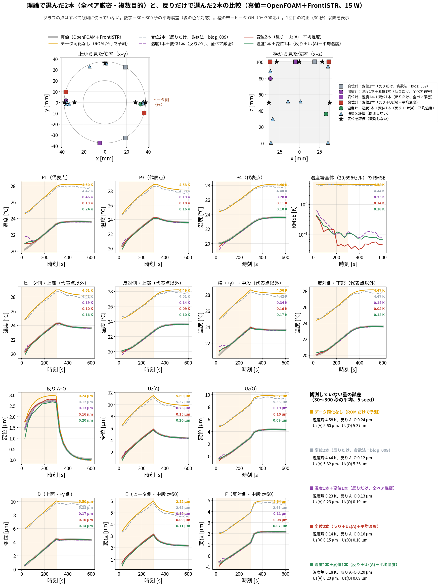

> 15 W。灰色の破線＝反りだけで選んだ変位2本（§2）、赤＝目的3つで選んだ変位2本（上面 $U_z$ の鏡写し）、緑＝目的3つで選んだ温度1本＋変位1本、紫＝反りだけで厳密に選んだ温度1本＋変位1本。見方は §4 の図と同じ。25 W と間欠加熱の図：[unobserved_mo_q25.png](img/unobserved_mo_q25.png)、[unobserved_mo_intermittent.png](img/unobserved_mo_intermittent.png)

**測っていない量の誤差**（30〜300 秒の平均、5回の平均。15 W／25 W／間欠）

| 2本の配置 | 反り A−O | 温度場全体 | $U_z(A)$ | $U_z(O)$ |
|---|---|---|---|---|
| データ同化なし | 0.24／1.38／0.14 µm ※ | 4.58／3.12／4.51 K | 5.60／3.22／5.49 µm | 5.37／4.59／5.35 µm |
| 変位2本（反りだけ、§2 の鏡写し $U_x$ ） | **0.12／0.13／0.09 µm** | 4.44／4.58／4.42 K | 5.32／5.54／5.29 µm | 5.36／5.55／5.33 µm |
| 温度1本＋変位1本（反りだけ、厳密） | 0.13／0.15／0.12 µm | 0.23／0.24／0.22 K | 0.23／0.29／0.22 µm | 0.19／0.24／0.19 µm |
| **変位2本（反り＋ $U_z(A)$ ＋平均温度、厳密）** | 0.16／0.17／0.14 µm | **0.14／0.14／0.14 K** | **0.15／0.14／0.14 µm** | **0.10／0.10／0.11 µm** |
| 温度1本＋変位1本（反り＋ $U_z(A)$ ＋平均温度、厳密） | 0.20／0.23／0.17 µm | 0.18／0.19／0.15 K | 0.20／0.21／0.15 µm | 0.09／0.10／0.09 µm |

※ A と O が同じ向きにずれて打ち消し合うため、データ同化なしでも反りだけは小さく見えます（§4）。

- **目的を3つにして選んだ変位2本（上面の上下方向）は、2本だけで温度場 0.14 K、 $U_z(A)$ 0.15 µm、 $U_z(O)$ 0.10 µm まで直りました。** 反りは 0.12 → 0.16 µm とわずかに譲るだけです。反りだけで選んだ2本（温度場 4.4 K、 $U_z$ 5 µm 以上のまま）との違いは、§5 の理論どおりです。
- 反りだけを目的に「温度1本＋変位1本」を厳密に選ぶと、反りは変位2本とほぼ同じ（0.13 µm）で、温度場も 0.23 K まで直ります。温度計が全体の温まりを見るためです。
- **測る前の σ の予測（§8-4 の表）と、実際の EnKF の順位はそろいました。** 3条件（25 W・間欠加熱は ROM を作っていない条件）でも同じ傾向です。
- 2本で温度場・個別の変位・反りをすべて当てたいなら、この中では「目的3つで選んだ変位2本（上面の上下方向の鏡写し）」が一番良い結果でした。

### 8-7. まとめ：4,000 本の総当たりは何に置き換わるか

| 今までの方法 | 理論的な置き換え | 効果 |
|---|---|---|
| ROM 4,000 本で $B$ を作る | 共分散の伝播（式で直接計算） | 乱数のぶれなし、本数を決めなくてよい、0.04 秒 |
| 候補を1本ずつ総当たりで採点 | $\cos\theta_B$ と SNR の閉じた式 | 結果は同じ。「反りと同じ向きで、よく動く」と意味が分かる |
| 1本ずつ足す貪欲法 | 全組み合わせの厳密評価（2×2 の式） | 貪欲法が最適解の 1 % 以内と確認できた |
| 反りだけの σ | 複数の目的の $J$ | 全体の温まりが見えない配置を避けられる |
| 1回だけ補正の σ | 逐次 σ（リッカチ） | 順位は同じ。値が実際の誤差に近づく |

**やっていないこと**：3本以上の厳密解（組み合わせが多すぎるので、貪欲法か凸緩和が必要）、モデル誤差 $Q$ を入れた逐次 σ、ノイズを実物並み（1 K、1 µm）にした場合。

## 9. 先行研究：温度センサの位置は、どこが良いとされているか

工作機械の熱変形の研究で、温度センサの配置は、ほぼすべて「**熱変位（工具先端のずれ）を推定するための配置**」として選ばれています。結論は大きく3つの流派に分かれます。**共通する答えは「熱源の近く」と「互いに違う情報を持つ点を選ぶ」の2点**で、どの機械にも当てはまる場所の正解はなく、機械や運転条件ごとに決める、という見方で一致しています。

| 流派 | 代表例 | 結論（どこが良いか） |
|---|---|---|
| **熱モード（物理モデル）** | Zhu, Ni, Shih（2008、ミシガン大、J. Manuf. Sci. Eng.） | FEM で温度場の「型（熱モード）」を求め、**主要な型の数だけセンサを置く**。一番目の型（ほぼ一様に温まる型）は**熱源のできるだけ近く**、それ以降の型は**温度の振れ幅が最大の場所**に置く。目的は、温度データどうしを独立にして推定を安定させること |
| **データ駆動（温度感応点）** | ファジィクラスタリング＋灰色関連分析、LASSO など多数。Tanaka, Kizaki, Teshima, Sugita（2025、東大、IJAT）は 307 点から LASSO で選択 | 多数のセンサを仮に付け、**熱変位との相関が高く、互いの相関が低い点**を各グループから1つずつ選ぶ（例：10点→4点）。結果は主軸の軸受・モータなど熱源の近くに集まりやすい。**運転パターンが変わると、重要な点も変わる**（Tanaka ら。センサ数を 76 % 減らしても誤差 10 µm 以下） |
| **FEM・ROM による事前選定** | Mian ら（2012、ハダースフィールド大、MATADOR）、Teshima ら（2024、CIRP J. Manuf. Sci. Technol.） | FEM や縮約モデルで、実験の前に場所を選ぶ枠組み。Mian らは3軸立形マシニングセンタの FEM から、**温度 1 °C あたりの工具変位（傾き）が大きく、ヒステリシス（時間遅れ）が小さい節点**を選び、主軸の熱には**主軸を支えるキャリア（主軸頭）の表面**、環境温度にはコラム・ベース・テーブルの節点を挙げている（実測との相関 84 %）。Teshima らは伝達関数行列と感度関数で、センサを付けずに数と場所を決め、3軸マシニングセンタでセンサ数を 50 % 減らした（場所の詳細は要旨に記載なし） |

**本研究との関係**

| | 先行研究 | 本研究 |
|---|---|---|
| 同じところ | 熱モードの数だけ、型をとらえる場所に置く | Q-DEIM の代表点の選び方は、同じ考え方 |
| 同じところ | 熱変位との相関が高く、互いの相関が低い点を選ぶ | 「ヒータ側と反対側に分ける」「同じことを2回測らない」は同じ結論 |
| 同じところ | 一番目の型（一様な温まり）をとらえるセンサが要る（Zhu ら） | 「反りだけを目的にすると、全体の温まりが見えないセンサが選ばれる」（§5）を、別の角度から示した |
| 違うところ | 観測は**温度だけ**。変位は回帰などで出す | **変位計も観測の候補**に入れ、データ同化の分散 σ で温度計と変位計の場所を一緒に評価 |
| 違うところ | 相関や回帰の精度で選ぶ | 目的（反り、 $U_z(A)$ 、全体の温まり）ごとの σ を、測る前に式で計算して選ぶ。目的によって最適な場所が変わり、落とし穴があることを理論で説明 |

**確認した範囲**：全文を読んで確かめたのは Zhu ら（2008）と Mian ら（2012）です。Teshima ら（2024）は要旨と要点（OpenAlex 経由）まで、Tanaka ら（2025）は要旨までです。この2件は本文が取れず、選ばれた具体的な場所（主軸頭、コラムなど）は確かめていません。発表で引用するときは、本文を確認する必要があります。

**参考文献**

- [Zhu, Ni, Shih (2008) Robust machine tool thermal error modeling through thermal mode concept, J. Manuf. Sci. Eng.](https://wumrc.engin.umich.edu/wp-content/uploads/sites/51/2013/08/08JMSEZhuMachinetoolthermalerrorcompensation.pdf)
- [Mian et al. (2012) An efficient offline method for determining the thermally sensitive points of a machine tool structure](https://pure.hud.ac.uk/en/publications/an-efficient-offline-method-for-determining-the-thermally-sensiti/)
- [Tanaka, Kizaki, Teshima, Sugita (2025) Int. J. Automation Technol.（307 点の温度センサと LASSO）](https://www.fujipress.jp/ijat/au/ijate001900050758/)
- [Teshima, Tanaka, Kizaki, Sugita (2024) Sensor placement strategy based on reduced-order models for thermal error estimation in machine tools, CIRP JMST 55, 403–410](https://doi.org/10.1016/j.cirpj.2024.10.015)
- [温度感応点の選定（ファジィクラスタリング＋灰色関連分析）の例：MDPI Machines](https://www2.mdpi.com/2075-1702/9/11/286)
- [温度感応点の選定の例（PMC 掲載論文）](https://pmc.ncbi.nlm.nih.gov/articles/PMC9315643/)
- [熱誤差補償とセンサ配置の概説：Euspen Thermal SIG](https://eprints.hud.ac.uk/21510/1/Euspen_Thermal_SIG_Extended_abstract_SF_v2.pdf)

