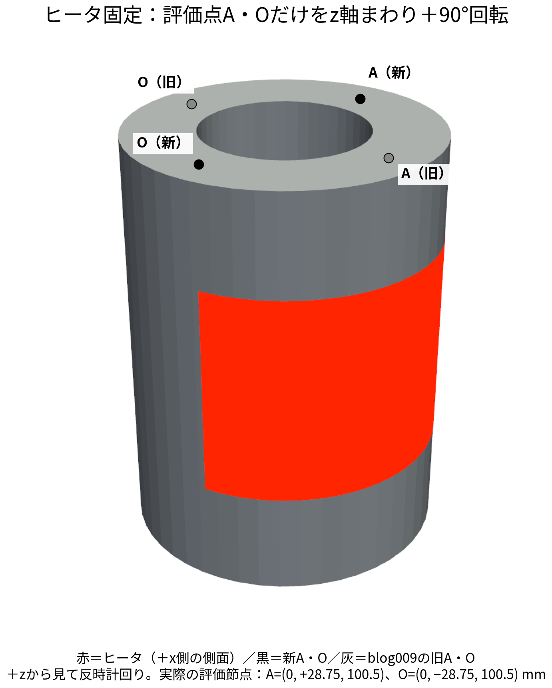
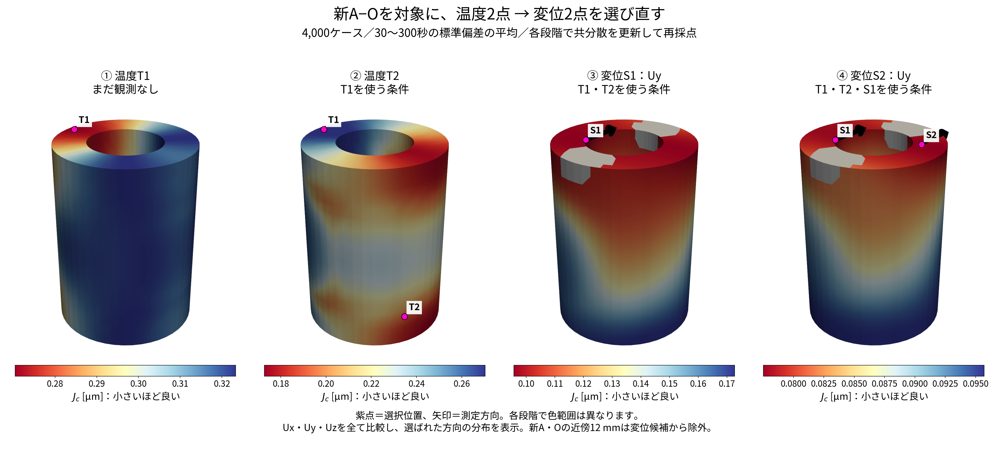
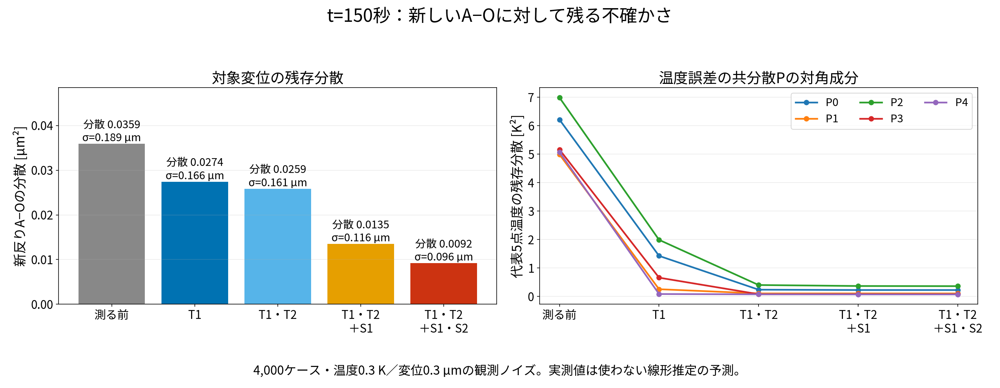
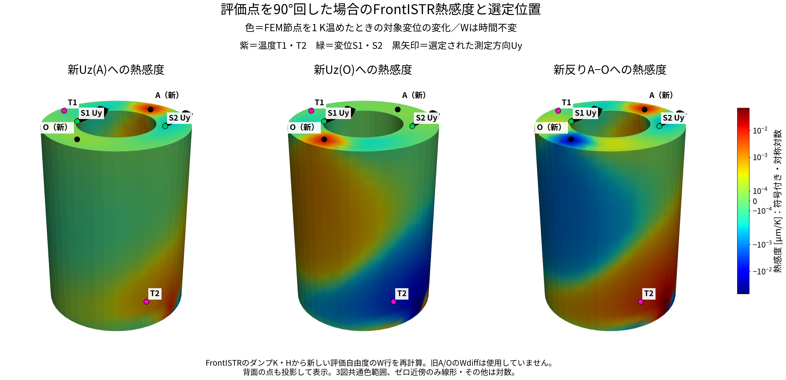
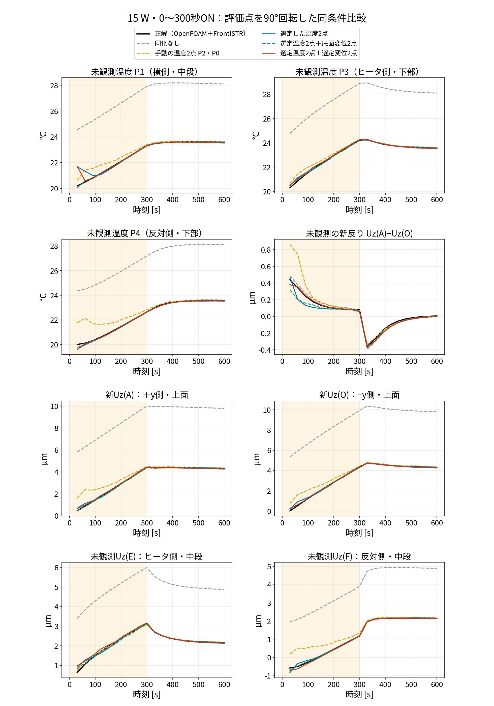
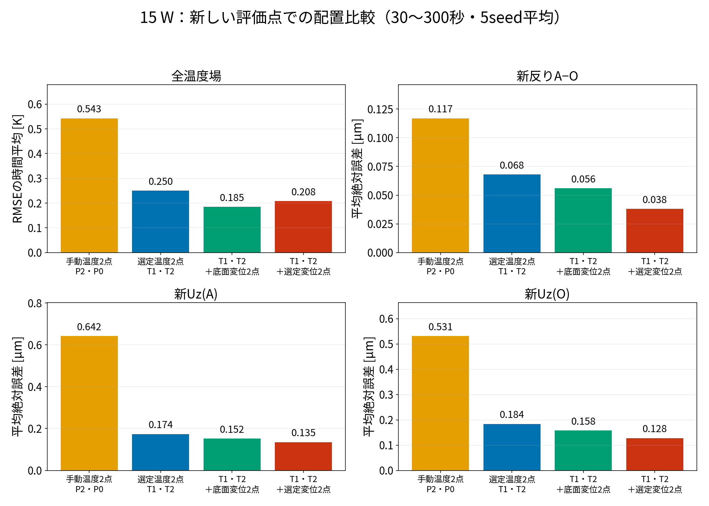
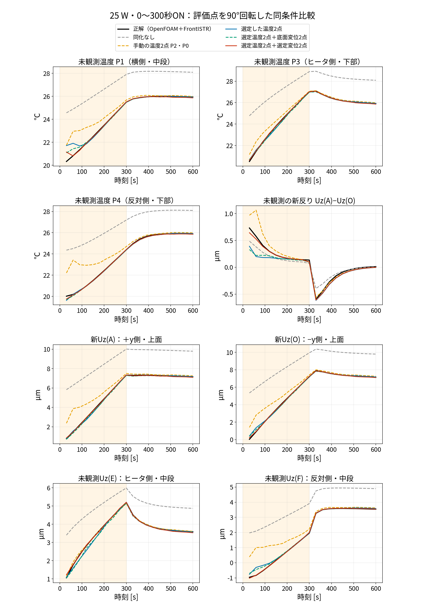
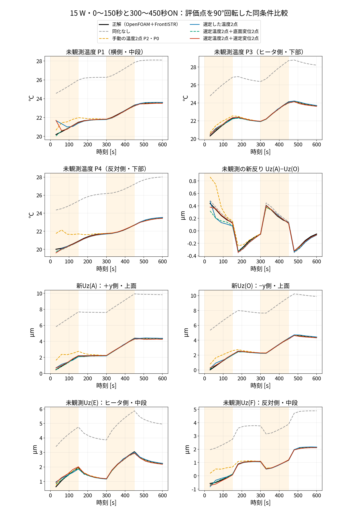
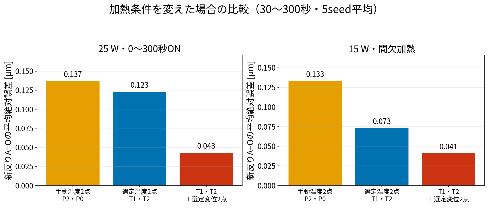

# blog010：評価点A・Oを90°回すと、選ぶ温度・変位センサはどう変わるか

**ヒータと計算モデルを固定し、評価対象のA・Oだけをz軸まわりに＋90°回しました。** [blog009](blog_009_two_sensors_nonrep.md)と同じ手順・比較条件で、温度2点を選び、その温度配置を固定して変位2点を選び直し、EnKFで検証します。

今回の問いは、**「同じ熱変形でも、予測したい2点間変位差が変われば、役立つ観測位置・方向も変わるか」**です。センサの位置だけでなく、変位の測定方向もUx・Uy・Uzの全候補から選びます。

## 1. 変えたものは、評価対象のA・Oだけ



*赤はヒータの領域、黒は今回の新A・O、灰はblog009の旧A・Oです。ヒータは外周＋x側、周方向約±80°、高さ24.75〜75.75 mmのままです。*

回転は＋zから見て反時計回りです。回転行列を明示すると、

$$
\underbrace{\begin{bmatrix}x'\\y'\\z'\end{bmatrix}}_{3\times1}
=\underbrace{\begin{bmatrix}0&-1&0\\1&0&0\\0&0&1\end{bmatrix}}_{3\times3}
\underbrace{\begin{bmatrix}x\\y\\z\end{bmatrix}}_{3\times1}.
$$

| 評価点 | blog009の実際のFEM節点 [mm] | blog010の実際のFEM節点 [mm] |
|---|---|---|
| A | (28.75, 0, 100.5) | (0, 28.75, 100.5) |
| O | (−28.75, 0, 100.5) | (0, −28.75, 100.5) |

コードでは旧指定座標±28 mmを90°回し、その最近傍FEM節点を評価しています。実際に使う節点は上表の半径28.75 mmの位置です。**A・O自身のUzは同化に使わず、推定精度を測る未観測出力にします。** 新A・Oの近傍12 mm以内も変位観測候補から除きます。

## 2. blog009とそろえた計算条件

| 項目 | 条件 |
|---|---|
| 高忠実度の正解 | 保存済みOpenFOAMの温度場と、IDWで温度を渡したFrontISTRの全節点変位 |
| ROM・POD | blog009と同じ校正済み5点熱ROM、同じPOD基底・平均場・Q-DEIM代表点 |
| 温度候補 | 代表5点を除くOpenFOAM全セル |
| 変位候補 | 新A・O近傍12 mmを除く全FEM節点のUx・Uy・Uz |
| 配置設計 | 4,000ケース、seed=20260930、RK4刻み2秒、30〜300秒の10時刻 |
| 初期温度の事前分布 | 代表5点ごと独立に17〜32 ℃ |
| 発熱の事前分布 | 発熱倍率qが0.3〜1.8、ON時Q=15q W |
| 放熱の事前分布 | h_ROMは平均0.02・標準偏差0.01 W/Kの正規分布を0.001〜0.1へ制限 |
| 観測ノイズ | 温度0.3 K、変位0.3 µm（標準偏差） |
| EnKF | 60メンバー、30秒ごと20更新、0〜600秒、インフレーション1.02 |
| EnKFのseed | 20260913、20260914、20260915、20260916、20260917 |
| 加熱条件 | 15 Wで0〜300秒ON、25 Wで0〜300秒ON、15 Wで0〜150秒・300〜450秒ON |
| 誤差の評価 | 30〜300秒の10時刻、5試行平均 |

4,000ケースは観測で補正しない配置設計用、60メンバーは観測で補正を繰り返すEnKF用です。代表点の選択・全温度場復元と、両計算の違いは [blog009 §2](blog_009_two_sensors_nonrep.md) に式展開を記載しています。ここでも同じ処理を使います。

今回、OpenFOAM・FrontISTRの正解を再計算する必要はありません。全場・全節点の正解が保存されているため、新A・Oの節点からUzを取り出して評価します。**新たに実行したのは、4,000ケースのROM、配置選定、3条件のEnKF比較、および新評価点の熱感度行の計算です。**

## 3. 新しい反りを対象に、温度2点→変位2点を選ぶ

新しい対象は、

$$
d=U_z(A_{\mathrm{new}})-U_z(O_{\mathrm{new}})
$$

です。代表5点温度から変位への重みを使うと、

$$
\underbrace{\delta d}_{1\times1}
=\underbrace{\begin{bmatrix}w_0&w_1&w_2&w_3&w_4\end{bmatrix}}_{1\times5}
\underbrace{\begin{bmatrix}\delta T[P0]\\\delta T[P1]\\\delta T[P2]\\\delta T[P3]\\\delta T[P4]\end{bmatrix}}_{5\times1},
\qquad w_j=h_{A_{\mathrm{new}},z,j}-h_{O_{\mathrm{new}},z,j}.
$$

**A・Oが変わるので、対象の重みwを新しく取り出します。** Bと温度復元行列G、全節点変位の復元係数はblog009と同じです。

候補cの重みをh_c、現在残る温度誤差の共分散をPとすると、候補1本を使って補正したと仮定した後の共分散と、反りの標準偏差は、

$$
\underbrace{P_{+c}}_{5\times5}
=\underbrace{P}_{5\times5}
-\frac{\underbrace{(P\mathbf h_c)(P\mathbf h_c)^{\mathsf T}}_{5\times5}}
{\underbrace{\mathbf h_c^{\mathsf T}P\mathbf h_c+r_c}_{1\times1}},
\qquad
\sigma_{+c}=\sqrt{\underbrace{\mathbf w^{\mathsf T}}_{1\times5}\underbrace{P_{+c}}_{5\times5}\underbrace{\mathbf w}_{5\times1}}.
$$

最初はP=Bです。候補を使った線形補正後にどれだけ誤差が残るかを、実測値を入れずに予測します。σを30〜300秒の10時刻で平均したJが最小となる候補を選びます。

$$
J_c=\frac1{10}\sum_{k=1}^{10}\sigma_{+c}(30k)
$$

温度1点目→共分散更新→温度2点目→共分散更新→変位1点目→共分散更新→変位2点目、の順序もblog009と同じです。全センサ組合せの総当たり最適化ではありません。



*色は候補を測った場合のJ [µm]、紫点は選定位置、矢印は測定方向です。温度は全候補セル、変位はUx・Uy・Uz全候補を比較し、上図には選ばれた方向を表示しています。各段階で色範囲は異なります。*

選ばれた位置は次のとおりです。T1・T2・S1・S2という名称は本記事内の選択順で、blog009と同じ座標を指しません。

| センサ | 今回の位置 [mm] | 測る量 |
|---|---|---|
| T1 | (-36.6, 0.8, 99.3) | 温度（反対側・上部） |
| T2 | (21.1, 0.8, 0.8) | 温度（ヒータ側・下部） |
| S1 | (-17.3, -10.0, 100.5) | Uy |
| S2 | (21.1, 12.2, 100.5) | Uy |

| 配置を選んだ段階 | J：反りの予測標準偏差の時間平均 [µm] |
|---|---:|
| 温度T1を追加 | 0.2704 |
| 温度T2を追加 | 0.1727 |
| さらに変位S1を追加 | 0.0957 |
| さらに変位S2を追加 | 0.0775 |

### 150秒で残る分散を確認する

同じB(150秒)について、選定済みの観測を順に加えた場合の共分散を計算しました。150秒だけで位置を選び直した試験ではありません。



*左は新A−Oの分散と標準偏差、右は代表5点温度の残存共分散の対角成分です。実際のEnKF誤差ではなく、配置設計に用いた線形モデル内での予測です。*

| 観測 | σ(150秒) [µm] |
|---|---:|
| なし | 0.1894 |
| T1 | 0.1656 |
| T1・T2 | 0.1608 |
| T1・T2＋S1 | 0.1163 |
| T1・T2＋S1・S2 | 0.0958 |

## 4. 新しいA・OのFrontISTR熱感度と、選択点を比較する



*レインボー配色の青は負、赤は正。色はFEM節点温度を1 K変えた場合の対象変位への感度 [µm/K] で、時間不変です。紫が温度センサ、緑が変位センサ、矢印がUyの測定方向です。上のモデル図で赤いヒータの位置を確認できます。*

今回のWは、105のFrontISTRが出力した剛性行列K_uと熱荷重行列H_thから、新しい評価自由度について求め直しています。

$$
\underbrace{K_u^{\mathsf T}}_{15120\times15120}
\underbrace{\boldsymbol\lambda_A}_{15120\times1}
=\underbrace{\mathbf e_{A,z}}_{15120\times1},
\qquad
\underbrace{W_{A,z,:}}_{1\times5040}
=\underbrace{\boldsymbol\lambda_A^{\mathsf T}}_{1\times15120}
\underbrace{H_{\mathrm{th}}}_{15120\times5040}.
$$

e_A,zは新Aのz自由度だけ1、ほかは0の選択ベクトルで、温度誤差eとは別です。Oも同様に求め、差W_A−W_Oを描きます。**旧A・Oに対するFrontISTR直接出力Wdiffを、新A・Oの感度として流用していません。** 随伴方程式の相対残差は `results/blog010/W_metadata.json` に保存しています。

このWは105の四面体分割による行列から求めたものです。一方、EnKFの変位復元は106の六面体で計算したPODモード応答Dを使用し、blog009と同じ離散化の違いがあります。W図は物理的な感度を比較するための図で、採点をそのWに置き換えてはいません。

選ばれたT1・T2は、単純にW_A−W_Oの正の最大・負の最小を取った位置ではありません。今回のBと復元行列の下で、新しい対象の不確かさを減らす位置です。変位計も、新しい対象に関係する温度の違いを捉えるUyが選ばれました。これを「熱感度が高い場所なら常に最適」と一般化しません。

## 5. 選定した観測でEnKFを実行する

状態はblog009と同じ7変数で、変位は独立した状態変数ではありません。

$$
\underbrace{\mathbf z}_{7\times1}
=\begin{bmatrix}T[P0]\\T[P1]\\T[P2]\\T[P3]\\T[P4]\\q_{\mathrm{scale}}\\h_{\mathrm{ROM}}\end{bmatrix}
$$

温度2点＋選定変位2点の場合、観測予報は今回はUyです。

$$
\underbrace{\mathbf y^{f,(m)}}_{4\times1}
=\begin{bmatrix}\theta_1^{f,(m)}\\\theta_2^{f,(m)}\\U_y^{f,(m)}(S1)\\U_y^{f,(m)}(S2)\end{bmatrix}
=\underbrace{\bar{\mathbf y}}_{4\times1}
+\underbrace{\begin{bmatrix}
g_{T1,0}&g_{T1,1}&g_{T1,2}&g_{T1,3}&g_{T1,4}\\
g_{T2,0}&g_{T2,1}&g_{T2,2}&g_{T2,3}&g_{T2,4}\\
h_{S1y,0}&h_{S1y,1}&h_{S1y,2}&h_{S1y,3}&h_{S1y,4}\\
h_{S2y,0}&h_{S2y,1}&h_{S2y,2}&h_{S2y,3}&h_{S2y,4}
\end{bmatrix}}_{4\times5}
\underbrace{(\mathbf T_P^{f,(m)}-\bar{\mathbf T}_P)}_{5\times1}.
$$

θは選定した温度センサの予報、gはGの該当行、h_SiyはUyへの変位復元の重み、バーはPOD平均場とその応答です。60メンバーの状態・観測予報からCzyとCyyを計算し、

$$
\underbrace{K}_{7\times4}
=\underbrace{C_{zy}}_{7\times4}\underbrace{(C_{yy}+R)^{-1}}_{4\times4},
\qquad
\underbrace{\mathbf z^{a,(m)}}_{7\times1}
=\underbrace{\widetilde{\mathbf z}^{f,(m)}}_{7\times1}
+\underbrace{K}_{7\times4}\underbrace{(\mathbf y^{\mathrm{obs}}+\boldsymbol\varepsilon^{(m)}-\widetilde{\mathbf y}^{f,(m)})}_{4\times1}
$$

と補正します。チルダは1.02倍のインフレーション後、aは補正後です。観測値はOpenFOAM・FrontISTRの正解にノイズを加えた4成分、εは更新時のメンバー別観測摂動です。実装は逆行列を作らず `np.linalg.solve()` を使います。

補正後の5点温度を次のROM初期値に使い、q・hも次の予報へ渡します。今回も、同化サイクル内でFrontISTRを毎回実行せず、事前計算した応答を使います。共分散の平均・偏差・成分ごとの更新式は [blog009 §6-0](blog_009_two_sensors_nonrep.md) と同じです。

### Uyを観測して、未観測のUzを補正する経路

Kの温度5行をK_Tとすると、

$$
\underbrace{\Delta_{\mathrm{corr}}\mathbf T_P}_{5\times1}
=\underbrace{K_T}_{5\times4}\underbrace{\mathbf r^{(m)}}_{4\times1},
\qquad
\underbrace{\Delta_{\mathrm{corr}}d}_{1\times1}
=\underbrace{\mathbf w^{\mathsf T}}_{1\times5}\underbrace{K_T}_{5\times4}\underbrace{\mathbf r^{(m)}}_{4\times1}.
$$

rは観測＋メンバー別摂動−予報の4成分です。**Uyの観測差→5点温度の補正→新A・OのUzを再計算**という経路です。UyがUzを物理的に押し動かすという意味ではありません。

## 6. 15 Wの結果：未観測温度と変位の時刻歴

比較する5条件はblog009と同じです：同化なし、手動温度P2・P0、選定温度T1・T2、選定温度＋底面近くの変位2点、選定温度＋選定変位2点。



*温度P1・P3・P4、変位A・O・E・Fは全て観測に使いません。Eはヒータ側中段、Fは反対側中段でblog009と同じ点です。黒が正解、色線は5試行それぞれの60メンバー平均をさらに平均した値。橙帯は加熱区間。初回更新後30秒から表示します。*

温度場は全20,696セルRMSEの時間平均、変位は平均絶対誤差で、いずれも30〜300秒の10時刻・5試行で平均します。反りについては、

$$
E_d=\frac1{5\cdot10}\sum_{s=1}^{5}\sum_{k=1}^{10}
\left|\widehat d_s(30k)-d^*(30k)\right|
$$

です。ハットはその試行の同化後60メンバー平均、星は正解です。温度場は、

$$
E_T=\frac1{5\cdot10}\sum_{s=1}^{5}\sum_{k=1}^{10}
\sqrt{\frac1{20696}\sum_{i=1}^{20696}\left(\widehat T_{s,i}(30k)-T_i^*(30k)\right)^2}
$$

です。5試行平均の線と正解との差を取ってから誤差を計算した値ではありません。

| 観測配置 | 温度場 [K] | 新反りA−O [µm] | 新Uz(A) [µm] | 新Uz(O) [µm] |
|---|---:|---:|---:|---:|
| 同化なし | 4.581 | 0.048 | 5.495 | 5.471 |
| 手動の温度2点 P2・P0 | 0.543 | 0.117 | 0.642 | 0.531 |
| 選定した温度2点 | 0.250 | 0.068 | 0.174 | 0.184 |
| 選定温度2点＋底面変位2点 | 0.185 | 0.056 | 0.152 | 0.158 |
| 選定温度2点＋選定変位2点 | 0.208 | 0.038 | 0.135 | 0.128 |



**温度の位置を選ぶと新反りの誤差は0.117→0.068 µm、選定Uy2点も追加すると0.038 µmへ減りました。** 一方、温度場RMSEは選定変位追加0.208 Kより底面変位追加0.185 Kの方が小さい結果でした。新反りを狙う配置が全温度場にも最良とは限りません。

同化なしでは新反り誤差が0.048 µmでも、A・O単体の誤差はそれぞれ約5.5 µmです。同じ向きの誤差が差を取ると打ち消されるため、反りだけでは推定全体の良さを判断できません。これもblog009と同じ評価上の注意点です。

## 7. 25 W・間欠加熱でも同じ配置を検証する

配置は15 Wの4,000ケースで決めたものを固定します。条件ごとに位置を選び直してはいません。





*観測・未観測点、EnKF条件、線の平均方法は15 Wと同じ。間欠加熱は0〜150秒と300〜450秒ON、他の区間はOFFです。*

| 加熱条件 | 手動温度2点：新反り誤差 | 選定温度2点：新反り誤差 | ＋選定変位2点：新反り誤差 |
|---|---:|---:|---:|
| 25 W・0〜300秒ON | 0.137 µm | 0.123 µm | 0.043 µm |
| 15 W・間欠加熱 | 0.133 µm | 0.073 µm | 0.041 µm |



**今回の3加熱条件では、選定した変位2点を追加すると、選定温度2点だけより新反りの誤差が小さくなりました。** 実機で検証した結果ではありません。

## 8. blog009との違いから、何が言えるか

| 項目 | blog009：旧A−O | blog010：新A−O |
|---|---|---|
| 対象の向き | ヒータ側＋xと反対側−xの上面差 | ＋yと−yの上面差 |
| 選ばれた温度位置 | ヒータ側中段・反対側中段 | 反対側上部・ヒータ側下部 |
| 選ばれた変位方向 | Ux・Ux | Uy・Uy |
| 15 Wの真値の最大絶対変位差（30〜600秒） | 2.753 µm | 0.439 µm |

**目的の変位差を変えると、同じモデル・事前分布・採点法でも、選ばれる温度位置と変位の測定方向が変わりました。** この点は「推定したい量に応じた観測設計」の具体例です。

ただし、新しい評価方向は＋x側加熱に対する横方向の対向点で、真値の変位差も旧A−Oより小さい条件です。新旧の絶対誤差だけを比べて「blog010の方が同化性能が高い」とは言えません。また、得られた非ゼロの新A−O差が、流体温度場・メッシュ・写像などのどの要因に由来するかは、この比較で切り分けていません。

今回の比較対象は手動温度P2・P0と底面変位の配置です。旧A−O向けの選定配置を新A−Oへそのまま使う移植比較は追加していないため、「今回の配置が旧選定配置より必ず優れる」とは結論しません。全配置の大域的最適性も未証明です。

## 9. 計算フォルダ・再現方法・出力

計算フォルダ：`sample/106_0_pod_selected_rom/`。

```bash
OPENBLAS_NUM_THREADS=4 OMP_NUM_THREADS=4 python run/rotated_target_sensor_study.py
OPENBLAS_NUM_THREADS=4 OMP_NUM_THREADS=4 python run/make_blog010_figures.py
python run/build_local_site.py
```

| ファイル・フォルダ | 内容 |
|---|---|
| `run/rotated_target_sensor_study.py` | 旧コードの関数を使い、新A・Oと独立した出力先で同じ選定・EnKFを実行 |
| `run/sequential_sensor_study.py` | blog009と共通の温度2点→変位2点の選定処理 |
| `run/select_nonrep_temp_disp.py` | 共通の4,000ケース、score、共分散の1本ずつの更新 |
| `run/selected_pair_unobserved_check.py` | 共通の5配置・3加熱条件・5seedのEnKF比較 |
| `run/make_blog010_figures.py` | 新評価点のW、J分布、時刻歴、誤差、150秒の分散を図示 |
| `results/blog010/conditions.json` | 新旧条件の対応、実評価節点、計算時間 |
| `results/blog010/sequential_selection.json` | 選定セル・節点・方向とJ |
| `results/blog010/sequential_scores.npz` | 全温度・変位候補の採点値 |
| `results/blog010/prior_covariances.npz` | 4,000ケースから求めた30〜300秒の10個のB |
| `results/blog010/unobserved_check_seq_*.json` | 3条件の各配置の誤差 |
| `results/blog010/unobserved_traj_seq_*.npz` | 未観測温度・変位の時刻歴と正解 |
| `results/blog010/posterior_t150.json` | 150秒のBと各観測段階のPc・σ |
| `results/blog010/vtk/sequential_sensor_scores.vtu` | ParaView用J分布 |
| `results/blog010/vtk/W_AO_rotated.vtu` | ParaView用の新A・OのW分布 |
| `results/blog010/vtk/selected_points.vtp` | 選定位置・測定方向。対応はW_metadata.json |
| `docs/img/blog010/` | 本記事の図 |

`results/blog010/` 内の正解・ROM・POD入力npzは、親フォルダの入力を指す相対シンボリックリンクです。入力を共有し、blog009の出力を上書きしていません。

計算時間の記録では、事前分布計算・選定・J図出力に約7.3秒、EnKFの5配置×5seedは15 Wで約3.6秒、25 Wで約3.4秒、間欠加熱で約3.6秒でした。保存済み正解と変位応答を使ったROM計算の時間で、OpenFOAM・FrontISTRの正解作成時間は含みません。W再計算と本記事用の図作成時間も、この記録には含めていません。
