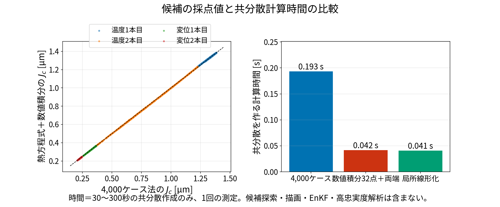
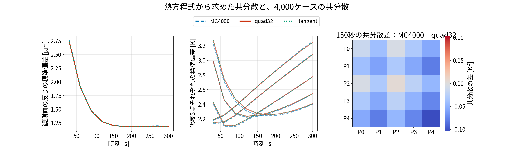
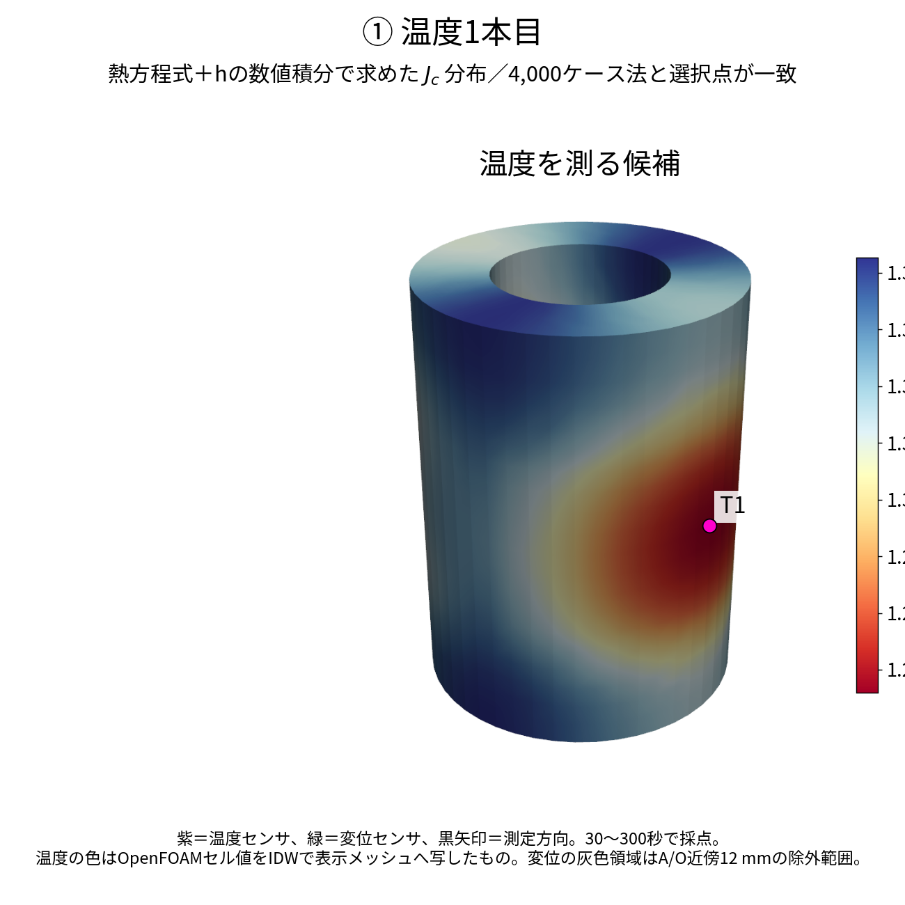
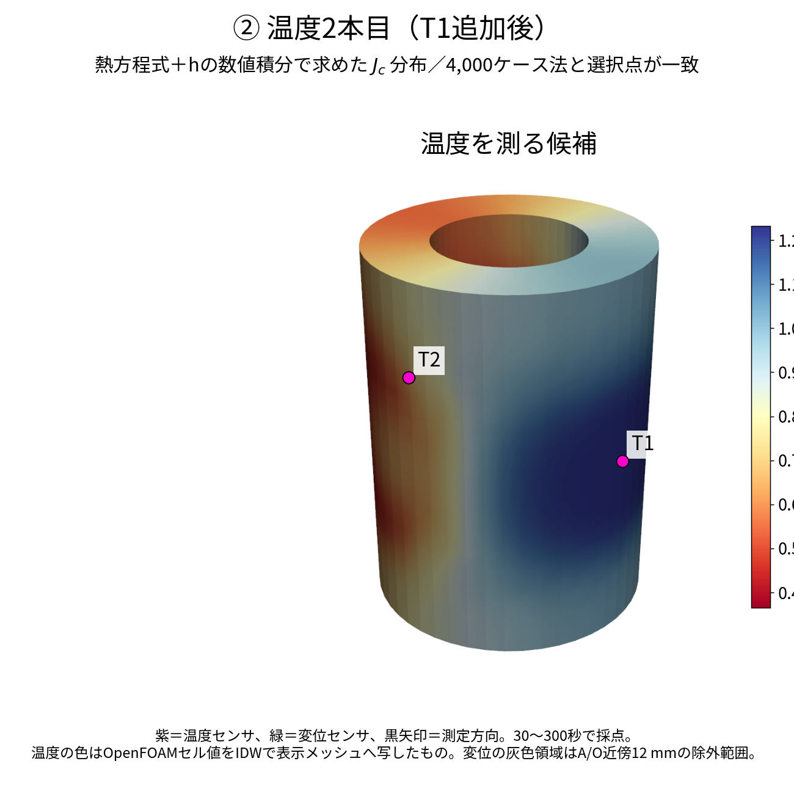
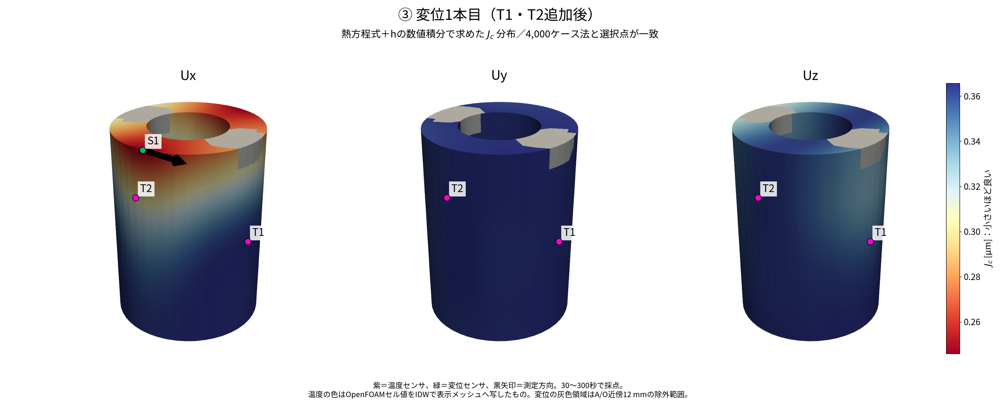
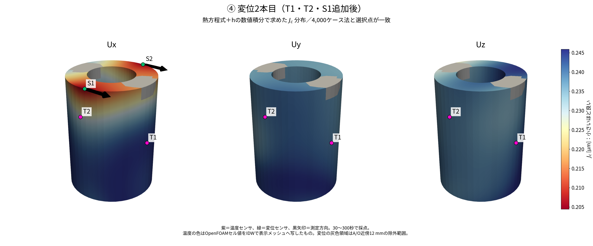
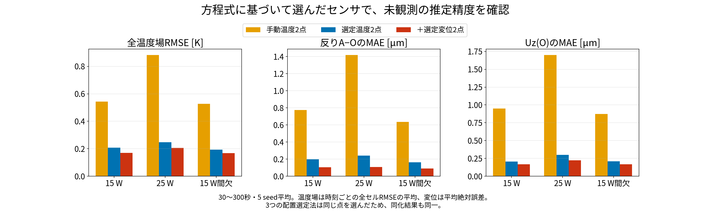
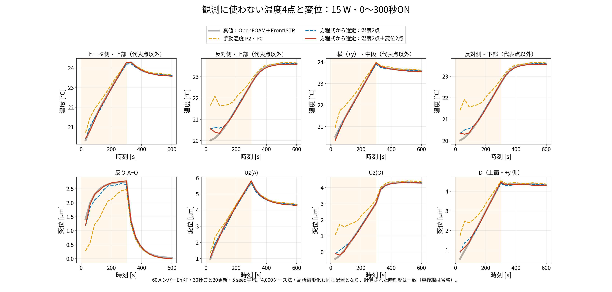
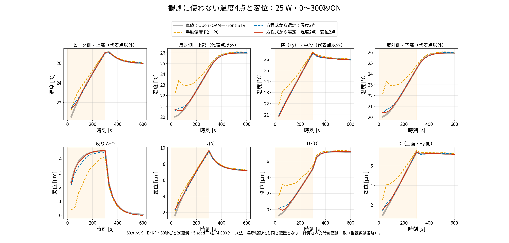
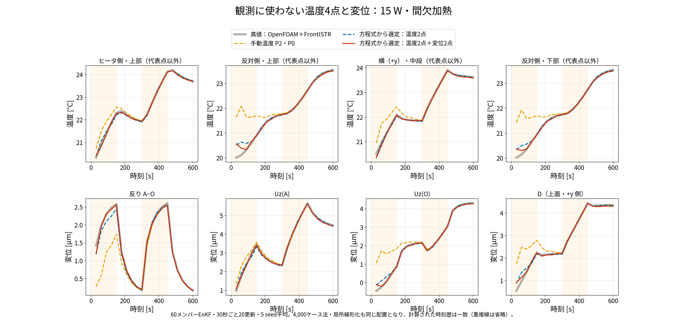

# blog011：4,000ケースを使わず、熱方程式から温度・変位センサを選べるか

## 1. 今回の問いと、実際に試した結果

blog009では、初期温度・発熱・放熱条件を変えてROMを4,000本計算し、そのばらつきから温度2点、続いて変位2点を選びました。

**今回は、その4,000本を、熱方程式から共分散を計算する方法に置き換えました。温度2点・変位2点はすべて同じ位置・方向になり、同じEnKFを使うと未観測温度・変位の時刻歴も一致しました。** この条件では、大量の乱数計算をせずに、同じ配置を決められました。

| 比較した方法 | 共分散の求め方 | 選ばれた温度2点・変位2点 |
|---|---|---|
| 従来法：MC4000 | 4,000本のROM結果を集計 | blog009のT1・T2、S1のUx・S2のUx |
| 今回の主方法：quad32 | 固定した放熱条件で線形応答を求め、放熱条件だけ数値積分 | 従来法と4本すべて一致 |
| 補助比較：tangent | 基準温度の周りで熱方程式を微分し、不確かさを伝える | 従来法と4本すべて一致 |

**何を良くする配置か**：観測に使わない反り $d=U_z(A)-U_z(O)$ の推定です。全温度場や発熱量に対する最適性を証明した試験ではありません。対象A・O、ヒータ位置、候補範囲はblog009と同じです。blog010の90°回転したA・Oについては、今回の方法での再選定はまだ行っていません。



> 左：同じ候補の採点値 $J_c$ を比較。破線は完全一致の線。表示する点を間引いていますが、選定には全候補を使用。右：30〜300秒の共分散を作る時間。候補探索、描画、EnKF、OpenFOAM・FrontISTRの事前計算を含みません。

## 2. 4,000ケースで計算していたものは何か

代表点5点の温度を、次の列ベクトルで表します。

$$
\underbrace{\mathbf T_P(t)}_{5\times1}=
\begin{bmatrix}T[P0]{}(t)\\T[P1]{}(t)\\T[P2]{}(t)\\T[P3]{}(t)\\T[P4]{}(t)\end{bmatrix}.
$$

$T[Pj]$ はOpenFOAM上の代表セルPjの温度です。今回の共分散計算は、まだ観測で補正していない状態から始めます。

4,000ケース法では、同じ時刻の温度を並べ、平均からの偏差を作ります。

$$
\overline{\mathbf T}_P(t)=\frac1{4000}\sum_{m=1}^{4000}\mathbf T_P^{(m)}(t),
\qquad
\delta\mathbf T_P^{(m)}=\mathbf T_P^{(m)}-\overline{\mathbf T}_P.
$$

$$
\underbrace{B(t)}_{5\times5}=
\frac1{3999}\sum_{m=1}^{4000}
\underbrace{\delta\mathbf T_P^{(m)}}_{5\times1}
\underbrace{(\delta\mathbf T_P^{(m)})^{\mathsf T}}_{1\times5}.
$$

**センサ候補を採点する段階で必要なのは、この $B(t)$ です。** 4,000本の時刻歴そのものを、候補ごとのデータ同化に使っているわけではありません。今回は、この行列を方程式から作ります。実際のデータ同化のメンバー数は、引き続き60です。

### 2-1. 比較する不確かさをそろえる

| 入力 | blog009と今回で共通に与えた分布 | 単位 |
|---|---|---|
| 初期温度5点 | 各点独立、17〜32 ℃の一様分布 | Kまたは℃ |
| 発熱倍率 $q$ | 0.3〜1.8の一様分布、 $Q=15q$ | $q$ は無次元、 $Q$ はW |
| 放熱 $h$ | 平均0.02、標準偏差0.01の正規乱数を0.001〜0.1にクリップ | W/K |

ここから $q=q_{\mathrm{scale}}$ 、 $h=h_{\mathrm{ROM}}$ と短く書きます。**この $h$ は集中定数ROMの放熱コンダクタンスであり、表面熱伝達率 [W/(m² K)] とは区別します。** 5点初期温度、 $q$ 、 $h$ は互いに独立という仮定です。

不確かさの大きさは、今回も事前に仮定しています。熱方程式が決めるのは、与えた不確かさが時間とともにどう広がるかです。

## 3. 放熱条件を固定すると、熱モデルは線形になる

代表点iの熱方程式は、既存コードのままです。

$$
C_i\dot T[P_i] =\sum_{j\ne i}K_{ij}\big(T[P_j]-T[P_i]\big) -h\big(T[P_i]-T_{\mathrm{air}}\big) +15b_iq\,s(t).
$$

- $C_i$ ：熱容量 [J/K]。
- $K_{ij}$ ：代表点間の熱コンダクタンス [W/K]。
- $b_i$ ：ヒータ入力点だけ1、ほかは0。
- $s(t)$ ：加熱ONなら1、OFFなら0。配置設計では0〜300秒ON。
- $T_{\mathrm{air}}=293.15$ K（20 ℃）。

外気温からの温度上昇を $\boldsymbol\theta=\mathbf T_P-T_{\mathrm{air}}\mathbf1$ と定義します。熱容量行列と熱移動行列は、

$$
\underbrace{C}_{5\times5}=\mathrm{diag}(C_0,\ldots,C_4),
\qquad
L_{ij}=K_{ij}\ (i\ne j),\quad L_{ii}=-\sum_{j\ne i}K_{ij}.
$$

したがって、

$$
\underbrace{\dot{\boldsymbol\theta}}_{5\times1} =\underbrace{C^{-1}(L-hI)}_{A_h:\ 5\times5}
\underbrace{\boldsymbol\theta}_{5\times1} +\underbrace{15C^{-1}\mathbf b}_{\mathbf b_q:\ 5\times1}q\,s(t).
$$

** $h$ を固定すると、初期温度と $q$ に対して線形です。** ここを使います。

### 3-1. 5点の初期温度と発熱の影響を、6列の行列にする

初期温度上昇と発熱倍率をまとめます。

$$
\underbrace{\boldsymbol\xi}_{6\times1}=
\begin{bmatrix}
\theta[P0]{}(0)\\\theta[P1]{}(0)\\\theta[P2]{}(0)\\\theta[P3]{}(0)\\\theta[P4]{}(0)\\q
\end{bmatrix}.
$$

固定した $h$ について、時刻tの温度上昇は、

$$
\boxed{
\underbrace{\boldsymbol\theta(t)}_{5\times1} =\underbrace{F_h(t)}_{5\times6}
\underbrace{\boldsymbol\xi}_{6\times1}
}
$$

と表せます。 $F_h$ の各列の意味を明示すると、

$$
F_h=
\begin{bmatrix}
f_{00}&f_{01}&f_{02}&f_{03}&f_{04}&f_{0q}\\
f_{10}&f_{11}&f_{12}&f_{13}&f_{14}&f_{1q}\\
f_{20}&f_{21}&f_{22}&f_{23}&f_{24}&f_{2q}\\
f_{30}&f_{31}&f_{32}&f_{33}&f_{34}&f_{3q}\\
f_{40}&f_{41}&f_{42}&f_{43}&f_{44}&f_{4q}
\end{bmatrix}.
$$

$f_{ij}$ は「初期のPj温度が1 K違うと、時刻tのPi温度が何 K違うか」、 $f_{iq}$ は「発熱倍率が1違うと、時刻tのPi温度が何 K違うか」です。

例えばP0温度は、

$$
\theta[P0]{}(t)=
f_{00}\theta[P0]{}(0)+f_{01}\theta[P1]{}(0)+f_{02}\theta[P2]{}(0) +f_{03}\theta[P3]{}(0)+f_{04}\theta[P4]{}(0)+f_{0q}q.
$$

連続時間の解として書けば、

$$
F_h(t)=\begin{bmatrix}
\underbrace{\exp(A_ht)}_{5\times5}&
\underbrace{\int_0^t\exp(A_h(t-\tau))\mathbf b_qs(\tau)\,d\tau}_{5\times1}
\end{bmatrix}.
$$

**今回の実装では、行列指数を直接計算せず、既存のRK4積分器で単位応答を作りました。** 外気温・発熱ゼロの基準1本、初期温度を1点ずつ1 K上げる5本、発熱倍率だけ1にする1本の、計7本を同時に進めます。基準との差が $F_h$ の6列です。

これは乱数を使わない、決まった入力に対する応答計算です。任意入力の直接ROM計算との最大差は、150秒で ** $2.27\times10^{-12}$ K** でした。

### 3-2. 固定したhでの平均・共分散は、掛け算で求まる

一様分布 $U(a,b)$ の平均は $(a+b)/2$ 、分散は $(b-a)^2/12$ です。今回、

$$
\underbrace{\boldsymbol\mu_\xi}_{6\times1} =\begin{bmatrix}4.5\\4.5\\4.5\\4.5\\4.5\\1.05\end{bmatrix},
\qquad
\underbrace{V_\xi}_{6\times6} =\mathrm{diag}\left(
\frac{15^2}{12},\frac{15^2}{12},\frac{15^2}{12},\frac{15^2}{12},\frac{15^2}{12},\frac{1.5^2}{12}
\right).
$$

最初の5成分の単位は、平均がK、分散がK²です。最後の成分は無次元です。独立なので、 $V_\xi$ の非対角はゼロです。

$h$ を固定したときの平均温度上昇と共分散は、

$$
\underbrace{\boldsymbol\mu_h}_{5\times1} =\underbrace{F_h}_{5\times6}\underbrace{\boldsymbol\mu_\xi}_{6\times1},
\qquad
\boxed{
\underbrace{B_h}_{5\times5} =\underbrace{F_h}_{5\times6}\underbrace{V_\xi}_{6\times6}
\underbrace{F_h^{\mathsf T}}_{6\times5}
}.
$$

導出は、平均からのずれ $\delta\boldsymbol\xi=\boldsymbol\xi-\boldsymbol\mu_\xi$ を使うと、

$$
\delta\boldsymbol\theta=F_h\delta\boldsymbol\xi,
$$

$$
\mathbb E[\delta\boldsymbol\theta\delta\boldsymbol\theta^{\mathsf T}\mid h] =F_h\mathbb E[\delta\boldsymbol\xi\delta\boldsymbol\xi^{\mathsf T}]F_h^{\mathsf T} =F_hV_\xi F_h^{\mathsf T}.
$$

つまり、初期温度・発熱倍率を何千通りも振る必要はありません。

## 4. hの違いを、1次元の数値積分でまとめる

まだ $h$ の不確かさが残っています。 $h$ ごとの結果を、 $h$ の確率分布に従って平均します。

$$
\overline{\boldsymbol\theta}(t)=\mathbb E_h[\boldsymbol\mu_h(t)].
$$

全体の温度偏差を2つに分けます。

$$
\boldsymbol\theta-\overline{\boldsymbol\theta} =\underbrace{(\boldsymbol\theta-\boldsymbol\mu_h)}_{(1)} +\underbrace{(\boldsymbol\mu_h-\overline{\boldsymbol\theta})}_{(2)}.
$$

（(1) 同じ $h$ での初期温度・発熱の違い、(2) $h$ が違うことによる平均温度の違い。）

この列ベクトルとその転置を掛けて平均すると、交差項は $\mathbb E[\boldsymbol\theta-\boldsymbol\mu_h\mid h]=0$ により消えます。したがって、

$$
\boxed{
B(t)=\mathbb E_h[B_h(t)] +\mathbb E_h\left[
(\boldsymbol\mu_h-\overline{\boldsymbol\theta})
(\boldsymbol\mu_h-\overline{\boldsymbol\theta})^{\mathsf T}
\right]
}\qquad(5\times5).
$$

温度上昇と絶対温度は定数だけ違うので、温度の共分散も同じ $B(t)$ です。

### 4-1. 実際の積分方法と、クリップ処理

積分点を $h_\ell$ 、その重みを $\omega_\ell$ とすると、

$$
\overline{\boldsymbol\theta}\approx\sum_\ell\omega_\ell\boldsymbol\mu_{h_\ell},
$$

$$
B\approx\sum_\ell\omega_\ell B_{h_\ell} +\sum_\ell\omega_\ell
(\boldsymbol\mu_{h_\ell}-\overline{\boldsymbol\theta})
(\boldsymbol\mu_{h_\ell}-\overline{\boldsymbol\theta})^{\mathsf T}.
$$

区間 $[0.001,0.1]$ の積分にGauss–Legendre求積を使いました。これは、決められた位置で関数を評価し、重みを掛けて足す数値積分です。

元コードの `np.clip()` は、範囲外の乱数を端点へ移します。そのため、区間内部の正規分布密度の積分に加え、下端・上端の確率も含めます。 $Z\sim\mathcal N(0.02,0.01^2)$ とすると、任意の関数 $f$ の平均は、

$$
\mathbb E[f(h)] =\Pr(Z\le0.001)f(0.001) +\int_{0.001}^{0.1}f(h)p_Z(h)\,dh +\Pr(Z\ge0.1)f(0.1).
$$

**「範囲内だけで正規分布を再正規化する」処理ではありません。元のクリップした分布に合わせています。**

### 4-2. 積分点数を増やして確かめた結果

| 区間内部の積分点数 | 重みの合計 | 64点計算に対する共分散の相対差 | 判断 |
|---:|---:|---:|---|
| 8 | 1.002893 | 約13％ | 重みの合計の検査を満たさないため不採用 |
| 16 | 1.0000000059 | $6.71\times10^{-9}$ | ほぼ収束 |
| 32 | 1.0000000000 | $1.96\times10^{-13}$ | 本比較に採用 |
| 64 | 1.0000000000 | 基準 | 収束確認用 |

相対差は、10時刻すべての行列要素の二乗和の平方根で比較しています。8点は粗い積分の診断結果であり、その共分散を配置選定には使用していません。

32点法は、区間内部32点と両端2点で、各7本の単位応答、計 **238本相当** を計算します。初期温度・発熱の分布は行列で扱い、乱数サンプルは使いません。64点との一致は **h方向の積分の収束** の確認であり、ROMの物理精度やRK4の時間刻み誤差の検証とは別です。

## 5. 補助比較：感度方程式だけでも共分散を作れるか

もう1つ、基準の温度・発熱・放熱の周りで線形化する方法も試しました。

初期入力を $\boldsymbol\chi=[\boldsymbol\theta(0)^{\mathsf T},q,h]^{\mathsf T}$ （7×1）、その共分散を $V_\chi$ （7×7）とします。 $h$ の平均・分散には、上記のクリップ分布の数値積分値を使います。

$$
\underbrace{S(t)}_{5\times7} =\frac{\partial\boldsymbol\theta(t)}{\partial\boldsymbol\chi^{\mathsf T}} =\begin{bmatrix}S_0&S_q&S_h\end{bmatrix},
\quad S_0:5\times5,\quad S_q,S_h:5\times1.
$$

基準解の放熱を $\bar h$ とし、 $A_{\bar h}=C^{-1}(L-\bar hI)$ とすると、

$$
\dot S_0=A_{\bar h}S_0,\qquad S_0(0)=I,
$$

$$
\dot S_q=A_{\bar h}S_q+\mathbf b_qs(t),\qquad S_q(0)=0,
$$

$$
\dot S_h=A_{\bar h}S_h-C^{-1}\boldsymbol\theta(t),\qquad S_h(0)=0.
$$

最後の式は、放熱項 $-hC^{-1}\boldsymbol\theta$ をhで微分し、積の微分を適用して得られます。

$$
\frac{\partial}{\partial h}[-hC^{-1}\boldsymbol\theta] =-C^{-1}\boldsymbol\theta-hC^{-1}S_h.
$$

温度5成分と感度35成分を、同じRK4ステージで積分します。求めたい共分散は、

$$
\boxed{B_{\mathrm{tangent}}(t)\approx
\underbrace{S(t)}_{5\times7}
\underbrace{V_\chi}_{7\times7}
\underbrace{S(t)^{\mathsf T}}_{7\times5}}.
$$

**今回は、この局所線形化でも十分近い結果になりました。** 32点積分法との共分散の相対差は約 **0.0150％** です。ただし、hの不確かさを大きくした場合や、温度依存物性・放射などを含む場合にも成立するとは限りません。

発熱量Qに対する感度は、 $Q=15q$ より $\partial\mathbf T/\partial Q=S_q/15$ です。今回、これらの感度は温度共分散を作るために使いました。Q/h推定専用のセンサ配置比較は行っていません。



*観測前の反り・代表5点温度の標準偏差を比較。右は150秒での「4,000ケースの標本共分散 − 32点積分の共分散」。全10時刻での相対差は約1.01％。有限サンプルの標本共分散と、仮定した独立分布の積分値を比較しています。*

## 6. 共分散が分かれば、どの候補が良いかを計算できる

### 6-1. 温度・変位・反りを、同じ5点温度で表す

代表5点温度のずれを $\delta\mathbf T_P$ （5×1）とすると、候補cのセンサ値と反りのずれは、

$$
\delta y_c=
\underbrace{\begin{bmatrix}h_{c,0}&h_{c,1}&h_{c,2}&h_{c,3}&h_{c,4}\end{bmatrix}}_{\mathbf h_c^{\mathsf T}:\ 1\times5}
\underbrace{\delta\mathbf T_P}_{5\times1},
\qquad
\delta d=\underbrace{\mathbf w^{\mathsf T}}_{1\times5}\delta\mathbf T_P.
$$

ここで $h_{c,j}$ は「Pj温度が1 K違うと、候補cの値がいくら違うか」という固定の重みであり、放熱パラメータhとは別です。

重みは、既存のPOD・IDW・FrontISTR応答から求めます。

$$
\underbrace{G}_{20696\times5} =\underbrace{\Phi}_{20696\times5}
\underbrace{(\Phi_P)^+}_{5\times5},
\qquad \Phi_P=\Phi[P,:].
$$

（ $\Phi[P,:]$ ＝ $\Phi$ から代表5セルの行だけを取り出したもの。）

温度候補セルcの重みは、 $G$ のc行です。変位の重みは、

$$
\underbrace{H_u}_{15120\times5} =\underbrace{D}_{15120\times5}(\Phi_P)^+,
\qquad
D=\underbrace{W}_{15120\times5040}
\underbrace{M}_{5040\times20696}\Phi.
$$

- $M$ ：OpenFOAMセル温度をFEM節点温度へ写すIDW写像（8近傍、距離の逆数、行和1）。
- $W$ ：FEM節点温度変化から全節点の3方向変位への、固定の熱弾性応答。
- $D$ ：各PODモードのFrontISTR変位応答。実装は保存済みのDを使用し、候補ごとにFrontISTRを実行しません。
- $H_u$ ：FEM節点・方向ごとの5点温度への重み。保存配列の形は節点×3方向×5モードです。

対象の反りは、 $H_u$ のAのUz行とOのUz行の差です。

$$
\mathbf w^{\mathsf T}=[H_u]_{A,z,:}-[H_u]_{O,z,:}.
$$

### 6-2. 候補を測ると仮定したとき、どれだけ反りの不確かさを減らせるか

現在残っている5点温度の誤差共分散を $P(t)$ （5×5）とします。最初は $P=B$ です。

候補cの観測ノイズを独立な $\varepsilon_c$ 、分散を $r_c$ とすると、反り誤差を候補の観測と予報の差から補正する係数をaとして、補正後の分散は、

$$
V_d-2aC_{dy}+a^2V_y,
$$

$$
V_d=\mathbf w^{\mathsf T}P\mathbf w,
\qquad C_{dy}=\mathbf w^{\mathsf T}P\mathbf h_c,
\qquad V_y=\mathbf h_c^{\mathsf T}P\mathbf h_c+r_c.
$$

平方完成すると、

$$
V_y\left(a-\frac{C_{dy}}{V_y}\right)^2+V_d-\frac{C_{dy}^2}{V_y}.
$$

最小にする係数は $a=C_{dy}/V_y$ なので、候補を使うことで減らせる反り分散は、

$$
\boxed{\Delta V_c(t)=
\frac{(\mathbf w^{\mathsf T}P(t)\mathbf h_c)^2}
{\mathbf h_c^{\mathsf T}P(t)\mathbf h_c+r_c}}.
$$

これは線形補正の平均二乗誤差を最小化した結果です。ガウス分布を仮定しなくても、この線形補正の評価には使えます。非ガウス分布での厳密な条件付き分散が、すべての測定値でこの値になると主張するものではありません。

現在のプログラムと同じ採点値は、10時刻での残る標準偏差の平均です。

$$
\boxed{J_c=\frac1{10}\sum_{k=1}^{10}
\sqrt{\mathbf w^{\mathsf T}P(t_k)\mathbf w-\Delta V_c(t_k)}}.
$$

$t_k=30,60,\ldots,300$ 秒、 $r_c=0.3^2$ K²または0.3² µm²です。** $J_c$ が小さい候補を選びます。** 分散の時間平均の平方根ではなく、各時刻の標準偏差を平均しています。

1本を選んだ後の共分散は、

$$
\underbrace{P_{+c}}_{5\times5}=P-
\frac{\underbrace{P\mathbf h_c}_{5\times1}
\underbrace{\mathbf h_c^{\mathsf T}P}_{1\times5}}
{\mathbf h_c^{\mathsf T}P\mathbf h_c+r_c}.
$$

この更新後の行列を使って次の候補を再採点します。温度2本を先に選び、その2本を固定した条件で変位2本を選びます。

配置設計では、各時刻の事前共分散 $B(t_k)$ に対して、その時刻で選定センサを測れると仮定した線形補正を評価します。時刻間の観測履歴まで含むEnKFの予報共分散を、この段階で計算しているわけではありません。実際に30秒ごとに補正を繰り返した効果は、§8のEnKF試験で確認します。

### 6-3. 熱感度Wだけから選ぶこととの違い

$W$ は「どこが温まると対象がどう変位するか」を表します。今回の採点式では、それに温度の不確かさ $P$ と観測ノイズ $r_c$ を組み合わせます。

**選ばれるのは、まだ分からない温度の組合せを捉え、その情報が目的の反りを直すのに役立つ候補です。** $W$ が大きい場所や、よく動く場所を単独で順位付けする基準ではありません。

今回の試験で置き換えたのは $B$ を作る方法です。 $W$ 、温度復元の重み、候補の採点式は共通です。

## 7. 方程式から得たJc分布と、選ばれた4本

温度候補は代表5セルを除く **20,691セル**、変位候補はA/O近傍12 mmを除く **4,918節点×3方向＝14,754成分** です。元のA/Oはヒータ側・反対側の上面で、実際の節点座標はA=(28.75,0,100.5) mm、O=(−28.75,0,100.5) mmです。









*斜めアングル。小さいJcほど良い候補。変位はUx・Uy・Uzのすべてを採点し、各方向を同じカラースケールで表示。色の範囲は選定段階ごとに異なります。*

| 順序 | 選んだセンサ | 概略座標 [mm] | 4,000ケース法のJ [µm] | 32点積分法のJ [µm] |
|---|---|---|---:|---:|
| 1 | 温度T1：ヒータ側・中段 | (36.7, 0.8, 49.2) | 1.225906 | 1.231774 |
| 2 | 温度T2：反対側・中段 | (−35.9, −1.5, 51.6) | 0.365559 | 0.365736 |
| 3 | 変位S1：上面、Ux | (4.9, −37.2, 100.5) | 0.245882 | 0.245913 |
| 4 | 変位S2：上面、Ux | (4.9, 37.2, 100.5) | 0.204461 | 0.204454 |

この表のJは、各段階でそれまでの観測をすべて追加した条件の値です。Jは設計時の予測標準偏差であり、次節の実際の同化誤差と同じ量ではありません。

**今回は、乱数による標本共分散と理論に基づく共分散の差があっても、候補の最小位置は変わりませんでした。** これは今回の分布・候補範囲・目的量での検証結果です。4本の組合せ全体について大域的最適を証明したものではありません。

## 8. 選んだセンサで実際にデータ同化した結果

今回プログラムを実行して得た計算結果を示します。真値には、既存のOpenFOAM温度場とFrontISTR全節点変位を使用しています。実機での検証は今後の課題です。

- EnKF：60メンバー、30秒ごとに20回更新、0〜600秒。
- 乱数seed：20260913〜20260917の5回。
- 温度・変位の観測ノイズ標準偏差：0.3 K、0.3 µm。
- インフレーション：偏差を1.02倍。
- 更新する状態：代表5点温度・発熱倍率q・放熱hの計7変数。
- 真値：15 W基準、25 W、15 W間欠加熱の保存済み高忠実度解析結果。
- 配置設計は15 W・0〜300秒ONの事前分布から行い、配置を固定して3条件で試験。

MC4000、quad32、tangentの各配置を、同じEnKF・同じseedでそれぞれ計算し直しました。**選択点が同じなので、3方式の同化後の保存時刻歴は配列として完全一致しました。** 図では重なる線を1組にまとめています。

### 8-1. 温度2本から、変位2本を追加した効果



| 加熱条件 | 観測配置 | 全温度場 [K] | 反りA−O [µm] | Uz(A) [µm] | Uz(O) [µm] |
|---|---|---:|---:|---:|---:|
| 15 W | 手動温度P2・P0 | 0.543 | 0.775 | 0.241 | 0.951 |
| 15 W | 選定温度T1・T2 | 0.208 | 0.198 | 0.200 | 0.204 |
| 15 W | T1・T2＋S1・S2のUx | 0.169 | 0.103 | 0.140 | 0.168 |
| 25 W | 手動温度P2・P0 | 0.882 | 1.417 | 0.311 | 1.699 |
| 25 W | 選定温度T1・T2 | 0.247 | 0.242 | 0.226 | 0.298 |
| 25 W | T1・T2＋S1・S2のUx | 0.206 | 0.107 | 0.180 | 0.221 |
| 15 W間欠 | 手動温度P2・P0 | 0.528 | 0.635 | 0.276 | 0.874 |
| 15 W間欠 | 選定温度T1・T2 | 0.194 | 0.161 | 0.170 | 0.210 |
| 15 W間欠 | T1・T2＋S1・S2のUx | 0.167 | 0.090 | 0.139 | 0.166 |

全温度場は、30〜300秒の10時刻それぞれで全20,696セルのRMSEを求め、その時間平均を5 seedで平均した値です。変位は同じ10時刻の平均絶対誤差を5 seedで平均しています。

$$
E_T=\frac15\sum_{s=1}^{5}\frac1{10}\sum_{k=1}^{10}
\sqrt{\frac1{20696}\sum_{i=1}^{20696}
\big(\widehat T_i^{(s)}(t_k)-T_i^*(t_k)\big)^2},
$$

$$
E_d=\frac15\sum_{s=1}^{5}\frac1{10}\sum_{k=1}^{10}
\left|\widehat d^{(s)}(t_k)-d^*(t_k)\right|.
$$

星印は真値、帽子は同化後60メンバーの平均から求めた推定値です。平均した線の誤差ではなく、seedごとの誤差を平均しています。

### 8-2. 代表点以外の未観測温度・変位の時刻歴







*上段：代表点にも観測点にも使わない4セルの温度。下段：観測しない反りA−O、Uz(A)、Uz(O)、上面+y側DのUz。Dの評価位置はおよそ(0,36.2,100.5) mmで、S1・S2のUxとは異なる観測成分・位置です。黒が真値、橙が手動温度2点、青が選定温度2点、赤がさらに選定変位2点を追加した結果。橙色の背景は加熱ON。線は5 seed平均、1回目の同化を行った30秒以降。*

固定した未観測温度4点の概略位置は、ヒータ側上部(35.1,−0.8,94.6)、反対側上部(−37.5,0,90)、+y側中段(0,35.5,50)、反対側下部(−32.9,−1.6,29.7) mmです。最寄りのOpenFOAMセルで比較しています。

15 Wの温度＋変位同化では、この4点の平均絶対誤差は **0.146、0.206、0.095、0.149 K** です。同化なしでは **4.610、4.493、4.560、4.466 K** でした。代表点以外・観測点以外の温度も真値へ近づいています。ただし、変位を追加した配置がすべての温度点で最小誤差になるとは限りません。

## 9. 計算時間と検証した範囲

| 方法 | 共分散作成 [s] | 4本の候補探索 [s] |
|---|---:|---:|
| 4,000ケース法 | 0.193 | 0.086 |
| 32点＋両端の数値積分 | 0.042 | 0.088 |
| 局所線形化 | 0.041 | 0.094 |

この実行では共分散作成が約4.6倍速くなりました。いずれも既に小さい5点ROMであり、1回の計測値です。入出力・描画を含む全体速度や、高忠実度解析の高速化率を示す値ではありません。選定後のEnKFは、8構成×5 seedを各加熱条件で実行し、1条件あたり約4.7〜4.9秒（既存評価図の作成を含む）でした。

検査した事項は、単位応答と任意入力の直接計算の一致、積分重みの合計、32点と64点の収束、共分散の対称性・半正定値性、3方式の同化時刻歴の一致です。

**今回言えること**：blog009の条件では、温度共分散を熱モデルから作り、4,000ケースと同じ温度・変位配置を決められました。その配置による未観測温度・変位の推定精度も維持されました。

**今後の確認**：事前分布を変えた場合、A/Oを回転した場合、非線形な熱モデル、学習範囲外の大きな放熱変化でも同じ配置・精度になるか。今回の結果だけで「どの問題にも最適」「Q/h推定にも最適」とは結論しません。

## 10. 数式・プログラム・保存先の対応

| 数式・処理 | プログラム |
|---|---|
| 固定hでのROM、単位応答RK4 | `dacore/rom_general.py` の `integrate_ensemble()` |
| クリップ正規分布の積分点・端点確率 | `run/analytic_covariance_sensor_study.py` の `h_quadrature()` |
| $F_hV_\xi F_h^{\mathsf T}$ 、全共分散の合成 | 同ファイルの `conditional_covariance()` |
| 基準温度と直接感度Sの同時RK4 | 同ファイルの `tangent_covariance()` |
| 候補の重みG、Hu、反り重みw | 同ファイルの `operators()` |
| 温度2本→変位2本の貪欲選定 | 同ファイルの `select()` |
| Jcと1本追加後の共分散 | 既存 `run/select_nonrep_temp_disp.py` の `score()`、`add_row()` |
| 共通条件でのEnKF・未観測量評価 | 既存 `run/selected_pair_unobserved_check.py` を新規スクリプトから呼び出し |
| Jc分布・誤差・時刻歴の図 | `run/make_blog011_figures.py` |

計算フォルダは **`sample/106_0_pod_selected_rom/results/blog011/`** です。既存のblog009・010の結果は上書きしていません。

- `study.json`：選定結果、共分散差、収束、検査値、計算時間。
- `covariances.npz`：10時刻の各方式の共分散。
- `selection_*.json`、`scores_*.npz`：選定点と全候補のJc。
- `unobserved_check_analytic_*.json`：各加熱条件の誤差。
- `unobserved_traj_analytic_*.npz`：未観測温度・変位の時刻歴。
- `vtk/analytic_sensor_scores.vtu`：ParaView用のJc分布。温度は表示メッシュへのIDW写像、変位はFEM節点値。

再現コマンド（106フォルダ内で実行）：

```bash
OPENBLAS_NUM_THREADS=4 OMP_NUM_THREADS=4 python run/analytic_covariance_sensor_study.py
OPENBLAS_NUM_THREADS=4 OMP_NUM_THREADS=4 python run/make_blog011_figures.py
python run/build_local_site.py
```

既存のOpenFOAM・FrontISTR真値、校正済みROM、POD・変位応答が必要です。この試験ではそれらを再利用し、共分散計算・候補選定・ROM＋EnKFを新たに実行しました。
