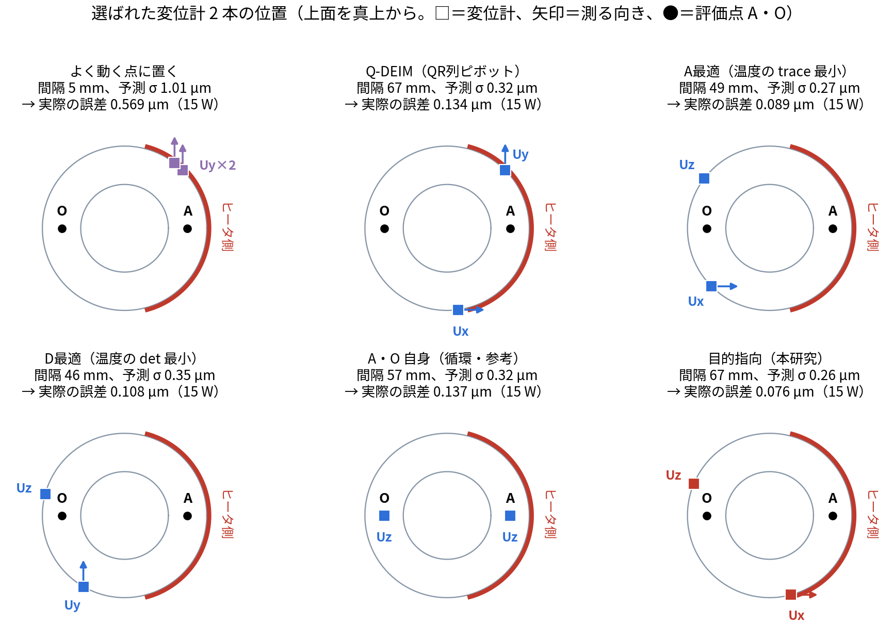

# blog_012：Fisher 情報行列でセンサの置き場所を選ぶ ― 温度計 1 本の手計算から、反りに効く変位計の選び方まで

発表資料 [presen_001 §12](presen_001_introduction_positioning.md#12-11-ページ目センサの置き場所fisher-情報行列) の「センサの置き場所：Fisher 情報行列」は、式が多く、1 ページでは分かりにくい所です。この記事では、そこを順を追って、本番の計算の数字で確かめながら解説します。

**この記事で分かること**

1. Fisher 情報とは何か（温度計 1 本、未知数 1 つの手計算）
2. 「測る前の不確かさ」と合わせると、測った後の不確かさがどうなるか
3. 未知数が 2 つになると、不確かさは楕円になる
4. 知りたいのが「反り」のとき、どの変位計がよいかを式で決める方法
5. 本番（未知数 5 つ、変位計 2 本）での選び方と、その結果

数字はすべて、本研究の本番のデータ（OpenFOAM の温度、POD の型、FrontISTR で解いた型ごとの変位、ROM）から計算しました（`run/make_blog012_fisher_figs.py`、`results/blog012_fisher.json`）。

---

## 1. 何を決めたいか

中空円筒の外周の片側（+x 側）にヒータがあり、温めると円筒が反ります。知りたいのは、上面の 2 点 A・O の高さの差（**反り** A−O）です。A・O には何も置けない（測れない）とします。

- 温度計は、すでに **P2・P0**（ヒータ側の中段）の 2 本があります。
- そこに **変位計を足す**なら、どこに、どの向き（Ux・Uy・Uz）に置けばよいか。候補は、表面の節点 × 3 方向で 14,754 通りあります。

データ同化を 14,754 回まわして比べることもできますが、時間がかかります。**データ同化をまわす前に、計算だけで良い場所を選べないか**。そのための道具が Fisher 情報行列です。

---

## 2. 言葉の準備：未知数・感度・ノイズ

### 2-1. 未知数：この記事では「型 1・型 2 の重み」

温度分布は、POD の型の足し合わせで表せます（[blog_004](blog_004_pod_selected_rom.md)）。

```math
\mathbf T(t) \approx \bar{\mathbf T} + a_1(t)\,\boldsymbol\varphi_1 + a_2(t)\,\boldsymbol\varphi_2 + \cdots
```

- $`\bar{\mathbf T}`$：平均の温度分布
- $`\boldsymbol\varphi_1, \boldsymbol\varphi_2`$：型 1（全体が温まる）、型 2（ヒータ側と反対側の差）
- $`a_1, a_2`$：その時刻の**型の重み**。ここが分かれば、温度分布全体が分かる

型 1・2 で、温度の変化の 99.89 % を表せます。そこでこの記事では、説明を簡単にするため、**未知数を $`a_1, a_2`$ の 2 つ**に絞ります（本番は 5 つ。§8）。

型の大きさは、私が「一番大きく変わるセルで 1」になるようにそろえました。そうすると、重み $`a_1, a_2`$ の単位が K になり、「型 1 の重みが 1 K 増える＝一番変わるセルで 1 K 上がる」と読めます。

### 2-2. センサの読みは、型の重みでどう決まるか（感度）

**温度計の読み。** 2-1 の式で、温度計 P2 の場所だけを見ると、P2 の読みは「P2 の平均の温度」に「型 1 の重み × 型 1 の P2 での値」と「型 2 の重み × 型 2 の P2 での値」を足したものです。

```math
T_{P2} = \bar T_{P2} + a_1\,\varphi_1(P2) + a_2\,\varphi_2(P2)
```

型 1・型 2 の P2・P0 での値は、図 0 のとおりです。


*図 0　型 1（左）と型 2（右）。色は型の値（一番大きく変わるセルで ±1 にそろえた）、黒い球が温度計 P2・P0。数字は、その場所での型の値。*

- 型 1 の P2 での値は −0.61、型 2 の P2 での値は −1.00 です。
- つまり、**型 1 の重み $`a_1`$ が 1 K 増えると P2 の読みは 0.61 K 下がり、型 2 の重み $`a_2`$ が 1 K 増えると 1.00 K 下がります。**（マイナスなのは、POD が型の向きをそう決めたからで、意味はありません。重み $`a`$ の側も同じ向きで測るので、温度は正しく出ます。）

本番の数字で確かめます。OpenFOAM の 150 秒では、$`a_1 = 0.91`$ K、$`a_2 = -0.65`$ K でした。P2 の平均の温度は 23.79 °C なので、

```math
T_{P2} = 23.79 + 0.91 \times (-0.61) + (-0.65) \times (-1.00) = 23.88\ ^\circ\mathrm C
```

OpenFOAM の P2 の温度は 23.86 °C で、0.02 K の差で合います（差は、型 3〜5 を省いたため）。

**感度とは。** この「重みが 1 増えたときに、読みがいくつ変わるか」の数を並べたものを、**感度** $`\mathbf h`$ と呼びます。P2 なら $`\mathbf h_{P2} = (-0.61,\ -1.00)`$ です。読みのずれ（平均からのずれ）は、感度と重みの掛け算の和で書けます。測ったときのノイズ $`\varepsilon`$ も足します。

```math
y = T_{P2} - \bar T_{P2} = h_1 a_1 + h_2 a_2 + \varepsilon = \mathbf h^{\mathsf T}\mathbf a + \varepsilon,
\qquad \mathbf a = \begin{pmatrix} a_1 \\ a_2 \end{pmatrix}
```

この式は説明のための例ではなく、**この記事の計算（図 1〜3、表の数字）で実際に使った式**です。本番のデータ同化（[presen_001 §9-3](presen_001_introduction_positioning.md)）でも、センサの読みを「未知の数の一次式」で書く点は同じで、未知の数が代表 5 点の温度になっているだけです。

**変位計の読み。** 変位計も同じ形です。違うのは感度の求め方で、「型 1 だけの温度分布」と「型 2 だけの温度分布」をそれぞれ FrontISTR に入れて解き、その場所・その向きの変位を感度にします（単位 µm/K）。例えば、上面のヒータ側（36.2, −9.7, 100.5 mm）の Ux なら $`\mathbf h = (-0.58,\ 1.32)`$ µm/K です。$`a_2`$ が 1 K 増えると、そこは +x 向きに 1.32 µm 動く、という意味です。

| センサ | 感度 $`\mathbf h = (h_1,\ h_2)`$ | 求め方 |
|---|---|---|
| 温度計 P2 | $`(-0.61,\ -1.00)`$ K/K | その場所での型 1・型 2 の値（図 0） |
| 温度計 P0 | $`(-0.75,\ -0.74)`$ K/K | 同上 |
| 変位計 | 場所と向きで変わる（§6） | 型 1・型 2 だけの温度を FrontISTR に入れて解いた変位 [µm/K] |

**知りたい反りも同じ形。** 反り（A の上下の変位 − O の上下の変位）も、重みの一次式です。

```math
d = \mathbf w^{\mathsf T} \mathbf a, \qquad \mathbf w = (0.327,\ -1.431)\ \ \mu\mathrm m/\mathrm K
```

$`\mathbf w`$ は反りの「感度」にあたります（測れないので、センサではない）。$`|w_2| \gg |w_1|`$ なので、**反りは型 2（ヒータ側と反対側の差）でほぼ決まります**。

### 2-3. ノイズ

センサのノイズの大きさ（標準偏差）は、本番と同じく、温度計 0.3 K、変位計 0.3 µm とします。分散は $`r = 0.3^2 = 0.09`$ です。

---

## 3. 未知数が 1 つのとき：Fisher 情報とは

まず一番簡単な場合、**未知数が $`a_1`$ だけ、センサが温度計 P2 の 1 本だけ**で考えます（$`a_2`$ は無視。説明のため）。

### 3-1. 式

P2 の値は $`y = h\,a_1 + \varepsilon`$、$`h = -0.609`$、ノイズの分散 $`r = 0.09`$ です。

例えば $`a_1`$ が 1 K 違うと、P2 の読みは $`h \times 1 = -0.61`$ K 違います。温度計のノイズは ± 0.3 K なので、0.61 K の違いはノイズより大きく、P2 の読みから「$`a_1`$ が違う」と気づけます。一方、$`a_1`$ が 0.2 K しか違わなければ、読みの違いは 0.12 K で、ノイズに隠れて気づけません。

このように、**未知数の違いが、ノイズに比べてどれだけ大きくセンサの読みに表れるか**を表す数が **Fisher 情報** $`F`$ です。

```math
F = \frac{h^2}{r} = \frac{(-0.609)^2}{0.09} = 4.12\ \ [1/\mathrm K^2]
```

- **感度 $`h`$ が大きいほど**、未知数の違いがセンサの読みに大きく表れるので、情報が多い。
- **ノイズ $`r`$ が小さいほど**、未知数の小さな違いでもノイズに隠れずに読みに表れるので、情報が多い。
- $`1/F = 0.24`$ は、「P2 の温度計だけから $`a_1`$ を求めたときのばらつき（分散）」です。標準偏差にすると $`\sqrt{0.24} = 0.49`$ K。

#### なぜ $`h^2/r`$ なのか（出どころ）

$`a_1`$ が分かっているとき、P2 の値 $`y`$ が出る確からしさ（**尤度**）は、ノイズが正規分布なら

```math
p(y \mid a_1) \propto \exp\!\left(-\frac{(y - h\,a_1)^2}{2r}\right)
```

です。$`a_1`$ を横軸にしてこれを描くと、山の形になります。山の頂上は、測った読み $`y`$ を一番よく説明する $`a_1`$ です。**山が鋭いほど**、$`a_1`$ が頂上から少し離れただけで、その読みが出る確率が大きく下がります。つまり、読みから $`a_1`$ を狭い範囲に絞り込めます。これが「情報が多い」ということです。山の鋭さは、尤度の対数を $`a_1`$ で 2 回微分した値（にマイナスを付けたもの）で測ります。

```math
F = -\frac{\partial^2 \ln p}{\partial a_1^2} = \frac{h^2}{r}
```

これが Fisher 情報の定義です（一般には期待値をとるが、この一次式では値が 1 つに決まる）。どんな推定方法でも、ばらつきは $`1/F`$ より小さくできません（クラメール・ラオの下限）。

参考：[Fisher情報量と共分散行列（Qiita）](https://qiita.com/nekokaitaiyo_ne/items/aee3f7152b984b3644bf)、[フィッシャー情報量、どんなイメージ？（note）](https://note.com/kimukimucitrus/n/nace8ba84d129)

### 3-2. 測る前の不確かさと合わせる

データ同化では、測る前にも「$`a_1`$ はだいたいこのくらい」という見込みがあります。本番と同じ方法で、初期温度・発熱・放熱をばらつかせた 4,000 本の ROM を 150 秒まで進め、その散らばりから決めました。

- 測る前の分散 $`B = 6.36`$（標準偏差 2.52 K）

測った後の分散 $`P`$ は、「情報の足し算」で求まります（分散の逆数を情報と見る）。

```math
\frac{1}{P} = \frac{1}{B} + F = \frac{1}{6.36} + 4.12 = 4.28, \qquad P = 0.234
```


*図 1　型 1 の重み $`a_1`$ の不確かさ。点線が測る前（標準偏差 2.52 K）、緑が P2 の温度計だけから（0.49 K）、赤が両方を合わせた後（0.48 K）。幅を比べるため、中心を 0 にそろえて描いた。*

- 温度計 1 本で、$`a_1`$ の幅が 2.52 K → 0.48 K に絞れました。
- 測る前の見込み（$`1/B = 0.16`$）より、温度計の情報（$`F = 4.12`$）の方がずっと大きいので、合わせた後はほぼ温度計で決まっています。

**ここまでのまとめ**：情報は $`F = h^2/r`$。測る前の情報 $`1/B`$ に足すと、測った後の不確かさ $`P`$ が出る。

---

## 4. 未知数が 2 つのとき：不確かさは楕円になる

次に、未知数を $`a_1, a_2`$ の 2 つ、温度計を P2・P0 の 2 本にします。式は 3 章と同じ形で、数が行列になるだけです。

### 4-1. Fisher 情報行列

センサ 1 本の情報は、感度のベクトル $`\mathbf h`$ から作る 2×2 の行列 $`\mathbf h\mathbf h^{\mathsf T}/r`$ です。2 本あれば足し算します。

```math
F = \frac{\mathbf h_{P2}\mathbf h_{P2}^{\mathsf T}}{r} + \frac{\mathbf h_{P0}\mathbf h_{P0}^{\mathsf T}}{r}
= \frac{1}{0.09}\left[\begin{pmatrix}0.371 & 0.609\\ 0.609 & 1.000\end{pmatrix} + \begin{pmatrix}0.568 & 0.557\\ 0.557 & 0.546\end{pmatrix}\right]
= \begin{pmatrix}10.43 & 12.95\\ 12.95 & 17.17\end{pmatrix}
```

（P2 の行列の 1 行目は $`(-0.609)^2 = 0.371`$、$`(-0.609)(-1.000) = 0.609`$ のように計算します。）

### 4-2. 測った後の不確かさ

測る前の不確かさ（4,000 本の散らばり、150 秒）は

```math
B = \begin{pmatrix} 6.36 & 1.93 \\ 1.93 & 1.26 \end{pmatrix}
```

で、測った後は 3 章と同じく「情報の足し算」の逆数です。

```math
P = \left(B^{-1} + F\right)^{-1} = \begin{pmatrix} 0.427 & -0.286 \\ -0.286 & 0.246 \end{pmatrix}
```

$`P`$ の対角は、$`a_1`$・$`a_2`$ それぞれの分散です。非対角（−0.286）は、「$`a_1`$ が大きめなら $`a_2`$ は小さめ」という組み合わせのばらつきを表します。2 つの未知数の不確かさは、**楕円**で描けます（図 2 の緑）。

楕円が斜めに細長いのは、温度計 2 本の感度 $`\mathbf h_{P2} = (-0.61, -1.00)`$ と $`\mathbf h_{P0} = (-0.75, -0.74)`$ が似た向きだからです。温度計は「$`\mathbf h`$ の向き」の組み合わせはよく測れますが、それと直角の向き（$`a_1`$ を増やして $`a_2`$ を減らす向き）はあまり測れません。

---

## 5. 知りたいのは反り：$`\mathbf w^{\mathsf T}P\,\mathbf w`$

反りは $`d = \mathbf w^{\mathsf T}\mathbf a`$ なので、反りの分散は

```math
\sigma_d^2 = \mathbf w^{\mathsf T} P\, \mathbf w
```

です。手で計算すると、

```math
P\mathbf w = \begin{pmatrix} 0.427 \times 0.327 + (-0.286)(-1.431) \\ (-0.286)(0.327) + 0.246 \times (-1.431) \end{pmatrix} = \begin{pmatrix} 0.549 \\ -0.445 \end{pmatrix},
\qquad
\mathbf w^{\mathsf T} P\mathbf w = 0.327 \times 0.549 + (-1.431)(-0.445) = 0.816
```

| | 反りの不確かさ（標準偏差） |
|---|---:|
| 測る前（$`B`$） | 1.21 µm |
| 温度計 P2・P0 で測った後（$`P`$） | **0.90 µm** |

温度計 2 本だけでは、反りは ± 0.90 µm までしか絞れません。図 2 で見ると、反りが増える向き（矢印、$`\mathbf w`$ の向き）が、緑の楕円の**長い方向に近い**からです。温度計が苦手な向きと、反りが変わる向きが重なっています。

---

## 6. 変位計を 1 本足すと：どこが効くか

### 6-1. 1 本足したときの式

候補の変位計（感度 $`\mathbf h_c`$、ノイズ $`r`$）を 1 本足すと、情報は $`F + \mathbf h_c\mathbf h_c^{\mathsf T}/r`$ になります。逆行列を計算し直さなくても、次の式（シャーマン・モリソンの式）で更新できます。

```math
P_{\text{新}} = P - \frac{P\mathbf h_c\,\mathbf h_c^{\mathsf T}P}{\mathbf h_c^{\mathsf T}P\,\mathbf h_c + r}
```

これに $`\mathbf w`$ を両側から掛けると、**反りの分散がどれだけ減るか**が出ます。

```math
\Delta_c = \mathbf w^{\mathsf T}P\mathbf w - \mathbf w^{\mathsf T}P_{\text{新}}\mathbf w = \frac{\big(\mathbf w^{\mathsf T} P\,\mathbf h_c\big)^2}{\mathbf h_c^{\mathsf T} P\,\mathbf h_c + r}
```

- **分子** $`(\mathbf w^{\mathsf T}P\mathbf h_c)^2`$：その変位計が測るもの（$`\mathbf h_c`$）と、反りの分からなさ（$`P\mathbf w`$）が、どれだけ同じ向きか。
- **分母** $`\mathbf h_c^{\mathsf T}P\mathbf h_c + r`$：その変位計の値の予想のばらつき＋ノイズ。$`\mathbf h_c^{\mathsf T}P\mathbf h_c`$ が小さい＝**もう温度計で分かっている向きを測っている**。

$`\Delta_c`$ が一番大きい候補を選べば、反りが一番よく分かる配置になります。これを**目的指向**の選び方と呼びます（知りたい量＝目的を指定するから）。

### 6-2. 2 つの候補で手計算

本番の候補から、2 つを取り出して比べます。

| | 目的指向で選んだ点 | よく動くが反りに効かない点 |
|---|---|---|
| 場所 [mm]・向き | (36.2, −9.7, 100.5)・Ux（上面のヒータ側） | (37.2, 4.9, 80.4)・Uz（外周のヒータ側の上の方） |
| 感度 $`\mathbf h_c`$ [µm/K] | $`(-0.577,\ 1.324)`$ | $`(-0.693,\ -0.776)`$ |
| $`P\mathbf h_c`$ | $`(-0.626,\ 0.491)`$ | $`(-0.074,\ 0.008)`$ |
| 分母 $`\mathbf h_c^{\mathsf T}P\mathbf h_c + r`$ | $`1.010 + 0.09 = 1.100`$ | $`0.045 + 0.09 = 0.135`$ |
| 分子 $`(\mathbf w^{\mathsf T}P\mathbf h_c)^2`$ | $`(-0.906)^2 = 0.821`$ | $`(-0.035)^2 = 0.0013`$ |
| 反りの分散の減り $`\Delta_c`$ | **0.746** | 0.009 |
| 足した後の反りの不確かさ | $`\sqrt{0.816 - 0.746}`$ = **0.26 µm** | $`\sqrt{0.816 - 0.009}`$ = 0.90 µm |

右の点は、感度の大きさは左とあまり変わらない（よく動く点の上位 10 % に入る）のに、反りはほとんど絞れません。理由は感度の**向き**です。右の点の $`\mathbf h_c = (-0.69, -0.78)`$ は、温度計 P0 の $`(-0.75, -0.74)`$ とほぼ同じ向きで、**温度計がすでに測った情報を、もう一度測っているだけ**です。そのため分母の $`\mathbf h_c^{\mathsf T}P\mathbf h_c`$ が 0.045 と小さく、分子も小さくなります。


*図 2　型 1・型 2 の重みの不確かさ（1 標準偏差の楕円）。点線が測る前、緑が温度計 P2・P0 で測った後、赤が目的指向の変位計を 1 本足した後、青が「よく動くが反りに効かない点」を足した後。灰の点線は反りが一定の線、矢印は反りが増える向き。右は左の中心を拡大したもの。*

- 赤の楕円は、矢印（反りの向き）の方向に短くなっています。反りが一番分からなかった向きを、変位計が測ったからです。
- 青の楕円は、緑とほとんど同じです。

### 6-3. 全部の候補を採点する

$`\Delta_c`$ は、候補ごとにベクトルの掛け算をするだけなので、14,754 通りでもすぐ計算できます。


*図 3　表面の各点に変位計を 1 本置いたときの、反りの分散の減り $`\Delta_c`$（3 方向のうち一番大きいもの、最大を 1 にそろえた）。黄色ほど反りに効く。A・O の近く（12 mm 以内）は候補から外したので 0（濃い紫）。*

- 上面と、ヒータから離れた側の側面が効きます。ヒータ側の側面の中ほどから下（温度計 P2 の近く）は効きません。温度計と同じ情報になるからです。
- この 2 次元の例で、変位計 1 本だけを選ぶ場合は、A 最適・D 最適（§9）や「一番よく動く点」で選んでも、反りの不確かさは 0.27 µm で、目的指向（0.26 µm）とほぼ同じでした。**違いがはっきり出るのは、未知数が多く、2 本目を選ぶとき**です（§8）。

---

## 7. ここまでの式を一般の形に

未知数を $`\boldsymbol\theta`$（本番では代表 5 点の温度）、センサ $`c`$ の感度を $`\mathbf h_c`$、ノイズの分散を $`r_c`$、観測する時刻を $`k`$ とすると、

```math
F = \sum_{c}\sum_{k} \frac{\mathbf h_{c,k}\,\mathbf h_{c,k}^{\mathsf T}}{r_c}, \qquad P = \left(B^{-1} + F\right)^{-1}, \qquad \sigma_d^2 = \mathbf w^{\mathsf T} P\,\mathbf w
```

- **センサを足すと、$`F`$ は足し算**。温度計も変位計も、ノイズで割るので同じものさしで足せる（温度は K、変位は µm でも単位がそろう）。
- 測った後の不確かさ $`P`$ は、測る前の $`B`$ と、センサの情報 $`F`$ で決まる。**$`P`$ はセンサの値そのものを使わない**（置く前に計算できる）。
- $`B^{-1}+F`$ の形は、カルマンフィルタの補正後の共分散 $`(I - KH)B`$ と同じです（線形・正規分布の場合）。だから、データ同化をまわす前に、補正後の不確かさが予想できます。

---

## 8. 本番：未知数 5 つ、変位計 2 本、時刻の平均

本番（[presen_001 §12-4](presen_001_introduction_positioning.md#12-3-結果既存の選び方と比べる)）は、この記事の例と次の点が違います。

| | この記事の例 | 本番 |
|---|---|---|
| 未知数 | 型 1・2 の重み（2 つ） | 代表 5 点の温度（5 つ） |
| 測る前の不確かさ $`B`$ | 150 秒の 1 時刻 | 30〜300 秒の 10 時刻 |
| 採点 | 反りの分散の減り $`\Delta_c`$ | 10 時刻で平均した「残る反りの標準偏差」$`J_c`$ |
| 変位計の本数 | 1 本 | 2 本（1 本ずつ選ぶ） |

### 8-1. 1 本ずつ選ぶ手順（貪欲法）

1. 温度計 P2・P0 で測った後の $`P`$ から始める。
2. すべての候補を採点し、一番よい候補を選ぶ。
3. 6-1 の式で $`P`$ を更新する（選んだ変位計で測った後にする）。
4. 2 に戻って 2 本目を選ぶ。

3 で $`P`$ を更新するのが大事です。1 本目と同じ情報を持つ候補は、2 本目の採点で分母が小さくなり、選ばれにくくなります。

### 8-2. 選び方による違い

同じ候補 14,754 通りから、選び方だけを変えて 2 本を選び、データ同化（EnKF）をまわして実際の反りの誤差を比べました（`results/placement_method_comparison.json`）。



*図 4　選び方ごとに選ばれた変位計 2 本の位置（上面を真上から見た図）。*

| 選び方 | 予測した反りの不確かさ [µm] | 実際の反りの誤差 15 W [µm] | 25 W | 間欠加熱 |
|---|---:|---:|---:|---:|
| 変位なし（温度 2 点のみ） | 1.19 | 0.775 | 1.417 | 0.635 |
| よく動く点に置く | 1.01 | 0.569 | 1.079 | 0.453 |
| Q-DEIM | 0.32 | 0.134 | 0.165 | 0.105 |
| D 最適 | 0.35 | 0.108 | 0.109 | 0.095 |
| A 最適 | 0.27 | 0.089 | 0.097 | 0.078 |
| **目的指向** | **0.26** | **0.076** | **0.083** | **0.072** |

- **よく動く点に置く**は、2 本が 5 mm しか離れず、同じ情報を 2 回測っていました。6-2 の「よく動くが反りに効かない点」と同じ理由で、効きません。
- 目的指向が 3 条件とも一番小さくなりました。ただし A 最適との差は 8〜15 % です。
- 予測した不確かさ（$`P`$ から計算、データ同化はしていない）の順番と、実際の誤差の順番は、おおむねそろっています。

---

## 9. 基準の違い：A 最適・D 最適・E 最適・目的指向

「$`P`$ を小さくする」と言っても、何を小さくするかで選ぶ場所が変わります。1 本足したときの得は、6-1 の式から次のように書けます。

| 基準 | 小さくするもの | 1 本足したときの得（大きいほどよい） | 意味 |
|---|---|---|---|
| A 最適 | $`\operatorname{tr}P`$（対角の和） | $`\dfrac{\mathbf h_c^{\mathsf T}P^2\mathbf h_c}{\mathbf h_c^{\mathsf T}P\mathbf h_c + r}`$ | すべての未知数を平均的によく知る |
| D 最適 | $`\det P`$（楕円の面積） | $`\ln\!\Big(1 + \dfrac{\mathbf h_c^{\mathsf T}P\mathbf h_c}{r}\Big)`$ | 楕円の面積（体積）を小さくする |
| E 最適 | $`F`$ の最小固有値を大きく | 閉じた式にならない（候補ごとに固有値を計算） | 一番分からない向きをなくす |
| **目的指向** | $`\mathbf w^{\mathsf T}P\mathbf w`$ | $`\dfrac{(\mathbf w^{\mathsf T}P\mathbf h_c)^2}{\mathbf h_c^{\mathsf T}P\mathbf h_c + r}`$ | **知りたい量（反り）だけ**をよく知る |

- どれも分母に $`\mathbf h_c^{\mathsf T}P\mathbf h_c + r`$ があり、「すでに分かっている向きを測っても得が小さい」ことは共通です。
- D 最適の得は、足すほど小さくなる性質（劣モジュラ性）を持つので、1 本ずつ選んでも、全部の組み合わせの最適の 63 % 以上の得が保証されます。A 最適と目的指向には、一般にこの保証はありません。
- 本研究の比較（§8-2）の A 最適・D 最適・目的指向は、この手順で選んだものです。**E 最適で選ぶ計算はしていません（未実施）**。E 最適は、発熱量と放熱のように見分けにくい 2 つの未知数を見分けたいときに向いています（[blog_005 §3](blog_005_optimal_sensor_placement.md)）。

---

## 10. 気をつけること

| 注意 | 中身 |
|---|---|
| 知りたい量で答えが変わる | 反りに最適な点と、温度場全体・発熱量に最適な点は違う。本研究で確かめたのは**反り**に対する配置だけ |
| 線形・正規分布の近似 | $`P = (B^{-1}+F)^{-1}`$ は、モデルが一次式でノイズが正規分布のときの式。実際の EnKF は、発熱・放熱も推定するので少し非線形で、メンバーの数も有限。選んだ後に必ずデータ同化で確かめる（§8-2 で確かめた） |
| 1 本ずつ選ぶ方法 | 全部の組み合わせの中での最適は保証しない |
| 測る前の不確かさ $`B`$ の決め方 | $`B`$ を変えると選ぶ場所も変わりうる。本研究は、初期温度・発熱・放熱をばらつかせた 4,000 本の ROM から決めた |
| この記事の 2 次元の例 | 説明のため、未知数を型 1・2 に絞った。本番の 5 次元とは数字が違う（§8） |

---

## 11. まとめ

- **Fisher 情報** $`F = \mathbf h\mathbf h^{\mathsf T}/r`$ は、「未知数のずれが、ノイズに比べてどれだけセンサに出るか」。センサを足すと足し算になる。
- 測る前の不確かさ $`B`$ と合わせると、**測った後の不確かさ** $`P = (B^{-1}+F)^{-1}`$ が、センサを置く前に計算できる。
- 知りたいのが反り $`d = \mathbf w^{\mathsf T}\boldsymbol\theta`$ なら、$`\mathbf w^{\mathsf T}P\mathbf w`$ を一番減らすセンサを選ぶ（目的指向）。1 本足したときの減り $`\Delta_c`$ は、ベクトルの掛け算だけで出る。
- 感度が大きくても、**温度計がすでに測った向きを測るセンサは効かない**（6-2 の例：反りの不確かさ 0.90 → 0.90 µm）。反りが分からない向きを測るセンサが効く（0.90 → 0.26 µm）。
- 本番（未知数 5、変位計 2 本）では、目的指向が既存の選び方（A 最適・D 最適・Q-DEIM）より少しよかった（反りの誤差 0.076 µm、A 最適 0.089 µm）。

---

## 使ったプログラム

| プログラム | すること |
|---|---|
| `run/make_blog012_fisher_figs.py` | この記事の図 1〜3 と数字（`results/blog012_fisher.json`）。型 1・2 に絞った例 |
| `run/placement_method_comparison.py` | 本番の比較（未知数 5、2 本、6 つの選び方、EnKF での確認） |
| `run/select_nonrep_temp_disp.py` | 本番の目的指向の採点（`add_row`・`score`） |

1 本足したときの更新と採点（`run/make_blog012_fisher_figs.py` から）：

```python
def post(Bm, hs, rs):                                  # 測った後の不確かさ P = (B⁻¹ + F)⁻¹
    F = sum(np.outer(h, h) / r for h, r in zip(hs, rs))
    return np.linalg.inv(np.linalg.inv(Bm) + F), F

PT, FT = post(B, hT, [SIG_T**2] * 2)                   # 温度計 P2・P0 で測った後
q    = np.einsum("ij,jk,ik->i", H, PT, H)              # 候補ごとの hᵀ P h
goal = (H @ PT @ w)**2 / (q + r)                       # 目的指向の得 Δ_c（反りの分散の減り）
Aopt = np.einsum("ij,jk,ik->i", H, PT @ PT, H) / (q + r)   # A 最適の得
Dopt = np.log(1 + q / r)                               # D 最適の得
```
