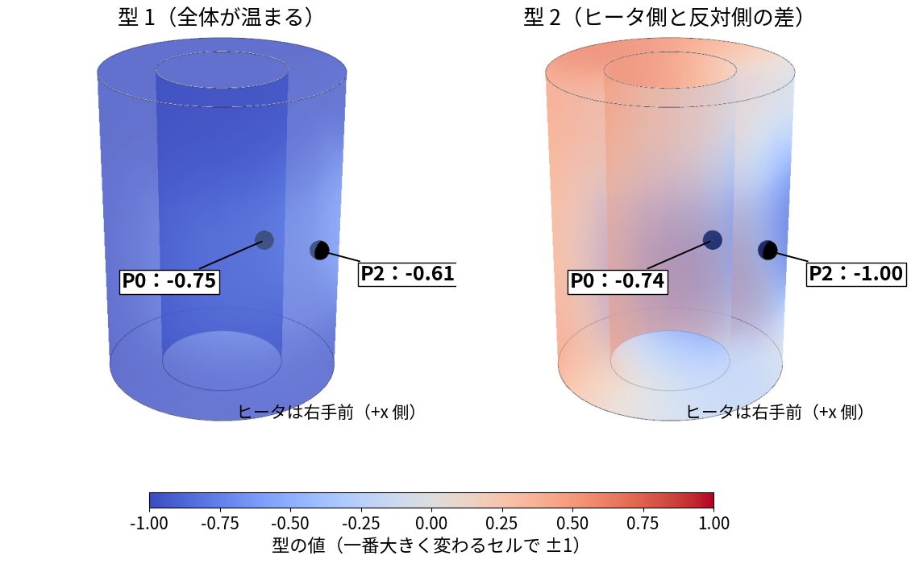
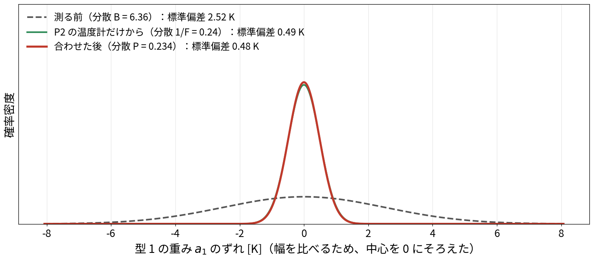
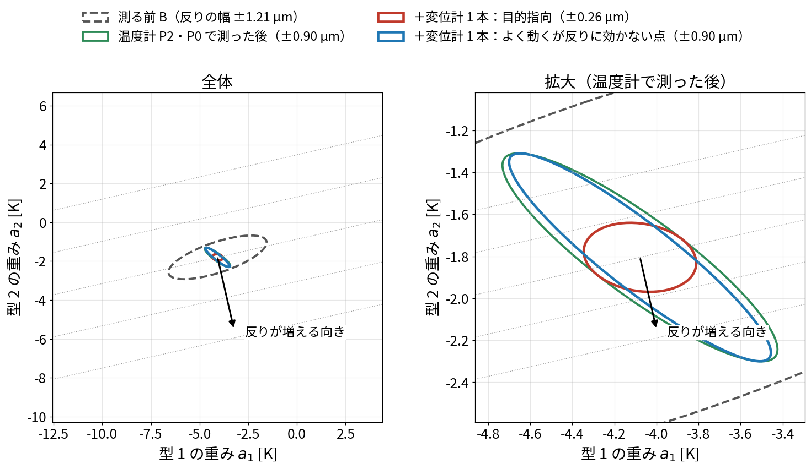
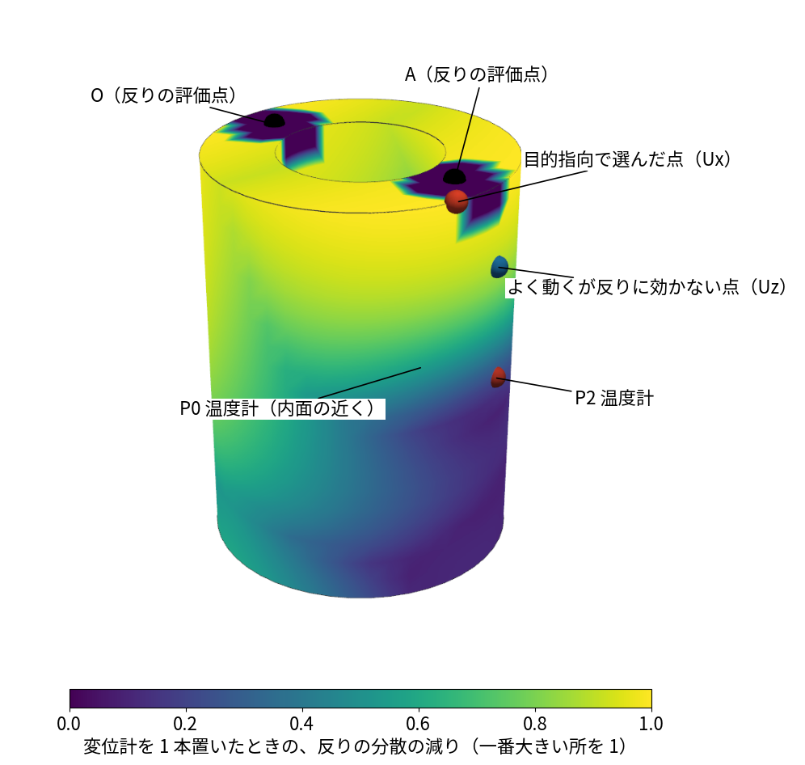
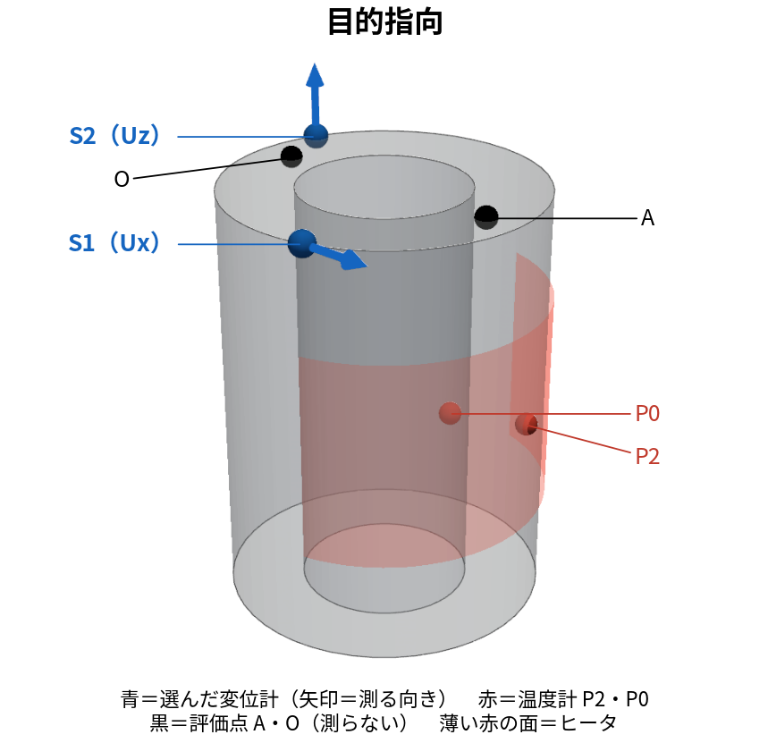
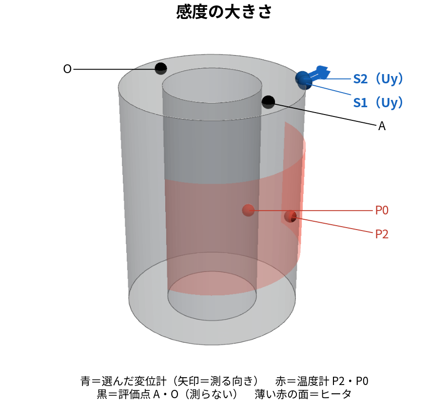
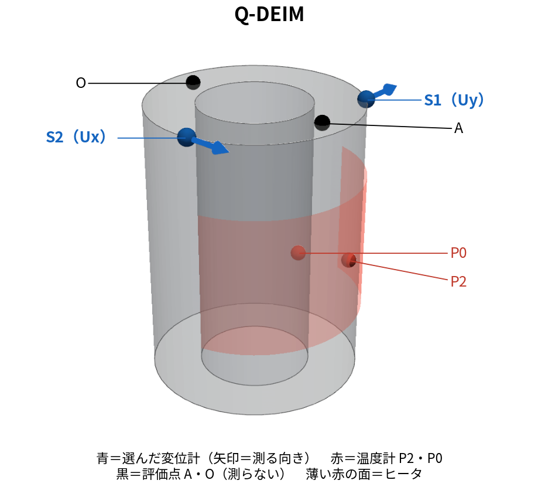
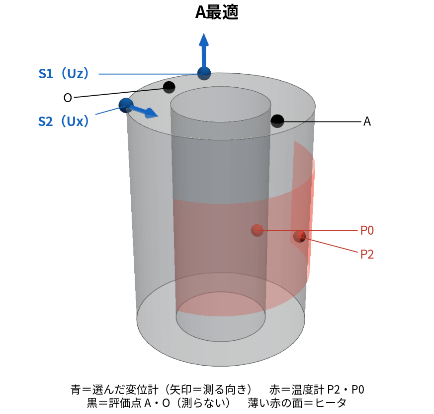
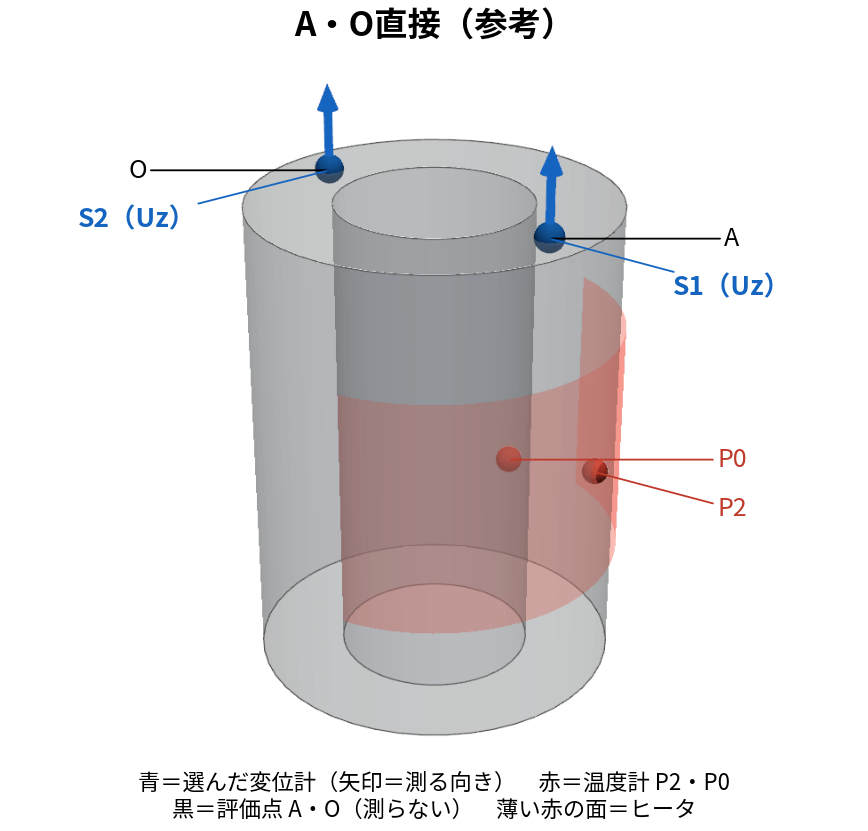

# blog_012：フィッシャー情報で、反りの推定に役立つセンサ位置を選ぶ

**目的は、直接測れない2点A・Oの上下変位差（反り）を、少数の温度計・変位計から正確に推定することです。そこで、どこを測ると反りの推定誤差を小さくできるかを、設置前に計算します。**

**フィッシャー情報とは、一言でいうと「知りたい量の違いが、測定ノイズに埋もれず、どれだけ測定値に表れるか」を示す指標です。** 同じ未知量なら、感度が大きく、ノイズが小さい測定ほど情報が多くなります。未知量が複数なら、それぞれの違いを区別できるかも重要です。

**発表スライドでは、こう伝えます。**

> **反りの推定精度を高めるセンサ位置を、計算で選ぶ。**
>
> 各候補の感度と観測ノイズから情報量を求め、反りの推定誤差が小さくなる位置・測定方向を選ぶ。

温度センサも変位センサも、この計算で選べます。ただし、**本記事の既存結果は、温度計P2・P0を固定し、追加する変位センサ2本を選んだ試験**です。温度2点から順に選ぶ試験は[blog_009](blog_009_two_sensors_nonrep.md)で扱っています。この区別をしたうえで、文字式から選定手順まで説明します。

## 1. 推定したい量と、使う記号

反りを、AとOの上下変位の差として定義します。

```math
d(t)=U_z(A,t)-U_z(O,t).
```

A・Oは観測に使わず、別の場所の温度・変位から反りを推定します。A・Oの正解値は、最後の精度評価にだけ使います。

| 記号 | 意味 |
|---|---|
| $`a_1,a_2`$ | 温度分布を表すPODモードの係数。説明ではまずこの2個を未知量とする |
| $`c`$ | 候補センサ。変位計では「場所と方向」の組合せ |
| $`y_c`$ | センサ測定値から、その場所の基準値を引いた量 |
| $`h_{c,j}`$ | 係数 $`a_j`$ が変わると候補 $`c`$ の値がどれだけ変わるかを表す感度 |
| $`r_c`$ | 候補 $`c`$ の観測ノイズの分散 |
| $`F`$ | 観測から得られるフィッシャー情報。複数未知量なら行列 |
| $`B`$ | 観測前の未知量の共分散 |
| $`P`$ | 観測を使って推定した後の、未知量の推定誤差の共分散 |

$`h_{c,j}`$ はセンサ感度であり、放熱パラメータ $`h_{\mathrm{ROM}}`$ とは別です。共分散行列 $`P`$ と、代表点名P0〜P4も区別します。

## 2. 温度分布からセンサ値の式を作る

### 2-1. 温度分布を2個の係数で表す

PODは温度分布を「平均温度場＋モードの足し合わせ」で近似します。

```math
\underbrace{\mathbf T}_{N\times1}\approx
\underbrace{\overline{\mathbf T}}_{N\times1}
+\underbrace{\begin{bmatrix}
\varphi_1[1]&\varphi_2[1]\\
\varphi_1[2]&\varphi_2[2]\\
\vdots&\vdots\\
\varphi_1[N]&\varphi_2[N]
\end{bmatrix}}_{\Phi:\ N\times2}
\underbrace{\begin{bmatrix}a_1\\a_2\end{bmatrix}}_{\mathbf a:\ 2\times1}.
```

$`N`$ はOpenFOAM固体セル数、$`\overline T[i]`$ はセル $`i`$ の時間平均温度、$`\varphi_j[i]`$ はモード $`j`$ のセル $`i`$ での値です。平均温度場は、全空間に共通する温度1個ではありません。

図では、各モードを「絶対値の最大が1」にそろえ、係数 $`a_1,a_2`$ の単位をKにしています。

2モードにしたのは説明のためです。未知量が2個なら行列が2×2になって手計算でき、不確かさを楕円で描けます。実際の選定（§8）は5モードで計算しています。5モードで同じ計算をすると、一番よい変位計は (−36.2, 9.7, 100.5) mm の Uz になり、2モードの答え（(36.2, −9.7, 100.5) mm の Ux）とは変わります。



*黒い球がP2・P0。モードの符号は係数と組で使います。負の色だけから、その点の温度が下がるとは判断しません。*

### 2-2. 温度計の式

セル $`c`$ に温度計を置くと、そのセルの行を取り出します。

```math
T[c]\approx\overline T[c]+\varphi_1[c]a_1+\varphi_2[c]a_2.
```

測定値を $`T^{\mathrm{obs}}[c]`$、ノイズを $`\varepsilon_c`$ とすると、

```math
y_c\equiv T^{\mathrm{obs}}[c]-\overline T[c]
=\underbrace{\varphi_1[c]}_{h_{c,1}}a_1
+\underbrace{\varphi_2[c]}_{h_{c,2}}a_2+\varepsilon_c.
```

**温度計の感度は、その位置でのPODモードの値です。** 数値を代入せずとも、どの係数がどの重みで測定値に現れるかを読めます。

### 2-3. 変位計の式

線形熱弾性では、同じ係数から変位も復元できます。節点 $`S`$ の方向 $`\alpha`$`（`$`x,y,z`$）の変位は、

```math
U_\alpha(S)\approx\overline u_{S,\alpha}
+D_{S\alpha,1}a_1+D_{S\alpha,2}a_2.
```

$`D_{S\alpha,j}`$ は、モード $`j`$ の温度変化に対する節点 $`S`$・方向 $`\alpha`$ の変位応答です。温度場をFEM節点へ写し、FrontISTRで事前計算した応答から取り出します。

```math
y_c\equiv U_\alpha^{\mathrm{obs}}(S)-\overline u_{S,\alpha}
=\underbrace{D_{S\alpha,1}}_{h_{c,1}}a_1
+\underbrace{D_{S\alpha,2}}_{h_{c,2}}a_2+\varepsilon_c.
```

温度計も変位計も、次の形で統一できます。

```math
\underbrace{y_c}_{1\times1}
=\underbrace{\begin{bmatrix}h_{c,1}&h_{c,2}\end{bmatrix}}_{\mathbf h_c^{\mathsf T}:\ 1\times2}
\underbrace{\begin{bmatrix}a_1\\a_2\end{bmatrix}}_{\mathbf a:\ 2\times1}
+\varepsilon_c,\qquad \varepsilon_c\sim\mathcal N(0,r_c).
```

温度計の感度はK/K、変位計はµm/Kです。ノイズ分散も温度計はK²、変位計はµm²に合わせます。

## 3. 未知量1個からフィッシャー情報を導く

### 3-1. 感度とノイズが推定誤差を決める

この節では、未知量をモード1の係数 $`a_1`$ の1個にし、温度計P2の1本で測るとします（モード2は、この節だけ考えません）。§2-1の式をP2の場所だけ取り出すと、

```math
T_{P2}=\overline T_{P2}+\varphi_1[P2]\,a_1+\varepsilon .
```

- $`a_1`$：未知量。その時刻の温度分布が、時間平均の温度分布からモード1の形にどれだけずれているか
- $`T_{P2}`$`：P2の読み、`$`\overline T_{P2}`$：P2の時間平均温度
- $`\varphi_1[P2]`$`：モード1のP2での値。`$`a_1`$ が1増えたときに、P2の読みが変わる量（感度）
- $`\varepsilon`$：温度計のノイズ。平均0、分散 $`r`$

記号を短くするため、$`y=T_{P2}-\overline T_{P2}`$`、`$`h=\varphi_1[P2]`$`、`$`a=a_1`$ と書くと、

```math
y=ha+\varepsilon .
```

$`h\ne0`$ なら、測定だけからの推定値は $`\widehat a=y/h`$ です。

```math
\widehat a-a=\frac{\varepsilon}{h},\qquad
\operatorname{Var}(\widehat a-a)=\frac{r}{h^2}.
```

**感度 $`|h|`$ が大きく、ノイズ分散 $`r`$ が小さいほど、推定誤差が小さくなります。** この誤差分散の逆数にあたる $`h^2/r`$ が、このモデルのフィッシャー情報です。

### 3-2. 定義から $`h^2/r`$ を計算する

ノイズが平均0・分散 $`r`$ の正規分布なら、ある $`a`$ のもとで測定値 $`y`$ が得られる確率密度は、

```math
p(y\mid a)=\frac1{\sqrt{2\pi r}}
\exp\left[-\frac{(y-ha)^2}{2r}\right].
```

測定値 $`y`$ を固定し、どの $`a`$ がその値を説明しやすいかを見るとき、これを**尤度**と呼びます。対数を取り、$`a`$ に依存しない項を $`C`$ とします。

```math
\log p(y\mid a)=C-\frac{(y-ha)^2}{2r}.
```

$`a`$ で1回、さらにもう1回微分します。

```math
\frac{\partial\log p}{\partial a}=\frac{h(y-ha)}r,\qquad
\frac{\partial^2\log p}{\partial a^2}=-\frac{h^2}r.
```

フィッシャー情報の定義に代入すると、

```math
\boxed{F=-\mathbb E\left[\frac{\partial^2\log p(y\mid a)}{\partial a^2}\right]
=\frac{h^2}{r}}.
```

$`\mathbb E`$ は同じ条件で測定を繰り返したときの平均です。このモデルでは2回微分した値が $`y`$ に依存しないので、平均しても同じです。

$`F`$ が大きいほど、$`a`$ の小さな違いを測定から区別しやすくなります。クラメール・ラオの下限もこの量を使いますが、不偏性などの条件が必要です。「どんな推定でも分散が $`1/F`$ 未満にならない」とは一般化しません。定義と条件は[Lyらの解説論文](https://arxiv.org/html/1705.01064)を参照してください。

### 3-3. 観測前の予測も使うと、精度はどうなるか

観測前に $`a\sim\mathcal N(a_0,B)`$ という予測があるとします。$`a_0`$ は予測平均、$`B`$ は予測分散です。観測後の確率密度は「観測前の確率密度×尤度」に比例します。

```math
p(a\mid y)\propto
\exp\left[-\frac12\left\{\frac{(a-a_0)^2}{B}+\frac{(y-ha)^2}{r}\right\}\right].
```

中括弧を展開すると、

```math
\left(\frac1B+\frac{h^2}r\right)a^2
-2\left(\frac{a_0}B+\frac{hy}r\right)a+\text{$a$に依存しない項}.
```

平方完成して正規分布の形に戻すと、観測後の分散 $`P`$ と平均 $`\widehat a`$ は、

```math
\boxed{P=(B^{-1}+F)^{-1}},\qquad
\widehat a=P\left(\frac{a_0}B+\frac{hy}r\right).
```

**推定平均には測定値 $`y`$ を使います。一方、この線形・正規分布モデルの分散は、$`B,h,r`$ から設置前に計算できます。** 「観測後の分散を先に計算する」とは、この仮定のもとで期待できる推定精度を計算することです。



*既存データによる1未知量の例。幅を比べるため中心をそろえています。推定平均がどこへ移るかを示す図ではありません。*

## 4. 未知量2個なら情報も共分散も行列になる

温度計P2・P0の2本を使うとき、センサ式を縦に並べます。

```math
\underbrace{\begin{bmatrix}y_{P2}\\y_{P0}\end{bmatrix}}_{\mathbf y:\ 2\times1}
=\underbrace{\begin{bmatrix}h_{P2,1}&h_{P2,2}\\h_{P0,1}&h_{P0,2}\end{bmatrix}}_{H:\ 2\times2}
\underbrace{\begin{bmatrix}a_1\\a_2\end{bmatrix}}_{\mathbf a:\ 2\times1}
+\underbrace{\begin{bmatrix}\varepsilon_{P2}\\\varepsilon_{P0}\end{bmatrix}}_{\boldsymbol\varepsilon:\ 2\times1},
\qquad
\underbrace{R}_{2\times2}=\begin{bmatrix}r_{P2}&0\\0&r_{P0}\end{bmatrix}.
```

2本のノイズを独立としています。§3の微分を行列で行うと、

```math
\boxed{\underbrace{F}_{2\times2}=
\underbrace{H^{\mathsf T}}_{2\times2}\underbrace{R^{-1}}_{2\times2}\underbrace{H}_{2\times2}}
=\sum_{c\in\{P2,P0\}}\frac1{r_c}
\begin{bmatrix}h_{c,1}^2&h_{c,1}h_{c,2}\\h_{c,1}h_{c,2}&h_{c,2}^2\end{bmatrix}.
```

対角は各係数への感度の二乗、非対角は2係数の感度の積です。**対角が大きいだけでは、2係数を別々に求められるとは限りません。**

例えば両方のセンサ式が $`a_1+a_2`$ だけに反応する場合、$`a_1`$ を増やして $`a_2`$ を同じだけ減らしても測定値が変わりません。測定だけでは両者を区別できません。

観測前の平均を $`\mathbf a_0`$、共分散を $`B`$ とすると、

```math
\underbrace{P}_{2\times2}=(B^{-1}+F)^{-1}
=\begin{bmatrix}P_{11}&P_{12}\\P_{12}&P_{22}\end{bmatrix},\qquad
\underbrace{\widehat{\mathbf a}}_{2\times1}
=P(B^{-1}\mathbf a_0+H^{\mathsf T}R^{-1}\mathbf y).
```

$`P_{11},P_{22}`$ は各係数の推定誤差分散、$`P_{12}`$ は2係数の誤差の共分散です。2個の誤差の分布は、楕円で示せます。

## 5. なぜ反りの推定誤差を計算するのか

**目的はPOD係数自体ではなく、測れない反りA−Oを正確に推定することです。** 係数のどの誤差が反りに影響するかを、ここで式にします。

### 5-1. A・Oの変位の式を引く

§2の変位復元式をA・Oの上下方向に使います。

```math
\begin{aligned}
U_z(A)&\approx\overline u_{A,z}+D_{Az,1}a_1+D_{Az,2}a_2,\\
U_z(O)&\approx\overline u_{O,z}+D_{Oz,1}a_1+D_{Oz,2}a_2.
\end{aligned}
```

2式を引き、$`\overline d=\overline u_{A,z}-\overline u_{O,z}`$ と置きます。

```math
d\approx\overline d
+\underbrace{(D_{Az,1}-D_{Oz,1})}_{w_1}a_1
+\underbrace{(D_{Az,2}-D_{Oz,2})}_{w_2}a_2
=\overline d+\underbrace{\begin{bmatrix}w_1&w_2\end{bmatrix}}_{\mathbf w^{\mathsf T}:\ 1\times2}\mathbf a.
```

**$`w_j`$ は「係数 $`a_j`$ が変わると反りがどれだけ変わるか」です。** AとOのFrontISTR応答の差から求まります。

### 5-2. 係数の誤差を反りの誤差に換算する

真の係数と推定係数の差を定義します。

```math
\underbrace{\mathbf e}_{2\times1}=\mathbf a-\widehat{\mathbf a}
=\begin{bmatrix}a_1-\widehat a_1\\a_2-\widehat a_2\end{bmatrix}
=\begin{bmatrix}e_1\\e_2\end{bmatrix}.
```

同じ復元モデルで反りを計算すると、

```math
d-\widehat d=w_1e_1+w_2e_2.
```

二乗して平均します。線形・正規分布モデルの条件付き平均を推定値に使うと、条件付き誤差平均は0です。

```math
\begin{aligned}
\operatorname{Var}(d-\widehat d\mid\mathbf y)
&=\mathbb E[(w_1e_1+w_2e_2)^2\mid\mathbf y]\\
&=w_1^2\underbrace{\mathbb E[e_1^2\mid\mathbf y]}_{P_{11}}
+2w_1w_2\underbrace{\mathbb E[e_1e_2\mid\mathbf y]}_{P_{12}}
+w_2^2\underbrace{\mathbb E[e_2^2\mid\mathbf y]}_{P_{22}}.
\end{aligned}
```

この3項を行列でまとめたものが、

```math
\boxed{\sigma_d^2=
\underbrace{\begin{bmatrix}w_1&w_2\end{bmatrix}}_{1\times2}
\underbrace{\begin{bmatrix}P_{11}&P_{12}\\P_{12}&P_{22}\end{bmatrix}}_{2\times2}
\underbrace{\begin{bmatrix}w_1\\w_2\end{bmatrix}}_{2\times1}
=\mathbf w^{\mathsf T}P\mathbf w}.
```

**この式は、係数の推定誤差を反りへ換算した分散です。小さいほど、このモデルで期待する反りの推定精度が高い、という採点に使えます。** 平方根 $`\sigma_d`$ はµm単位の標準偏差です。復元モデル自体の偏りや打ち切り誤差まで、この式だけで保証するものではありません。

## 6. 候補を追加した場合の精度を計算する

### 6-1. 候補の感度を情報行列に足す

**やりたいこと。** 今は温度計P2・P0の2本で測っています。そこに変位計の候補 $`c`$ を1本足したら、測った後の共分散 $`P`$ がどう変わるかを計算します。

**手順1：候補 $`c`$ のセンサ式を書く。** 候補 $`c`$ も、§2の温度計と同じ形の一次式です。

```math
y_c=h_{c,1}\,a_1+h_{c,2}\,a_2+\varepsilon_c,\qquad \operatorname{Var}\varepsilon_c=r_c .
```

$`h_{c,1},h_{c,2}`$ は「$`a_1`$・$`a_2`$ が1増えたときに、その場所・その向きの変位がどれだけ変わるか」（§2-3）、$`r_c`$ は変位計のノイズの分散です。

**手順2：センサ式を1行足す。** §4では、温度計2本の式を縦に並べて $`H`$（2×2）と $`R`$ を作りました。候補 $`c`$ を足すと、行が1本増えます。

```math
H_{+c}=\begin{bmatrix}h_{P2,1}&h_{P2,2}\\h_{P0,1}&h_{P0,2}\\h_{c,1}&h_{c,2}\end{bmatrix},\qquad
R_{+c}=\begin{bmatrix}r_{P2}&0&0\\0&r_{P0}&0\\0&0&r_c\end{bmatrix}.
```

**手順3：フィッシャー情報を計算し直す。** §4の式 $`F=H^{\mathsf T}R^{-1}H`$ に入れると、$`R`$ が対角なので、センサ1本ごとの項の足し算に分かれます。

```math
F_{+c}=H_{+c}^{\mathsf T}R_{+c}^{-1}H_{+c}
=\underbrace{\frac{\mathbf h_{P2}\mathbf h_{P2}^{\mathsf T}}{r_{P2}}+\frac{\mathbf h_{P0}\mathbf h_{P0}^{\mathsf T}}{r_{P0}}}_{\text{今の }F}
+\underbrace{\frac1{r_c}\begin{bmatrix}h_{c,1}^2&h_{c,1}h_{c,2}\\h_{c,1}h_{c,2}&h_{c,2}^2\end{bmatrix}}_{\text{候補 }c\text{ の分 }\mathbf h_c\mathbf h_c^{\mathsf T}/r_c}.
```

つまり、**センサを1本足すと、フィッシャー情報には、そのセンサの「感度×感度÷ノイズ」の行列が1つ足されるだけ**です。

**手順4：測った後の共分散にする。** §4と同じく、測る前の情報 $`B^{-1}`$ と足して逆行列を取ります。

```math
P_{+c}=\bigl(B^{-1}+F_{+c}\bigr)^{-1}=\Bigl(\underbrace{B^{-1}+F}_{=P^{-1}}+\frac{\mathbf h_c\mathbf h_c^{\mathsf T}}{r_c}\Bigr)^{-1}.
```

**手順5：逆行列を計算し直さずに求める。** かっこの中の $`B^{-1}+F`$ は、今の共分散の逆行列 $`P^{-1}`$ です。そこに1本分の行列を足したときの逆行列は、次の式で求まります（シャーマン・モリソンの式）。

```math
P_{+c}=P-\frac{P\mathbf h_c\mathbf h_c^{\mathsf T}P}{r_c+\mathbf h_c^{\mathsf T}P\mathbf h_c}.
```

未知量が1個（§3）なら、この式は通分で確かめられます。$`P`$、$`h`$、$`r`$ がただの数のとき、

```math
\Bigl(\frac1P+\frac{h^2}{r}\Bigr)^{-1}=\frac{P\,r}{r+h^2P}=P-\frac{P^2h^2}{r+h^2P}.
```

右端が上の式の1個版です。未知量が2個でも、同じ形になります。

文字で展開して、実際に入れるものを確かめます。

**$`P_{11},P_{12},P_{22}`$ はどこで決まるか。** 候補 $`c`$ を足す**前**の共分散、つまり温度計P2・P0だけで測った後の $`P=(B^{-1}+F)^{-1}`$（§4）の成分です。かっこの中を $`A=B^{-1}+F`$ と書くと、2×2の逆行列なので

```math
\begin{bmatrix}P_{11}&P_{12}\\P_{12}&P_{22}\end{bmatrix}
=\frac1{A_{11}A_{22}-A_{12}^2}\begin{bmatrix}A_{22}&-A_{12}\\-A_{12}&A_{11}\end{bmatrix}.
```

- $`B`$：測る前の共分散。初期温度・発熱・放熱を変えた4,000本のROMを、評価する時刻（この例は150秒）まで進め、その散らばりから決める
- $`F`$：温度計P2・P0の感度 $`\mathbf h_{P2},\mathbf h_{P0}`$ とノイズ $`r`$ から決める（§4）

どちらも**センサの実測値を使わない**ので、$`P_{11},P_{12},P_{22}`$ はセンサを置く前に決まります。候補 $`c`$ を何本比べても、同じ $`P`$ を使います（候補ごとに変わるのは $`h_{c,1},h_{c,2}`$ だけ）。本番（§8）では、30〜300秒の10時刻それぞれで $`B_k`$ を作るので、$`P`$ も時刻ごとに10個あります。

```math
\underbrace{P\mathbf h_c}_{2\times1}
=\begin{bmatrix}P_{11}h_{c,1}+P_{12}h_{c,2}\\
P_{12}h_{c,1}+P_{22}h_{c,2}\end{bmatrix}
\equiv\begin{bmatrix}v_1\\v_2\end{bmatrix},
```

```math
s_c=r_c+P_{11}h_{c,1}^2+2P_{12}h_{c,1}h_{c,2}+P_{22}h_{c,2}^2,
```

```math
P_{+c}=\begin{bmatrix}
P_{11}-v_1^2/s_c&P_{12}-v_1v_2/s_c\\
P_{12}-v_1v_2/s_c&P_{22}-v_2^2/s_c
\end{bmatrix}.
```

**候補点と測定方向を決めると $`h_{c,1},h_{c,2}`$ が決まります。それを現在の $`P`$ と上の式に入れると、候補追加後の共分散が求まります。** 仮の実測値を作る必要はありません。

### 6-2. 反りの分散がどれだけ減るか

§5の式を、追加前後に使います。

```math
\begin{aligned}
\Delta_c
&=\mathbf w^{\mathsf T}P\mathbf w-\mathbf w^{\mathsf T}P_{+c}\mathbf w\\
&=\frac{(\mathbf w^{\mathsf T}P\mathbf h_c)^2}
{r_c+\mathbf h_c^{\mathsf T}P\mathbf h_c}
=\frac{(w_1v_1+w_2v_2)^2}{s_c}.
\end{aligned}
```

$`\Delta_c`$ は追加により減る反りの分散です。1時刻・1本なら、これが大きい候補を選びます。

分子に出る $`\mathbf w^{\mathsf T}P\mathbf h_c`$ は、**現在残っている反りの誤差と、その候補の予測誤差の共分散**です。分母は候補の予測誤差分散と観測ノイズ分散の和です。

感度が大きくても、反りの誤差と関係が小さければ分子が小さく、改善は小さくなります。「感度が大きい点」と「反りの推定に有効な点」が異なる理由です。分母が小さいことだけで改善の大小は判断できません。



*点線は観測前、緑は温度2点を使う場合。赤は反りを目的に選んだ変位1成分を追加した場合、青は比較候補のUzを追加した場合。2次元のこの楕円内が68%の確率という意味ではありません。*

#### まとめ：選び方の方針（発表用）

> **フィッシャー情報を足して、反りの分散が一番小さくなる候補を選ぶ。**

```math
\underbrace{\mathbf h_c}_{\text{候補の感度}}
\ \longrightarrow\
\underbrace{F+\frac{\mathbf h_c\mathbf h_c^{\mathsf T}}{r_c}}_{\text{フィッシャー情報を足す}}
\ \longrightarrow\
\underbrace{P_{+c}=\Bigl(B^{-1}+F+\frac{\mathbf h_c\mathbf h_c^{\mathsf T}}{r_c}\Bigr)^{-1}}_{\text{測った後の共分散}}
\ \longrightarrow\
\underbrace{\mathbf w^{\mathsf T}P_{+c}\,\mathbf w}_{\text{反りの分散}}\ \text{が最小の }c
```

1. 候補ごとに、そのセンサの情報（感度×感度÷ノイズ）をフィッシャー情報に足す。
2. 測る前の情報 $`B^{-1}`$ と合わせて逆行列を取り、測った後の共分散 $`P_{+c}`$ にする。
3. 知りたい反りの分散 $`\mathbf w^{\mathsf T}P_{+c}\mathbf w`$ が一番小さい候補を選ぶ（＝ $`\Delta_c`$ が一番大きい候補）。

どれも実測値を使わないので、**センサを置く前に計算だけで選べます**。次の図は、この3を表面の全候補で計算した結果です。

### 6-3. 採点結果を空間分布にする

1. 温度計P2・P0を使う場合の $`P`$ を計算する。
2. 各節点 $`S`$ について、Ux・Uy・Uzそれぞれの感度を取り出す。
3. 方向ごとに $`\Delta_{S,x},\Delta_{S,y},\Delta_{S,z}`$ を計算する。
4. 図では節点ごとに3方向の最大を色で示す。

```math
\Delta_{\max}(S)=\max\{\Delta_{S,x},\Delta_{S,y},\Delta_{S,z}\},
\qquad C(S)=\frac{\Delta_{\max}(S)}{\max_{S'}\Delta_{\max}(S')}.
```



*上の $`C(S)`$ の分布。A・Oから12 mm以内は候補から除外し、描画上は0としています。除外部の0は情報量を評価した結果ではありません。*

**色だけでは測定方向は分かりません。** 同じ場所でもUxとUzで感度が異なります。図の青い球は「Uzでは改善が小さい」比較候補ですが、色はその場所の最良方向の値です。選ぶときは、最大となる方向も保存します。

## 7. 温度センサの位置も、この計算で選べるか

**選べます。温度候補と変位候補の違いは、感度とノイズ分散です。**

5点ROMでは、POD平均温度場からの差を使い、

```math
\underbrace{\mathbf x}_{5\times1}=\begin{bmatrix}
T[P0]-\overline T[P0]\\T[P1]-\overline T[P1]\\T[P2]-\overline T[P2]\\
T[P3]-\overline T[P3]\\T[P4]-\overline T[P4]
\end{bmatrix}
```

を未知量にします。代表点でのモード行列を $`\Phi_P`$ とすると、5モードのgappy-POD復元と変位復元は、

```math
\underbrace{\mathbf T-\overline{\mathbf T}}_{N\times1}
\approx\underbrace{\Phi\Phi_P^+}_{G:\ N\times5}\mathbf x,
\qquad
\underbrace{\mathbf u-\overline{\mathbf u}}_{3N_F\times1}
\approx\underbrace{D\Phi_P^+}_{L_u:\ 3N_F\times5}\mathbf x.
```

$`N_F`$ はFEM節点数、$`+`$`は擬似逆行列です。`$`D`$ はFEM節点への温度写像とFrontISTR応答を含みます。

候補の感度は、温度なら $`G`$ の該当セルの行、変位なら $`L_u`$ の該当節点・方向の行です。

```math
\underbrace{\mathbf h_c^{\mathsf T}}_{1\times5}
=\begin{cases}
\begin{bmatrix}g_{c,0}&g_{c,1}&g_{c,2}&g_{c,3}&g_{c,4}\end{bmatrix}&\text{温度候補},\\
\begin{bmatrix}\ell_{c,0}&\ell_{c,1}&\ell_{c,2}&\ell_{c,3}&\ell_{c,4}\end{bmatrix}&\text{変位候補}.
\end{cases}
```

反りの重みは $`L_u`$ のA・Uzの行からO・Uzの行を引いて求めます。§4〜6を2次元から5次元へ広げ、同じ採点をします。

**温度2点を選んでから変位2点を選ぶなら、手順は次のとおりです。**

1. 観測前共分散 $`B`$ を用意し、$`P=B`$ から始める。
2. 全温度候補の感度・ノイズから、候補追加後の反りの標準偏差を採点する。
3. 最良の温度候補を選んで $`P`$ を更新し、再採点して2本目を選ぶ。
4. その温度2点を固定し、変位の場所・方向を同じ方法で採点する。
5. 変位1本目を加えて再採点し、2本目を選ぶ。

候補を加えるたび、情報で書けば $`F\leftarrow F+\mathbf h_c\mathbf h_c^{\mathsf T}/r_c`$、共分散で書けば§6の更新です。**フィッシャー情報による計算と既存の共分散更新は、この線形モデルでは同じ観測情報を扱います。** 4,000ケースは、その前提になる $`B`$ を作るために使っています。フィッシャー情報と呼び替えるだけで、事前共分散が不要になるわけではありません。

この手順は1本ずつ選ぶ貪欲法で、全組合せの最良配置を保証しません。次節は温度を固定した既存比較であり、上記手順の新たな計算結果ではありません。

## 8. 実際のプログラムで行った選定と精度比較

この章では、本番のプログラム（`run/placement_method_comparison.py`）で行った選定と、その結果を説明します。

本番のプログラムは、測った後の共分散 $`P`$ を、§6の式 $`P=(B^{-1}+F)^{-1}`$ ではなく、カルマンフィルタと同じ形の次の式で計算しています。

```math
P=B-BH^{\mathsf T}\left(HBH^{\mathsf T}+R\right)^{-1}HB .
```

$`H`$ は選んだセンサの感度 $`\mathbf h_c^{\mathsf T}`$ を縦に並べた行列、$`R`$ はノイズの分散を並べた対角行列です。この式と $`P=(B^{-1}+F)^{-1}`$（ただし $`F=H^{\mathsf T}R^{-1}H`$）は、式変形で同じものになります（逆行列の補題）。どちらで計算しても同じ $`P`$ が出るので、**本番の選定も、フィッシャー情報を足して $`P`$ を小さくする選び方そのもの**です。

#### 解説：2つの式が同じになることを、未知量1個・センサ1本で確かめる

§3の例（未知量 $`a`$ が1個、センサ1本、感度 $`h`$、ノイズの分散 $`r`$、測る前の分散 $`B`$）にすると、行列がすべてただの数になります。カルマンフィルタの形の式は

```math
P=B-\frac{B\,h\cdot h\,B}{h\,B\,h+r}=B-\frac{h^2B^2}{h^2B+r}.
```

通分すると、

```math
P=\frac{B\,(h^2B+r)-h^2B^2}{h^2B+r}=\frac{B\,r}{h^2B+r}.
```

分子と分母を $`B\,r`$ で割ると、

```math
P=\frac{1}{\dfrac{h^2B+r}{B\,r}}=\frac{1}{\dfrac1B+\dfrac{h^2}{r}}=\Bigl(B^{-1}+\underbrace{\frac{h^2}{r}}_{F}\Bigr)^{-1}.
```

最後の形は、§3-3の $`P=(B^{-1}+F)^{-1}`$ そのものです。分母の $`h^2/r`$ がフィッシャー情報 $`F`$ です。

未知量やセンサが複数のときは、数の割り算が逆行列になるだけで、同じ式変形が成り立ちます（逆行列の補題、ウッドベリーの公式）。

- フィッシャー情報の形 $`(B^{-1}+F)^{-1}`$：「測る前の情報 $`B^{-1}`$ と、センサの情報 $`F`$ を足して、逆数にする」と読める
- カルマンフィルタの形 $`B-BH^{\mathsf T}(HBH^{\mathsf T}+R)^{-1}HB`$：「測る前の分散 $`B`$ から、センサで分かった分を引く」と読める

同じものを、足し算で見るか引き算で見るかの違いです。

### 8-1. 説明例と5点ROMの試験を区別する

| 条件 | §2〜6の図の説明例 | 既存の配置法比較 |
|---|---|---|
| 未知量 | POD係数2個 | 代表5点温度 |
| 固定する温度計 | P2・P0 | P2・P0 |
| 事前共分散 | 150秒の $`B`$ | 30〜300秒の各時刻の $`B_k`$ |
| 選ぶ変位計 | 1本 | 2本を1本ずつ |
| 採点 | 1時刻の分散低減量 | 各時刻の反りの標準偏差の平均 |

初期5点温度・発熱倍率・放熱条件を変えた4,000本のROMを進め、時刻ごとの5点温度の標本共分散 $`B_k`$ を作ります。候補選定の事前計算であり、EnKFの60メンバーとは別です。

選んだセンサ集合を $`S`$ として、各時刻を独立に評価します。

```math
\underbrace{F_S}_{5\times5}=\sum_{c\in S}\frac{\mathbf h_c\mathbf h_c^{\mathsf T}}{r_c},
\qquad
\underbrace{P_{S,k}}_{5\times5}=(B_k^{-1}+F_S)^{-1},
```

```math
\boxed{J(S)=\frac1{10}\sum_{k=1}^{10}
\sqrt{\mathbf w^{\mathsf T}P_{S,k}\mathbf w}},\qquad t_k=30k\ \mathrm{s}.
```

候補を加えた集合 $`S\cup\{c\}`$ の $`J`$ が小さいものを選びます。**異なる時刻の情報行列をそのまま足している計算ではありません。** 時刻ごとの温度状態は異なるためです。全時刻で共通するQなどの情報行列なら、そのパラメータから各時刻の観測値への感度を別に用意する必要があります。

採点後、60メンバー・30秒ごとに更新するEnKFで実際に試し、観測に使わないA・Oの反りを評価しています。

### 8-2. 6つの選び方を式で書く

**共通の設定。** 未知量は代表5点の温度のずれ $`\delta\mathbf T_P`$（5×1）です。変位計の候補 $`c`$ は「節点 $`n`$ と向き $`j\in\{x,y,z\}`$」の組で、A・Oから12 mm以内を除いた14,754通りの集合を $`\mathcal C`$ とします。候補 $`c`$ の感度は、温度から変位への換算行列 $`W=D\,\Phi_P^{-1}`$ の1行です。

```math
y_c=\mathbf h_c^{\mathsf T}\,\delta\mathbf T_P+\varepsilon_c,\qquad
\mathbf h_c^{\mathsf T}=W[c,:],\qquad \operatorname{Var}\varepsilon_c=r_U .
```

温度計P2・P0は全方式で固定し、その2行を $`H_T`$（2×5）とします。変位計の集合を $`S`$ とすると、時刻 $`t_k`$ での観測後の共分散は

```math
P_{S,k}=\Bigl(\underbrace{B_k^{-1}}_{\text{測る前の情報}}
+\underbrace{\frac{H_T^{\mathsf T}H_T}{r_T}+\sum_{c\in S}\frac{\mathbf h_c\mathbf h_c^{\mathsf T}}{r_U}}_{\text{フィッシャー情報 }F_S\ (5\times5)}\Bigr)^{-1},\qquad k=1,\dots,10\ (t_k=30k\ \mathrm s).
```

かっこの中の後ろ2項が**フィッシャー情報行列** $`F_S`$ です。温度計P2・P0の分 $`H_T^{\mathsf T}H_T/r_T`$ と、変位計1本ごとの分 $`\mathbf h_c\mathbf h_c^{\mathsf T}/r_U`$ を足したものです（§3の $`h^2/r`$ を、未知量5個に広げたもの）。$`B_k^{-1}`$ は測る前の予測の情報で、$`F_S`$ と足して逆行列を取ると、測った後の共分散 $`P_{S,k}`$ になります。下の表の「目的指向・A最適・D最適」は、どれもこの $`P_{S,k}`$ から採点するので、**フィッシャー情報を使って選んでいます**。「感度の大きさ」と「Q-DEIM」は $`F_S`$ も $`P`$ も使いません。

**選び方。** どの方式も変位計を2本選びます。候補 $`c`$ を1本足したときのフィッシャー情報と、測った後の共分散は

```math
\underbrace{F_{S\cup\{c\}}}_{\text{足した後のフィッシャー情報}}
=\underbrace{F_S}_{\text{すでにある分}}+\underbrace{\frac{\mathbf h_c\mathbf h_c^{\mathsf T}}{r_U}}_{\text{候補 }c\text{ の分}},
\qquad
P_{S\cup\{c\},k}=\bigl(B_k^{-1}+F_{S\cup\{c\}}\bigr)^{-1}.
```

目的指向・A最適・D最適は、この $`P_{S\cup\{c\},k}`$ を採点して $`c`$ を選びます。つまり**フィッシャー情報 $`F`$ を足して、測った後の不確かさ $`P`$ がどれだけ小さくなるかで選ぶ**方式です。違いは $`P`$ の何を小さくするかだけです。1本目を選んだら $`S=\{c_1\}`$ として、同じ式で2本目を選びます（貪欲法）。

**A最適・D最適という名前について。** どちらも、どこで何を測るかを統計的に決める分野（**最適実験計画**）の標準の用語です（[Kiefer 1959](https://doi.org/10.1111/j.2517-6161.1959.tb00338.x) が名付け、教科書は [Uciński 2005](https://www.routledge.com/products/9780367393984)）。測った後の共分散 $`P`$（＝ $`(B^{-1}+F)^{-1}`$）の「どの大きさ」を小さくするかで名前が違い、頭文字は次の意味です。

- **A最適**（A：average、平均）：$`\operatorname{tr}P`$（対角の和）を小さくする。未知量それぞれの分散を、平均的に小さくする。
- **D最適**（D：determinant、行列式）：$`\det P`$ を小さくする。不確かさの楕円（楕円体）の体積を小さくする。
- ほかに **E最適**（E：eigenvalue、固有値）もあり、$`P`$ の最大固有値（一番分からない向きの分散）を小さくする。本研究では使っていません。

「目的指向」（知りたい量 $`\mathbf w^{\mathsf T}\delta\mathbf T_P`$ の分散 $`\mathbf w^{\mathsf T}P\mathbf w`$ を小さくする）も、同じ分野で使われる考え方です（例：[Wu, Chen, Ghattas 2021](https://arxiv.org/abs/2102.06627)）。

| 選び方 | フィッシャー情報 $`F`$ | 1本ずつ選ぶ式 | 何を小さくするか |
|---|---|---|---|
| **目的指向** | 使う | $`c=\arg\min_{c}\ \frac1{10}\sum_k\sqrt{\mathbf w^{\mathsf T}P_{S\cup\{c\},k}\,\mathbf w}`$ | 反り $`d=\mathbf w^{\mathsf T}\delta\mathbf T_P`$ の標準偏差 |
| A最適 | 使う | $`c=\arg\min_{c}\ \frac1{10}\sum_k\operatorname{tr}P_{S\cup\{c\},k}`$ | 5点の温度の分散の和 |
| D最適 | 使う | $`c=\arg\min_{c}\ \frac1{10}\sum_k\log\det P_{S\cup\{c\},k}`$ | 5点の温度の不確かさの体積 |
| 感度の大きさ | 使わない | $`\lVert\mathbf h_c\rVert_2`$ が大きい順に上位2つ | ―（感度の長さだけを見る） |
| Q-DEIM | 使わない | 行列 $`[\,\mathbf h_c\,]_{c\in\mathcal C}`$（5×14,754）を列の入れ替え付きQR分解し、最初の2列 | ―（感度の向きの違いだけを見る） |
| A・O直接（参考） | 使わない | $`S=\{(A,z),(O,z)\}`$（候補の外。反りそのものを測る） | ― |

#### 解説：それぞれの選び方で、フィッシャー情報をどこに使っているか

3つとも、候補 $`c`$ ごとに次の①②を計算し、③の採点だけが違います。

① **フィッシャー情報を足す**（ここで使う）

```math
F_{S\cup\{c\}}=\underbrace{\frac{H_T^{\mathsf T}H_T}{r_T}}_{\text{温度計P2・P0}}+\underbrace{\sum_{c'\in S}\frac{\mathbf h_{c'}\mathbf h_{c'}^{\mathsf T}}{r_U}}_{\text{選んだ変位計}}+\underbrace{\frac{\mathbf h_c\mathbf h_c^{\mathsf T}}{r_U}}_{\text{候補 }c}
```

② **測った後の共分散にする**

```math
P_{S\cup\{c\},k}=\bigl(B_k^{-1}+F_{S\cup\{c\}}\bigr)^{-1}\qquad(k=1,\dots,10)
```

③ **採点して、一番よい $`c`$ を選ぶ**

**目的指向はこれ。** 知りたい反り $`d=\mathbf w^{\mathsf T}\delta\mathbf T_P`$ の標準偏差を小さくします。

```math
c=\arg\min_{c}\ \frac1{10}\sum_{k}\sqrt{\mathbf w^{\mathsf T}\Bigl(B_k^{-1}+\underbrace{F_{S\cup\{c\}}}_{\text{フィッシャー情報}}\Bigr)^{-1}\mathbf w}
```

**A最適はこれ。** 5点の温度の分散の和（$`P`$ の対角の和）を小さくします。

```math
c=\arg\min_{c}\ \frac1{10}\sum_{k}\operatorname{tr}\Bigl(B_k^{-1}+\underbrace{F_{S\cup\{c\}}}_{\text{フィッシャー情報}}\Bigr)^{-1}
```

**D最適はこれ。** 5点の温度の不確かさの体積（$`P`$ の行列式）を小さくします。

```math
c=\arg\min_{c}\ \frac1{10}\sum_{k}\log\det\Bigl(B_k^{-1}+\underbrace{F_{S\cup\{c\}}}_{\text{フィッシャー情報}}\Bigr)^{-1}
```

3つとも、フィッシャー情報 $`F`$ は②のかっこの中で使っています。違うのは、できた $`P`$ の「どこを見るか」だけです（目的指向は $`\mathbf w`$ の向き、A最適は対角、D最適は行列式）。

**感度の大きさはこれ。** フィッシャー情報も $`P`$ も使わず、感度の長さだけで選びます。

```math
c_1,\ c_2:\ \lVert\mathbf h_c\rVert_2\ \text{が大きい順に上位2つ}
```

**Q-DEIMはこれ。** フィッシャー情報も $`P`$ も使わず、感度を並べた行列 $`[\,\mathbf h_c\,]_{c\in\mathcal C}`$（5×14,754）を列の入れ替え付きQR分解し、最初に選ばれた2列にします（感度の向きがなるべく違う2つ）。

**比べ方。** 選んだ $`S`$ ごとに、EnKF（60メンバー、30秒ごと）をまわして反りを推定し、正解（OpenFOAM＋FrontISTR）との差 $`E_d`$（下の式）を比べました。「予測した反りの不確かさ」は、目的指向の採点値 $`\frac1{10}\sum_k\sqrt{\mathbf w^{\mathsf T}P_{S,k}\mathbf w}`$ を、各方式の $`S`$ について計算したものです。

**選ばれた位置。** 図は円筒を斜め上から見たもので、青い球が選んだ変位計、青い矢印が測る向きです（赤い球は温度計P2・P0、黒い球は評価点A・O、薄い赤の面はヒータ。作図：`run/make_blog012_position_oblique.py`）。

| 選び方 | $`c_1`$（位置 mm、向き） | $`c_2`$（位置 mm、向き） |
|---|---|---|
| **目的指向** | (9.7, −36.2, 100.5)、Ux | (−34.6, 14.4, 100.5)、Uz |
| 感度の大きさ | (26.5, 26.5, 100.5)、Uy | (22.8, 29.8, 100.5)、Uy |
| Q-DEIM | (26.5, 26.5, 100.5)、Uy | (4.9, −37.2, 100.5)、Ux |
| A最適 | (−29.8, 22.8, 100.5)、Uz | (−26.5, −26.5, 100.5)、Ux |
| D最適 | (−36.2, 9.7, 100.5)、Uz | (−18.8, −32.5, 100.5)、Uy |
| A・O直接（参考） | (28.7, 0.0, 100.5)、Uz | (−28.7, 0.0, 100.5)、Uz |

*目的指向*



*感度の大きさ*



*Q-DEIM*



*A最適*



*D最適*


*A・O直接（参考）*



**結果。**

| 選び方 | 予測した反りの不確かさ [µm] | 実際の反りの誤差 15 W [µm] | 25 W | 間欠加熱 |
|---|---:|---:|---:|---:|
| 変位なし（温度 2 点のみ） | 1.19 | 0.775 | 1.417 | 0.635 |
| 感度の大きさ | 1.01 | 0.569 | 1.079 | 0.453 |
| Q-DEIM | 0.32 | 0.134 | 0.165 | 0.105 |
| D 最適 | 0.35 | 0.108 | 0.109 | 0.095 |
| A 最適 | 0.27 | 0.089 | 0.097 | 0.078 |
| **目的指向** | **0.26** | **0.076** | **0.083** | **0.072** |

- **感度の大きさ**で選ぶと、2 本が 5 mm しか離れず、感度 $`\mathbf h_{c_1}`$ と $`\mathbf h_{c_2}`$ がほぼ同じ向きで、同じ情報を 2 回測っていました。6-2 の「よく動くが反りに効かない点」と同じ理由で、効きません。
- 目的指向が 3 条件とも一番小さくなりました。A最適に対する誤差低減率は、この表では約8〜14 %です。全組合せの最適性を証明した結果ではありません。
- 予測した不確かさ（$`P`$ から計算、データ同化はしていない）の順番と、実際の誤差の順番は、おおむねそろっています。

---


表の実際の誤差はRMSEではなく、30〜300秒の10時刻の絶対誤差を平均し、さらに5個の乱数seedで平均した値です。

```math
E_d=\frac1{5}\sum_{s=1}^{5}\frac1{10}\sum_{k=1}^{10}
|\widehat d_{s,k}-d_k^*|.
```

$`\widehat d_{s,k}`$ はデータ同化後の推定反り、$`d_k^*`$ はOpenFOAM・FrontISTRの正解反りです。予測標準偏差と実際の絶対誤差は異なる量なので、数値が一致する必要はありません。

## 9. 「何をよく推定したいか」で選定基準が変わる

| 基準 | 小さくするもの | 目的 |
|---|---|---|
| A最適 | $`\operatorname{tr}P`$：分散の和 | 未知量全体の平均的な精度 |
| D最適 | $`\log\det P`$ | 誤差楕円の体積 |
| E最適 | $`\lambda_{\max}(P)`$。事前情報込みなら $`B^{-1}+F`$ の最小固有値の最大化と等価 | 最も推定しにくい組合せの精度 |
| 目的指向 | $`\mathbf w^{\mathsf T}P\mathbf w`$ | 指定した出力、ここでは反りの精度 |

E最適は今回未実施です。単位の異なる未知量を混ぜる場合、A最適・E最適などはその尺度にも依存するため、規格化を定めて比べます。

**フィッシャー情報だけから、何に対しても最適な1か所が自動的に決まるわけではありません。** 推定対象、事前共分散、ノイズ、時刻、候補の制約を決めたうえで基準を選びます。

## 10. 今回の結果を発表でどう伝えるか

> **反りの推定精度を高める変位センサの位置・方向を、感度と観測ノイズから選定した。温度2点に選定した変位2点を加えることで、観測していない反りの推定精度が向上した。**

温度位置も選ぶ理論は§7のとおりです。一方、掲載した比較は温度P2・P0固定です。温度2点から選定した結果を発表する場合は、blog_009の該当試験を使います。

採点では線形モデル・正規分布を仮定します。4,000本から作る事前分布は厳密な正規分布とは限らず、共分散による近似評価です。実際のEnKFはQ・放熱条件も推定し、モデル誤差もあるため、採点だけで実際の誤差を保証せず、配置後の数値試験で確かめています。実機での確認は別途必要です。

## 使ったプログラムと数式の対応

| ファイル | 関数・変数 | 対応 |
|---|---|---|
| `run/make_blog012_fisher_figs.py` | `Us`, `Ds`, `hT`, `w` | 2モードの温度・変位感度、反りへの重み |
| 同上 | `post()` | $`F=\sum_c\mathbf h_c\mathbf h_c^{\mathsf T}/r_c`$`、`$`P=(B^{-1}+F)^{-1}`$ |
| 同上 | `goal` | 分散低減量 $`\Delta_c`$ |
| `run/placement_method_comparison.py` | `post()`, `scores()`, `greedy()` | 5次元の採点、変位2本の選定 |
| 同上 | `run()` | EnKFで反りの平均絶対誤差を比較 |
| `run/select_nonrep_temp_disp.py` | `add_row()`, `score()` | 共分散更新と採点。温度・変位候補を扱う別試験 |
| `run/make_blog012_position_figs.py` | `main()` | 保存済みの配置から読みやすい位置図を生成 |

5次元の候補追加は、既存コードでは次のように実装されています。

```python
def add_row(P, h, r):
    Ph = P @ h
    return P - np.outer(Ph, Ph) / (h @ Ph + r)
```

`Ph` は5×1、戻り値は5×5です。§6で文字展開した式と同じです。

基準フォルダは `sample/106_0_pod_selected_rom/`。既存結果は `results/blog012_fisher.json` と `results/placement_method_comparison.json` です。今回の修正は解説と表示であり、センサ選定・EnKFの解析条件や結果は変更していません。
