# blog_012：はじめに ― この研究の立ち位置（何が問題で、何が課題で、何に取り組んだか）

更新日：2026-10-28

オープンCAE学会（B-16、2026-11-12）の発表の「はじめに」と「目的」のスライドに載せる情報を、1 か所に整理した記事です。
最初の表（§1）で全体を見渡せるようにし、§2 以降でその根拠を順に説明します。
発表のページとの対応は、§2 が 1 ページ目「はじめに」、§3 が 2 ページ目「目的」、§4 が 3 ページ目「全体の流れ」、§5 が 4 ページ目「データ同化とは」、§6 が 5 ページ目「データ同化による課題」、§7 が 6 ページ目「低次元モデル化（ROM）」、§8 が 7 ページ目「ROM の適用範囲」、§9 が 8 ページ目「データ同化の流れ」、§10 が 9 ページ目「データ同化で試したこと」、§11 が 10 ページ目「未観測点の温度」、§12 が 11 ページ目「センサの置き場所：Fisher 情報行列」です。

> **この記事の対象**：本研究は、工作機械を想定した**中空円筒の数値実験**です。真値はすべて計算（OpenFOAM＋FrontISTR、または ROM）で、実機では確かめていません。

---

## 1. 表で見る立ち位置

| | 中身 |
|---|---|
| **問題**（何に困っているか） | 工作機械の加工誤差の大きな部分は、熱による変形（熱変位）である。補正するには、熱変形を正しく予測する必要がある |
| **課題**（なぜ難しいか） | ① 解析モデルの条件（発熱量、熱伝達率、初期温度）が分からず、解析だけでは合わない<br>② 温度の傾向が合っても、変形が合うとは限らない<br>③ 本当に知りたい工具先端の変位は、加工中に測れない<br>④ 詳しい解析を測定のたびに何十回も回すのは重い |
| **既存の取り組み** | 温度を測って回帰で変位を予測する／FEM で計算する／ROM とカルマンフィルタで温度場を推定する／変位を直接測って補正する。どれも**変位を「出力」か「補正の対象」として扱い**、推定の入力（観測）には使っていない |
| **本研究のアプローチ** | 少ない温度・変位の測定を、解析モデルと**データ同化**で組み合わせ、温度場・発熱量・熱変形を逐次推定する。**変位も観測に入れる**。軽いモデル（ROM）で回し、センサの置き場所は推定したい量に合わせて**測る前に計算で選ぶ** |
| **やったこと** | 中空円筒の片側加熱を題材に、OpenFOAM → FrontISTR で正解を作り、POD・Q-DEIM の ROM と EnKF で、測っていない場所の熱変形を推定した。すべてオープンソース |

---

## 2. 1 ページ目「はじめに」：問題と課題

ここ（2-1 の問題と 2-2 の課題）までを、発表の 1 ページ目に載せます。

### 2-1. 問題：熱変位は加工誤差の大きな原因

#### (1) どのくらい大きいか

- 熱による誤差は、加工した部品の誤差全体の**最大 75 %** を占めることがある、と報告されています。
  - Li, Z. et al. (2024) "Machine Tool Thermal Error Measurement and Prediction via Wireless Microscope", *Manufacturing Letters* 41（全文無料：<https://tsapps.nist.gov/publication/get_pdf.cfm?pub_id=957076>）の "Thermal errors can contribute **up to 75 percent** of the overall machining errors"。
  - 元は Mayr, J. et al. (2012) "Thermal issues in machine tools", *CIRP Annals* 61(2)（有料）。Bünger, A. et al. (2023, arXiv:2306.12736) も同じ数字を Mayr から引いています。
- これは上限の値で、どの機械でも 75 % という意味ではありません。
- スライドの「約 40〜70 %」は、よく引用される数字です（Bryan (1990) や Ramesh ほか (2000) が出典としてよく挙がる）。ただし**この 2 本の原文は確認していません**。そのまま使うなら原文を確かめるか、原文を確認済みの「最大 75 %［Mayr 2012］」に置きかえることを勧めます。

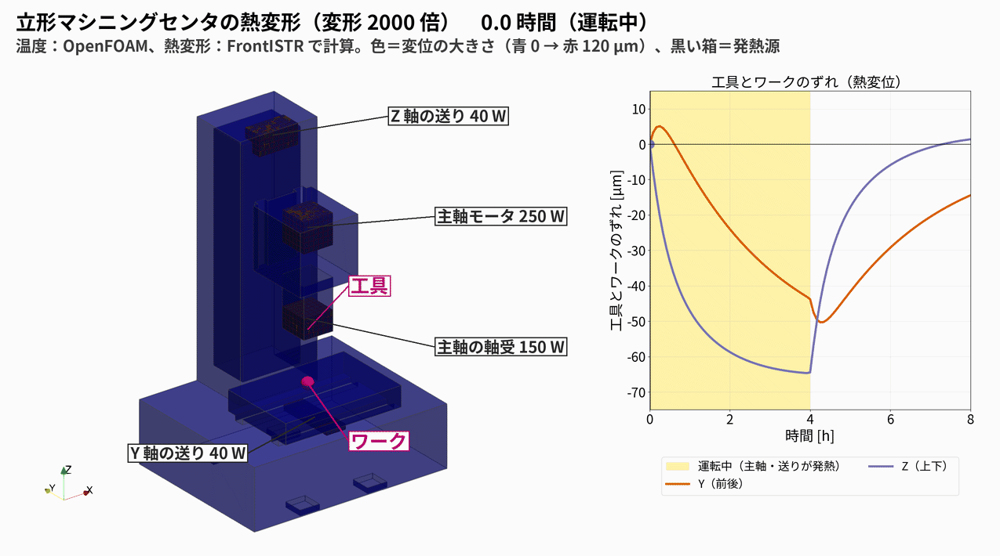

*図 0　立形マシニングセンタの熱変形（107 の S1：4 時間運転 → 4 時間停止。温度は OpenFOAM、熱変形は FrontISTR で計算した結果。変形を 2000 倍）。黒い箱が発熱源（主軸モータ 250 W、主軸の軸受 150 W、Z 軸の送り 40 W、Y 軸の送り 40 W）。左：運転すると主軸頭とコラムが温まって変形し、工具の位置がずれる。右：工具とワークのずれ。運転中に上下（Z）で約 65 µm ずれ、止めると時間をかけて戻る。実機ではなく、工作機械を想定した形での計算。計算ケース：`sample/107_machining_center_rom/01_openfoam_thermal/cases/S1_run4h_stop4h`（OpenFOAM）、`sample/107_machining_center_rom/02_frontistr_thermal_deform/work/S1_run4h_stop4h`（FrontISTR）。作図：`presentation/make_intro_machine_gif.py`。*

#### (2) 対策は「回避」と「補正」

Li ら (2024) は、熱誤差の対策を 2 つに分けています。

| 対策 | 中身 | 例 |
|---|---|---|
| **回避** | 温度変化や変形を起こしにくくする | 低膨張材、構造の工夫、冷却 |
| **補正** | 熱変形を予測して、位置指令を直す | 温度からの回帰、FEM、学習モデル |

Li らは、回避は補正より費用がかかることが多い、と述べています。補正では、**熱変形を正しく予測できること**が前提になります。

メーカー各社も補正の機能を出しています（オークマのサーモフレンドリーコンセプト、マザックの AI Thermal Shield、DMG MORI の Spindle Growth Sensor など。詳しくは [blog_001 §0-3](blog_001_cht_thermal_expansion_and_htc.md)）。

### 2-2. 課題：なぜ熱変形の予測は難しいのか

#### (1) 解析モデルの条件が分からない

熱解析には、発熱量、表面の熱伝達率、初期の温度分布などの条件が必要です。これらは運転のしかたや組み立てで変わり、事前に正しく決めるのは困難です。

- Bünger ら (2023) は、TCP（工具先端）の予測精度は「熱交換のパラメータや初期温度などのモデルパラメータの精度に大きく依存する」と書いています（<https://arxiv.org/abs/2306.12736>）。
- 熱伝達率は、熱流束・壁の温度・基準の温度から求める量で、それを直接読む計測器はありません（2025 年の論文、<https://pmc.ncbi.nlm.nih.gov/articles/PMC12473924/>。本文は検索結果からの要約で、原文の確認が必要）。

#### (2) 温度の傾向が合っても、変形は合うとは限らない

熱変形は、温度の上がり方の**空間分布**と、構造の拘束で決まります。数点の温度や平均温度が合っても、変形が合う保証はありません。

本研究の題材（中空円筒の片側加熱）でも、温度計 2 点だけでデータ同化をすると、測っていない上面の 2 点 A・O の変位の差（反り）は 0.77 µm ずれました（真値は OpenFOAM＋FrontISTR、2026-10-12 の IDW 版、`results/holdout_AO_realsolver.json`）。

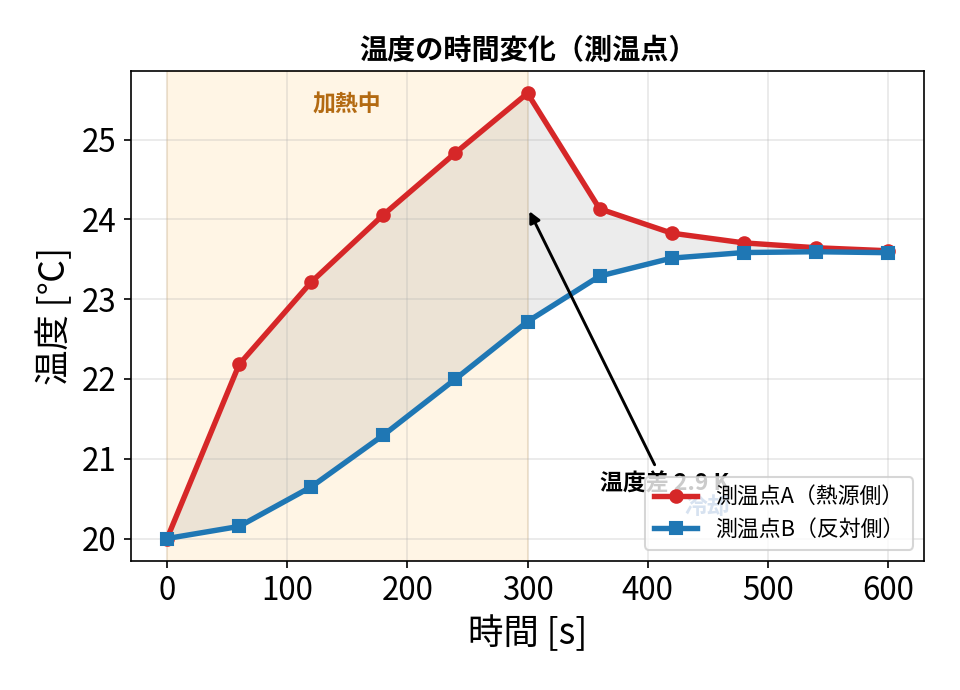

*図 1　中空円筒の片側を 0〜300 秒加熱したときの、熱源側と反対側の温度（OpenFOAM）。加熱の終わりに 2.9 K の差がつく。*

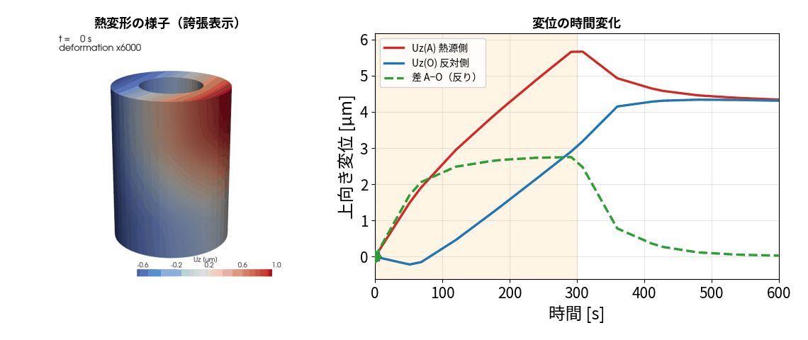

*図 2　同じ計算の熱変形（FrontISTR、変形を拡大）。温度の差によって円筒が反る。*

#### (3) 本当に知りたい場所は、加工中に測れない

知りたいのは工具先端とワークの位置のずれです。しかし加工中の工具先端は、切粉やクーラント、工具交換があり、センサを置けません。タッチプローブなどで直接測る方法は、測るたびに加工を止める必要があります（[blog_001 §0-5](blog_001_cht_thermal_expansion_and_htc.md)）。

#### (4) 詳しい解析は重い

測定のたびに解析モデルを直すには、データ同化が使えます。ただし、詳しい解析（OpenFOAM＋FrontISTR）をそのまま使うと重くなります。本研究の前段（104）では、実ソルバで EnKF を回すと、一連の計算に約 13 時間かかりました。

---

## 3. 2 ページ目「目的」：既存の取り組みと、この研究の目的

ここ（3-1〜3-4）を、発表の 2 ページ目に載せます。

### 3-1. 既存の取り組みと、空いている所

| 流派 | やり方 | 弱いところ |
|---|---|---|
| ① 回帰・機械学習 | 温度を多点で測り、変位を回帰や学習で予測 | 学習した運転条件の外で外れやすい |
| ② FEM による補正 | 詳しい FEM で、温度から変位を計算 | 条件（熱伝達率、発熱量）が合わないと外れる |
| ③ 低次元化＋状態推定 | ROM とカルマンフィルタで温度場を推定（ETH 2024 など） | 観測は温度だけ。変位は出力 |
| ④ 直接測定による補正 | 変位を測って直接補正 | 加工中は測れない。状態の推定には戻さない |

③は変位を「出力」、④は変位を「補正の対象」として扱っています。**変位を「観測」として状態推定に戻す取り組みは、調べた範囲では見当たりませんでした**（英語 5 回・日本語 1 回の検索で、網羅的な調査ではありません。[blog_008 §3・§8](blog_008_novelty_displacement_assimilation.md)）。

センサの置き場所を ROM と感度で決める研究（Teshima ら 2024 など）や、熱モデルとベイズ推定で配置を評価する研究（Bünger ら 2023）はすでにあります。本研究は置き場所の考え方そのものではなく、**変位も観測に入れたときに、推定したい量に合わせて置き場所を選び、実際のデータ同化で確かめる**点に取り組みます。

### 3-2. 目的

> **少ない温度・変位の測定を解析モデルとデータ同化で組み合わせ、測れない場所の熱変形を推定する。そのために、どこで何を測ればよいかを、測る前に計算で決める。**

### 3-3. この研究でしたこと

| # | したこと | 結果（数値） |
|---|---|---|
| 1 | **正解を作る**：中空円筒の片側加熱を、OpenFOAM（流体と固体の熱連成）→ FrontISTR（熱変形）で計算 | 双子実験の「本物」とする |
| 2 | **実ソルバでデータ同化**：OI と EnKF | EnKF は温度 7.61 → 0.011 K、発熱量 14.93 W（真値 15 W）。ただし約 13 時間。OI は軽いが発熱量が約 9 W 止まり |
| 3 | **軽いモデルを作る**：POD で温度分布の型を取り出し、Q-DEIM で代表 5 点を選んで ROM にする | 2 つの型で 99.9 %。0〜600 秒が 31 ms |
| 4 | **変位も観測に入れる**：ROM と EnKF に、温度 2 点＋変位 2 点を入れる | 一度も測らない A・O の反りの誤差 0.076 µm（A・O を直接測ると 0.137 µm、温度 2 点だけだと 0.77 µm） |
| 5 | **置き場所を計算で選ぶ**：反りの「測った後に残る不確かさ」が最小になる点を選ぶ | 既存の選び方と同じ条件で比べて最小（0.076 µm。A最適 0.089、D最適 0.108 µm） |
| 6 | **条件を変えて確かめる**：発熱量 25 W、間欠加熱（作るのに使っていない条件） | 反りの誤差 0.07〜0.08 µm（上の 4 と同じ置き方） |

4〜6 の数値は、真値を OpenFOAM＋FrontISTR にし、2026-10-12 に IDW で計算し直した結果です（加熱期 30〜300 秒、5 回の乱数の平均。`results/holdout_AO_realsolver.json`、`results/placement_method_comparison.json`）。

### 3-4. 範囲（言えること・言えないこと）

| 言えること | 言えないこと |
|---|---|
| オープンソース（OpenFOAM＋FrontISTR＋Python）だけで、解析からデータ同化までつないだ | 実機で同じ精度が出ること（実機は未検証） |
| この題材と条件で、測っていない場所の反りを当てられた | 「初めて提案した」こと（調査は網羅的ではない） |
| 置き場所を事前の計算で選べた | どの機械にもそのまま通用すること（熱源の位置が変わると ROM も配置も作り直し） |
| 発熱量も推定できた | 放熱（熱伝達）の条件まで正しく同定できたこと（600 秒では当たらない。[blog_003 §4-0-b](blog_003_ensemble_kalman_filter.md)） |

---

## 4. 3 ページ目「全体の流れ」

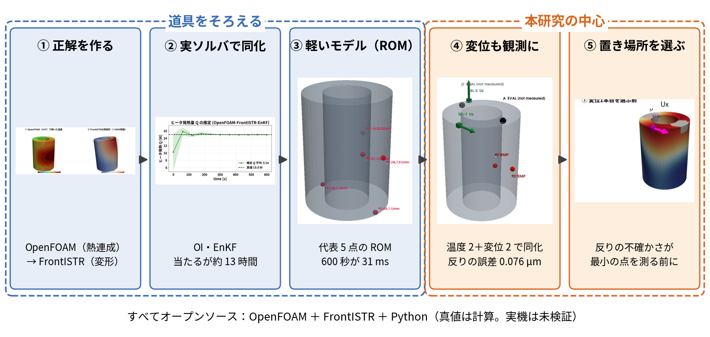

*図 3　研究全体の流れ。①〜③で道具（正解データ、データ同化、軽い ROM）をそろえ、④・⑤が本研究の中心（変位も観測に入れる、置き場所を計算で選ぶ）。作図：`presentation/make_flow_figure.py`。*

| 段階 | 言うこと（各 10 秒ほど） |
|---|---|
| ① 正解を作る | OpenFOAM で温度、FrontISTR で熱変形を計算し、これを「本物」とする |
| ② 実ソルバで同化 | データ同化で発熱量まで当たるが、実ソルバでは約 13 時間かかる |
| ③ 軽いモデル | POD と Q-DEIM で代表 5 点の ROM にし、600 秒を 31 ms で計算する |
| ④ 変位も観測に | 温度だけでなく変位も測ってデータ同化し、測っていない場所の反りを当てる |
| ⑤ 置き場所を選ぶ | どこを測ればよいかを、知りたい量（反り）に合わせて測る前に計算で選ぶ |

---

## 5. 4 ページ目「データ同化とは」

ここ（5-1〜5-4）を、発表の 4 ページ目に載せます。5-5 は使ったプログラム、5-6 は話す内容です。

### 5-1. データ同化とは

**データ同化**は、数値モデルの計算（予報）と、測った値（観測）を、それぞれの不確かさに応じて混ぜ合わせ、今の状態と未知のパラメータを推定する方法です。天気予報で発達した方法です。

- モデルだけでは、初期の状態や条件（発熱量、熱伝達率など）が分からず、ずれていく。
- 観測だけでは、測った点の値しか分からない。
- 2 つを合わせると、**測っていない場所の状態**や、**直接は測れない条件**まで推定できる。

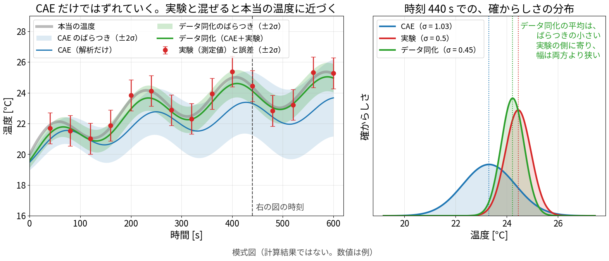

*図 4a　データ同化のイメージ（模式図。計算結果ではない）。左：CAE（解析だけ、青）は発熱や放熱の条件が分からず、波の大きさも時刻もずれ、ばらつき（帯）も広がる。実験（赤）はときどき測った値で、誤差がある。両方を混ぜたデータ同化（緑）は本当の温度（灰）に近づき、ばらつきも狭い。右：時刻 440 s での確からしさの分布。データ同化の平均は、ばらつきの小さい実験の側に寄り、幅は CAE・実験のどちらより狭い。作図：`presentation/make_da_image_figure.py`。*

正規分布どうしを混ぜると、データ同化の平均 $`\mu_a`$ とばらつき $`\sigma_a`$ は次のようになります（$`f`$：CAE、$`o`$：実験）。

```math
\mu_a = \frac{\sigma_o^2\,\mu_f + \sigma_f^2\,\mu_o}{\sigma_f^2 + \sigma_o^2},\qquad
\frac{1}{\sigma_a^2} = \frac{1}{\sigma_f^2} + \frac{1}{\sigma_o^2}
```

ばらつきの小さいほうを強く信じ、情報（$`1/\sigma^2`$）は足し算になります。

### 5-2. 2 つの型：逐次型と変分型

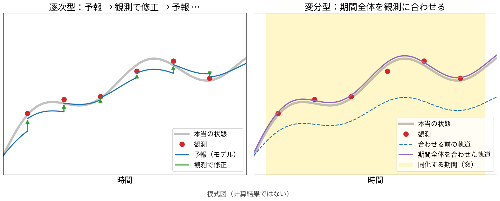

*図 4　データ同化の 2 つの型（模式図。計算結果ではない）。左の逐次型は、予報し、観測が来るたびに修正して、次を予報する。右の変分型は、ある期間（窓）の観測すべてに合うように、期間の初めの状態などを変えて軌道全体を合わせる。作図：`presentation/make_da_types_figure.py`。*

| | 逐次型（フィルタ） | 変分型 |
|---|---|---|
| 考え方 | 観測が来るたびに、その時刻の状態を修正する | ある期間の観測すべてに合うように、初めの状態などを最適化する |
| 代表的な方法 | カルマンフィルタ、**最適内挿（OI）**、**アンサンブルカルマンフィルタ（EnKF）**、粒子フィルタ | 3 次元変分法（3D-Var）、4 次元変分法（4D-Var） |
| 計算の中身 | 予報と観測の差に、重み（カルマンゲイン）を掛けて足す | 「予報からのずれ」と「観測とのずれ」の和を最小にする |
| 必要なもの | 予報の不確かさ（共分散）。EnKF は複数の予報（アンサンブル）から作る | 4D-Var では、モデルを逆向きにたどる式（アジョイント）が必要 |
| 向いている使い方 | 測りながら、その場で推定し続ける | 過去の期間をまとめて、よく合う状態・条件を求める |

**逐次型の 1 回の修正**（EnKF・OI）：

```math
\mathbf x_a = \mathbf x_f + K\,(\mathbf y - H\mathbf x_f),\qquad
K = P_f H^{\mathsf T}\left(H P_f H^{\mathsf T} + R\right)^{-1}
```

- $`\mathbf x_f`$：予報した状態、$`\mathbf x_a`$：修正した状態、$`\mathbf y`$：観測、$`H\mathbf x_f`$：予報から求めた観測の予想
- $`P_f`$：予報の不確かさ（共分散）、$`R`$：観測の誤差の大きさ、$`K`$：重み（カルマンゲイン）
- 予報が不確かなほど（$`P_f`$ が大きいほど）、観測を強く信じて大きく直す。

**変分型（3D-Var）で最小にする量**：

```math
J(\mathbf x) = (\mathbf x - \mathbf x_b)^{\mathsf T} B^{-1} (\mathbf x - \mathbf x_b) + (\mathbf y - H\mathbf x)^{\mathsf T} R^{-1} (\mathbf y - H\mathbf x)
```

- 第 1 項が「予報（背景 $`\mathbf x_b`$）からのずれ」、第 2 項が「観測とのずれ」です。
- 4D-Var は、これを期間内のすべての時刻の観測に広げ、モデルの式に従う軌道の中で最小を探します。
- モデルと観測の関係が線形で、誤差が正規分布なら、3D-Var の答えは OI と同じになります。

### 5-3. 一般的に使われるデータ同化の方法

データ同化は天気予報で発達し、いまは海洋・地下水・燃焼・構造などにも使われています。よく使われる方法を整理します。

| 型 | 方法 | 中身 | 長所 | 短所 |
|---|---|---|---|---|
| 逐次型 | **OI**（最適内挿） | 予報の不確かさ $`B`$ を**固定**して、観測のたびに直す | 軽い（予報は 1 本） | $`B`$ が固定なので、パラメータ（発熱量など）は当たりにくい |
| 逐次型 | **カルマンフィルタ（KF・EKF）** | 予報の不確かさ $`P`$ も、モデルの式で時間発展させる | 線形なら最適 | $`P`$ が（状態の数）×（状態の数）で大きい。非線形には線形化（EKF）が必要 |
| 逐次型 | **EnKF**（アンサンブルカルマンフィルタ） | 少しずつ違う予報を何本も回し、そのばらつきから $`P`$ を作る | モデルの微分がいらない。パラメータも状態に加えて推定できる | 予報を本数分回すので重い。本数が少ないと、関係のない遠くの点どうしに見かけの相関が出る |
| 逐次型 | **LETKF**（局所アンサンブル変換カルマンフィルタ） | EnKF の一種。観測に乱数を足さず、**場所ごとに近くの観測だけ**で直す（局所化） | 見かけの相関が出にくい。場所ごとに独立に計算でき、並列で速い | 局所化の範囲を決める必要がある |
| 逐次型 | **粒子フィルタ** | 予報を「粒子」として回し、観測に合う粒子ほど重みを大きくする | 正規分布を仮定しない（非線形・多峰に強い） | 状態の数が多いと、膨大な粒子が必要 |
| 変分型 | **3D-Var**（3 次元変分法） | ある時刻で、「予報からのずれ」と「観測とのずれ」の和 $`J`$ を最小にする | 大きな問題でも解ける | $`B`$ が固定（OI と同じ答えになる） |
| 変分型 | **4D-Var**（4 次元変分法） | 一定の期間（窓）の**全時刻の観測**に合うように、期間の初めの状態を最適化する。モデルの式に従う軌道の中で探す | 期間内の観測を、モデルと矛盾なく使える。精度が高い | モデルを逆向きにたどる式（**アジョイント**）が必要で、作るのが大変 |
| 両方 | **ハイブリッド（En-Var、4DEnVar など）** | 変分型の $`B`$ に、アンサンブルのばらつきを混ぜる | 両方の長所を合わせる | 仕組みが複雑 |
| 期間でまとめる | **ES-MDA**（多段アンサンブルスムーザ） | 期間全体の観測を、同じデータで数回に分けて取り込む | 非線形の逆問題（パラメータ推定）に強い。地下水・油田で使われる | 期間の途中の推定には向かない |

**4D-Var と LETKF**（天気予報の現場でよく使われる 2 つ）

- **4D-Var**：「6 時間なら 6 時間の間の観測すべてに、モデルの計算が一番よく合う初期状態」を探す方法です。合わせる量 $`J`$ は、3D-Var の $`J`$ を期間内の全時刻に広げたものです。$`J`$ の初期状態についての微分（勾配）を、モデルを逆向きにたどる式（アジョイント）で一度に計算して、最小を探します。精度は高いですが、アジョイントを作るのがとても大変です。
- **LETKF**：EnKF の仲間です。各場所（格子点）で、その近くの観測だけを使って、アンサンブルの重みを決め直します。補正はアンサンブルの本数ぶん（例：60 × 60）の小さな行列の計算で済み、場所ごとに独立なので並列にできます。大きなモデルでも速く回せます。

本研究で使ったのは **EnKF**（観測に乱数を足す型）です。状態が 7 つ（代表 5 点の温度、発熱量、放熱）と少ないので、局所化（LETKF）は使っていません。

### 5-4. 本研究は逐次型（EnKF）を使う

| 理由 | 中身 |
|---|---|
| 測りながら推定したい | 加工中の補正では、観測が来るたびに今の状態を知りたい。本研究は 30 秒ごとに修正する |
| アジョイントがいらない | OpenFOAM と FrontISTR を組み合わせたモデルを逆向きにたどる式は用意されていない。EnKF は予報を何本か回すだけでよい |
| 発熱量も一緒に推定できる | 発熱量 $`Q`$ と放熱 $`h`$ を状態に加えると、アンサンブルの共分散を通して、温度・変位の観測から $`Q`$ も直せる |

実際に試した結果と、そこで見えた課題は次のページ（§6）で示します。

### 5-5. 使ったプログラム

| プログラム | すること |
|---|---|
| `dacore/oi.py` | OI の補正（共分散 $`B`$ を固定） |
| `dacore/enkf.py` | EnKF の補正（共分散を 60 メンバーから数える） |

OI（`dacore/oi.py`）：重み $`K = BH^{\mathsf T}(HBH^{\mathsf T}+R)^{-1}`$ を 1 回だけ計算し、毎回同じ重みで直します。

```python
def oi_gain(H, B, R):
    HB = H @ B
    S = HB @ H.T + R
    K = np.linalg.solve(S, HB).T    # K = B Hᵀ S⁻¹
    return K

def oi_update(z_b, y, y_pred, K):
    return z_b + K @ (y - y_pred)   # z_a = z_b + K (y - y_pred)
```

EnKF（`dacore/enkf.py` の `enkf_update`）：共分散を 60 メンバーのばらつきから毎回数え直します。

```python
zbar = Zf.mean(axis=0); ybar = Yf.mean(axis=0)
dZ = Zf - zbar                       # 状態のばらつき（メンバー × 7）
dY = Yf - ybar                       # センサの予想のばらつき
C_zy = dZ.T @ dY / (n_ens - 1)       # 状態とセンサの共分散
C_yy = dY.T @ dY / (n_ens - 1)       # センサの予想の分散
S = C_yy + R
eps = rng.multivariate_normal(np.zeros(len(y)), R, size=n_ens)   # 観測の乱数
innov = (y[None, :] + eps) - Yf      # 実測 − 予想
gain_T = np.linalg.solve(S, C_zy.T)  # Kᵀ = S⁻¹ C_zyᵀ
Za = Zf + innov @ gain_T             # z_a = z_f + K (y + ε − y_f)
```

### 5-6. 4 ページ目で言うこと（約 1 分）

- データ同化は、モデルの予報と観測を、不確かさに応じて混ぜて、状態と条件を推定する方法。
- 逐次型（観測のたびに修正）と変分型（期間全体を合わせる）がある。
- 本研究は、測りながら推定でき、アジョイントがいらない**逐次型の EnKF** を使う。

---

## 6. 5 ページ目「データ同化による課題」

ここ（6-1〜6-4）を、発表の 5 ページ目に載せます。6-5 は使ったプログラム、6-6 は話す内容です。4 ページ目の方法を、熱流体・熱解析の実ソルバでそのまま回すと何が困るかを示します。

### 6-1. 正解を作る：双子実験

実機の測定はまだないので、**双子実験**で確かめます。

1. OpenFOAM（流体と固体の熱連成）で温度を、FrontISTR（熱弾性）で変位を計算し、これを「本物」とする。
2. 本物の温度・変位の一部の点に、測定の誤差を乱数で足して「観測」を作る。
3. 条件（初期温度、発熱量）を外したモデルから始めて、観測でどこまで本物に近づけるかを見る。

### 6-2. OI では発熱量が当たらない

OI（最適内挿）は、予報の不確かさ（共分散）を固定して、予報 1 本だけで修正します。実ソルバ（OpenFOAM＋FrontISTR）で試した結果です（104）。

| | OI | EnKF |
|---|---|---|
| 全セルの温度の誤差 | 5.0 → 0.11 K | 7.61 → 0.011 K |
| 発熱量 Q（真値 15 W） | **約 9 W 止まり** | **14.93 W** |
| 計算時間 | 約 1.2〜1.6 時間 | **約 13 時間** |

- OI は温度・変位を本物に寄せられますが、**発熱量は約 9 W で止まりました**。共分散を固定しているため、温度のずれを発熱量の修正に結びつけられません。
- 予報の不確かさの大きさ $`\sigma_Q`$ を 0.5 → 50 W と 100 倍に振っても、発熱量の推定は 8.8〜9.0 W でほとんど変わりませんでした。

### 6-3. EnKF は当たるが、計算に時間がかかる

EnKF は、条件を少しずつ変えた予報を何本も（アンサンブル）回し、そのばらつきから共分散を作ります。発熱量まで当たりましたが、

- 予報 1 本が OpenFOAM（熱連成）＋FrontISTR の計算そのもので、重い。
- 104 では 5 本・60 秒ごとに 10 回の修正で、一連の計算に**約 13 時間**かかりました（作業記録からの概算）。
- 5 本はアンサンブルとしては少なく、106 の ROM では 60 本を使っています。実ソルバで 60 本にすると、単純に比べて約 12 倍の計算になる見込みです（見積もりで、実行していません）。

**熱流体・熱解析の計算時間が、データ同化のネックになります。** 現象の 600 秒を推定するのに、何時間もかかっていては、加工しながら補正することはできません。

### 6-4. どこを測ればよいかが分からない

計算時間に加えて、**どこの温度（や変位）を測るか**も結果を左右します。

- 測る場所によって、推定がよく当たる場合と外れる場合があります。たとえば温度 2 点だけでは、測っていない上面 A・O の反りは 0.77 µm ずれました（§2-2）。
- 実ソルバのデータ同化が重いので、置き場所を何通りも試して比べることができません。

### 6-5. 使ったプログラム

実ソルバでのデータ同化は 104 のフォルダにあります（`sample/104_0_openfoam_frontistr_da_enkf/`）。

| プログラム | すること |
|---|---|
| `run/run_openfoam_fem_enkf.py` | 実ソルバの EnKF を実行する（設定は `openfoam/da_openfoam_config.yaml`） |
| `daof/of_fem_twin.py` の `run_fem_twin` | 真値の計算、メンバーごとの OpenFOAM・FrontISTR、EnKF の補正を 1 サイクルずつ回す |
| `run/run_openfoam_fem_oi.py` | 実ソルバの OI |

1 サイクルの中身（`daof/of_fem_twin.py`、抜粋）：メンバーの数だけ OpenFOAM と FrontISTR を回すので重くなります。

```python
for ci, t1 in enumerate(times):                 # 60 秒ごとの補正
    for i, m in enumerate(members):             # メンバーごとに
        ok, log = of_case.run_window(m, t0, t1) # ← OpenFOAM（熱連成）を t0→t1 まで回す
        yv, Tm = member_obs(m, t1, ...)         # ← FrontISTR で変位を計算し、センサの値を作る
        Z[i, :Nc] = Tm                          # 状態 = 固体 20,696 セルの温度 + 発熱量
        Z[i, iQ] = Q[i]
        Yf[i] = yv
    Za = enkf_update(Z, y, None, R, rng, inflation=..., Yf=Yf)   # 補正
    for i, m in enumerate(members):
        of_case.set_solid_state(m, t1, Za[i, :Nc], float(Za[i, iQ]))  # 直した温度を OpenFOAM に書き戻す
```

### 6-6. 5 ページ目で言うこと（約 1 分）

- OpenFOAM と FrontISTR で正解の温度と変位を作り、双子実験でデータ同化を確かめた。
- OI は軽いが発熱量が当たらない（約 9 W、真値 15 W）。EnKF は当たるが約 13 時間かかる。
- 熱流体・熱解析の計算時間がネックになり、どこを測ればよいかも試して決められない。→ 次のページから、軽いモデル（ROM）で解決する。


---

## 7. 6 ページ目「低次元モデル化（ROM）」

ここ（7-1〜7-4）を、発表の 6 ページ目に載せます。7-5 は一般的な ROM との違い（補足）、7-6 は使ったプログラム、7-7 は話す内容です。5 ページ目の「実ソルバでは重い」を、OpenFOAM の結果から作る軽いモデル（ROM）で解決します。手順は **特異値分解（POD）→ Q-DEIM → ROM** の 3 段です。

### 7-1. 材料：OpenFOAM の温度の「写真」121 枚

- OpenFOAM（熱連成）の固体 **20,696 セル**の温度を、0〜600 秒で 5 秒ごとに **121 枚**残します。
- 1 枚（ある時刻の全セルの温度）を 1 列にし、121 列を横に並べた行列を作ります。各セルの時間平均 $`\bar{\mathbf u}`$ を引いたものを $`X`$ とします。

```math
X = \big[\,\mathbf u(t_1)-\bar{\mathbf u},\ \mathbf u(t_2)-\bar{\mathbf u},\ \dots,\ \mathbf u(t_{121})-\bar{\mathbf u}\,\big]\qquad(20{,}696 \times 121)
```

ROM を作るために OpenFOAM を回すのは、この 1 回だけです。データ同化の本番では OpenFOAM も FrontISTR も回しません。

### 7-2. 特異値分解（POD）：温度分布の「型」を取り出す

$`X`$ を特異値分解します。

```math
X = U\,\Sigma\,V^{\mathsf T}
```

- $`U`$ の列 $`\boldsymbol\varphi_1, \boldsymbol\varphi_2, \dots`$ が、温度分布の**型（POD モード）**です。
- 特異値 $`\sigma_k`$ の 2 乗の割合 $`\sigma_k^2 / \sum_j \sigma_j^2`$ が、その型で温度の変化の何割を表せるか（寄与率）です。
- どの時刻の温度も、型の足し合わせで $`\mathbf u(t) \approx \bar{\mathbf u} + a_1(t)\,\boldsymbol\varphi_1 + a_2(t)\,\boldsymbol\varphi_2 + \cdots`$ と書けます。

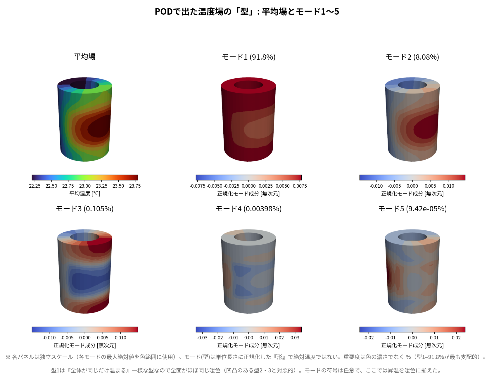

*図 5　平均の温度と POD モード 1〜5。モード 1（91.8 %）は全体が温まる型、モード 2（8.08 %）はヒータ側と反対側の偏りの型。*

**2 つの型で 99.89 %** を表せました。2 万セルの温度でも、ほとんどは 2 つの数 $`a_1, a_2`$ で決まるということです。

### 7-3. Q-DEIM：型を見分けるのに一番よい 5 点を選ぶ

型の重み $`a_1, a_2, \dots`$ を知るには、どこかの点の温度が分かればよいはずです。ただ、点の選び方が悪いと（たとえば型がどれも 0 に近い点や、似た点ばかり）重みを正しく決められません。

**Q-DEIM** は、型の行列 $`\Phi_r = [\boldsymbol\varphi_1, \dots, \boldsymbol\varphi_r]`$ の転置に、列の入れ替え付きの QR 分解をかけて、点を選びます。

```math
\Phi_r^{\mathsf T}\,\Pi = Q\,R
```

- $`\Pi`$（列の入れ替え）の最初の $`r`$ 列が、選ぶ点です。
- 「型の値が大きく、すでに選んだ点と似ていない点」を、1 点ずつ貪欲に選んでいくことに当たります。
- モード 5 本を使い、**代表 5 点**（P0〜P4）を選びました。

#### 行列で見る：列の入れ替え付き QR 分解

型の行列を横にした $`\Phi_r^{\mathsf T}`$（5 行 × 20,696 列）を考えます。**1 列が 1 セル**で、その列には「そのセルでの 5 つの型の値」が縦に並んでいます。

```math
\Phi_r^{\mathsf T} =
\begin{pmatrix}
\varphi_1(1) & \varphi_1(2) & \cdots & \varphi_1(N)\\
\vdots & \vdots & & \vdots\\
\varphi_5(1) & \varphi_5(2) & \cdots & \varphi_5(N)
\end{pmatrix}
= \big[\,\mathbf c_1,\ \mathbf c_2,\ \dots,\ \mathbf c_N\,\big],\qquad N = 20{,}696
```

列の入れ替え付き QR 分解 $`\Phi_r^{\mathsf T}\,\Pi = Q\,R`$ は、次の手順を 5 回くりかえすのと同じです。

1. **一番長い列を選ぶ**：残っている列の中で、長さ $`|\mathbf c_i|`$ が最大の列（セル）を選び、先頭へ入れ替える（これが $`\Pi`$）。
2. **その向きを、全部の列から引く**：選んだ列の向き $`\mathbf q = \mathbf c_{\text{選}}/|\mathbf c_{\text{選}}|`$ の成分を、ほかの列から引く（$`\mathbf c_i \leftarrow \mathbf c_i - (\mathbf q^{\mathsf T}\mathbf c_i)\,\mathbf q`$）。これが $`Q`$ の 1 列を作ることに当たり、引いた量が $`R`$ に入る。
3. 引いた後の長さで、次の列を選ぶ。

- 1 回目は、型の値が大きいセル（列が長いセル）が選ばれます。
- 2 回目からは、すでに選んだセルと同じ向きの成分が引かれるので、**似たセルは短くなり、選ばれにくくなります**。
- その結果、5 点で取り出した 5 × 5 の行列 $`\Phi_P`$ が、つぶれにくい（逆行列が安定に求まる）組になります。gappy-POD で 5 点から 5 つの型の重みを決めるとき、この $`\Phi_P`$ の逆行列を使います。

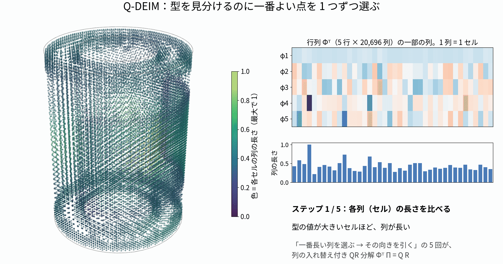

*図 6a　Q-DEIM の選び方（実際の円筒、モード 5 本）。左：各セル（点）の色が、その時点の列の長さ（最大で 1）。赤い球が今回選んだ点、白い球がすでに選んだ点。右上：行列 $`\Phi^{\mathsf T}`$ の一部の列（1 列 = 1 セル、赤枠が選んだ列）。右中：列の長さ。選んだ列の向きを引くと、選んだ列は 0 になり、似た列も短くなる。P0 → P1 → P2 → P3 → P4 の順に選ばれ、`scipy.linalg.qr(..., pivoting=True)` の結果と同じ順であることを確かめた。きれいに見るなら `img/qdeim_animation.mp4`。作図：`run/make_qdeim_animation.py`。*

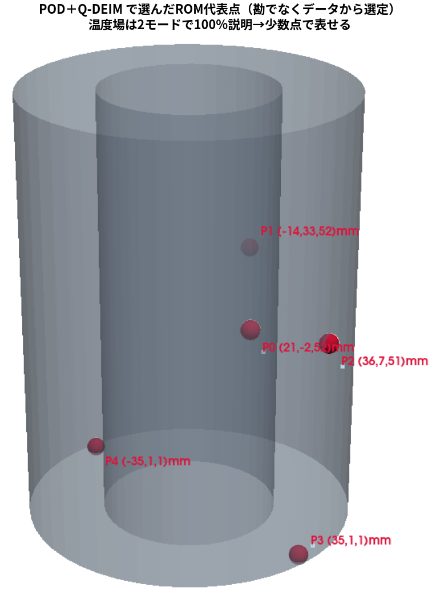

*図 6　Q-DEIM で選んだ代表 5 点（P0〜P4）。ヒータ側の中段（P0・P2）、反対側寄りの中段（P1）、底面近くの両側（P3・P4）が選ばれた。*

5 点の温度が分かれば、全セルの温度は gappy-POD で戻せます（型の重みを 5 点の温度から最小二乗で求め、型を足し合わせる）。

### 7-4. ROM：代表 5 点の熱回路を作り、OpenFOAM に合わせる

代表 5 点をノードにして、熱容量と熱コンダクタンスでつないだ熱回路（集中定数モデル）を作ります。ノード $`i`$（$`i = 0, \dots, 4`$）の式は次のとおりです。

```math
C_i\,\frac{dT_i}{dt} = \sum_{j \ne i} K_{ij}\,(T_j - T_i) + q_i(t) - h\,(T_i - T_{\mathrm{air}})
```

- $`C_i`$：ノード $`i`$ の熱容量 [J/K]
- $`K_{ij}`$：ノード $`i`$ と $`j`$ の間の熱コンダクタンス [W/K]（5 点なら 10 本）
- $`q_i`$：発熱。ヒータに一番近い P2 だけに入れる
- $`h`$：空気への放熱 [W/K]

未知の 16 個（$`C`$ 5 個、$`K`$ 10 個、$`h`$ 1 個）を、5 点の温度の時刻歴が OpenFOAM と一致するように最小二乗で合わせました。

#### 合わせ方（最適化）

- **目的**：5 点 × 121 時刻（0〜600 秒、5 秒ごと）の「ROM の温度 − OpenFOAM の温度」の 2 乗の和を最小にする。

```math
\hat{\boldsymbol\theta} = \arg\min_{\boldsymbol\theta}\ \sum_{p=0}^{4}\sum_{k=1}^{121}\Big(T_p^{\mathrm{ROM}}(t_k;\boldsymbol\theta) - T_p^{\mathrm{OF}}(t_k)\Big)^2,\qquad
\boldsymbol\theta = (C_0,\dots,C_4,\ K_{01},\dots,K_{34},\ h)
```

- **解き方**：`scipy.optimize.least_squares`（非線形最小二乗、範囲の制約つき）。$`\boldsymbol\theta`$ を決めるたびに ROM を 0〜600 秒計算し直す。
- **初めの値と範囲**：$`C`$ は 120 J/K から（1〜5000）、$`K`$ は 1.5 W/K から（0.0001〜200）、$`h`$ は 0.3 W/K から（0.0001〜50）。どれも 0 より大きく制約。
- **前提**：初期温度は 5 点とも室温、発熱 15 W はヒータに一番近い P2 だけに入れる、合わせるのに使ったのは 15 W・0〜300 秒加熱の 1 本だけ。
- **結果**：残差（RMSE）0.014 K。
- **かかった時間**：最適化は約 **14 秒**（2026-11-01 にこの PC で計り直した値。ROM を 0〜600 秒計算した回数 590 回、1 回あたり約 23 ms。反復 46 回）。このほかに、OpenFOAM の温度 121 枚の読み込みに約 14 秒。計り直した係数は保存してある値と同じでした。

| 係数 | 合わせた値 |
|---|---|
| 熱容量 $`C_0 \ldots C_4`$ [J/K] | P0 136、P1 323、P2 93、P3 243、P4 416（合計 1,211） |
| 熱コンダクタンス $`K_{ij}`$ [W/K] | P0–P2 17.5、P0–P3 6.21、P1–P4 2.60、P3–P4 2.11、P1–P2 1.62、P0–P1 0.84。P0–P4・P1–P3・P2–P3・P2–P4 は下限の 0.0001（ほぼ 0） |
| 放熱 $`h`$ [W/K] | 0.0154（5 点それぞれに掛かるので、全体で 5 × 0.0154 = 0.077 W/K） |

（`results/rom_calibrated_pod.npz`、`run/build_calibrate_rom.py`）

#### 局所最適になっていないか（初期値を変えて 40 回やり直した）

最小二乗は、初期値によっては近くの谷（局所最適）で止まります。そこで、16 個の係数の初期値を範囲の中からばらばらに選び（対数で一様、40 通り）、同じ計算をやり直しました（`run/calib_multistart.py`、`results/calib_multistart.json`、計算 13 分）。

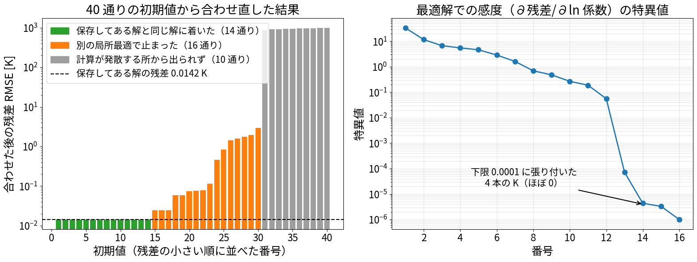

*図 7a　左：40 通りの初期値から合わせた後の残差。緑は保存してある解と同じ解に着いたもの、橙は別の局所最適、灰は時間刻み 2 秒で計算が発散する係数から出られなかったもの。右：保存してある解での、残差の係数についての感度の特異値。*

| 結果 | 数 | 中身 |
|---|---:|---|
| 保存してある解と同じ解に着いた | 14 | 残差 0.0142 K。16 個の係数がすべて 0.05 % 以内で一致 |
| 別の局所最適で止まった | 16 | 残差 0.025〜3.0 K（保存してある解より悪い） |
| 計算が発散する所から出られなかった | 10 | 初期値の熱容量が小さすぎ、時間刻み 2 秒の計算が発散 |

- **局所最適はある**：40 回のうち 26 回は、保存してある解より悪い所で止まりました。初期値 1 つで合わせると、たまたま悪い谷に落ちることがあります。
- **一番よい解は 1 つだった**：残差が一番小さい 14 回は、すべて同じ係数の組に着きました。「違う係数の組で同じくらい合う」解は、今回は見つかりませんでした（40 通りで調べた範囲）。
- **0 になった 4 本の $`K`$ は決まらない**：右の図で、特異値が 4 つほぼ 0 です。これは下限（0.0001）に張り付いた $`K_{04}, K_{13}, K_{23}, K_{24}`$ で、0 の近くで少し変えても温度はほとんど変わりません。「この 4 本は熱を流さなくても温度が再現できる」という意味です。

#### 合わせた値は物理的に妥当か（物性と距離からの見積もり）

円筒の物性は炭素鋼相当（密度 7,850 kg/m³、比熱 480 J/(kg K)、熱伝導率 50 W/(m K)）、大きさは内半径 20 mm・外半径 37.5 mm・高さ 100.5 mm です。

**① 熱容量：合計は物性からの値とほぼ同じ（妥当）**

```math
\rho\,c\,V = 7850 \times 480 \times \pi\,(0.0375^2 - 0.020^2) \times 0.1005 \approx 1{,}197\ \mathrm{J/K}
```

ROM の合計 1,211 J/K との差は約 1 % です。5 点は円筒をいくつかの領域に分けて受け持っていて、その熱容量の合計が、円筒全体の熱容量と合っています。ヒータの P2 が一番小さい（93 J/K）のは、温度がすぐ上がる狭い範囲を受け持っているためと考えられます。

**② 熱コンダクタンス：大きさはおおむね妥当。ただし 1 本ずつは物理の熱の通り道と一致しない**

棒の熱伝導 $`K = k A / L`$ から、合わせた $`K`$ を「同じ熱を流すのに必要な断面積」$`A = K L / k`$ に直して比べます。円筒の壁の断面積は、周方向に流れるなら 厚さ 17.5 mm × 高さ 100.5 mm ≈ 18 cm²、上下に流れるなら 円環 ≈ 32 cm² です。

| 2 点 | 距離 $`L`$ | 合わせた $`K`$ | 断面積に直すと $`A = KL/k`$ |
|---|---:|---:|---:|
| P0–P2（どちらもヒータ側の中段） | 17 mm | 17.5 W/K | 61 cm² |
| P0–P3（ヒータ側、中段と底面近く） | 53 mm | 6.21 W/K | 65 cm² |
| P1–P4 | 64 mm | 2.60 W/K | 33 cm² |
| P3–P4（底面近くの両側） | 70 mm | 2.11 W/K | 30 cm² |
| P1–P2 | 57 mm | 1.62 W/K | 18 cm² |
| P0–P1 | 50 mm | 0.84 W/K | 8 cm² |

- 断面積に直すと 8〜65 cm² で、壁の断面積（18〜32 cm²）と**同じ桁**です。ノードは点ではなく領域を受け持つので、2〜3 倍大きいのは不自然ではありません。
- ただし、**P2–P3（同じヒータ側で 50 mm 上下）が 0** になりました。物理的には、上下につながった同じ側の 2 点の間には、はっきり熱が流れるはずです。合わせた結果では、この熱を P2 → P0 → P3 と回り道で流しています。
- 初期値を変えて合わせ直しても、同じ値に着きました（上の図 7a）。つまり、この ROM の形（発熱は P2 だけ、ノード 5 つ）の中では、**$`K`$ の値は一意に決まっている**。それでも P2–P3 が 0 なのは、ROM の形の仮定（発熱を 1 点に入れる、5 点で全体を代表させる）に合わせた結果で、物理の熱の通り道とは一致しないということです。1 本ずつの $`K`$ を、そのまま物体の熱伝導として読むのは無理があります。

**③ 放熱 $`h`$：物理からの値よりかなり小さい（妥当とは言えない）**

OpenFOAM から求めた表面の熱伝達率は全面平均で 13.4 W/(m² K)（[blog_001 §3-4](blog_001_cht_thermal_expansion_and_htc.md)）、表面積は約 0.043 m² なので、

```math
h_{\text{物理}} \approx 13.4 \times 0.043 \approx 0.57\ \mathrm{W/K}
```

です。ROM の全体の放熱 0.077 W/K は、その約 1/7 です。

- 理由：0〜600 秒では、放熱の効きが小さいためです。円筒が空気へ熱を逃がす時定数は $`\rho c V / h_{\text{物理}} \approx 1197 / 0.57 \approx 2{,}100`$ 秒で、600 秒の計算ではまだ温まる途中です。温度の時刻歴は「熱容量に熱がたまる」ことでほぼ決まり、$`h`$ を変えても温度はあまり変わりません。そのため、最小二乗で $`h`$ を決めても、物理の値には寄りません。
- これは、データ同化で放熱 $`h`$ が 600 秒では当たらなかったこと（5,000 秒まで延ばすと当たる）と同じ理由です。
- 600 秒の範囲では ROM の温度は合っていますが、**もっと長い時間（温度が落ち着くまで）の予測では、放熱が小さすぎて温度を高く出すおそれがあります**（OpenFOAM との比較は未実施）。

**まとめ**：熱容量の合計は物理と合う。熱コンダクタンスは大きさは合い、値も一意に決まったが、ROM の形の仮定のため 1 本ずつは物理の通り道と一致しない（0 になった 4 本は決まらない）。放熱は物理の値より小さく、600 秒の計算では決まらない。ROM は「この範囲の温度を再現する」ためのモデルで、係数 1 つ 1 つを物性として読むのは注意が必要です。

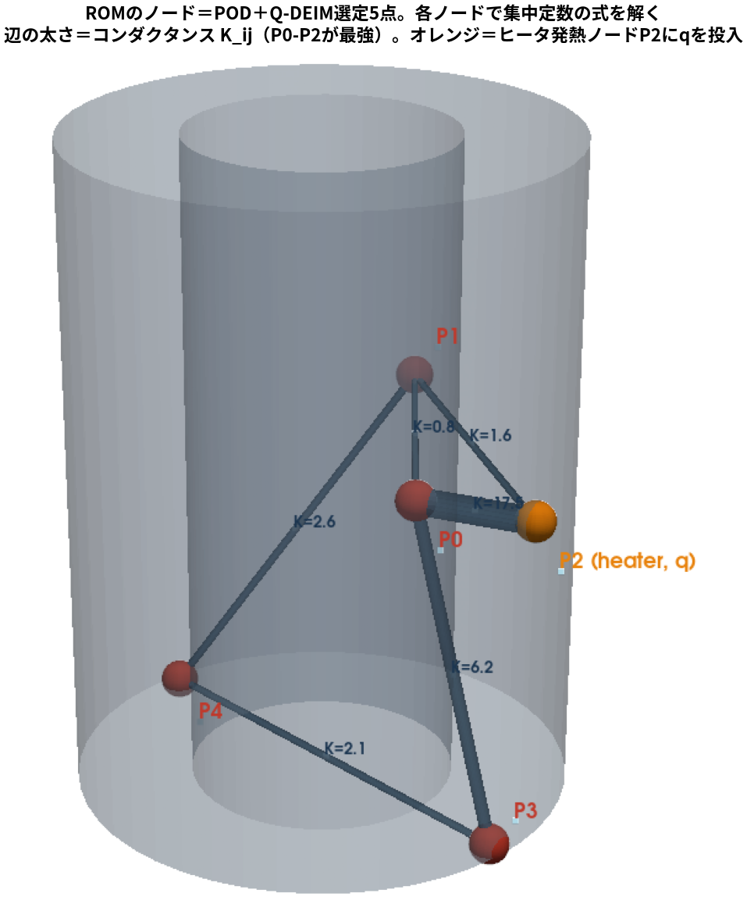

*図 7　代表 5 点の熱回路。線の太さが合わせた熱コンダクタンス。オレンジの P2 に発熱を入れる。*

| | 結果 |
|---|---|
| OpenFOAM との差（5 点の温度、合わせた後の残差） | **0.014 K** |
| 0〜600 秒の計算時間（ROM 1 本） | **約 31 ms** |

この熱回路は 1D-CAE（Modelica などの熱回路網）と同じ形です。違いは、**ノードの場所を POD・Q-DEIM でデータから選び、係数を 3D の計算に合わせた**ことです。

#### ROM を解いて、全体の温度と変形に戻す（gappy-POD）

ROM が出すのは代表 5 点の温度だけです。そこで、5 点の温度から gappy-POD で全体に戻しました。データ同化は使っていません。

1. ROM を 0〜600 秒解く（15 W、0〜300 秒加熱、初期 20 °C）→ 代表 5 点の温度 $`\boldsymbol T_P(t)`$
2. 型の重み $`\boldsymbol a = \Phi_P^{-1}(\boldsymbol T_P - \bar{\boldsymbol T}_P)`$ を求め、全 20,696 セルの温度を $`\boldsymbol T = \bar{\boldsymbol T} + \Phi\,\boldsymbol a`$ で戻す（色）
3. 変位は、型ごとに FrontISTR で前もって解いておいた変位 $`D`$ を同じ重みで足す：$`\boldsymbol u = \bar{\boldsymbol u} + D\,\boldsymbol a`$（形）

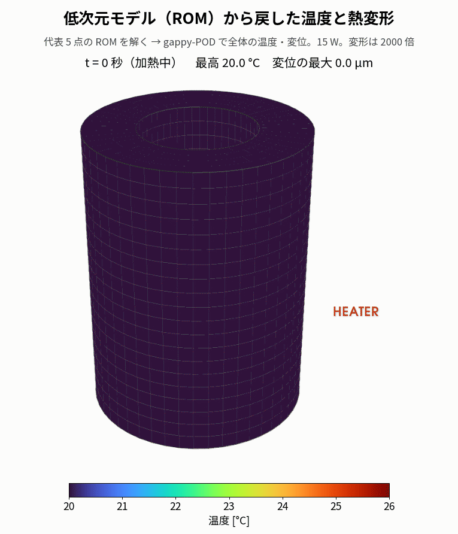

*図 7b　ROM を解き、代表 5 点の温度から gappy-POD で戻した温度（色）と熱変形（形、2000 倍）。色の範囲・向き・倍率は正解（OpenFOAM → FrontISTR）の `img/temp_deform_anim.gif` とそろえてある。300 秒のコマ：`img/temp_deform_t300_rom.png`。作図：`run/make_temp_deform_anim.py rom`。*

| 正解（OpenFOAM → FrontISTR）との差（0〜600 秒、30 秒ごと） | 値 |
|---|---|
| 節点温度の RMSE（全時刻の最大） | 0.025 K |
| 変位の最大値の差（全時刻の最大） | 0.037 µm |
| 300 秒の最高温度・変位の最大（ROM） | 25.7 °C、6.5 µm |

ROM は同じ 15 W の計算に合わせたものなので、よく合うのは当然です。別の発熱条件で使えるかは 8 章で確かめます。

### 7-5. 一般的な ROM の作り方との違い

ROM（低次元モデル）の作り方はいくつかあります。本研究の ROM は、よく使われる方法と少し違います。

| 作り方 | 中身 | 必要なもの |
|---|---|---|
| **クリロフ部分空間法**（モーメント合わせ） | 有限要素の式 $`C\dot T + KT = Fq`$ の行列から、入力（発熱）から出力（見たい点）への伝わり方が元と合うように縮める。構造・熱の FEM でよく使われる | 解析ソルバーの行列（$`C`$, $`K`$, $`F`$） |
| **POD–ガラーキン** | POD の型を使って、元の式（行列）を型の数まで縮める | 結果（スナップショット）と、元の式の行列 |
| **本研究（POD・Q-DEIM＋熱回路）** | POD の型から代表 5 点を選び、5 点の熱回路の係数を OpenFOAM の結果に合わせる | **結果（スナップショット）だけ** |

商用ソフトの ROM の機能とも比べておきます（各社の公開資料の範囲。バージョンで変わるので、使うときは各社の資料で確かめてください）。

| ソフト | ROM の機能 | 中身 |
|---|---|---|
| **COMSOL Multiphysics** | Model Reduction（モデル縮約）のスタディ | 方法は 3 つ。**Modal**（固有モードで縮約、既定。入力と出力を持ち、縮約した行列を書き出せる）、**AWE**（周波数応答を速く掃引する）、**POD**（計算結果から型を取り出す）。学習用の計算と、ROM の作成の 2 段で作る |
| **Ansys Twin Builder** | ROM Builder | **Static ROM**（定常の結果から作る）、**LTI ROM**（線形・時不変。流れを固定した熱伝導など）、**LPV ROM**（冷却の流量などが変わる場合）、**Nonlinear Dynamic ROM**（放射・自然対流などの非線形）。Fluent・Icepak・Mechanical の結果から作り、デジタルツインに使う |
| **Siemens Simcenter Reduced Order Modeling** | ROM の作成・確かめ・書き出しの専用ソフト | 計算と試験のデータから ROM を作る。熱では、**Simcenter 3D（NX）の熱の行列を読み込み、クリロフ部分空間法（多周波数）で縮める**ことができる（2504 版）。ほかに平衡打ち切りなど。境界条件が変わる表面のモデルは POD で縮める。Simcenter Amesim・Flomaster（1D）で使う |
| **Siemens Simcenter FLOEFD・Flotherm** | BCI-ROM | 熱伝導だけの 3D モデルから、境界条件によらない ROM を作り、行列・VHDL-AMS・FMU で書き出す（電子機器の熱） |
| **本研究** | 自作（Python） | POD・Q-DEIM で代表 5 点を選び、熱回路の係数を OpenFOAM の結果に合わせる |

- 本研究の ROM は、考え方としては Ansys の **LTI ROM** に近い（流れを固定した、線形・時不変の熱の ROM）。違いは、状態が「代表 5 点の温度」で、係数が熱容量・熱コンダクタンスの形をしていることです。
- COMSOL の **POD** による縮約も、計算結果から型を取り出す点は同じです。本研究は、そこに Q-DEIM の代表点と熱回路を組み合わせています。
- 商用ソフトの ROM は、作成と書き出し（FMU など）までがそろっています。本研究は、すべてオープンソースで、**データ同化（EnKF）の中で使う**ところまでつないでいる点が違います。

**NX（Simcenter 3D）の縮約モデルとの違い**

| | NX（Simcenter 3D）の縮約 | 本研究の ROM |
|---|---|---|
| 構造 | **スーパーエレメント**（部品ごとに、境界の自由度だけを残す静縮約・Craig–Bampton 法）。大和研の「部品ごとに縮約してつなぐ」と同じ考え方 | 構造は縮約していない。FrontISTR で「POD の型ごとの変位」を前もって計算し、足し合わせる |
| 熱 | FEM の熱の行列（$`C`$, $`K`$）をそのまま縮める（クリロフ部分空間法など）。元の式と物理がつながっている | 行列は使わず、OpenFOAM の温度の結果だけから、5 点の熱回路の係数を合わせる |
| 必要なもの | NX の FEM モデル（行列） | 計算結果のファイル（OpenFOAM でも何でもよい） |
| 流体を含む熱 | 流体（CFD）の熱連成は、そのままでは行列にしにくい | 流体と固体の熱連成（CHT）の結果からでも作れる |
| 係数の物理の意味 | 元の行列から作るので保たれる | 熱容量の合計は物理と合う。熱コンダクタンスは一意に決まるが物理の通り道とは一致しない。放熱は 600 秒では決まらない（7-4） |

#### ROM の枠組み：オフライン（作る）とオンライン（使う）

ROM は、どのソフトでも次の 2 段で使います。

| 段 | すること | 本研究では |
|---|---|---|
| **オフライン（前もって 1 回）** | 詳しい解析（FEM・CFD）を回す → 縮める（POD、クリロフ、モード縮約など）→ 元の解析と比べて確かめる → 書き出す | OpenFOAM → POD・Q-DEIM → 熱回路の係数合わせ → FrontISTR で型ごとの変位（約 1 時間＋数十秒） |
| **オンライン（現場で何度も）** | ROM で速く予測する。センサの値と混ぜて（データ同化・カルマンフィルタ）、測れない場所の値を推定し、画面に出す（**仮想センサ**） | ROM＋EnKF で 30 秒ごとに補正（600 秒が 31 ms）。画面表示・実機接続は未実施 |

#### リアルタイムの仮想センサの製品：Siemens Simcenter 3D Smart Virtual Sensing

Siemens の公式ブログ（[仕組み](https://blogs.sw.siemens.com/simcenter/simcenter-3d-smart-virtual-sensing-unveiling-the-magic/)、[リアルタイムの構成](https://blogs.sw.siemens.com/simcenter/the-new-revolution-in-testing-simcenter-3d-smart-virtual-sensing-and-model-based-system-testing/)）から読み取れる範囲です。

| 項目 | 中身 |
|---|---|
| すること | 少ない実測と**縮約 FEM** を組み合わせ、センサを置けない場所の荷重・ひずみ・加速度・速度・変位を推定する（仮想センサ） |
| 実測との融合 | **カルマンフィルタ**（種類は記事に書かれていない）。モデルの誤差と測定の誤差の両方を補う |
| リアルタイム表示 | Simcenter Testlab RT（リアルタイム対応のハードとソフト）で動かし、推定結果を可視化ツールに流して、全体の応力・変形を画面で見る |
| 書き出し | **実行可能デジタルツイン（xDT）**として書き出し、現場の機器（エッジ）・リアルタイム機器・クラウドで動かす。オフラインでは FMU として配置する |
| 対象 | この 2 つの記事では**構造**（風車のブレード、車両の部品など）。熱は書かれていない |

本研究との関係：考え方（縮約モデル＋カルマンフィルタ＋少ないセンサで測れない場所を推定）は、本研究と同じです。違いは、Siemens の記事の対象が構造（荷重・ひずみ）であることと、本研究が熱（流体と固体の熱連成の結果から作った ROM）で、温度と変位の両方を観測に使い、発熱量も推定していることです。ただし、Siemens は熱の ROM（Flotherm）とカルマンフィルタを組み合わせた研究も出していて、熱への広がりは十分ありえます（[docs/26](26_研究テーマ再検討_先行研究との比較.md) §2・§6）。本研究の ROM も、600 秒を 31 ms で計算でき、リアルタイムに使える速さはありますが、実機のセンサとつないで画面に出すところまでは試していません（未実施）。

#### FMU とは

**FMU（Functional Mock-up Unit）**は、計算モデルを「部品」として、ほかのソフトに持っていくための共通の形式です。規格は **FMI（Functional Mock-up Interface）**で、Modelica Association が決めています。

- **中身**：1 つの zip ファイルに、入力・出力・パラメータの説明（`modelDescription.xml`）と、計算の本体（コンパイルした実行ファイル、またはソースコード）が入っている。
- **2 つの型**：
  - Model Exchange：式（微分方程式）だけを渡し、時間積分は使う側のソフトが行う。
  - Co-Simulation：時間積分のやり方も中に入れて渡す。使う側は「入力を渡して、時間を進めて、出力を受け取る」だけ。
- **使い道**：COMSOL・Ansys・Siemens などで作った ROM を FMU で書き出すと、Simulink、Amesim、OpenModelica、Python（FMPy）など、別のソフトで動かせる。1D-CAE（システムのモデル）に、3D 解析から作った ROM を部品として入れられる。
- **本研究との関係**：本研究の ROM は Python のままで、FMU にはしていません。5 点の熱回路は Modelica で書ける形（熱容量と熱コンダクタンス）なので、FMU にして OpenModelica の 1D-CAE に入れることはできるはずです（未実施）。

- クリロフ部分空間法や POD–ガラーキンは、元の式（行列）を数学的に縮めるので、物理との対応がはっきりしています。ただし、OpenFOAM の流体と固体の熱連成から行列を取り出すのは大変です。
- 本研究は、OpenFOAM の温度の結果ファイルだけから作れます。その代わり、熱回路の係数は合わせ込んだ値で、元の式から決まるわけではありません。作った条件から外れたときの精度は、7 ページ目のように確かめる必要があります。
- 1D-CAE（熱回路網）と同じ形なので、係数の意味（熱容量・熱コンダクタンス）は読み取れます。

### 7-6. 使ったプログラム

| プログラム | すること |
|---|---|
| `run/select_points_qdeim.py` | 121 枚の温度の特異値分解（POD）と、Q-DEIM で代表 5 点を選ぶ |
| `run/make_qdeim_animation.py` | Q-DEIM の選び方のアニメーション（図 6a）。「一番長い列を選ぶ → その向きを引く」を 5 回くりかえし、QR 分解と同じ点になることを確かめる |
| `run/build_calibrate_rom.py` | 熱回路の 16 個の係数を、OpenFOAM の 5 点の温度に最小二乗で合わせる |
| `dacore/rom_general.py` | 熱回路を時間積分する（4 次のルンゲ・クッタ、2 秒刻み） |
| `run/make_temp_deform_anim.py rom` | ROM を解き、gappy-POD で全体の温度と変位に戻した GIF（図 7b）。引数なしなら正解の GIF |

POD と Q-DEIM（`run/select_points_qdeim.py`）：

```python
mean = X.mean(axis=1); Xc = X - mean[:, None]           # 各セルの時間平均を引く
U, S, Vt = np.linalg.svd(Xc, full_matrices=False)        # 特異値分解 X = U Σ Vᵀ
energy = S**2 / (S**2).sum()                             # 寄与率
_, _, piv = qr(U[:, :RMODE].T, pivoting=True)            # Q-DEIM：Φᵀ に列の入れ替え付き QR
pts = list(piv[:NPT])                                    # 入れ替えの先頭 5 列 = 代表 5 点
```

係数の合わせ込み（`run/build_calibrate_rom.py`）：

```python
def forward(vec):                      # 係数 vec = [C 5 個, K 10 個, h 1 個] で ROM を計算
    C = vec[:NPT]; K = rg.tri_to_matrix(vec[NPT:NPT+ne], NPT); h = vec[NPT+ne]
    ...                                # 0〜600 秒を積分して 5 点の温度の時刻歴を返す

def resid(vec):
    return (forward(vec) - Yobs).ravel()   # ROM − OpenFOAM（5 点 × 全時刻）

sol = least_squares(resid, x0, bounds=(lb, ub))   # 差の 2 乗和を最小にする
```

熱回路の時間積分（`dacore/rom_general.py` の `integrate_ensemble`）：$`C\,dT/dt = -(\sum K + h)T + KT + hT_{\mathrm{air}} + q`$ を行列で書き、60 メンバーを一度に進めます。

```python
M = Kmat / C[:, None]                          # 他ノードからの熱流入
M[idx, idx] = -(Ksum + h) / C                  # 対角：自分から出ていく熱と放熱
def deriv(Tv, t):
    heat[:, heat_node] = heater_power_W(t, q_scale) / C[heat_node]   # P2 だけに発熱
    return M @ Tv + h * T_AIR / C + heat
k1 = deriv(T, t); k2 = deriv(T + 0.5*dt*k1, t + 0.5*dt)            # 4 次のルンゲ・クッタ
k3 = deriv(T + 0.5*dt*k2, t + 0.5*dt); k4 = deriv(T + dt*k3, t + dt)
T = T + dt/6 * (k1 + 2*k2 + 2*k3 + k4)
```

### 7-7. 6 ページ目で言うこと（約 1 分 30 秒）

- OpenFOAM の温度 121 枚を特異値分解すると、温度分布は 2 つの型で 99.89 % 表せる。
- Q-DEIM で、型を見分けるのに一番よい代表 5 点を自動で選ぶ。
- 5 点の熱回路を OpenFOAM に合わせて ROM にした（差 0.014 K）。600 秒が 31 ms で計算でき、データ同化を何十本でも回せる。

---

## 8. 7 ページ目「ROM の適用範囲」

ここ（8-1〜8-4）を、発表の 7 ページ目に載せます。8-5 は使ったプログラム、8-6 は話す内容です。6 ページ目の ROM は、OpenFOAM の計算 **1 本**（15 W を 0〜300 秒入れ、300〜600 秒は切る）から作りました。そこで「作ったときと違う条件でも使えるか」を、OpenFOAM で新しく計算した条件と比べて確かめました（詳しくは [blog_007](blog_007_rom_applicability.md)）。

### 8-1. 比べた 3 つの条件

| 条件 | ヒータ | ROM を作るときに見たか |
|---|---|---|
| 15 W・0〜300 秒 | 15 W を 0〜300 秒 | **見た**（この計算から作った） |
| 25 W・0〜300 秒 | 発熱量だけ 25 W | 見ていない（新しく計算） |
| 15 W 間欠加熱 | 0〜150 秒と 300〜450 秒に 15 W | 見ていない（新しく計算） |

どれも、データ同化はせず、発熱量と ON/OFF を OpenFOAM と同じに与えて、ROM を 0 → 600 秒まで計算しました。

### 8-2. 結果：発熱量や加熱のしかたが変わっても使える

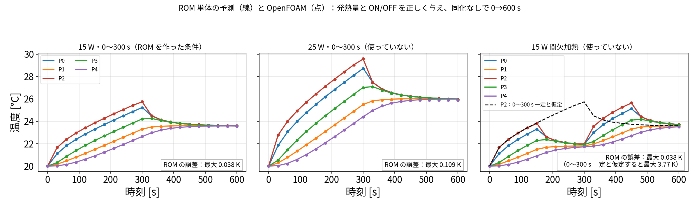

*図 8　OpenFOAM（太い薄い線）と ROM（細い破線）の代表 5 点の温度（上）と、その差（下）。下の帯は温度計のノイズ ±0.30 K。左から、ROM を作った条件、25 W、間欠加熱。右の点線は参考で、ON/OFF を与えず「0〜300 秒ずっと発熱」と決め打ちした ROM。*

| 条件 | 最大の温度上昇 | ROM の誤差（5 点の最大） | 温度上昇に対する比 |
|---|---:|---:|---:|
| 15 W（作った条件） | 5.8 K | 0.038 K | 0.7 % |
| **25 W** | 9.6 K | **0.109 K** | 1.1 % |
| **間欠加熱**（ON/OFF を与える） | 5.7 K | **0.038 K** | 0.7 % |

- どの条件でも、ROM の誤差は温度計のノイズ（0.3 K）より小さく収まりました。
- 間欠加熱では、**ヒータがいつ入っているかを ROM に教える**必要があります。教えずに「0〜300 秒ずっと発熱」のままにすると、最大 3.8 K 外れます（図 8 の右の点線）。

同じ結果に、ヒータの発熱（灰色の面、右の目盛り）を重ねて、字を大きくしたのが図 8b です（発表用）。ヒータが入っている間に温度が上がり、切れると下がる様子と、ROM がそれに付いていく様子が 1 枚で見えます。

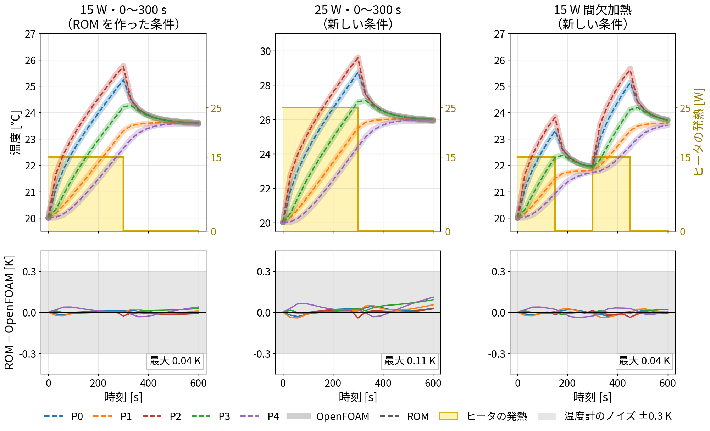

*図 8b　図 8 の上段にヒータの発熱を重ねた版。灰色の面がヒータの発熱（右の目盛り、W）。下段は ROM − OpenFOAM、帯は温度計のノイズ ±0.3 K。図 8 の右の点線（ON/OFF を与えない ROM）は載せていない。*

#### 代表点以外の場所：ROM から戻した温度分布も OpenFOAM と合う

上の比較は代表 5 点の温度だけです。そこで、ROM の 5 点の温度から gappy-POD で全 20,696 セルの温度を戻し（$`\mathbf T = \bar{\mathbf T} + \Phi\,\Phi_P^{-1}(\mathbf T_P - \bar{\mathbf T}_P)`$、§7-4 と同じ）、**代表 5 点以外の 20,691 セル**で OpenFOAM と比べました。データ同化はしていません。

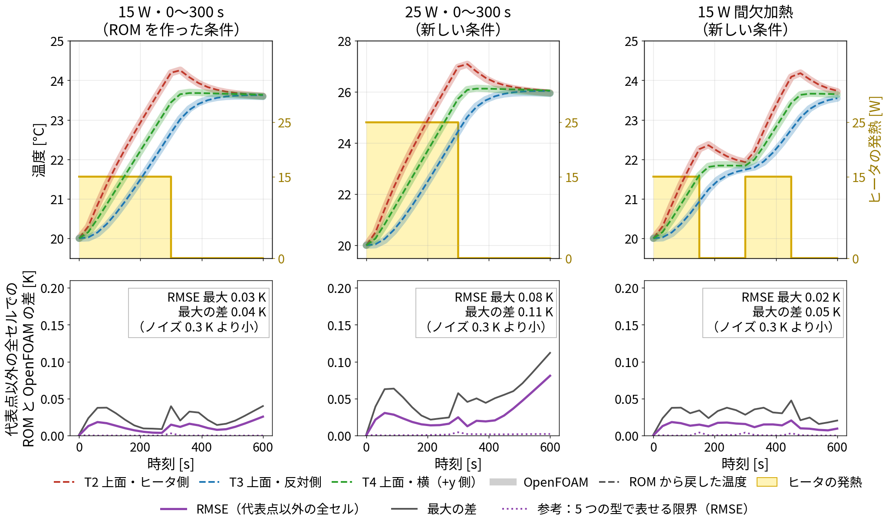

*図 8c　上：代表点以外の 3 か所の温度。T2（上面・ヒータ側、(26.6, −1.6, 98.8) mm）、T4（上面・横の +y 側、(1.6, 26.6, 98.8) mm）、T3（上面・反対側、(−26.6, −1.6, 98.8) mm）で、上面をヒータ側から 0°・90°・180° 回った 3 か所（場所は図 8d）。T2・T3 は §11 と同じセル、T4 は §11 の T4（反対側・中段）とは別の場所。太い薄い線が OpenFOAM、破線が ROM から戻した温度、黄色の面がヒータの発熱（右の目盛り、W）。ヒータから離れるほど（T2 → T4 → T3）温度の上がり方が遅い。下：代表点以外の全セルでの差（紫＝RMSE、灰＝最大の差、紫の点線＝OpenFOAM の温度を 5 つの型で一番よく表したときの RMSE）。*

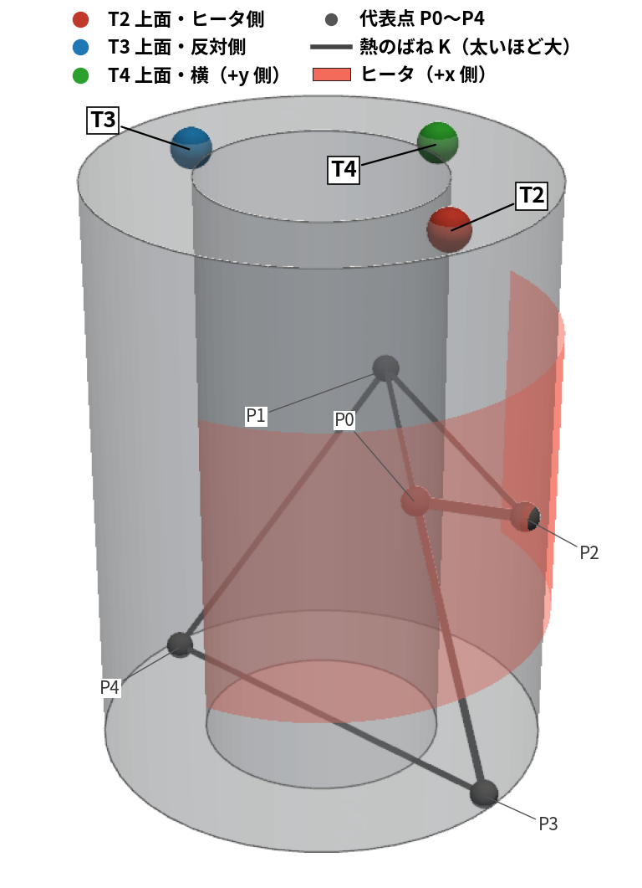

*図 8d　図 8c で代表点以外の温度を比べた 3 か所（T2 赤・T3 青・T4 緑、図 8c の線と同じ色）と、代表点 P0〜P4（灰）、代表点どうしをつなぐ熱回路の熱コンダクタンス K（灰の線、太いほど K が大きい。§7-4 の図 7 と同じ 6 本）、ヒータ（薄い赤、外周の +x 側、高さ 25〜75 mm）。斜めから見た図。3 か所とも上面で、ヒータからの向きだけが違う（T2 0°、T4 90°、T3 180°）。*

| 条件 | RMSE の最大 | 最大の差 | 5 つの型で表せる限界（RMSE） |
|---|---:|---:|---:|
| 15 W（作った条件） | 0.03 K | 0.04 K | 0.003 K |
| 25 W | 0.08 K | 0.11 K | 0.005 K |
| 間欠加熱 | 0.02 K | 0.05 K | 0.004 K |

- 代表点以外のどの場所でも、差は温度計のノイズ（0.3 K）より小さく収まりました。5 点の温度が合えば、温度分布全体も合います。
- 「5 つの型で表せる限界」は 0.005 K 以下です。残っている差のほとんどは、型が 5 つしかないことではなく、ROM（熱回路）が出す 5 点の温度のずれから来ています。
- 25 W では、600 秒に向かって差が大きくなります。§7-4 で見た「ROM の放熱 $`h`$ が物理の値より小さい」ことと合っていますが、原因かどうかは確かめていません。

### 8-3. 使えるかどうかの決め手：温度分布の「型」が変わるかどうか

ROM の温度は、POD の型（固定）の足し合わせ $`\mathbf u(t) \approx \bar{\mathbf u} + \sum_k a_k(t)\,\boldsymbol\varphi_k`$ で表しています。条件が変わって動くのは混ぜ具合 $`a_k(t)`$ だけで、型 $`\boldsymbol\varphi_k`$ は変わりません。

新しい条件の OpenFOAM の温度を、5 つの型で最も近く表したときに残る誤差（全 20,696 セル）は次のとおりで、どれも型で表せました。

| 条件 | 型で表したときに残る誤差 |
|---|---:|
| 15 W（作った条件） | 0.0007 K |
| 25 W | 0.0029 K |
| 間欠加熱 | 0.0019 K |

- **型の組み合わせで表せる変化**（全体の温まり方が強い・弱い、ON/OFF の時間が違う）→ 使える
- **型そのものが変わる変化**（熱い場所が移る、冷え方の分布が変わる）→ 使えない（作り直し）

### 8-4. 作り直しが必要なもの

| 変わるもの | 作り直しが必要な理由 |
|---|---|
| 熱源の位置・数 | 熱い場所が変わり、温度分布の型が変わる |
| 形状・メッシュ | 型がセルに結び付いている |
| 材料（熱伝導率・熱容量） | ROM の係数が変わる |
| 拘束（固定のしかた） | 温度から変位への換算が変わる |

作り直すには、OpenFOAM の計算（1 本あたり約 1〜3 時間）からやり直します。手順はスクリプトにしてあります。

確かめていない条件：25 W より大きく外れた発熱量、ランプ状の発熱や 30 秒より短い ON/OFF、600 秒より長い運転（OpenFOAM との比較）、周囲温度の変化、実機。

### 8-5. 使ったプログラム

| プログラム | すること |
|---|---|
| `run/limit_realsolver_truth.py` | 25 W・間欠加熱の OpenFOAM の結果を読み、ROM と比べる。5 つの型で表したときに残る誤差も計算 |
| `run/rom_alone_intermittent.py` | 間欠加熱で、ON/OFF を与えた ROM と与えない ROM を比べる（図 8 の右の列） |
| `dacore/rom_general.py` の `heater_power_W` | ヒータの発熱の時間変化。間欠加熱ではこの関数を差し替える |
| `run/make_rom_applicability_fig.py --heater` | 図 8b（ヒータの発熱を重ねた版）。`--heater` なしで図 8 |
| `run/rom_field_vs_openfoam.py` | 図 8c。ROM → gappy-POD で全セルの温度を戻し、代表点以外で OpenFOAM と比べる（`results/rom_field_vs_openfoam.json`） |
| `run/make_rom_field_points_fig.py` | 図 8d。図 8c で温度を比べた場所・代表点・ヒータの図 |

最初の ROM では、ヒータの時間変化が「0〜300 秒だけ発熱」と書き込まれていました（`dacore/rom_general.py`）。間欠加熱ではここを実際の ON/OFF に差し替えます。

```python
HEATER_ON_S = 300.0
def heater_power_W(t, q_scale=1.0):
    return np.where(np.asarray(t) < HEATER_ON_S, q_scale * HEATER_RATED_W, 0.0)
```

### 8-6. 7 ページ目で言うこと（約 1 分）

- ROM は OpenFOAM の計算 1 本から作ったが、発熱量（25 W）や加熱のしかた（間欠加熱）が変わっても、作り直さずに使えた（誤差 0.04〜0.11 K、温度計のノイズ以下）。
- 間欠加熱では、ヒータがいつ入っているかを ROM に与える必要がある。
- 5 点の温度から戻した温度分布も、代表点以外の場所で OpenFOAM と合った（RMSE 0.02〜0.08 K）。
- 使えるかどうかは、温度分布の「型」が変わるかどうかで決まる。熱源の位置や形が変わったら作り直し。

---

## 9. 8 ページ目「データ同化の流れ」

ここ（9-1〜9-4）を、発表の 8 ページ目に載せます。9-5 は使ったプログラム、9-6 は話す内容です。6・7 ページ目の ROM を予報のモデルにして、EnKF で 30 秒ごとに観測を取り込みます（詳しくは [blog_006 §3](blog_006_temp2_disp2_step_by_step.md)）。

### 9-1. 推定するもの（状態）：7 つの数

```math
\mathbf z = \big(T_0,\ T_1,\ T_2,\ T_3,\ T_4,\ q,\ h\big)^{\mathsf T}
```

- $`T_0 \ldots T_4`$：代表 5 点（P0〜P4）の温度
- $`q`$：発熱の倍率（発熱量 $`Q = 15\,q`$ [W]）
- $`h`$：空気への放熱 [W/K]
- **変位は状態に入れません。** 変位は 5 点の温度から計算できるからです（9-3）。

最初は、7 つの数を少しずつ変えた 60 通り（メンバー）を用意します。

| 成分 | 最初のばらつかせ方 |
|---|---|
| 温度 | 気温 20 ℃ から −3〜+12 K（一様乱数） |
| $`q`$ | 0.3〜1.8（発熱量 4.5〜27 W） |
| $`h`$ | 平均 0.02、標準偏差 0.01 W/K |

### 9-2. 1 サイクルの 4 ステップ

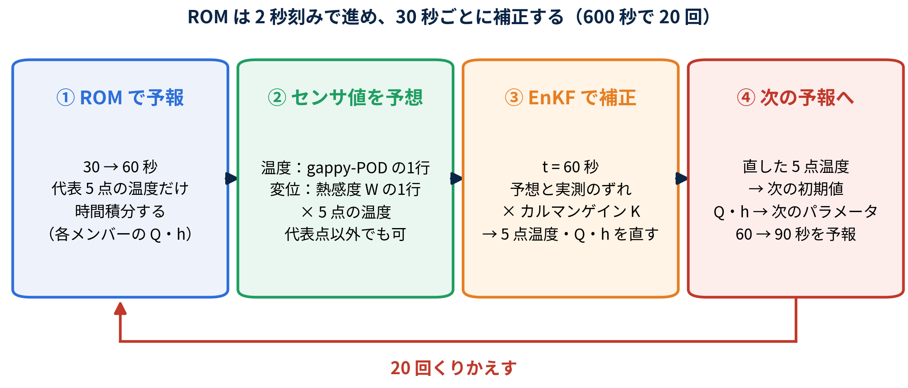

*図 9　データ同化の 1 サイクル。ROM は 2 秒刻みで進め、30 秒ごとに補正する（600 秒で 20 回）。*

| ステップ | すること |
|---|---|
| ① ROM で予報 | 60 メンバーそれぞれを、ROM で 30 秒進める（2 秒刻み × 15 回）。計算するのは代表 5 点の温度だけ |
| ② センサの値を予想 | 各メンバーについて「このメンバーの状態が正しいなら、センサは何を示すはずか」を計算する |
| ③ EnKF で補正 | 予想と実測のずれに、重み（カルマンゲイン）を掛けて、5 点の温度・$`q`$・$`h`$ を直す |
| ④ 次の予報へ | 直した 5 点の温度を次の初期値、直した $`q`$・$`h`$ を次の発熱・放熱の条件にして、次の 30 秒を予報する |

予報している 30 秒の間はセンサを使わず、補正する瞬間は時間を進めません。この 2 つを交互にくりかえします。

### 9-3. センサの値の予想（観測演算子）：どれも「5 点の温度の一次式」

センサは代表 5 点に置かなくてかまいません。どのセンサの値も、5 点の温度に重みを掛けて足した形で予想できるからです。

```math
y_c = \mathbf h_c^{\mathsf T}\,\delta\mathbf T_P
```

- $`\delta\mathbf T_P`$：代表 5 点の温度（基準からの差）
- **温度計**：$`\mathbf h_c^{\mathsf T}`$ は、5 点の温度から全セルを戻す gappy-POD の、その場所の行
- **変位計**：$`\mathbf h_c^{\mathsf T}`$ は、POD の型ごとに FrontISTR で前もって計算しておいた変位（熱感度）の、その場所・向きの行

重みはデータ同化を始める前に 1 回計算しておくので、**データ同化の中で OpenFOAM も FrontISTR も回しません**。

### 9-4. 補正の式

メンバー $`m`$ ごとに、次の 1 式で直します。

```math
\mathbf z_a^{(m)} = \mathbf z_f^{(m)} + K\left(\mathbf y_{\mathrm{obs}} + \boldsymbol\varepsilon^{(m)} - \mathbf y_f^{(m)}\right),\qquad
K = P_{zy}\left(P_{yy} + R\right)^{-1}
```

- $`\mathbf z_f`$：補正前（予報）、$`\mathbf z_a`$：補正後
- $`\mathbf y_f`$：センサの値の予想、$`\mathbf y_{\mathrm{obs}}`$：実測、$`\boldsymbol\varepsilon^{(m)}`$：メンバーごとに足す観測の乱数
- $`P_{zy}`$：「状態」と「センサの予想」が 60 メンバーの中で一緒に動く度合い（共分散）、$`P_{yy}`$：センサの予想のばらつき、$`R`$：センサの誤差

$`P_{zy}`$ の中には、$`q`$ とセンサの予想の関係も入っています。そのため、温度や変位のずれから**発熱量も直せます**。

| 設定 | 値 |
|---|---|
| メンバー数 | 60 |
| 補正の間隔・回数 | 30 秒ごと、600 秒で 20 回 |
| センサの誤差（乱数の大きさ） | 温度 0.30 K、変位 0.30 µm |
| ばらつきを保つための膨張 | 1.02 倍 |
| 乱数を変えた計算 | 5 回（seed 20260913〜17）の平均で評価 |

### 9-5. 使ったプログラム

| プログラム | すること |
|---|---|
| `dacore/rom_general.py` | ① ROM で 60 メンバーを 30 秒進める |
| `run/holdout_AO_realsolver.py` | ② センサの値の予想（5 点の温度の一次式）、③ `dacore/enkf.py` で補正、④ 次へ、を 20 回 |
| `run/build_full_disp_operator.py` | 変位計の重み（POD の型ごとの FrontISTR の変位）を前もって計算する |

1 サイクル（`run/holdout_AO_realsolver.py`、抜粋）：

```python
for ci, tb in enumerate(cyc, 1):                    # 30 秒ごとに 20 回
    Z[:, :NPT] = integ_on(Z[:, :NPT], C, Km, Z[:, IH], Z[:, IQ], heat, on, tp, tb)   # ① ROM で予報
    yv = list(T5[ci][TN]); Yf = Z[:, TN]            # ② 温度計の予想 = その代表点の温度
    for (i, c), w, b0 in zip(obs, ws, u0):          #    変位計の予想 = 5 点の温度の一次式
        yv.append(utrue[ci, i, c])
        Yf = np.column_stack([Yf, b0 + (Z[:, :NPT] - mp) @ w])
    y = np.array(yv) + ro.normal(0, np.sqrt(np.diag(Rd)))   # 実測（正解 + 誤差）
    Z = enkf_update(Z, y, None, Rd, rng, inflation=INFL, Yf=Yf)   # ③ 補正（5 点の温度・q・h）
```

### 9-6. 8 ページ目で言うこと（約 1 分 30 秒）

- ROM が持つのは、代表 5 点の温度と、発熱・放熱の 7 つの数。これを 60 通り同時に回す。
- 30 秒ごとに、センサの値を予想し、実測とのずれで 7 つの数を直して、次の予報に渡す。
- センサは代表 5 点でなくてよい。温度も変位も「5 点の温度の一次式」で予想できるので、データ同化の中で OpenFOAM・FrontISTR は回さない。
- 状態とセンサの関係から、温度や変位のずれで発熱量まで直せる。

---

## 10. 9 ページ目「データ同化で試したこと」

ここ（10-1〜10-4）を、発表の 9 ページ目に載せます。10-5 は使ったプログラム、10-6 は話す内容です。8 ページ目の流れで、**一度も測らない場所の反りを当てられるか**を試しました（詳しくは [blog_008 §6](blog_008_novelty_displacement_assimilation.md)、数値は 2026-10-12 に IDW で計算し直したもの）。

### 10-1. 3 種類の点：代表点・観測点・未観測点

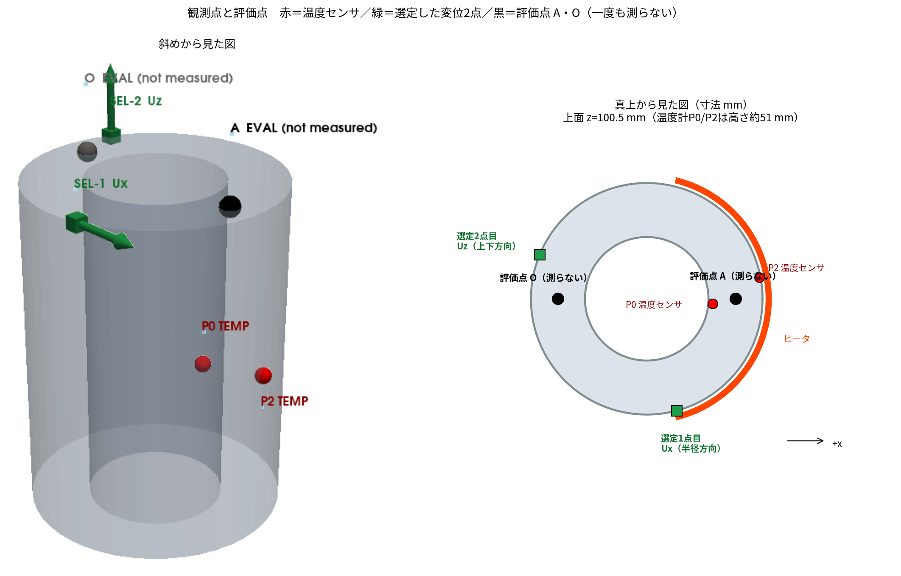

*図 10　点の場所。赤＝温度計（P2・P0）、緑＝選んだ変位計 2 点（S1・S2）、黒＝評価点 A・O（一度も測らない）。左は斜めから、右は真上から見た図。*

| 種類 | 点 | 何のための点か |
|---|---|---|
| **代表点** | P0〜P4（Q-DEIM で選んだ 5 セル） | ROM が温度を計算する点。センサを置く点ではない |
| **観測点** | 温度計 P2・P0（ヒータ側の中段）／変位計 S1・S2（上面、S1 は横方向 $`U_x`$、S2 は上下方向 $`U_z`$） | 実際に測って、データ同化に使う点 |
| **未観測点（評価点）** | 上面のヒータ側 A と反対側 O | **一度も測らない**。推定した反り $`U_z(A) - U_z(O)`$ を、正解と比べるためだけに使う |

- 代表点のうち P1・P3・P4 には温度計がありません。それでもデータ同化で温度が直るかを見ます。
- 評価点 A・O は工具先端の代わりです。「測れない場所」を、測れる場所の観測から当てられるかを見ます。

### 10-2. 計算ケース

**正解**は OpenFOAM＋FrontISTR で計算した温度と変位です（ROM とは別の計算）。3 つの加熱の条件で試しました。

| 条件 | ヒータ | ROM を作るときに見たか |
|---|---|---|
| 15 W | 15 W を 0〜300 秒 | 見た |
| 25 W | 25 W を 0〜300 秒 | 見ていない |
| 間欠加熱 | 15 W を 0〜150 秒と 300〜450 秒 | 見ていない（ON/OFF の時刻は与える） |

温度計はどれも P2・P0 の 2 本で、変位計の置き方を変えて比べました。

| 観測の組み合わせ | 変位計の置き方 |
|---|---|
| 温度 2 点のみ | なし |
| ＋A・O 自身を測る（参考） | 評価点 A・O に変位計を置く（測れない場所を測った場合） |
| ＋中段の 2 点（B・C） | 中段（高さ 75 mm）の 2 点 |
| ＋底面近くの 2 点（悪い例） | 底面近く（高さ 5 mm）の 2 点 |
| **＋選んだ 2 点（本研究）** | **上面の S1・S2**（選び方は次のページ） |

EnKF の設定は 8 ページ目のとおりです（60 メンバー、30 秒ごと、5 回の乱数の平均）。誤差は、加熱している 30〜300 秒の平均です。

### 10-3. 計算結果

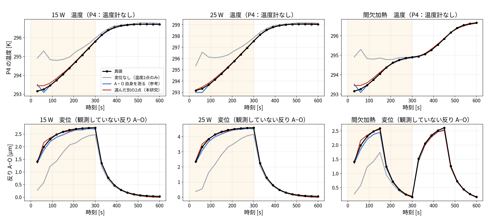

*図 11　上：温度計のない代表点 P4 の温度。下：一度も測らない反り A−O。黒が正解（OpenFOAM＋FrontISTR）、灰が温度 2 点だけ、青が A・O 自身を測った場合（参考）、赤が選んだ 2 点（本研究）。*

**一度も測らない反り A−O の誤差 [µm]**

| 観測の組み合わせ | 15 W | 25 W | 間欠加熱 |
|---|---:|---:|---:|
| 温度 2 点のみ | 0.775 | 1.417 | 0.635 |
| ＋A・O 自身を測る（参考） | 0.137 | 0.154 | 0.100 |
| ＋中段の 2 点（B・C） | 0.186 | 0.193 | 0.142 |
| ＋底面近くの 2 点（悪い例） | 0.587 | 1.100 | 0.487 |
| **＋選んだ 2 点（本研究）** | **0.076** | **0.083** | **0.072** |

（`results/holdout_AO_realsolver.json`）

- **温度 2 点だけでは、反りが合わない**（0.6〜1.4 µm）。温度計のない P4 の温度も、加熱の初めに 1.5 K 以上ずれます（図 11 上の灰）。
- **変位を 2 点足すと、測っていない反りが当たる**。選んだ 2 点では 0.07〜0.08 µm で、3 条件とも同じ結果でした。
- **A・O を直接測るより、選んだ別の 2 点のほうが正確**（0.076 対 0.137 µm）。
- **置き場所が悪いと効かない**。底面近くでは 0.5〜1.1 µm で、温度 2 点だけとあまり変わりません。

### 10-4. 分かったこと

- 変位は温度場全体の重み付き和なので、変位計 1 本が温度計のない場所の温度まで直します（図 11 上の P4）。
- ただし、**どこに置くかで結果が大きく変わる**（0.076 〜 0.587 µm）。置き場所の選び方が大事になります（11 ページ目）。

### 10-5. 使ったプログラム

| プログラム | すること |
|---|---|
| `run/holdout_AO_realsolver.py` | 3 条件 × 5 通りの観測 × 5 回の乱数でデータ同化し、一度も測らない反り A−O の誤差を計算（`results/holdout_AO_realsolver.json`） |
| `dacore/temperature_mapping.py` | 正解の OpenFOAM の温度を、FrontISTR の節点へ IDW で渡す（近い 8 セルを距離の逆数で重み付け） |

反りの推定（同じスクリプト、抜粋）：直した 5 点の温度の平均から、A・O の変位を一次式で計算します。

```python
m = Z[:, :NPT].mean(0); dm = m - mp                  # 直した 5 点の温度（平均）の、基準からの差
est = (aA + wA @ dm) - (aO + wO @ dm)                # 反り = U_z(A) − U_z(O)（どちらも 5 点の温度の一次式）
eAO.append(abs(est - aot[ci]))                       # 正解（OpenFOAM＋FrontISTR）との差
```


### 10-6. 9 ページ目で言うこと（約 2 分）

- 点は 3 種類。ROM が計算する代表点、実際に測る観測点、一度も測らずに答え合わせだけに使う評価点 A・O。
- 温度 2 点だけでは、測っていない反りが合わない（0.78 µm）。
- 選んだ変位 2 点を足すと、測っていない反りが 0.076 µm まで当たり、A・O を直接測る（0.137 µm）より正確だった。発熱量 25 W・間欠加熱でも同じ。
- 置き場所が悪いと効かない。どう選ぶかは 11 ページ目で示す。次のページでは、測っていない場所の温度を見る。

---

## 11. 10 ページ目「未観測点の温度：データ同化で、測っていない場所も合う」

ここ（11-1〜11-2）を、発表の 10 ページ目に載せます。11-3 は使ったプログラム、11-4 は話す内容です。9 ページ目は反り（変位）でした。このページでは、**測っていない場所の温度**も合うかを見ます。

### 11-1. やり方：データ同化 → gappy-POD で全体の温度を戻す

データ同化で直したのは代表 5 点の温度だけです。そこから gappy-POD で全 20,696 セルの温度を戻し、観測していない場所の温度を正解（OpenFOAM）と比べました。

```math
\mathbf T_{\text{全体}} = \bar{\mathbf u} + \Phi\,\Phi_P^{+}\,\big(\mathbf T_P - \bar{\mathbf u}_P\big)
```

（$`\Phi`$：POD の型、$`\Phi_P`$：その代表 5 点の行、$`^{+}`$：擬似逆行列、$`\mathbf T_P`$：直した代表 5 点の温度。5 回の乱数の平均）

比べた場所は、温度計のある P2・P0 とは別の 4 か所（T1〜T4）です。どれも観測には使いません。

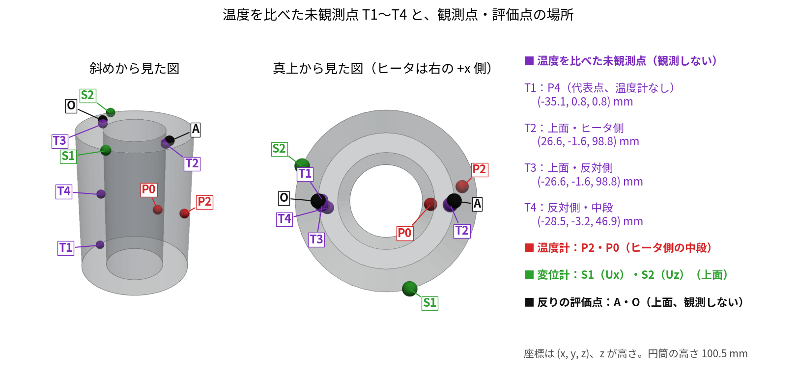

*図 12a　温度を比べた未観測点 T1〜T4（紫）と、温度計 P2・P0（赤）、変位計 S1・S2（緑）、反りの評価点 A・O（黒）。左は斜めから、右は真上から見た図。ヒータは +x 側（右）。*

| 点 | 場所 | 座標 (x, y, z) [mm] |
|---|---|---|
| T1 | 代表点 P4。反対側の底面近く（温度計なし） | (−35.1, 0.8, 0.8) |
| T2 | 上面・ヒータ側（評価点 A の近く） | (26.6, −1.6, 98.8) |
| T3 | 上面・反対側（評価点 O の近く） | (−26.6, −1.6, 98.8) |
| T4 | 反対側・中段 | (−28.5, −3.2, 46.9) |

### 11-2. 結果

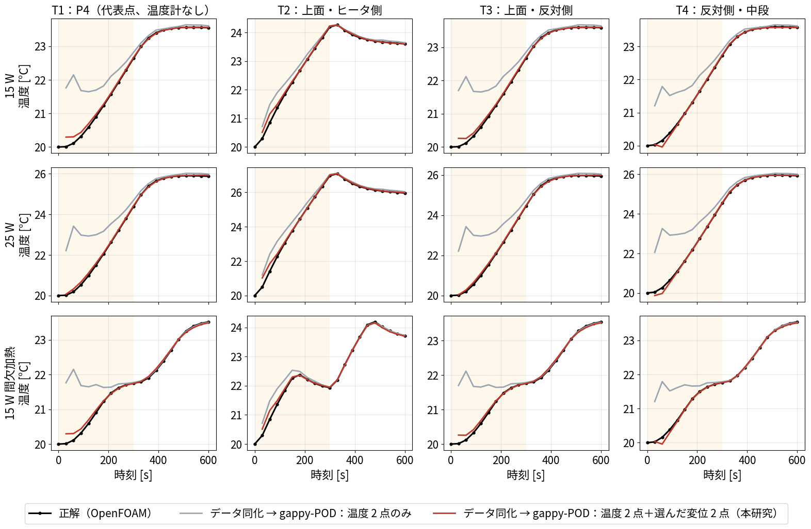

*図 12　未観測点 T1〜T4 の温度（行：加熱の条件、列：場所）。黒が正解（OpenFOAM）、灰が温度 2 点だけ、赤が温度 2 点＋選んだ変位 2 点（本研究）。どちらもデータ同化で直した代表 5 点から gappy-POD で戻した温度。T1（P4）は代表点だが温度計はない。T2〜T4 は代表点でもない。*

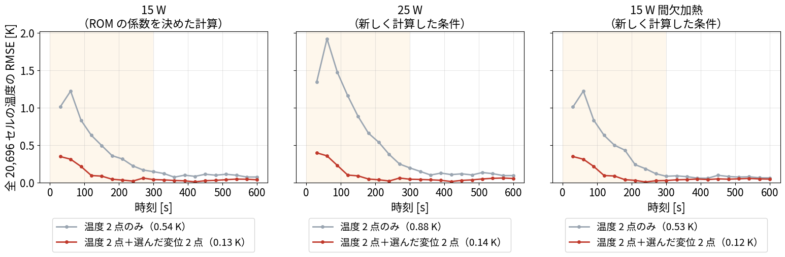

*図 13　全 20,696 セルの温度の RMSE の時間変化。かっこ内は加熱期 30〜300 秒の平均。*

**観測していない場所の温度の誤差（加熱期 30〜300 秒の平均）[K]**

| 条件 | 観測 | 全セル（RMSE） | T1（P4） | T2 上面・ヒータ側 | T3 上面・反対側 | T4 反対側・中段 |
|---|---|---:|---:|---:|---:|---:|
| 15 W | 温度 2 点のみ | 0.54 | 0.89 | 0.28 | 0.88 | 0.73 |
| 15 W | **＋選んだ変位 2 点** | **0.13** | **0.09** | **0.08** | **0.08** | **0.04** |
| 25 W | 温度 2 点のみ | 0.88 | 1.47 | 0.49 | 1.47 | 1.37 |
| 25 W | **＋選んだ変位 2 点** | **0.14** | **0.07** | **0.13** | **0.05** | **0.07** |
| 間欠加熱 | 温度 2 点のみ | 0.53 | 0.78 | 0.25 | 0.77 | 0.64 |
| 間欠加熱 | **＋選んだ変位 2 点** | **0.12** | **0.08** | **0.08** | **0.07** | **0.04** |

（`run/holdout_unobserved_cells.py` → `results/holdout_unobserved_cells.json`。全セル以外は、その場所の温度の差の絶対値の平均）

- **温度 2 点だけでは、ヒータと反対側の温度が合わない**（0.6〜1.5 K）。温度計がヒータ側（P2・P0）にしかないためです。
- **変位 2 点を足すと、反対側も含めて 0.04〜0.13 K まで合う**。全セルでも 0.12〜0.14 K で、温度 2 点だけ（0.53〜0.88 K）の 1/4〜1/6 です。
- 誤差が大きいのは加熱の初め（0〜100 秒）で、データ同化を重ねるにつれて小さくなります（図 13）。

### 11-3. 使ったプログラム

| プログラム | すること |
|---|---|
| `run/make_unobserved_points_fig.py` | 未観測点 T1〜T4 と観測点・評価点の場所の図（図 12a） |
| `run/holdout_unobserved_cells.py` | 9 ページ目と同じデータ同化（温度 2 点のみ／温度 2 点＋選んだ変位 2 点）を 3 条件 × 5 回の乱数で回し、直した代表 5 点から gappy-POD で全セルの温度を戻して、OpenFOAM と比べる |

全体の温度を戻す gappy-POD（`run/holdout_unobserved_cells.py`）：

```python
UPp = np.linalg.pinv(U[pod, :])                      # 代表 5 点の行の擬似逆行列（5 × 5）
def recon(T5):                                       # 直した代表 5 点の温度 → 全 20,696 セル
    return mean[None, :] + ((T5 - mp) @ UPp.T) @ U.T # T = 平均 + Φ Φ_P⁺ (T_P − 平均_P)
full = recon(T5m)                                    # 各時刻の全セルの温度
rmse = np.sqrt(((full - Tf) ** 2).mean(1))           # 正解（OpenFOAM）との差
```

### 11-4. 10 ページ目で言うこと（約 1 分）

- データ同化で直すのは代表 5 点の温度だけ。そこから gappy-POD で全体の温度を戻す。
- 温度 2 点だけでは、温度計のないヒータの反対側が 0.6〜1.5 K ずれる。
- 変位 2 点を足すと、測っていない場所の温度も 0.04〜0.13 K で合い、全セルでも 0.12〜0.14 K（温度 2 点だけの 1/4〜1/6）。25 W・間欠加熱でも同じ。

---

## 12. 11 ページ目「センサの置き場所：Fisher 情報行列」

ここ（12-1〜12-5）を、発表の 11 ページ目に載せます。12-6 は使ったプログラム、12-7 は話す内容です。9 ページ目で「置き場所が悪いと効かない」ことが分かりました。どこに置けばよいかを、**Fisher 情報行列**の考え方で示します。

### 12-1. Fisher 情報行列：その観測で、知りたいものがどれだけ分かるか

推定したいもの（未知の数）を $`\boldsymbol\theta`$、センサの値を $`\mathbf y`$ とします。センサの値が未知の数でどれだけ変わるか（感度）を $`G = \partial \mathbf y / \partial \boldsymbol\theta`$、センサの誤差の大きさを $`R`$ とすると、Fisher 情報行列は次の式です。

```math
F = \sum_{k} G_k^{\mathsf T}\, R^{-1}\, G_k
```

- $`k`$ は観測の時刻。時刻ごとの情報を足し合わせます。
- **感度が大きく、誤差が小さいほど、情報が多い**（$`F`$ が大きい）。
- $`R^{-1}`$ で割るので、温度（K）と変位（µm）の単位がそろい、**温度計と変位計を同じものさしで比べられます**。
- 独立なセンサを足すと、$`F`$ は足し算になります（$`F_{\text{温度}+\text{変位}} = F_{\text{温度}} + F_{\text{変位}}`$）。

#### Fisher 情報量のイメージと、上の式の出どころ

参考：[Fisher情報量と共分散行列（Qiita）](https://qiita.com/nekokaitaiyo_ne/items/aee3f7152b984b3644bf)、[フィッシャー情報量、どんなイメージ？（note）](https://note.com/kimukimucitrus/n/nace8ba84d129)

1. **尤度**：未知の数が $`\boldsymbol\theta`$ のとき、センサの値 $`\mathbf y`$ が出る確からしさ $`p(\mathbf y \mid \boldsymbol\theta)`$。
2. **スコア関数**：対数尤度を $`\boldsymbol\theta`$ で微分したもの $`\mathbf s = \partial \ln p / \partial \boldsymbol\theta`$。正しい $`\boldsymbol\theta`$ では、平均は 0 になる。
3. **Fisher 情報量**：スコア関数のばらつき（分散）。対数尤度の 2 階微分（山のとがり具合）の期待値にマイナスを付けたものと等しい。

```math
F = \mathrm E\!\left[\mathbf s\,\mathbf s^{\mathsf T}\right] = -\,\mathrm E\!\left[\frac{\partial^2 \ln p}{\partial \boldsymbol\theta\,\partial \boldsymbol\theta^{\mathsf T}}\right]
```

尤度の山が鋭いほど（少し $`\boldsymbol\theta`$ がずれただけで、その観測が出にくくなるほど）、情報が多い。

**センサの誤差が正規分布のとき**：センサの値を $`\mathbf y = \mathbf g(\boldsymbol\theta) + \boldsymbol\varepsilon`$（誤差 $`\boldsymbol\varepsilon`$ の共分散 $`R`$）とすると、

```math
\ln p = -\tfrac12\,\big(\mathbf y - \mathbf g(\boldsymbol\theta)\big)^{\mathsf T} R^{-1} \big(\mathbf y - \mathbf g(\boldsymbol\theta)\big) + \text{定数}
```

これを 2 回微分して期待値をとると、感度 $`G = \partial \mathbf g / \partial \boldsymbol\theta`$ を使って $`F = G^{\mathsf T} R^{-1} G`$ になります。これが上の式です。

**推定のばらつきとの関係**：どんな（偏りのない）推定でも、推定のばらつき（共分散）$`C`$ は $`F^{-1}`$ より小さくできません（クラメール・ラオの下限、$`C \succeq F^{-1}`$）。データが多ければ、最尤推定のばらつきは $`F^{-1}`$ に近づきます。つまり、**$`F`$ を大きくする置き場所ほど、推定のばらつきを小さくできる**。

次の 12-2 は、これに「測る前の不確かさ」を加えたものです（$`F^{-1}`$ が $`(B^{-1}+F)^{-1}`$ になる）。

### 12-2. 測る前の不確かさと合わせる：測った後に残る不確かさ

データ同化では、測る前にも「だいたいこのくらい」という不確かさ（事前の共分散 $`B`$）があります。モデルと観測の関係が線形で誤差が正規分布なら、測った後に残る不確かさは

```math
P = \left(B^{-1} + F\right)^{-1}
```

です。置き場所の良し悪しは、この $`P`$ を何の基準で小さくするかで決まります。

| 基準 | 小さくするもの | 意味 |
|---|---|---|
| A 最適 | $`\operatorname{tr} P`$ | 5 点の温度の不確かさの合計 |
| D 最適 | $`\det P`$ | 不確かさの体積 |
| E 最適 | $`F`$ の最小固有値を大きく | 一番分かりにくい方向をなくす（発熱量と放熱の見分けなど） |
| **目的指向** | $`\mathbf w^{\mathsf T} P\, \mathbf w`$ | **知りたい量（反り $`d = \mathbf w^{\mathsf T}\delta\mathbf T_P`$）の不確かさ** |

### 12-3. 本研究で使った基準：反りに対する目的指向

本研究は、知りたいのが**反り A−O** なので、目的指向の基準を使いました。センサ $`c`$（感度 $`\mathbf h_c`$、誤差 $`r_c`$）を 1 本足すと、情報は $`F`$ に $`\mathbf h_c \mathbf h_c^{\mathsf T}/r_c`$ が足され、反りの分散は

```math
\Delta_c = \frac{\big(\mathbf w^{\mathsf T} P_S\, \mathbf h_c\big)^2}{\mathbf h_c^{\mathsf T} P_S\, \mathbf h_c + r_c}
```

だけ減ります（$`P_S`$ はすでに選んだセンサで測った後の不確かさ）。30〜300 秒で平均した「残る反りの標準偏差」$`J_c`$ が最小の点を、1 本ずつ選びました（[docs/25](25_sensor_selection_theory_and_idw.md)）。

- 分子：その観測が、反りを変える温度の動きを捉えているか
- 分母：観測の信号が、誤差に埋もれないか
- 2 本目は、1 本目で測った後の $`P_S`$ で採点し直すので、1 本目と同じ情報しか持たない点は選ばれにくい

これは、12-2 の式（$`B^{-1} + F`$）に 1 本ずつ情報を足していく計算そのものです。

### 12-4. 結果：既存の選び方と比べる

同じ候補（変位 14,754 通り）から、選び方だけを変えて 2 点を選び、9 ページ目と同じデータ同化で比べました（真値は OpenFOAM＋FrontISTR、温度計は P2・P0、`results/placement_method_comparison.json`）。

| 選び方 | 予測した反りの不確かさ [µm] | 実際の反りの誤差 15 W [µm] | 25 W | 間欠加熱 |
|---|---:|---:|---:|---:|
| 変位なし（温度 2 点のみ） | 1.19 | 0.775 | 1.417 | 0.635 |
| よく動く点に置く | 1.01 | 0.569 | 1.079 | 0.453 |
| Q-DEIM | 0.32 | 0.134 | 0.165 | 0.105 |
| D 最適 | 0.35 | 0.108 | 0.109 | 0.095 |
| A 最適 | 0.27 | 0.089 | 0.097 | 0.078 |
| **目的指向（本研究）** | **0.26** | **0.076** | **0.083** | **0.072** |

- 目的指向が 3 条件とも一番小さくなりました。ただし A 最適との差は 8〜15 % です。
- 「よく動く点に置く」は、2 点が 5 mm しか離れず同じ情報を測ってしまい、効きませんでした。
- 予測した不確かさの順番と、実際の誤差の順番がおおむねそろっています（D 最適と Q-DEIM の順は入れ替わる）。

### 12-5. Fisher 情報行列で、最適な温度センサと変位センサの位置が分かるか

**分かります。ただし「何を知りたいか」「測る前の不確かさ」「センサの誤差」を決めたうえでの、近似の最適です。**

分かること：

- 温度計と変位計を、同じものさし（誤差で割った情報量）で比べ、組み合わせて選べる。
- 知りたい量を決めれば、それに合った置き場所を、データ同化を回す前に計算で選べる。本研究では、反りに対して選んだ 2 点が、実際のデータ同化でも一番よかった。

気をつけること：

| 注意 | 中身 |
|---|---|
| 知りたい量で答えが変わる | 反りに最適な点と、温度場全体・発熱量に最適な点は違う。本研究で確かめたのは**反り**に対する配置だけ |
| Fisher だけでは状態は決まらない | $`F`$ は観測からの情報だけ。温度場（状態）を推定するには、測る前の不確かさ $`B`$ と合わせた $`P = (B^{-1}+F)^{-1}`$ で評価する |
| 線形・正規分布の近似 | 実際の EnKF は非線形で、メンバーは有限。1 回の補正の分散減少と、20 回補正した後の誤差の順位は一致しないことがある（[docs/19 §4-1](19_research_advantage_and_validation.md)）。選んだ後に必ずデータ同化で確かめる |
| 1 本ずつ選ぶ方法 | 全部の組み合わせの中での最適（大域最適）は保証しない |
| 発熱量と放熱の見分け | $`F`$ の最小固有値（E 最適）で、発熱量 $`Q`$ と放熱 $`h`$ を見分けられる位置・時間を選ぶ考え方は整理済み（[blog_005 §3](blog_005_optimal_sensor_placement.md)）。**実際に計算して選んだことはまだない（未実施）** |

### 12-6. 使ったプログラム

| プログラム | すること |
|---|---|
| `run/select_nonrep_temp_disp.py` | `add_row`（1 本測った後の不確かさ）と `score`（残る反りの不確かさ $`J_c`$） |
| `run/make_sensor_score_map.py` | 変位の候補 14,754 通りを採点し、1 本ずつ 2 本選ぶ（`results/sensor_score_idw.json`） |
| `run/placement_method_comparison.py` | A 最適・D 最適・Q-DEIM などで選び、同じデータ同化で比べる（`results/placement_method_comparison.json`） |

1 本測った後の不確かさと採点（`run/select_nonrep_temp_disp.py`）：

```python
def add_row(P, h, r):                 # センサ（感度 h、誤差 r）を 1 本足した後の P
    Ph = P @ h
    return P - np.outer(Ph, Ph) / (h @ Ph + r)      # = (P⁻¹ + h hᵀ / r)⁻¹

def score(Ps, w, Hc, r):              # 候補ごとに、残る反りの標準偏差を時刻平均
    s = np.zeros(len(Hc))
    for P in Ps:                      # 30〜300 秒の 10 時刻
        HP = Hc @ P
        s += np.sqrt(np.maximum(w @ P @ w - (HP @ w)**2 / (np.einsum("ij,ij->i", HP, Hc) + r), 0))
    return s / len(Ps)                # J_c（小さいほどよい）
```

A 最適・D 最適（`run/placement_method_comparison.py`）：同じ $`P`$ から、トレースと行列式を計算します。

```python
def post(B, ws):                      # 温度 2 点 + 変位を測った後の P
    H = np.vstack([Ht] + [w[None, :] for w in ws])
    K = B @ H.T @ np.linalg.inv(H @ B @ H.T + R)
    return B - K @ H @ B
P = post(B, ws)
sigma_AO = np.sqrt(w_AO @ P @ w_AO)   # 目的指向（反りの不確かさ）
trace    = np.trace(P)                # A 最適
logdet   = np.linalg.slogdet(P)[1]    # D 最適
```

### 12-7. 11 ページ目で言うこと（約 1 分 30 秒）

- 置き場所は、Fisher 情報行列（感度を誤差で割った情報量）で考える。温度計と変位計を同じものさしで比べられる。
- 測る前の不確かさと合わせると、測った後に残る不確かさが計算できる。本研究は、知りたい反りの不確かさが一番小さくなる点を選んだ（目的指向）。
- 既存の選び方（A 最適・D 最適・Q-DEIM）と同じ条件で比べ、3 条件とも一番よかった（0.076 µm）。
- ただし、知りたい量が変われば最適な位置も変わる。選んだ後はデータ同化で確かめる。
