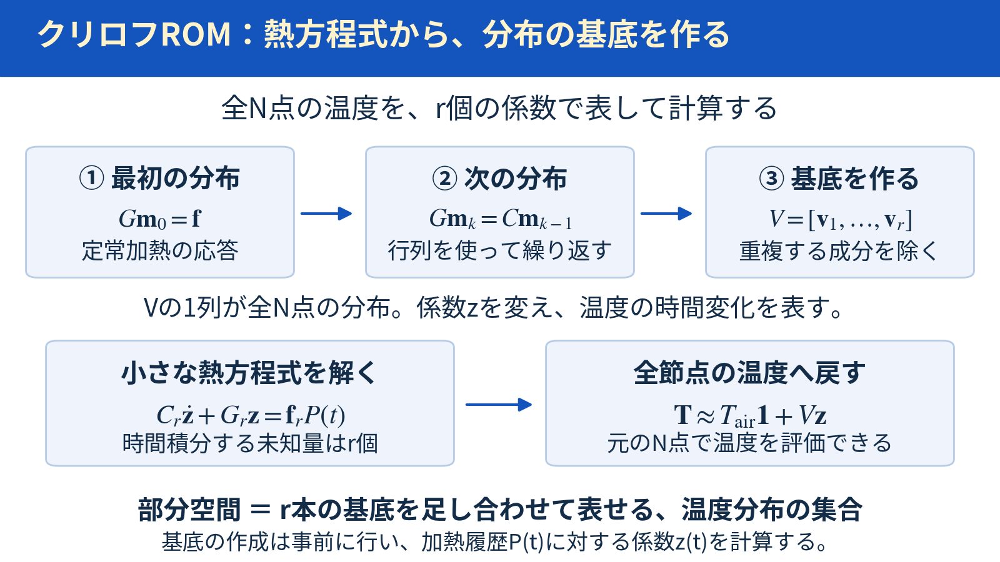
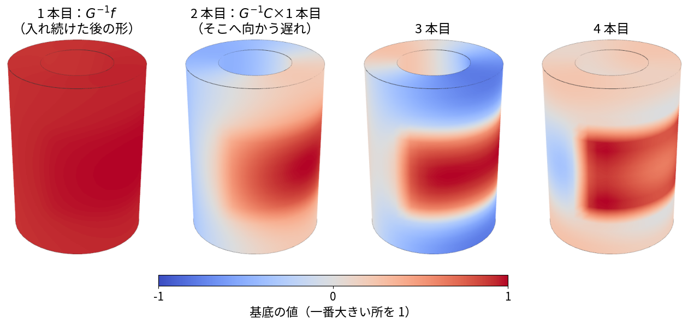
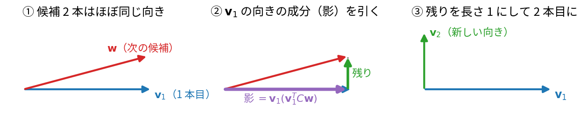
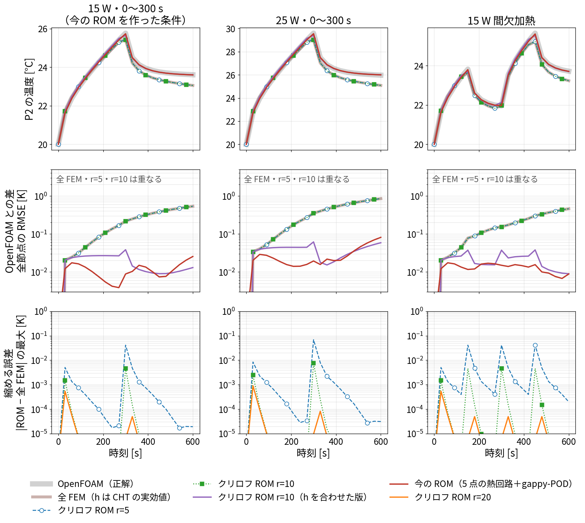
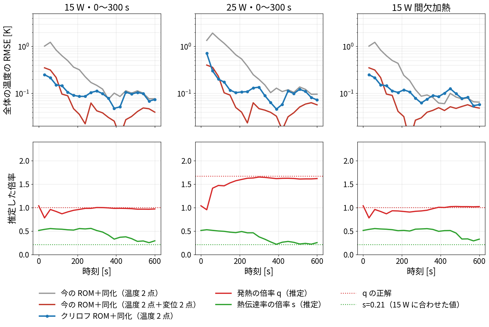
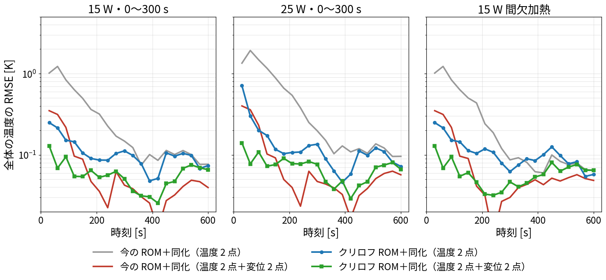
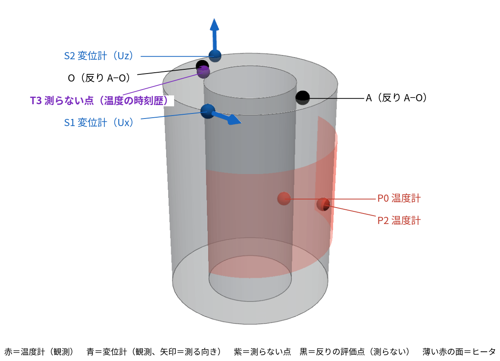
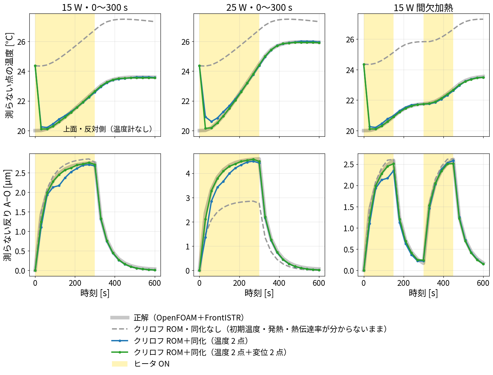
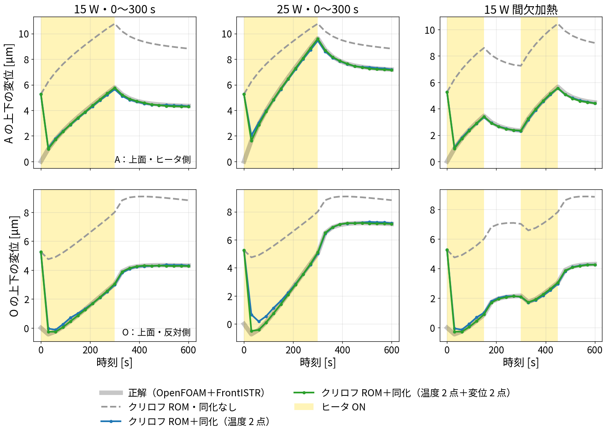

# blog_013：クリロフ部分空間法とは何か ― 熱方程式から小さなROMを作る

**クリロフ部分空間法は、元の熱方程式の行列から温度分布の基底を作り、その少数の係数だけを時間積分する方法です。**

全N節点の温度を直接計算する代わりに、r本の分布を足し合わせて温度を近似し、r個の係数を計算します。**「部分空間」は、そのr本の基底を足し合わせて表せる温度分布の集合**という意味です。



*計算手順の模式図。NはFEM節点数、rは保持する基底の本数。CAEの温度分布を描いた図ではありません。*

この記事では、中空円筒の熱FEMからROMを作り、既存のPOD・Q-DEIM＋熱回路ROMと比べます。まず元の熱方程式、基底作成、少数の係数の時間積分、全節点への復元の順に説明します。ラプラス変換による理由は§3-6へまとめています。

計算プログラムは `run/krylov_rom.py`、既存結果は `results/krylov_rom.json` です。後半の§6には、追加された温度観測・変位観測を使うデータ同化の結果があります。前半の§2〜5は基底作成と温度ROM単体の説明、§6はその応用です。

## 1. POD・Q-DEIMのROMと何が違うか

| | 今の ROM（POD・Q-DEIM＋熱回路） | クリロフ ROM（この記事） |
|---|---|---|
| 何から作るか | OpenFOAM の温度の結果（121 枚） | 熱伝導の式の行列（FEM の $`C`$・$`K`$・$`H`$・$`f`$） |
| 状態（未知の数） | 代表 5 点の温度 | 全節点に値を持つ基底に掛ける係数 $`z_1,\ldots,z_r`$ |
| 全体の温度 | gappy-PODで復元 | $`\mathbf T\approx T_{\mathrm{air}}\mathbf1+V\mathbf z`$ で復元 |
| 係数の決め方 | OpenFOAM に最小二乗で合わせる | 行列から決まる（合わせ込みなし） |
| 熱伝達率 | 合わせ込んだ係数に入る | FEM の境界条件として与える |

---

**両方とも分布を少数の基底で表します。** 既存ROMは代表5点の温度を計算しますが、本記事のクリロフROMでは代表点を選ばず、全節点の分布に掛ける係数を計算します。

## 2. 元になる式：固体の熱伝導のFEM

プログラムの `build_fem()` が、Pythonで熱FEMの行列を組み立てています。

円筒（外径 75 mm、内径 40 mm、高さ 100.5 mm）を、FrontISTR と同じ六面体メッシュ（半径 4 × 周 48 × 高さ 20、5,040 節点）に分けます。全節点の温度を $`\mathbf T`$、一定の外気温を $`T_{\mathrm{air}}`$ とし、NをFEM節点数とします（今回はN=5,040）。

```math
\underbrace{\mathbf T}_{N\times1}=\begin{bmatrix}T[1]\\T[2]\\\vdots\\T[N]\end{bmatrix},
\qquad
\underbrace{\boldsymbol\theta}_{N\times1}
=\begin{bmatrix}T[1]-T_{\mathrm{air}}\\T[2]-T_{\mathrm{air}}\\\vdots\\T[N]-T_{\mathrm{air}}\end{bmatrix}.
```

$`\boldsymbol\theta`$ は外気温からの温度上昇です。熱方程式は、

```math
\underbrace{C}_{N\times N}\underbrace{\dot{\boldsymbol\theta}}_{N\times1}
+\underbrace{G}_{N\times N}\underbrace{\boldsymbol\theta}_{N\times1}
=\underbrace{\mathbf f}_{N\times1}P(t),\qquad G=K+H.
```

例えば節点iの式は $`\sum_j C_{ij}\dot\theta[j]+\sum_jG_{ij}\theta[j]=f_iP(t)`$ です。全FEMは、このN本の式をまとめて時間積分します。

| 記号 | 何か | 作り方 |
|---|---|---|
| $`C`$ | 熱容量の行列 | $`\int\rho c\,N_aN_b\,dV`$（鋼 $`\rho=7850`$ kg/m³、$`c=480`$ J/(kg K)） |
| $`K`$ | 熱伝導の行列 | $`\int\kappa\,\nabla N_a\cdot\nabla N_b\,dV`$（$`\kappa=50`$ W/(m K)） |
| $`H`$ | 表面の熱伝達の行列 | $`\int h\,N_aN_b\,dA`$（面ごとの $`h`$） |
| $`\mathbf f`$ | ヒータ 1 W あたりの熱の入り方 | 外周の +x 側（周長 100 mm、高さ 25〜75 mm）に面積に比例して配る |
| $`P(t)`$ | ヒータの電力 [W] | 15 W・25 W・間欠加熱（OpenFOAM と同じ） |

表中の $`N_a,N_b`$ はFEM要素内の補間関数、a・bは要素内の節点番号です。$`P(t)`$ は既存記事の発熱量Qに相当し、ここではコードに合わせてPと書きます。

表面の $`h`$ は、blog_001 で OpenFOAM の CHT から求めた面ごとの実効値を使いました。

| 面 | 外周（ヒータ側 +x） | 外周（反対側 −x） | 内面 | 上面 | 底面 |
|---|---:|---:|---:|---:|---:|
| $`h`$ [W/(m²K)] | 15.8 | 10.5 | 10.8 | 11.9 | 19.5 |

ここでの表面熱伝達率h [W/(m²K)]と、5点熱回路の放熱コンダクタンス $`h_{\mathrm{ROM}}`$ [W/K]は単位が異なります。

この FEM（「全 FEM」と呼ぶ）を、時間刻み 2 秒のクランク・ニコルソン法で 0〜600 秒解くと、約 0.9 秒かかります。

---

## 3. 基底を作り、少数の係数だけを時間積分する

### 3-1. 最初の候補：定常加熱への温度応答を求める

一定電力を与えて温度が落ち着くと、$`\dot{\boldsymbol\theta}=\mathbf0`$ になります。1 Wあたりの定常温度上昇を $`\mathbf m_0`$ とすると、

```math
\underbrace{G}_{N\times N}\underbrace{\mathbf m_0}_{N\times1}
=\underbrace{\mathbf f}_{N\times1},\qquad
\mathbf m_0=G^{-1}\mathbf f.
```

**最初の候補は、ヒータを入れ続けたときの定常温度分布の形です。** 一定電力 $`P_0`$ [W]なら $`\boldsymbol\theta_{\mathrm{ss}}=\mathbf m_0P_0`$ です。

$`G^{-1}\mathbf f`$ は「Gの連立方程式を解く」という意味で使っています。コードは `lu.solve(f)` で解き、大きな逆行列を作りません。

### 3-2. 次の候補：Cを掛けたベクトルを右辺にして、またGを解く

```math
\begin{aligned}
G\mathbf m_0&=\mathbf f,\\
G\mathbf m_1&=C\mathbf m_0,\\
G\mathbf m_2&=C\mathbf m_1,\\
&\ \vdots
\end{aligned}
\qquad
\underbrace{\mathbf m_k}_{N\times1}
=\underbrace{G^{-1}C}_{N\times N}\mathbf m_{k-1}.
```

こうして $`\mathbf m_0,(G^{-1}C)\mathbf m_0,(G^{-1}C)^2\mathbf m_0,\ldots`$ を作ります。**kは基底候補の番号で、実際の時刻を進める計算ではありません。** これらを選ぶ理論的な理由は§3-6で示します。

#### なぜ $`G\mathbf m_1=C\mathbf m_0`$ なのか（式の出どころ）

**考え方：** ヒータの電力 $`P(t)`$ がゆっくり変わるとき、温度は「定常の形 $`\mathbf m_0`$ × 今の電力」に、遅れの分の補正を足したものになると考えます。

```math
\boldsymbol\theta(t)\approx\mathbf m_0\,P(t)\;-\;\mathbf m_1\,\frac{dP}{dt}\;+\;\mathbf m_2\,\frac{d^2P}{dt^2}\;-\;\cdots
```

- 1 項目：今の電力で、すぐに定常になったとしたときの温度
- 2 項目：電力が増えている間（$`dP/dt>0`$）は、温まるのが追いつかず、そのぶん低くなる（遅れ）
- 3 項目以降：遅れの、さらに細かい補正

これを元の式 $`C\dot{\boldsymbol\theta}+G\boldsymbol\theta=\mathbf f P`$ に入れます。$`\dot{\boldsymbol\theta}\approx\mathbf m_0\,dP/dt-\mathbf m_1\,d^2P/dt^2+\cdots`$ なので、

```math
\underbrace{G\mathbf m_0}_{P\ の係数}P\;+\;\underbrace{\left(C\mathbf m_0-G\mathbf m_1\right)}_{dP/dt\ の係数}\frac{dP}{dt}\;+\;\underbrace{\left(-C\mathbf m_1+G\mathbf m_2\right)}_{d^2P/dt^2\ の係数}\frac{d^2P}{dt^2}\;+\cdots\;=\;\mathbf f\,P .
```

どんな $`P(t)`$ でも成り立つためには、$`P`$、$`dP/dt`$、$`d^2P/dt^2`$ … の係数が左右で等しくなければなりません。

```math
G\mathbf m_0=\mathbf f,\qquad G\mathbf m_1=C\mathbf m_0,\qquad G\mathbf m_2=C\mathbf m_1,\qquad\cdots
```

これが上の手順の式です。

**意味：** $`C\mathbf m_0`$ は、温度を「$`\mathbf m_0`$ の形で 1 秒あたり 1 だけ」上げるのに、各節点が吸い込む熱です。$`G\mathbf m_1=C\mathbf m_0`$ は、「この吸い込まれる熱を、熱源のかわりに置いたときの温度の形が $`\mathbf m_1`$」という意味になります。つまり $`\mathbf m_1`$ は、**熱容量に熱を取られて、温まるのが遅れる分の形**です。熱容量が大きく、大きく温まる所ほど、遅れが大きくなります。

**節点が 1 つの場合で確かめる：** $`C,G,f`$ がただの数なら、

```math
m_0=\frac fG,\qquad m_1=\frac CG\,m_0=\tau\,m_0,\qquad m_2=\tau^2 m_0,\qquad \tau=\frac CG\ （時定数）
```

となり、$`\theta\approx m_0\left(P-\tau\,\dfrac{dP}{dt}+\tau^2\dfrac{d^2P}{dt^2}-\cdots\right)`$ です。これは、時定数 $`\tau`$ の 1 次遅れの応答を展開したものそのものです。節点が多いと、$`\mathbf m_1,\mathbf m_2`$ は $`\mathbf m_0`$ と同じ形ではなくなり、場所ごとの遅れの違い（ヒータ側が先に温まる、など）を表す新しい形になります。図 0 の 2 本目以降が、その形です。

### 3-3. 「部分空間」は、候補の足し合わせで表せる分布の集合

最初のr本の候補から作れるベクトル全体は、

```math
\mathcal K_r=
\left\{\beta_0\mathbf m_0+\beta_1\mathbf m_1+\cdots+\beta_{r-1}\mathbf m_{r-1}
\ ;\ \beta_0,\ldots,\beta_{r-1}\in\mathbb R\right\}.
```

$`\beta_k`$ は任意の係数です。これを短く書くと、

```math
\mathcal K_r=\operatorname{span}\{\mathbf m_0,\mathbf m_1,\ldots,\mathbf m_{r-1}\}.
```

**spanは「そのベクトルの足し合わせで表せるものすべて」という意味です。** 候補r本が独立なら、この空間はr次元です。

**絵で見ると。** 下の 4 つは、実際の円筒で作った基底の最初の 4 本です（§3-4 の手順で、前の形と重ならないようにしたもの）。温度は、この形の足し合わせ $`z_1\mathbf v_1+z_2\mathbf v_2+\cdots`$ で表し、時間とともに変わるのは係数 $`z_j`$ だけです。5,040 個の節点の温度の代わりに、$`r`$ 個の係数だけを計算すればよい、これが「縮める」ということです。



*図 0　クリロフ基底の最初の 4 本（`run/make_krylov_basis_fig.py`）。1 本目はヒータを入れ続けたときに落ち着く温度の形で、この円筒は熱がよく伝わるのでほぼ一様になる。2 本目以降は、そこへ向かう途中の「ヒータ側が先に温まる」形で、本数を増やすほど細かい形が加わる。*

### 3-4. 重複する成分を除き、使いやすい基底を作る

**なぜ重複を除くのか。** §3-2 の候補 $`\mathbf m_0,\mathbf m_1,\mathbf m_2,\dots`$ は、そのままだとほとんど同じ形です。この円筒で実際に計算すると、2 つの候補の「向きの近さ」（下の内積で測った cos）は、

| | $`\mathbf m_0`$ と $`\mathbf m_1`$ | $`\mathbf m_1`$ と $`\mathbf m_2`$ | $`\mathbf m_2`$ と $`\mathbf m_3`$ |
|---|---:|---:|---:|
| 向きの近さ（1 なら完全に同じ向き） | 0.99956 | 1.00000 | 1.00000 |

でした。この円筒は熱がよく伝わるので、温まり方の形はほぼ一様で、遅れの形 $`\mathbf m_1`$ もほとんど $`\mathbf m_0`$ と同じ形になるためです（§3-2 の 1 節点の例で $`m_1=\tau m_0`$ になったのと同じ）。

このまま並べても、同じ情報が何度も入るだけで、新しい形は増えません。しかも、ほぼ同じ向きのベクトルで連立方程式を解くと、計算が不安定になります。そこで、**新しい候補から「もう持っている形で表せる部分」を引き、残った「新しい部分」だけを次の基底にします。**



*2 次元の模式図（`run/make_gram_schmidt_fig.py`）。① 次の候補 $`\mathbf w`$ は 1 本目 $`\mathbf v_1`$ とほぼ同じ向き。② $`\mathbf w`$ のうち $`\mathbf v_1`$ の向きの成分（影）を引くと、短い「残り」が出る。③ 残りを長さ 1 にそろえて 2 本目 $`\mathbf v_2`$ にする。この円筒では、$`\mathbf m_1`$ から $`\mathbf m_0`$ の成分を引くと、残りは元の長さの約 3 % だった。この 3 % が「遅れによる形の違い」で、新しい情報。*

**「長さ」と「向きの近さ」を熱容量 $`C`$ で測る理由。** 普通の長さ $`\sqrt{\mathbf x^{\mathsf T}\mathbf x}`$ ではなく、熱容量 $`C`$ を重みにした長さを使います。

- 節点ごとの体積（熱容量）の違いを考えに入れるためです。メッシュの細かい所の節点が、たくさんあるだけで重く数えられることがなくなります。$`\mathbf x^{\mathsf T}C\mathbf x`$ は、温度分布 $`\mathbf x`$ のときに円筒にたまる熱の大きさ（に比例する量）です。
- こうしておくと、できた基底が $`V^{\mathsf T}CV=I`$（§3-5 の縮めた式の熱容量の行列が単位行列）になり、縮めた式が簡単になります。

```math
\langle\mathbf x,\mathbf y\rangle_C=\mathbf x^{\mathsf T}C\mathbf y,
\qquad
\lVert\mathbf x\rVert_C=\sqrt{\mathbf x^{\mathsf T}C\mathbf x}.
```

最初は $`\mathbf v_1=\mathbf m_0/\lVert\mathbf m_0\rVert_C`$ です。j本目では候補 $`\mathbf w=G^{-1}C\mathbf v_{j-1}`$ から、

```math
\widetilde{\mathbf w}
=\mathbf w-\sum_{\ell=1}^{j-1}\mathbf v_\ell
(\mathbf v_\ell^{\mathsf T}C\mathbf w),
\qquad
\mathbf v_j=\frac{\widetilde{\mathbf w}}
{\sqrt{\widetilde{\mathbf w}^{\mathsf T}C\widetilde{\mathbf w}}}
```

として作ります。コードでは丸め誤差を抑えるため、成分を除く処理を2回行います。このアーノルディ法で得る基底行列は、

```math
\underbrace{V}_{N\times r}
=\begin{bmatrix}
v_1[1]&v_2[1]&\cdots&v_r[1]\\
v_1[2]&v_2[2]&\cdots&v_r[2]\\
\vdots&\vdots&&\vdots\\
v_1[N]&v_2[N]&\cdots&v_r[N]
\end{bmatrix},
\qquad V^{\mathsf T}CV=I_r.
```

**1列が全N節点に値を持つ1本の基底です。** 候補が完全に重複して残差が0になれば、それ以上は独立な基底を追加できません。今回確認したr=2〜20では基底を作れています。

#### V を作る手順を、節点 3 つの例で 1 歩ずつ

式だけでは分かりにくいので、節点が 3 つの小さな例で、$`V`$ を実際に作ってみます。棒を 3 つに分け、節点 1 にヒータがあるとします（数字は説明のために私が決めたもの）。

```math
C=\begin{bmatrix}1&0&0\\0&1&0\\0&0&1\end{bmatrix},\qquad
G=\begin{bmatrix}2&-1&0\\-1&2&-1\\0&-1&2\end{bmatrix},\qquad
\mathbf f=\begin{bmatrix}1\\0\\0\end{bmatrix}
```

- $`C`$：熱容量（どの節点も 1）
- $`G`$：隣どうしの熱の行き来（$`-1`$）と、両端からの放熱（対角の 2）
- $`\mathbf f`$：ヒータは節点 1 だけ

**手順 1：1 本目の候補 $`\mathbf m_0`$ を作る**（$`G\mathbf m_0=\mathbf f`$ を解く）

```math
\mathbf m_0=G^{-1}\mathbf f=\begin{bmatrix}0.75\\0.50\\0.25\end{bmatrix}
```

ヒータを入れ続けたときに落ち着く温度の形です（ヒータに近い節点 1 が一番高い）。

**手順 2：長さを 1 にそろえて $`\mathbf v_1`$ にする**

```math
\lVert\mathbf m_0\rVert_C=\sqrt{\mathbf m_0^{\mathsf T}C\mathbf m_0}=\sqrt{0.75^2+0.50^2+0.25^2}=0.935,\qquad
\mathbf v_1=\frac{\mathbf m_0}{0.935}=\begin{bmatrix}0.802\\0.535\\0.267\end{bmatrix}
```

**手順 3：次の候補 $`\mathbf w`$ を作る**（右辺を $`C\mathbf v_1`$ にして、また $`G`$ を解く）

```math
G\mathbf w=C\mathbf v_1\quad\Rightarrow\quad \mathbf w=\begin{bmatrix}0.935\\1.069\\0.668\end{bmatrix}
```

**手順 4：$`\mathbf w`$ から、$`\mathbf v_1`$ で表せる部分（影）を引く**

影の大きさは $`\mathbf v_1^{\mathsf T}C\mathbf w=0.802\times0.935+0.535\times1.069+0.267\times0.668=1.50`$ なので、

```math
\widetilde{\mathbf w}=\mathbf w-1.50\,\mathbf v_1
=\begin{bmatrix}0.935\\1.069\\0.668\end{bmatrix}-1.50\begin{bmatrix}0.802\\0.535\\0.267\end{bmatrix}
=\begin{bmatrix}-0.267\\0.267\\0.267\end{bmatrix}.
```

残ったのは「節点 1 が低く、節点 2・3 が高い」形です。これが、$`\mathbf v_1`$ だけでは表せない**新しい形**（時間の遅れで生まれる、温まり方の偏りの違い）です。

**手順 5：長さを 1 にそろえて $`\mathbf v_2`$ にする**

```math
\lVert\widetilde{\mathbf w}\rVert_C=0.463,\qquad
\mathbf v_2=\frac{\widetilde{\mathbf w}}{0.463}=\begin{bmatrix}-0.577\\0.577\\0.577\end{bmatrix}
```

確かめ：$`\mathbf v_1^{\mathsf T}C\mathbf v_2=0`$（重なりがない）、$`\mathbf v_2^{\mathsf T}C\mathbf v_2=1`$（長さ 1）です。

**手順 6：3 本目も同じ**（$`G\mathbf w=C\mathbf v_2`$ を解き、$`\mathbf v_1`$ と $`\mathbf v_2`$ の両方の影を引き、長さを 1 にする）

```math
\mathbf w=\begin{bmatrix}0\\0.577\\0.577\end{bmatrix},\quad
\widetilde{\mathbf w}=\mathbf w-0.463\,\mathbf v_1-0.667\,\mathbf v_2=\begin{bmatrix}0.014\\-0.055\\0.069\end{bmatrix},\quad
\mathbf v_3=\begin{bmatrix}0.154\\-0.617\\0.772\end{bmatrix}
```

**できあがり：** 並べたものが $`V`$ です。

```math
V=\begin{bmatrix}\mathbf v_1&\mathbf v_2\end{bmatrix}=\begin{bmatrix}0.802&-0.577\\0.535&0.577\\0.267&0.577\end{bmatrix}\ （r=2\ のとき）,\qquad V^{\mathsf T}CV=\begin{bmatrix}1&0\\0&1\end{bmatrix}
```

**順番のまとめ**（実際の円筒でも、節点が 5,040 個になるだけで同じ）

| 手順 | すること | コード（`krylov_basis`） |
|---|---|---|
| 1 | $`G\mathbf m_0=\mathbf f`$ を解く | `v = lu.solve(f)` |
| 2・5 | すでにある基底の影を引く | `v = v - V[:, :j] @ (V[:, :j].T @ (C @ v))` |
| 3 | 長さを 1 にそろえて $`j`$ 本目にする | `V[:, j] = v / np.sqrt(v @ (C @ v))` |
| 4 | 次の候補：$`G\mathbf w=C\mathbf v_j`$ を解く | `v = lu.solve(C @ V[:, j])` |
| 6 | 2〜4 を $`r`$ 本になるまでくりかえす | `for j in range(r)` |

- $`G`$ の LU 分解は最初に 1 回だけ行い、手順 1・4 で使い回します。
- 影を引く処理（手順 2）は、計算の丸め誤差で重なりが少し残るのを防ぐため、2 回くりかえしています。

### 3-5. 係数だけの熱方程式へ縮め、全温度場へ戻す

温度上昇を、

```math
\underbrace{\boldsymbol\theta}_{N\times1}
\approx\underbrace{V}_{N\times r}
\underbrace{\begin{bmatrix}z_1\\z_2\\\vdots\\z_r\end{bmatrix}}_{\mathbf z:\ r\times1},
\qquad
\mathbf T\approx T_{\mathrm{air}}\mathbf1+V\mathbf z
```

と近似します。節点iでは $`T[i]\approx T_{\mathrm{air}}+\sum_jv_j[i]z_j`$ です。**$`z_j`$ は基底に掛ける係数で、代表点の温度そのものではありません。** ここで足す基準は外気温です。PODの時間平均温度場とは異なります。

Vを時間に依存しない基底として元の式へ代入します。

```math
CV\dot{\mathbf z}+GV\mathbf z\approx\mathbf fP(t).
```

左から $`V^{\mathsf T}`$ を掛け、縮約後の式として等号を課します（ガラーキン射影）。

```math
\underbrace{V^{\mathsf T}CV}_{C_r:\ r\times r}\dot{\mathbf z}
+\underbrace{V^{\mathsf T}GV}_{G_r:\ r\times r}\mathbf z
=\underbrace{V^{\mathsf T}\mathbf f}_{\mathbf f_r:\ r\times1}P(t).
```

今回は $`C_r=I_r`$ になるよう正規化しています。コードは数値誤差も含めた $`C_r`$ を計算して使用します。**時間積分するのはr個の係数だけで、その後 $`T_{\mathrm{air}}\mathbf1+V\mathbf z`$ から全節点温度を復元します。**

今回のC・Gが対称正定値で、Vの列が独立なら、$`C_r,G_r`$ も対称正定値です。そのため、無入力時に温度上昇が減衰する性質を保持できます。対称性だけから正定値が決まるわけではありません。

今回の初期温度は全節点で外気温なので $`\mathbf z(0)=\mathbf0`$ です。別の初期温度場を使う場合には、その分布を基底で表せるかも確認します。

### 3-6. なぜこの基底候補を使うのか：モーメント合わせ

ここは基底の作り方の理論的な補足です。初期温度上昇0として元の式をラプラス変換すると、

```math
(G+sC)\boldsymbol\theta(s)=\mathbf fP(s),\qquad
\boldsymbol\theta(s)=(G+sC)^{-1}\mathbf fP(s).
```

sはラプラス変換の変数で、$`s=0`$ は定常応答に対応します。$`G+sC=G(I+sG^{-1}C)`$ と分け、0付近で展開します。

```math
\begin{aligned}
(G+sC)^{-1}\mathbf f
&=(I+sG^{-1}C)^{-1}G^{-1}\mathbf f\\
&=\left[I-sG^{-1}C+s^2(G^{-1}C)^2-\cdots\right]G^{-1}\mathbf f\\
&=\mathbf m_0-s\mathbf m_1+s^2\mathbf m_2-\cdots.
\end{aligned}
```

展開の係数（符号を含めた $`(-1)^k\mathbf m_k`$）をモーメントと呼びます。**§3-2の候補は、元のFEMが入力にどう応答するかを表す、この展開の係数から作ったものです。**

最初のr本を含む基底を使うと、この設定では縮約モデルも最初のr個の係数を再現できます。これがモーメント合わせです。0付近での一致を使うため、急なON/OFFを含む任意の入力について、時間領域の誤差を一律に保証するものではありません。rを変え、実際の入力履歴で確認します。[TUMのクリロフROMの説明](https://www.epc.ed.tum.de/en/rt/research/model-order-reduction/past-topics/krylov-subspace-methods/)

### 3-7. 式とプログラムを対応させる

| 計算 | コード中の場所 | 意味 |
|---|---|---|
| 行列の組立て | `build_fem()` | メッシュ・物性・境界条件からC・G・fを作る |
| 最初の候補 | `krylov_basis()` の `lu.solve(f)` | $`G\mathbf m_0=\mathbf f`$ を解く |
| 既存成分を除く | `v - V[:, :j] @ (V[:, :j].T @ (C @ v))` | Cを使った射影成分を引く |
| 正規化 | `v / np.sqrt(v @ (C @ v))` | Cを使った長さを1にする |
| 次の候補 | `lu.solve(C @ V[:, j])` | $`G\mathbf w=C\mathbf v_j`$ を解く |
| 縮約行列の計算 | `run_rom()` の `Cr, Gr, fr` | $`V^{\mathsf T}CV,V^{\mathsf T}GV,V^{\mathsf T}\mathbf f`$ |
| 復元 | `np.array(out) @ V.T` | 時刻ごとに $`V\mathbf z`$ を計算し、行方向に並べて返す |

GのLU分解は基底作成時に1回行って使い回します。時間積分は全FEM・ROMともクランク・ニコルソン法、刻み2秒です。

## 4. 結果 1：縮める誤差は $`r`$ でどれだけ小さくなるか

同じ熱FEMを縮めたときの誤差を比較します。下表は今回の再確認値です。0〜600秒を**30秒ごとに出力した21時刻**と全5,040節点について、最大絶対差を求めています。

| 基底数r | 2 | 3 | 5 | 10 | 20 |
|---|---:|---:|---:|---:|---:|
| 15 W連続加熱 [K] | 0.3567 | 0.1348 | 0.04123 | 0.004584 | 0.0005389 |
| 15 W間欠加熱 [K] | 0.3456 | 0.1370 | 0.04127 | 0.004584 | 0.0005389 |

- $`r`$ を増やすと、差は急に小さくなります。$`r=10`$ で 0.005 K で、温度計のノイズ（0.3 K）よりずっと小さいです。
- 今回の連続・間欠加熱では同程度の差でした。誤差は入力履歴にも依存します。同じON/OFFのまま電力を一定倍率にする場合は、ゼロ初期条件の線形モデル同士の差も同倍率になります。
- $`r=10`$ の ROM で 0〜600 秒を計算する時間は、約 0.014 秒でした（全 FEM は約 0.9 秒）。

**この一定境界条件のFEMは、r=10でも元のFEMに近い応答を再現できました。** ここで確認したのは縮約誤差で、元モデルとOpenFOAMのCHTとの違いは次節で評価します。

---

## 5. 結果 2：OpenFOAM と比べる

OpenFOAM の温度を節点へ移したものを正解にして、全節点の温度の差を比べました。



*図 1　上：OpenFOAMの代表点P2に最も近いFEM節点の温度。中：全節点の温度の RMSE（OpenFOAM との差、対数の目盛り）。下：縮める誤差（クリロフ ROM と全 FEM の差、全節点の最大）。全 FEM（茶の太い線）とクリロフ ROM r=5（丸）・r=10（四角）は、上と中の段ではほぼ重なる。r=5・r=10 の違いは下の段で見える（加熱の入り切りの直後に誤差が大きくなる）。*

評価は、OpenFOAMの固体温度をIDWでFEM節点へ写し、各時刻の全節点RMSEを求め、その最大値を取っています。

```math
\mathrm{RMSE}(t_k)=\sqrt{\frac1N\sum_{i=1}^N
\left(T_{\mathrm{model}}[i,t_k]-T_{\mathrm{CHT\ mapped}}[i,t_k]\right)^2},
\qquad E_{\mathrm{RMSE}}=\max_k\mathrm{RMSE}(t_k).
```

| 全節点の RMSE の最大 [K] | 15 W | 25 W | 間欠加熱 |
|---|---:|---:|---:|
| 全 FEM（CHT の $`h`$ をそのまま使う） | 0.54 | 0.85 | 0.46 |
| クリロフ ROM r=10（同じ $`h`$） | 0.54 | 0.85 | 0.46 |
| クリロフ ROM r=10（$`h`$ を 0.21 倍して 15 W に合わせた） | **0.04** | **0.06** | **0.04** |
| 今の ROM（5 点の熱回路＋gappy-POD） | **0.03** | **0.08** | **0.02** |

| 最大の差（全節点・全時刻）[K] | 15 W | 25 W | 間欠加熱 |
|---|---:|---:|---:|
| クリロフ ROM r=10（$`h`$ を合わせた版） | 0.20 | 0.33 | 0.20 |
| 今の ROM | 0.04 | 0.11 | 0.05 |

### 5-1. CHT の $`h`$ をそのまま使うと合わない

- 全 FEM とクリロフ ROM は同じ値で、どちらも OpenFOAM から 0.5〜0.9 K ずれます。**ずれの主な部分は、縮約前のFEMにもあります。** 熱伝達率の調整で改善しますが、熱源の離散化・空気側の扱い・メッシュ・温度写像などの寄与をすべて切り分けたわけではありません。
- 600 秒後の円筒全体の平均の温度上昇は、全 FEM 3.05 K、OpenFOAM 3.59 K でした。FEM は放熱が大きすぎます。
- CHT の熱伝達率は時間で変わります（[results/heat_transfer_check.json](../results/heat_transfer_check.json)：全表面の実効値は 300 秒で約 8.6、600 秒で約 3.6 W/(m²K)。実効値は熱流と基準温度差の取り方にも依存するため、この変化の原因は別途確認が必要）。blog_001 の面ごとの値は、この変化を 1 つの値で表したもので、一定の $`h`$ では表しきれません。

### 5-2. $`h`$ に 1 つの係数を掛けて合わせると

- すべての面の $`h`$ に同じ係数 $`s`$ を掛け、15 W の OpenFOAM との差が最小になる $`s`$ を探すと、$`s=0.21`$ でした（$`h`$ は約 2〜4 W/(m²K)）。
- そのまま 25 W・間欠加熱でも、RMSE 0.04〜0.06 K で合いました。今の ROM とほぼ同じです。
- ただし、最大の差は 0.2〜0.33 K で、今の ROM より大きいです。ヒータの近くの、時間で変わる熱の逃げ方は、一定の $`h`$ では表せないためと考えられます（確かめてはいません）。

---

## 6. クリロフ ROM は合わないものなのか？データ同化をすれば合うか

### 6-1. 縮約誤差と、元モデルの不一致を分けて考える

§4・§5 から、ずれの出どころは次のように分けられます。

```math
\underbrace{\boldsymbol\theta_{\mathrm{OpenFOAM}}-\boldsymbol\theta_{\mathrm{ROM}}}_{\text{全体のずれ}}
=\underbrace{\left(\boldsymbol\theta_{\mathrm{OpenFOAM}}-\boldsymbol\theta_{\mathrm{FEM}}\right)}_{\text{モデルのずれ：0.5〜0.9 K}}
+\underbrace{\left(\boldsymbol\theta_{\mathrm{FEM}}-\boldsymbol\theta_{\mathrm{ROM}}\right)}_{\text{縮める誤差：r=10 で 0.005 K}}
```

- クリロフ法が受け持つのは、2 つ目の「縮める誤差」だけで、これはとても小さいです。
- 1 つ目の「モデルのずれ」は、元の FEM が OpenFOAM と違う（熱伝達率が一定、ヒータの扱い）ことから来ます。**どんな縮め方をしても、このずれは消えません。**
- 今の ROM は、OpenFOAM の結果に直接合わせて作るので、このずれも係数に吸収されています。

### 6-2. データ同化で熱伝達率を直すと

ここからは、係数の時間発展を観測値で補正する計算です。前半の10本のクリロフ基底に、一様な初期温度差を表す基底を1本追加しているため、温度の係数はm=11個です。r=10のROM単体比較と、状態の数が異なります。

そこで、熱伝達率の倍率 $`s`$ を未知の数に入れ、測った温度で直しました（`run/krylov_da.py`）。

```math
\underbrace{V^{\mathsf T}CV}_{C_r}\frac{d\mathbf z}{dt}+\Bigl(\underbrace{V^{\mathsf T}KV}_{K_r}+s\,\underbrace{V^{\mathsf T}HV}_{H_r}\Bigr)\mathbf z=\underbrace{V^{\mathsf T}\mathbf f}_{\mathbf f_r}\cdot 15\,\mathrm W\cdot q\cdot\mathrm{on}(t)
```

| 設定 | 内容 |
|---|---|
| 状態（EnKF で直すもの） | クリロフの座標 $`\mathbf z`$（r=10 ＋ 一様な温度の成分 1 つ）、発熱の倍率 $`q`$、熱伝達率の倍率 $`s`$ |
| 観測 | 温度計 P2・P0（OpenFOAM の値＋ノイズ 0.3 K、30 秒ごと）。今の ROM の「温度 2 点」と同じ |
| 測る前のばらつき | 初期温度 20 °C の −3〜+12 K、$`q`$ は 0.3〜1.8、$`s`$ は 0.1〜1.5（対数で一様） |
| EnKF | 60 メンバー、膨張係数 1.02、乱数 5 通りの平均 |

基底 $`V`$ は $`s=1`$ で 1 回作り、$`s`$ が変わっても使い回します（$`K_r`$・$`H_r`$ を前もって計算しておけば、$`s`$ を変えるのは足し算だけ）。



*図 2　上：全体の温度の RMSE（OpenFOAM との差）。下：推定した発熱の倍率 $`q`$（赤）と熱伝達率の倍率 $`s`$（緑）。点線は $`q`$ の正解と、15 W に合わせた $`s=0.21`$。今の ROM の線は presen_001 §11 の結果（全セルで計算）、クリロフ ROM の線は全節点で計算したもので、比べ方が少し違う。*

**比較条件の読み方**：クリロフ側はFEM節点、既存ROM側はOpenFOAMセルで温度誤差を評価しています。初期温度のばらつきも、クリロフ側は一様な温度差、既存5点ROM側は点ごとの温度差を使っています。下表はそれぞれの設定で得た値です。方式自体の優劣を比較するには、評価位置と初期分布もそろえる必要があります。

| 全体の温度の RMSE（加熱中 30〜300 秒の平均）[K] | 15 W | 25 W | 間欠加熱 |
|---|---:|---:|---:|
| 今の ROM＋同化（温度 2 点） | 0.54 | 0.88 | 0.53 |
| **クリロフ ROM＋同化（温度 2 点）** | **0.14** | **0.21** | **0.14** |
| 今の ROM＋同化（温度 2 点＋変位 2 点） | 0.13 | 0.14 | 0.12 |

| 600 秒での推定値 | 15 W | 25 W | 間欠加熱 |
|---|---:|---:|---:|
| 発熱の倍率 $`q`$（正解） | 0.97（1.00） | 1.62（1.67） | 1.02（1.00） |
| 熱伝達率の倍率 $`s`$ | 0.29 | 0.25 | 0.33 |

- **データ同化をすると合います。** 熱伝達率をそのまま使ったときの 0.5〜0.9 K のずれが、0.06〜0.07 K（600 秒）まで小さくなりました。
- 発熱の倍率 $`q`$ は、3 条件とも正解の 3 % 以内に入りました。熱伝達率の倍率 $`s`$ も、15 W に合わせた値（0.21）に近づきます。ただし、600 秒では 0.25〜0.33 で、まだ近づいている途中です（放熱は 600 秒ではゆっくりしか効かないため。presen_001 §7-4 と同じ理由）。
- **掲載した温度2点の設定では、クリロフ側の温度誤差指標が小さくなりました**（加熱中の平均 0.14〜0.21 K と 0.53〜0.88 K）。今の ROM は 5 点の温度しか持たないのに対し、クリロフ ROM は熱伝導の式から全体の温度の形を持っているので、測っていない場所も物理に沿って動くためと考えられます（確かめてはいません）。
- 今の ROM に変位 2 点を足した場合（0.12〜0.14 K）と比べると、15 W・間欠加熱ではほぼ同じ、25 W では少し悪いです。

### 6-3. 熱変形の行列を作り、変位の観測も使う

クリロフ ROM の温度から熱変形を出すため、熱弾性の行列を作りました（`run/krylov_thermoelastic.py`）。

```math
K_u\,\mathbf u=L\,\boldsymbol\theta,\qquad
K_u=\int B^{\mathsf T}DB\,dV,\qquad
L=\int B^{\mathsf T}D\,\mathbf m\,\alpha\,N^{\mathsf T}dV
```

- $`K_u`$：剛性行列（15,120×15,120）。$`B`$ はひずみと変位の関係、$`D`$ は鋼の弾性（$`E=205`$ GPa、$`\nu=0.3`$）。
- $`L`$：温度から熱荷重を作る行列（15,120×5,040）。$`\alpha=1.2\times10^{-5}`$ /K、$`\mathbf m=(1,1,1,0,0,0)^{\mathsf T}`$（熱ひずみは伸びだけ）。
- 拘束は FrontISTR と同じ 3-2-1 の点拘束です。

クリロフ ROM では $`\boldsymbol\theta=V\mathbf z`$ なので、

```math
\mathbf u=\underbrace{K_u^{-1}LV}_{W_z\ (3N\times m)}\ \mathbf z .
```

$`W_z`$ を前もって 1 回計算しておけば、変位は行列 × ベクトル 1 回で出ます。

ここでNはFEM節点数、mは温度の係数の数（このデータ同化では11）です。

**行列の確かめ。** OpenFOAM の温度（節点へ移したもの）を入れて変位を計算し、FrontISTR の変位（正解）と比べました。

| | 15 W | 25 W | 間欠加熱 |
|---|---:|---:|---:|
| 変位の最大 [µm] | 6.24 | 10.38 | 6.10 |
| FrontISTR との差の最大 [µm] | 0.014 | 0.023 | 0.013 |
| 反り A−O の差の最大 [µm] | 0.007 | 0.011 | 0.006 |

差は変位の 0.2 % 程度で、FrontISTR と同じ計算ができています。

**変位の観測も使ったデータ同化。** §6-2 の同化に、変位計 S1（Ux）・S2（Uz）（blog_012 の目的指向で選んだ 2 本）を足しました。予報した変位は $`W_z\mathbf z`$ の 2 行です。



*図 3　全体の温度の RMSE（OpenFOAM との差）。灰・赤は今の ROM（presen_001 §11、全セルで計算）、青・緑はクリロフ ROM（全節点で計算）。*

| 加熱中（30〜300 秒）の平均 | 観測 | 15 W | 25 W | 間欠加熱 |
|---|---|---:|---:|---:|
| 全体の温度の RMSE [K] | 今の ROM：温度 2 点 | 0.54 | 0.88 | 0.53 |
| | 今の ROM：温度 2 点＋変位 2 点 | 0.13 | 0.14 | 0.12 |
| | クリロフ ROM：温度 2 点 | 0.13 | 0.21 | 0.13 |
| | **クリロフ ROM：温度 2 点＋変位 2 点** | **0.07** | **0.09** | **0.06** |
| 測らない反り A−O の誤差 [µm] | 今の ROM：温度 2 点 | 0.775 | 1.417 | 0.635 |
| | 今の ROM：温度 2 点＋変位 2 点 | **0.076** | **0.083** | **0.072** |
| | クリロフ ROM：温度 2 点 | 0.219 | 0.348 | 0.199 |
| | クリロフ ROM：温度 2 点＋変位 2 点 | 0.090 | 0.100 | 0.086 |

- **掲載した各設定の温度指標では、クリロフROM＋温度・変位の同化が最小でした**（0.06〜0.09 K。今の ROM の約半分）。
- **測らない反りは、今の ROM のほうが少しよい**（0.076〜0.083 µm と 0.086〜0.100 µm）。変位計の位置は今の ROM（5 点の温度）で選んだもので、クリロフ ROM に合わせて選び直してはいません。
- 変位を足すと、温度だけのときより、温度は約半分、反りは約 1/2〜1/3 になりました。**変位の観測が効く**ことが、クリロフ ROM でも確かめられました。


**時刻歴で見ると。** 測らない点の温度と、測らない反りの時刻歴です。点の場所は下の図のとおりです。



*時刻歴を描いた点の場所（`run/make_da_points_fig.py`）。赤＝温度計 P2・P0（観測）、青＝変位計 S1（Ux）・S2（Uz）（観測、矢印＝測る向き）、紫＝温度の時刻歴を描いた測らない点 T3（上面・反対側）、黒＝反り A−O の評価点（測らない）、薄い赤の面＝ヒータ。*



*図 4　上：測らない点 T3 の温度。下：測らない反り A−O。灰の太線が正解、灰の破線がクリロフ ROM・同化なし（初期温度・発熱・熱伝達率が分からないまま、初めのばらつきの平均で進めただけ）、青がクリロフ ROM＋温度 2 点の同化、緑がクリロフ ROM＋温度 2 点＋変位 2 点の同化。乱数 5 通りの時刻歴の平均（`run/krylov_thermoelastic.py`）。初めは 20 °C の −3〜+12 K のばらつきの平均（約 24.5 °C）から始まり、30 秒（1 回目の補正）で正解に近づく。変位 2 点を足すと、加熱中の反りがより正解に近くなる。*

| 加熱中（30〜300 秒）の平均 | クリロフ ROM・同化なし | 温度 2 点で同化 | 温度 2 点＋変位 2 点で同化 |
|---|---:|---:|---:|
| 全体の温度の RMSE 15 W・25 W・間欠 [K] | 4.24・2.93・4.22 | 0.13・0.21・0.13 | **0.07・0.09・0.06** |
| 測らない反りの誤差 15 W・25 W・間欠 [µm] | 0.101・1.531・0.063 | 0.219・0.348・0.199 | 0.090・0.100・0.086 |

- 同化なしは、初めの温度のずれ（約 4.5 K）が最後まで残ります。
- 15 W・間欠加熱では、同化なしの反りの誤差が小さく出ています。初めの温度のずれは「全体に一様」で、一様なずれは反り（片側だけ伸びる量）にほとんど効かないうえ、発熱の初めの見込み（倍率の平均 1.05）がたまたま正解に近かったためです。発熱が 25 W に変わると、同化なしでは反りが 1.5 µm ずれます。

**A・O それぞれの変位で見ると。** 反り A−O は、A と O の上下の変位の「差」です。A と O それぞれの上下の変位も描きました。



*図 4b　上：A（上面・ヒータ側）の上下の変位。下：O（上面・反対側）の上下の変位。線の意味は図 4 と同じ。*

- 同化なしは、A も O も 3〜5 µm 大きく出ます。初めの温度が全体に約 4.5 K 高いので、円筒全体が上に伸びた分（熱膨張）がそのまま乗るためです。この「全体の伸び」は A と O で同じなので、差を取った反りでは消えます。図 4 で同化なしの反りが小さく見えたのは、このためです。
- 同化すると、A も O も 30 秒（1 回目の補正）で正解に乗ります。全体の伸び（A・O それぞれの変位）も、片側の伸び（反り）も、両方合います。

---

## 7. まとめ：どちらを使うか

| | クリロフ ROM | 今の ROM |
|---|---|---|
| 強み | 行列から作るので学習データが要らない。縮める誤差を $`r`$ で調べられ、物理の式とつながっている | OpenFOAM に合わせるので、熱伝達率のずれなども係数に吸収される |
| 弱み | 元の FEM の条件（熱伝達率など）が合っていないと、そのずれがそのまま残る | 係数の物理の意味が弱い（[presen_001 §7-4](presen_001_introduction_positioning.md)）。学習データが要る |
| この円筒での精度（RMSE） | 0.04〜0.06 K（$`h`$ を 1 つの係数で合わせた場合） | 0.02〜0.08 K |

- クリロフ法は、**元の熱FEMの行列と条件が与えられれば**、温度スナップショットを使わず、そのFEMに近いROMを作れます。現象自体に合うかは、物性・熱源・境界条件にも依存します。この研究のように流れ（CHT）で熱伝達率が決まり、しかも時間で変わる問題では、熱伝達率の与え方が精度を決めます。
- 熱伝達率を、データ同化で直す未知の数にすると、クリロフ ROM でも OpenFOAM に合いました（§6）。
- 熱弾性の行列を作れば、クリロフ ROM でも変位の観測を使えます。温度は今の ROM より正確、反りは少し劣りました（§6-3）。クリロフ ROM に合わせて変位計の位置を選び直すことは、まだしていません（未実施）。


### 7-1. 熱解析と熱流体解析での使い分け

**熱解析（固体の熱伝導だけ）なら、クリロフ法のほうが楽で確実です。**

- FEM の熱解析なら、熱容量 $`C`$、熱伝導 $`K+H`$、熱の入り方 $`\mathbf f`$ の行列がソルバーの中にあり、それを縮めるだけです。
- 正解の計算（学習用のスナップショット）を何本も回す必要がありません。連立方程式を $`r`$ 回解けば ROM ができます（今回 $`r=10`$、数秒）。
- $`r`$ を増やせば元の FEM に近づき、その差を直接計算できます（今回 $`r=10`$ で 0.005 K）。
- 発熱源が複数あれば、熱源ごとの $`\mathbf f`$ を並べて基底を作れば済み、新しい運転条件を学習し直す必要がありません。

**熱流体解析（流れと熱の連成、CHT）では、そのままでは使いにくいです。**

- 流れの式は非線形で、自然対流では流れが温度で変わります。クリロフ法は線形の式を縮める方法なので、流体の式にはそのまま使えません。
- 流体ソルバー（OpenFOAM など）から、縮めるための行列を取り出すのも大変です。
- 流体を表面の熱伝達率 $`h`$ に置き換えて固体だけを縮めると、$`h`$ が時間で変わるため、今回は 0.5〜0.9 K ずれました（§5）。縮め方が正確でも、$`h`$ の与え方で精度が決まります。

| | クリロフ ROM | 今の ROM（POD・Q-DEIM＋熱回路） |
|---|---|---|
| 作るのに要るもの | 熱解析の行列 | 正解の計算結果（CHT でもよい） |
| 流体を含む問題 | $`h`$ を与える必要がある | CHT の結果から直接作れる（流れの影響も係数に入る） |
| 同化なしの精度（OpenFOAM との RMSE） | 0.5〜0.9 K（$`h`$ は CHT の値）、0.04〜0.06 K（$`h`$ を 1 つの係数で合わせた場合） | 0.02〜0.08 K |
| 同化あり（温度 2 点＋変位 2 点）の全体の温度 | **0.06〜0.09 K** | 0.12〜0.14 K |
| 同化あり の測らない反り | 0.086〜0.100 µm | **0.072〜0.083 µm** |
| 条件の変化への強さ | 式から作るので、発熱の変化や熱源の追加に強い。熱伝達率の変化には弱い | 学習した温度分布の型から外れる変化（熱源の位置など）に弱い |

**おすすめの組み合わせ：固体はクリロフ ROM、熱伝達率はデータ同化で直す。**

- 固体の熱伝導は、クリロフ法で物理の式どおり正確に縮めます。
- 流れの影響（熱伝達率）は、運転中に測った温度・変位から同化で直します。
- 今回の計算でも、この組み合わせ（温度＋変位の同化）で、全体の温度が一番正確でした（§6-3）。

今の ROM（データから作る）が向いているのは、熱解析の行列が手に入らない（商用ソフトの結果しかない）場合や、熱伝達率の分布が複雑で少ない係数では表せない場合です。

流れが変わる問題（博士研究の方向 B）では、「固体はクリロフ、流れによる熱伝達率の分布は CHT の計算から少数の型（POD）で表し、その係数を同化で直す」という組み合わせが有力な案になります。**この組み合わせは試していません（未実施）。** 今回は熱伝達率を全体に 1 つの係数で直しただけで、面ごと・場所ごとの分布は直していません。

### 7-2. 熱流体（流れ＋熱）の低次元モデルは何がよいか

| 方法 | 中身 | 長所 | 短所 |
|---|---|---|---|
| POD–ガラーキン（OpenFOAM なら ITHACA-FV、[Stabile & Rozza 2018](https://scholar.google.com/scholar?q=Stabile+Rozza+2018+finite+volume+POD-Galerkin+stabilised+reduced+order+methods+Navier-Stokes)） | 流れと温度の式を、POD の型に射影して縮める | 物理の式に基づく | 非線形の項で不安定になりやすく、安定化の工夫が要る。ソルバーの中に手を入れる必要がある |
| オペレータ推論（[Peherstorfer & Willcox 2016](https://scholar.google.com/scholar?q=Peherstorfer+Willcox+2016+data-driven+operator+inference+nonintrusive+projection-based+model+reduction)） | 計算結果から、線形＋2 次の小さな式を最小二乗で学習する | ソルバーに手を入れなくてよい。流れの対流の 2 次の形に合う | 学習した範囲の外に弱い。データの質に左右される |
| パラメトリック ROM／LPV（Ansys Twin Builder の LPV ROM など） | 流量ごとに線形 ROM を作り、流量で補間・切り替える | 流量が変わる問題にそのまま合う。商用ソフトで実績がある | 流量の点ごとに計算が要る |
| DMD（動的モード分解） | 時刻歴データから線形の時間発展を取り出す | 簡単で速い | 入力（発熱・流量）が変わる問題には工夫が要る |
| ニューラルネット（オートエンコーダ＋LSTM、ニューラル作用素など） | データから非線形の関係を学習する | 複雑な流れも表せる | 大量の学習データが要る。説明・外挿が弱い |
| **固体は線形 ROM ＋ 熱伝達率を少数の係数で表す（勧める）** | 固体の熱伝導はクリロフ（または熱回路）で縮め、流れの影響は表面の熱伝達率の分布を POD の型で表す。係数を流量の関数にし、データ同化で直す | 固体は物理の式どおりで熱源の変化に強い。流れの非線形を直接解かなくてよい | 熱伝達率の型を作るのに、流量を変えた CHT が数本要る。流体の温度そのものは直接出ない |

この研究（工作機械の熱変位、クーラントの流量が変わる）では、**最後の行の組み合わせ**を勧めます。

- 知りたいのは固体の熱変形で、流れの細かい速度分布は要りません。固体にとって大事なのは「表面からどれだけ熱が逃げるか（熱伝達率）」です。
- 熱伝達率の分布は、流量や運転が変わってもいくつかの型で表せる見込みがあります（今の ROM で温度分布が 2〜5 個の型で表せたのと同じ考え方。ただし確かめていません）。
- 運転中にずれても、データ同化で直せます。今回、熱伝達率の倍率 1 つを同化で直すだけで、0.5〜0.9 K のずれが 0.06〜0.09 K になりました（§6）。
- 流れそのものを縮める方法（POD–ガラーキン、オペレータ推論）は、クーラントタンクのように**流体の温度そのもの**を知りたいときに向いています。

次の手順（どれも未実施）：① 108 のクーラントタンク（流量を変えた case_000〜002）で固体表面の熱伝達率の分布を取り出し、POD で何個の型で表せるかを見る → ② その係数を流量の関数にしてクリロフ ROM の熱伝達率に入れる → ③ 流量を変えた条件で係数を同化で直し、OpenFOAM と比べる。

---

## 使ったプログラム

| プログラム | すること |
|---|---|
| `run/krylov_thermoelastic.py` | 熱弾性行列と、温度・変位を使うデータ同化（§6-3） |
| `run/krylov_da.py` | クリロフ ROM ＋ EnKF（温度 2 点で $`\mathbf z`$・$`q`$・$`s`$ を直す）（図 2、`results/krylov_da.json`） |
| `run/krylov_rom.py` | FEM の行列を作る、クリロフ基底を作る、全 FEM・クリロフ ROM・今の ROM を 3 条件で解いて OpenFOAM と比べる（図 1、`results/krylov_rom.json`） |

クリロフ基底（アーノルディ法、$`C`$ の内積で正規直交化）：

```python
def krylov_basis(fem, r):
    C, G, f = fem["C"], fem["G"], fem["f"]; lu = splu(G)      # G = K + H を 1 回だけ LU 分解
    V = np.zeros((len(f), r)); v = lu.solve(f)                  # 1 本目：G⁻¹f（定常の温度分布）
    for j in range(r):
        for _ in range(2):                                      # すでにある基底の成分を引く（2 回）
            v = v - V[:, :j] @ (V[:, :j].T @ (C @ v))
        V[:, j] = v / np.sqrt(v @ (C @ v))                      # C の内積で大きさ 1
        v = lu.solve(C @ V[:, j])                               # 次：G⁻¹C v
    return V
```

縮めた式の時間積分（クランク・ニコルソン法）：

```python
Cr = V.T @ (C @ V); Gr = V.T @ (G @ V); fr = V.T @ f            # r×r、r×1
Al = np.linalg.inv(Cr / DT + Gr / 2); Ar = Cr / DT - Gr / 2
z = Al @ (Ar @ z + fr * (P(t) + P(t + DT)) / 2)                # 1 ステップ。温度は V @ z
```

## 再現と今回の説明確認

- 作業フォルダ：`sample/106_0_pod_selected_rom/`。
- 既存解析：`run/krylov_rom.py`。保存結果：`results/krylov_rom.json`。h倍率の校正とOpenFOAMとの比較は、この既存結果を参照しています。
- 今回の再確認：`run/check_blog013_explanation.py`。r=2・3・5・10・20で、基底の直交性と、連続・間欠加熱の縮約誤差を計算。結果は `results/blog013_explanation_check.json`。
- 図の生成：`run/make_blog013_concept.py`。計算手順を示す模式図です。
- §6-2・§6-3 のデータ同化と熱弾性の行列：`run/krylov_da.py`、`run/krylov_thermoelastic.py`（`results/krylov_da.json`、`results/krylov_thermoelastic.json`）。OpenFOAM・FrontISTR は新たに実行していません（保存してある正解を使用）。
- 基底の図：`run/make_krylov_basis_fig.py`。
